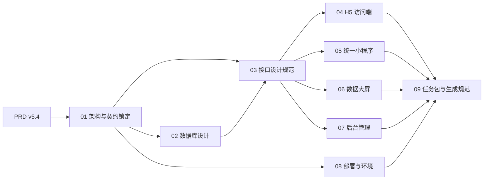
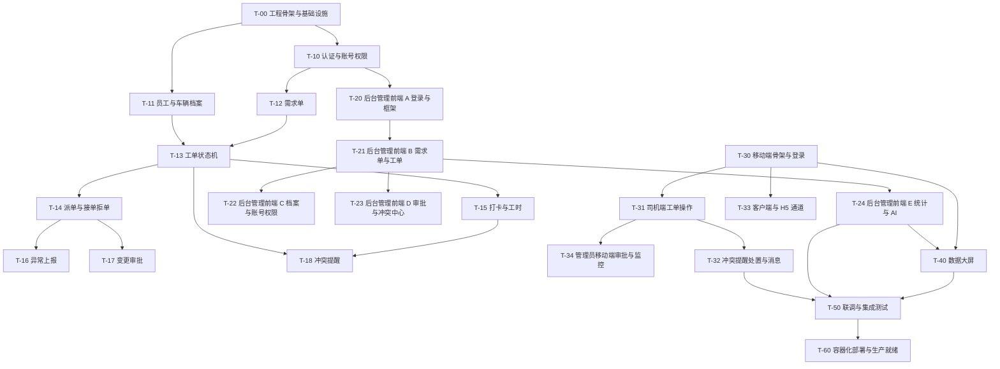

# 济南诚重吊装业务管理系统 — 开发前置规划方案与就绪标准

| 项 | 内容 |
|---|---|
| 文档编号 | 00 |
| 版本 | v1.0 |
| 状态 | 待评审 |
| 上游文档 | 《济南诚重吊装业务管理系统产品需求文档》v5.4 |
| 适用对象 | 项目负责人、架构师、前后端工程师、DevOps、AI 代码生成 Agent 使用者 |
| 定位 | 前置文档集的总纲与索引，回答「准备什么、按什么顺序做、怎么拆任务、何时可开工」 |

---

## 1. 结论摘要

本方案面向前后端分离架构，确立三条结论。

第一条，开发前必须完成的是一套彼此锁定、可相互引用的设计文档，而不是零散笔记。核心文档共 12 份，其中架构、数据库、接口三类是契约基准，任何模块文档不得与它们冲突。

第二条，后端设计文档与前端设计文档需要分别独立生成，且后端契约先行、前端依赖后端。原因是前端四条通道共用同一套接口与枚举，接口契约一旦漂移，四个前端应用会各自偏移。解除耦合的手段是在接口规范中同时交付 Mock 规范，使前端可在后端实现完成前并行开发。

第三条，整体开发必须拆为可独立验收的子任务，单个子任务只覆盖一个可交付单元（一个后端域、一个前端应用的一次迭代或一个部署环节），禁止将「完成整个系统」作为单个提示词交给生成 Agent。子任务的划分、依赖与提示词模板见文档 09。

---

## 2. 前置文档清单

### 2.1 必须先行完成的核心设计文档

| 编号 | 文档 | 作用 | 依赖 |
|---|---|---|---|
| 00 | 开发前置规划方案与就绪标准（本文） | 总纲、清单、拆分、路线图、就绪标准 | 无 |
| 01 | 总体技术架构设计（HLD） | 架构风格、技术选型、模块划分、前端共享层、命名与契约锁定 | PRD |
| 02 | 数据库设计文档 | 概念 / 逻辑 / 物理设计与数据字典 | 01 |
| 03 | 接口设计规范（API 契约） | 接口清单、逐接口契约、错误码、Mock 规范 | 01 |
| 04 | 移动端 H5 访问端设计文档 | H5 通道页面、路由、差异化处理 | 01、03 |
| 05 | 统一多角色小程序设计文档 | 三角色权限体系、路由与功能边界、审批与监控 | 01、03 |
| 06 | 数据大屏模块设计文档 | 指标口径、图表清单、刷新与告警规则 | 01、03 |
| 07 | 后台管理系统设计文档 | 信息架构、菜单、页面、权限矩阵 | 01、03 |
| 08 | 部署与环境设计文档 | 容器编排、端口 / 网络 / 卷、备份、发布回滚 | 01 |
| 09 | AI Agent 任务包与代码生成规范 | 逐子任务提示词模板、验收标准、分支与提交规范 | 00–08 |
| 10 | 轻量化精简方案 | 按实际规模裁剪组件、收敛范围、简化部署的决策记录（移除 Redis、容器 6 变 4、MVP 分级） | 01–09 |
| 11 | 前端设计手册 | 全系统前端设计唯一视觉基准：设计基调（实用克制）、色彩 / 字体 / 图标 / 组件 / 动效令牌与三端适配规则 | PRD 第十章、01 |

### 2.2 可选补充文档（按需生成，不阻塞开工）

| 文档 | 生成时机 | 说明 |
|---|---|---|
| 测试计划与用例规范 | 联调阶段前 | 覆盖全流程闭环、权限隔离、并行限制、冲突提醒等场景 |
| 第三方对接申请清单 | 阶段 1 起并行推进 | 微信小程序资质与类目、高德 Key、短信签名与模板、AI 服务通道开通、ICP 备案 |
| 隐私政策与用户协议文本 | 部署测试版前 | 法务相关文本，小程序与 H5 均需上线展示 |
| 数据字典导出物 | 02 完成后 | 由 02 派生的机器可读字典，供代码生成使用 |
| 运维手册与故障处置 SOP | 部署测试版后 | 由 08 派生，面向值班与运维 |
| 编码规范与 Git 分支规范 | 与 09 合并 | 已并入文档 09，不单独成文 |

---

## 3. 前后端设计文档的关系与生成顺序

需要分别独立生成后端设计文档与前端设计文档，两者不是并列关系，而是「上游契约 → 下游实现」的依赖关系。

| 维度 | 后端设计文档 | 前端设计文档 |
|---|---|---|
| 代表文档 | 01（后端部分）、02、03 | 01（前端部分）、04、05、06、07（视觉基准见 11） |
| 交付物 | 数据模型、接口契约、业务规则落点 | 路由、页面、组件、权限矩阵、交互时序 |
| 契约角色 | 定义契约（source of truth） | 消费契约 |
| 变更影响 | 变更会外溢到四个前端应用 | 变更局限在自身通道 |

顺序与依赖：

依赖说明：01 锁定命名、枚举与契约约定，是全部文档的唯一基准；02 与 03 互为校验（接口操作的实体必须在数据模型中出现，数据实体的字段必须能被接口读写），因此两者需交叉核对一次；04–07 只消费 03 的契约，通过 03 提供的 Mock 规范可在后端实现完成前并行开工；08 只依赖 01，可随时推进。

解除前后端串行等待的手段：03 必须交付 Mock 规范（含示例响应、错误码样例、分页样例），前端据此以 Mock 数据开发页面与交互，后端按同一契约实现真实接口，联调时替换数据源而非改契约。

---

## 4. AI Agent 任务拆分方案

### 4.1 拆分原则

单个生成任务的规模受两条约束控制：可验证性和最小独立交付。可验证性要求每个任务有明确的验收方式（能启动、能调用、能通过既定用例），最小独立交付要求任务完成后系统处于可运行或可回归状态，不留下半成品分支。

具体规则：

- 一个任务只对应一个交付单元，粒度为「一个后端业务域」「一个前端应用的一段功能迭代」「一个部署环节」三选一，不跨类混合
- 禁止把整个系统、整个前端应用或整个后端服务作为单个提示词
- 每个任务必须声明上游依赖（依赖哪些已完成任务）与下游影响（会影响哪些任务），形成有向无环图
- 每个任务必须声明验收标准，可执行、可观测，不接受「体验良好」这类无法验证的表述
- 跨端契约（枚举、路径、错误码）由 01 与 03 锁定，任务提示词直接引用，不得在任务内重新定义

### 4.2 任务树与依赖

依赖读法：箭头方向表示「先完成指向方，再开始被指向方」。例如 T-13 工单状态机是 T-14、T-15、T-18 的前置；T-50 联调必须等到四条通道的核心任务全部完成。

### 4.3 任务规模与顺序约束

| 任务类型 | 合适的粒度 | 不应出现的粒度 |
|---|---|---|
| 后端域 | 一个业务域的接口 + 服务 + 状态规则 | 整个后端服务一次性生成 |
| 前端迭代 | 一个应用的一段功能（登录框架、列表 CRUD、审批流页面） | 整个前端应用一次性生成 |
| 部署环节 | 编排文件、初始化脚本、健康检查、备份脚本分别成任务 | 一次性生成全部运维脚本 |

可并行任务：T-10 与 T-11 可并行；T-20 与 T-30 可在后端契约 Mock 就绪后并行；T-40 大屏可在统计接口 Mock 就绪后与后台前端并行。不可并行任务：T-13 必须在 T-12、T-11 之后；T-50 必须在 T-32、T-24、T-40 之后。

逐任务的提示词模板、输入文档引用、验收标准与提交规范见文档 09。

---

## 5. 阶段推进路线图

### 5.1 阶段划分与依赖

| 阶段 | 目标 | 主要产出 | 进入条件 | 退出条件 |
|---|---|---|---|---|
| 阶段 0 前置设计 | 契约与模块文档就绪 | 文档 00–11 | PRD v5.4 定稿 | 就绪标准 §6 全部通过 |
| 阶段 1 工程骨架 | 可运行的空框架 | monorepo、Docker Compose 本地环境、数据库初始化、统一响应 / 异常 / 鉴权 / 日志 / 文件等通用能力 | 阶段 0 完成 | 本地一键拉起，健康检查通过，鉴权接口可调用 |
| 阶段 2 后端核心域 | 主流程可跑通 | T-10 至 T-16 落地 | 阶段 1 完成 | 需求单转工单、派单、接单、签到、异常、结单链路接口通过用例 |
| 阶段 3 后端进阶域 | 审批、提醒、通知、统计、AI | T-17、T-18、通知双通道、统计报表、AI 适配、系统配置 | 阶段 2 完成 | 变更审批、冲突提醒四类触发、双通道通知、驾驶舱指标接口通过用例 |
| 阶段 4 后台管理前端 | 管理员可用 | T-20 至 T-24 | 阶段 1 完成且 03 Mock 就绪 | 全部菜单可用，权限与二次确认生效 |
| 阶段 5 移动端 | 司机与客户可用 | T-30 至 T-34（小程序 + H5 同源） | 阶段 1 完成且 03 Mock 就绪 | 小程序与 H5 双通道核心流程可用 |
| 阶段 6 数据大屏 | 监控可视化 | T-40 | 统计接口 Mock 就绪 | 指标、中央分布图、报警中心与冲突置顶可用 |
| 阶段 7 联调测试 | 端到端闭环 | 全流程用例、权限隔离、并行限制、冲突提醒用例 | 阶段 3、4、5、6 完成 | 阶段 7 用例全通过 |
| 阶段 8 部署测试版 | 上线到云服务器 | T-60：编排、隔离配置、备份、监控、发布回滚 | 阶段 7 通过且服务器信息确认 | 测试环境可访问，备份与健康检查生效 |
| 阶段 9 验收交付 | 交付与文档归档 | 交付清单、运维手册、账号初始化 | 阶段 8 完成 | 验收项确认，文档归档 |

### 5.2 节奏示意

下图为阶段相对顺序示意，用于对齐依赖与并行关系，不作为承诺工期；实际日历排期由团队按可用人力填充。

```mermaid
gantt
    title 阶段推进示意（相对节奏，非承诺工期）
    dateFormat X
    axisFormat %s
    section 前置
    阶段0 前置设计           :done,    p0, 0, 1
    section 后端
    阶段1 工程骨架           :active,  p1, 1, 1
    阶段2 后端核心域         :         p2, after p1, 2
    阶段3 后端进阶域         :         p3, after p2, 2
    section 前端
    阶段4 后台管理前端       :         p4, after p1, 3
    阶段5 移动端             :         p5, after p1, 3
    阶段6 数据大屏           :         p6, after p3, 1
    section 收尾
    阶段7 联调测试           :         p7, after p6, 1
    阶段8 部署测试版         :         p8, after p7, 1
    阶段9 验收交付           :         p9, after p8, 1
```

### 5.3 关键路径

关键路径为：阶段 0 → 阶段 1 → 阶段 2 → 阶段 3 → 阶段 6 或阶段 7 → 阶段 8 → 阶段 9。阶段 4 与阶段 5 属并行支线，不占用关键路径，其风险在于契约变更——只要 03 的 Mock 规范稳定，它们不拖累整体。

---

## 6. 就绪判断标准

以下条目全部通过，方可正式启动开发。

| # | 判断项 | 通过标准 | 当前状态 |
|---|---|---|---|
| R-01 | 需求基线固定 | PRD 版本号冻结，结论表无遗留待确认项 | 通过（PRD v5.4） |
| R-02 | 架构基准就绪 | 文档 01 通过评审，技术选型与命名 / 枚举 / 契约约定锁定 | 通过（本文档集） |
| R-03 | 数据模型就绪 | 文档 02 覆盖全部业务实体，逐表字段可建库 | 通过（31 张表：sys_ 8 / biz_ 20 / ai_ 3，覆盖 PRD 5.4 全部表） |
| R-04 | 接口契约就绪 | 文档 03 覆盖全部域，含鉴权、错误码与 Mock 规范 | 通过（68 个接口，覆盖 12 个域，含 Mock 规范与两幅时序图） |
| R-05 | 通道设计就绪 | 文档 04、05、06、07 覆盖四条通道的路由、页面与权限，视觉基准见 11 | 通过（04 13 页 / 05 40 页 / 06 大屏 / 07 25 页，视觉基准见 11） |
| R-06 | 部署方案就绪 | 文档 08 给出容器、端口、网络、卷、备份与发布流程 | 通过（4 个容器，含隔离核对清单与回滚流程） |
| R-07 | 任务包就绪 | 文档 09 给出逐子任务提示词、验收标准与依赖图 | 通过（26 个子任务包 T-00 至 T-60） |
| R-08 | 契约一致性 | 02 与 03 交叉核对通过，枚举字面量与 01 一致 | 通过（枚举字面量跨 01/02/03/05 一致，零品牌名、零 Emoji） |
| R-09 | 第三方资源可申请 | 微信小程序资质、高德 Key、短信服务、AI 通道、ICP 备案的申请路径明确 | 待确认 |
| R-10 | 服务器信息确认 | CPU / 内存 / 磁盘 / 系统 / 可用端口 / 域名 / 备案状态已知，占用端口不冲突 | 待确认 |
| R-11 | 人员与节奏确认 | 各阶段责任人与阶段顺序确认 | 待确认 |

判定规则：R-01 至 R-08 为开工必要条件，全部通过即可启动阶段 1；R-09 至 R-11 为外部依赖，可在阶段 1 至阶段 2 期间并行补齐，但不晚于其对应阶段进入时间（第三方资源不晚于阶段 5 前、服务器信息不晚于阶段 8 前）。

---

## 7. 风险与待确认项汇总

| 类别 | 风险或待确认项 | 应对 |
|---|---|---|
| 契约 | 枚举或路径在实现期被各自改动 | 以 01 §6.3 与 03 为唯一基准，变更需同时更新基准与受影响文档 |
| 数据 | 表结构在开发中途大改 | 阶段 2 前完成 02 与 03 交叉核对，冻结第一阶段表结构 |
| 外部 | 第三方审批（小程序类目、备案）周期不可控 | 阶段 1 起并行推进申请，见 09 的并行事项清单 |
| 环境 | 云服务器规格与端口未定 | 文档 08 以 [待确认] 占位并给出建议默认值，阶段 8 前回填 |
| 规模 | 单机 Docker 无高可用 | 按中小车队规模设计，可用性目标 99%，扩容路径留待后续评估 |
| 合规 | 隐私政策、用户协议、账号注销缺失 | 部署测试版前必须补齐，否则无法通过平台审核 |

待确认清单（跨文档汇总）：01 §10、02、03、04、05、06、07、08、09、10、11 各自的「待确认清单」章节，统一在阶段 0 评审时收敛。

---

## 8. 文档索引

| 编号 | 文件 |
|---|---|
| 00 | 开发前置规划方案与就绪标准（本文） |
| 01 | 总体技术架构设计（HLD） |
| 02 | 数据库设计文档 |
| 03 | 接口设计规范（API 契约） |
| 04 | 移动端 H5 访问端设计文档 |
| 05 | 统一多角色小程序设计文档 |
| 06 | 数据大屏模块设计文档 |
| 07 | 后台管理系统设计文档 |
| 08 | 部署与环境设计文档 |
| 09 | AI Agent 任务包与代码生成规范 |
| 10 | 轻量化精简方案 |
| 11 | 前端设计手册 |
