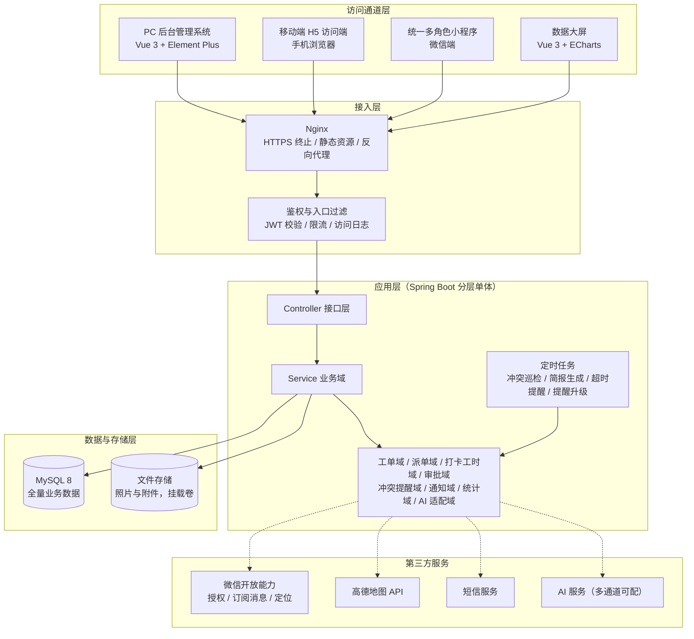
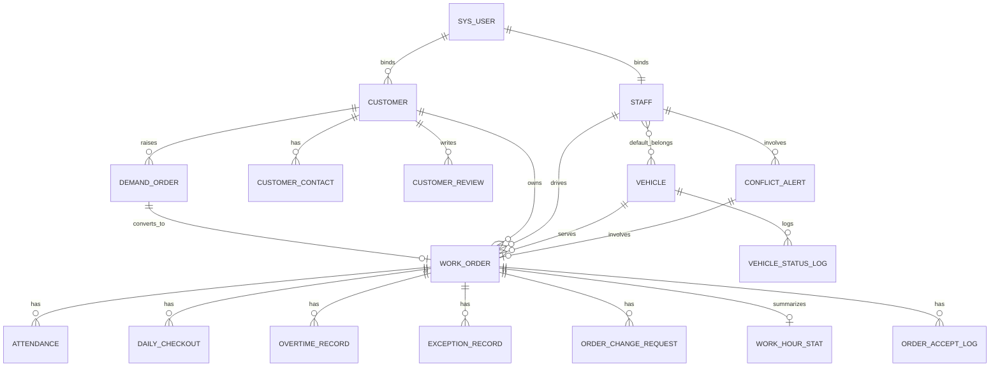

# 济南诚重吊装业务管理系统 — 总体技术架构设计（HLD）

| 项 | 内容 |
|---|---|
| 文档编号 | 01 |
| 版本 | v1.0 |
| 状态 | 待评审 |
| 上游文档 | 《济南诚重吊装业务管理系统产品需求文档》v5.4 |
| 适用对象 | 架构评审人、后端工程师、前端工程师、DevOps |
| 下游文档 | 02 数据库设计、03 接口设计规范、04 H5 访问端、05 统一多角色小程序、06 数据大屏、07 后台管理系统、08 部署与环境、09 AI Agent 任务包 |

---

## 1. 设计概述

### 1.1 目的与范围

本文定义系统的总体技术架构：架构风格、技术选型、后端模块划分、前端共享层、命名与契约约定、非功能设计与错误处理策略。它处在 PRD 的「做什么」与源码的「逐行怎么写」之间，回答「怎么架构、怎么划接口边界」。

覆盖范围：

- 后端服务（Spring Boot 单体的模块划分与职责边界）、数据库、文件存储
- 四条访问通道（PC 后台管理、移动端 H5、统一多角色小程序、数据大屏）的前端架构与共享层
- 第三方集成（微信开放能力、高德地图、短信、AI 服务）的接入位置与降级策略
- 部署形态概要

明确不覆盖（由下游文档承接）：

- 逐字段建表脚本、索引与数据字典 → 文档 02
- 逐接口请求 / 响应报文、错误码全集 → 文档 03
- 页面视觉、交互与路由明细 → 文档 04、05、06、07
- 容器编排与端口 / 网络 / 卷的具体配置 → 文档 08
- 可直接投喂代码生成 Agent 的子任务提示词 → 文档 09

### 1.2 上游需求追溯

| 架构目标 | 追溯来源 | 证据 |
|---|---|---|
| 统一后端 + 统一数据库 + 统一接口 | PRD 5.1 整体架构 | [Data-backed] |
| 四角色权限区分，管理员与总监合并为统一管理员 | PRD 1.2、六、结论 26~37 | [Data-backed] |
| 工单为核心的状态联动与自动结单 | PRD 2.2、4.3、4.5 | [Data-backed] |
| 司机工单互斥校验与冲突智能提醒 | PRD 4.18（v5.4 新增） | [Data-backed] |
| 双通道通知（微信订阅消息 + 短信） | PRD 3.4.5、4.6 | [Data-backed] |
| AI 智能分析为管理员 / 总监专属 | PRD 第九章 | [Data-backed] |
| Docker 与同机其他应用共存、端口 / 网络 / 卷隔离 | PRD 5.5 | [Data-backed] |
| 小程序合规与数据安全（备案、签名链接、HTTPS） | PRD 5.6 | [Data-backed] |

### 1.3 设计目标与约束

功能目标：以工单为唯一核心贯穿需求单、派单、接单、签到、异常、签退、评价全流程，四条访问通道读写同一套后端服务与数据。

非功能约束：

- 单机 Docker 部署，与同服务器其他 Docker 应用共存，不使用 Kubernetes [Data-backed：PRD 5.5]
- 业务规模为中小车队，按每日 200 张工单、峰值 30 并发、单表千万级以内设计 [Hypothesis，待确认]
- 关键写接口响应 P95 ≤ 500ms，列表查询 P95 ≤ 800ms [Hypothesis，待确认]
- 可用性目标 99%（单机形态，不承诺高可用与多活）[Hypothesis，待确认]
- 敏感配置不硬编码进镜像，照片等私有资源经签名链接访问 [Data-backed：PRD 5.6]
- 与 AI 相关的表述在文档与界面中统一使用通用词「AI」，不出现具体厂商或品牌名 [Data-backed：项目硬约束]

### 1.4 术语表

| 术语 | 含义 |
|---|---|
| 需求单 | 客户需求暂存态，与工单弱关联，可转为工单 |
| 工单 | 系统唯一核心实体，承载人、车、客户、点位、状态、工时、评价 |
| 互斥占用 | 司机在同一时间仅允许一项「未暂停且进行中」的工单占用 |
| 施工受阻 | 工单暂停态，不占用司机，恢复执行时触发互斥校验 |
| 第三方派单 | 车辆被外部任务占用，计入外部占用时长统计 |
| 双节点签退 | 跨天任务中「当日签退（不结单）」与「任务结束（自动结单）」两个节点 |
| 提前提醒时段 T | 距下一工单约定服务时间不足 T 分钟时开启互斥冲突巡检，T 默认 60 分钟、后台可配 |
| 冲突提醒记录 | 每次冲突提醒生成的留痕记录，支持查询、处置与升级 |
| 签名链接 | 带有效期签名的私有资源访问地址，替代公开 URL |

---

## 2. 系统架构

### 2.1 架构风格与选型理由

采用分层单体（monolith-with-modules）配合独立前端应用。理由：业务域之间耦合紧密（工单贯穿派单、打卡、审批、通知），团队规模小，单机 Docker 部署无独立扩缩容诉求，单体可显著降低分布式事务、链路追踪与运维复杂度；模块在代码层严格分包，保留后续按域拆分为服务的可能 [Expert judgment]。

前端采用多应用 + 共享包的组织方式：后台管理、大屏为独立 Vue 3 应用；H5 与小程序由同一个 uni-app 工程编译产出（同源复用）；跨应用共用的类型、枚举、接口客户端与图标放入共享包 [Expert judgment]。

### 2.2 架构图



图中四条通道经 Nginx 统一接入，HTTPS 在 Nginx 终止；鉴权层完成 JWT 校验、限流与访问日志；应用层为一个 Spring Boot 进程，内部按业务域分包，Controller 只做参数校验与编排，业务规则集中在 Service 与领域对象；定时任务是应用内调度（冲突巡检、简报生成、超时提醒、提醒升级），单实例部署下同一调度任务不并发重复执行，无需分布式锁 [Expert judgment]。数据层为单一 MySQL 承担全量业务数据，登录态失效、短信验证码、写接口幂等键等中间态数据落 MySQL，文件存储挂载持久化卷。第三方服务通过领域内的适配器调用，不直接侵入业务逻辑，便于降级与替换。

### 2.3 组件职责与边界

| 组件 | 拥有的职责 | 明确不属于它的职责 | 依赖 |
|---|---|---|---|
| Nginx | HTTPS 终止、静态资源托管、反向代理、压缩 | 业务鉴权、业务路由计算 | 无 |
| 鉴权入口过滤 | JWT 解析与校验、限流、访问日志、TraceId 注入 | 角色功能权限判定（交业务层） | MySQL（用户强制下线时间戳） |
| Controller 层 | 参数绑定与校验、调用 Service、组装统一响应 | 业务规则、状态流转 | Service |
| Service / 领域层 | 业务规则、状态机、互斥校验、事务边界 | HTTP 协议细节、SQL 拼接细节 | Mapper、适配器 |
| 定时任务 | 周期性巡检与批量生成（冲突巡检、简报、超时提醒、升级） | 实时接口的同步处理 | 领域层 |
| MySQL | 全量业务数据持久化与一致性，承载登录态失效、验证码、幂等键等中间态 | 消息队列 | 无 |
| 文件存储 | 照片与附件持久化、按工单 / 日期归档 | 访问鉴权（由签名链接承担） | 无 |
| 第三方适配器 | 微信 / 高德 / 短信 / AI 的调用与降级 | 业务决策 | 外部服务 |

### 2.4 关键交互与数据流

工单全流程（PRD 2.2）：需求单创建 → 复核 → 转工单（或管理员无需求单直接建单）→ 派单前置校验（车辆空闲、司机在岗、司机无进行中工单、时间合法性）→ 司机接单 / 拒单 → 到场签到（定位校验）→ 进行中 → 异常上报（可暂停为施工受阻）→ 当日签退 / 任务结束（触发状态联动与自动结单）→ 客户评价。任一节点的状态变化都会写入状态变更记录，并驱动通知域发出双通道通知。

冲突提醒数据流（PRD 4.18）：定时任务按「提前提醒时段 T」巡检同一司机的下一工单与当前进行中工单，命中则生成冲突提醒记录并即时推送司机与管理员；司机申请延期、管理员修改工单、管理员重新派单三类事件在业务动作中同步触发同一套冲突校验；司机处置（延期 / 转派 / 继续执行）或管理员处置（改派 / 延期审批 / 暂停终止）后更新记录状态；超时未处置则升级并在大屏报警中心置顶。

### 2.5 技术选型与理由

| 层次 | 选型 | 理由 | 证据 |
|---|---|---|---|
| 后端语言与框架 | Java 17 + Spring Boot 3.x（版本号待确认） | 生态成熟，事务、定时任务、权限框架完备，适合工单状态机与审批流 | [Expert judgment] |
| 持久层 | MyBatis-Plus（版本待确认） | 与 MySQL 配合成熟，复杂状态查询可控 | [Expert judgment] |
| 数据库 | MySQL 8，utf8mb4 | PRD 5.1 明确统一数据库承载全量数据 | [Data-backed] |
| 中间态存储 | 不引入缓存中间件，中间态落 MySQL | 登录态失效、验证码、幂等键直接入库，规模小无需缓存层 | [Expert judgment] |
| 前端后台 | Vue 3 + Vite + Element Plus + Pinia | 中后台组件齐备，团队上手快 | [Expert judgment] |
| 前端移动端 | uni-app（Vue 3 语法）一套代码编译 H5 与微信小程序 | 双通道同源复用，减少重复开发与不一致 | [Data-backed：本次决策] |
| 数据大屏 | Vue 3 + ECharts | 图表能力成熟，适配大屏自适应布局 | [Expert judgment] |
| 网关与部署 | Nginx + Docker Compose | 与同机其他 Docker 应用共存，隔离成本低 | [Data-backed：PRD 5.5] |
| 鉴权 | JWT 无状态令牌 + 用户强制下线时间戳校验，微信授权登录换取业务令牌 | 无状态接口与可强制下线兼得 | [Expert judgment] |
| 地图 | 高德地图 Web API（小程序侧用微信定位） | PRD 5.2 指定 | [Data-backed] |
| 通知 | 微信订阅消息 + 短信双通道 | PRD 5.2、3.4.5 指定，单通道失败可回退 | [Data-backed] |

> 所有版本号在开工前需以实际锁定版本回填，未确认前不作为代码生成输入。

---

## 3. 后端模块设计

后端按业务域分包（`com.crane.<domain>`），每个域单一职责。依赖方向自上而下，禁止环依赖（Controller → Service → Mapper / 适配器）。

| 模块 | 职责（一句话） | 输入 | 输出 | 依赖 | 边界 |
|---|---|---|---|---|---|
| auth 认证 | 处理微信授权登录、手机号绑定与令牌签发 | 微信 code、手机号验证码 | JWT、登录态 | MySQL（验证码 / 登录态）、微信适配器 | 不负责任何业务功能权限判定 |
| iam 账号权限 | 管理账号、角色、权限与数据隔离 | 角色分配请求 | 权限位、数据范围 | MySQL | 不承载业务规则 |
| staff 员工与车辆 | 管理员工档案、车辆档案与固定归属 | 档案维护请求 | 档案、归属关系 | MySQL | 不执行派单决策 |
| demand 需求单 | 承载需求单暂存与转工单 | 需求单请求 | 需求单、转工单指令 | MySQL、工单域 | 不直接改工单状态 |
| workorder 工单 | 工单状态机、互斥校验、自动结单 | 建单 / 派单 / 状态变更请求 | 工单、状态变更记录 | Mapper、通知域、冲突域 | 不实现通知通道细节 |
| dispatch 派单与接单 | 派单前置校验、接单 / 拒单、重新派单 | 派单 / 接单 / 拒单请求 | 派单结果、接拒单记录 | 工单域、员工车辆域 | 不做冲突提醒推送 |
| attendance 打卡与工时 | 签到 / 签退 / 今日任务完成 / 任务结束、加班与工时统计 | 打卡请求、定位坐标 | 打卡记录、工时记录 | MySQL、通知域 | 不做状态联动决策（由工单域驱动） |
| exception 异常 | 异常上报与处理 | 异常请求 | 异常记录 | MySQL、通知域 | 不做审批 |
| change 变更审批 | 工单变更申请与审批流 | 变更申请、审批动作 | 变更记录、审批记录 | 工单域、冲突域 | 不直接修改他人业务数据 |
| conflict 冲突提醒 | 互斥校验、提醒生成、处置与升级 | 巡检触发、业务事件 | 冲突提醒记录 | 工单域、通知域 | 不改变既有状态机 |
| notify 通知 | 双通道消息编排与送达回执 | 通知指令 | 通知记录、送达状态 | 微信适配器、短信适配器 | 不做业务判定 |
| stat 统计报表 | 数据驾驶舱指标、报表导出、绩效 | 统计查询 | 指标、报表 | MySQL | 不做实时写入 |
| ai AI 适配 | 简报生成、人效分析、报警分析、降级控制 | 定时触发、查询 | 简报、AI 报警记录 | AI 适配器、统计域 | 不参与业务流程判定 |
| file 文件 | 上传、归档、签名链接 | 文件流 | 存储路径、签名链接 | 文件存储 | 不做访问鉴权之外的业务 |
| system 系统配置 | 参数配置（T 值、阈值、端口等）、字典 | 配置请求 | 配置项 | MySQL | 不承载业务规则 |

> 单一职责校验：若某模块无法用一句不含「和」的话描述其职责，说明职责过载，应拆分。上表每个模块均已通过该校验。

---

## 4. 前端架构与共享层

### 4.1 工程组织

采用 pnpm 工作区多包仓库（monorepo），四个应用共享一个包：

```
crane-workorder-system/
├─ apps/
│  ├─ admin/      # PC 后台管理（Vue 3 + Element Plus + Vite）
│  ├─ screen/     # 数据大屏（Vue 3 + ECharts）
│  └─ mobile/     # H5 + 微信小程序（uni-app，一套代码多端）
└─ packages/
   └─ shared/     # 类型、枚举、接口客户端、权限位、SVG 图标、主题令牌
```

H5 与小程序由 `apps/mobile` 同一份源码编译产出：平台差异通过 `#ifdef H5` / `#ifdef MP-WEIXIN` 条件编译隔离，微信能力（授权登录、订阅消息、定位、图片上传）封装为跨端适配层，H5 侧以微信网页授权或手机号验证码登录并调用浏览器定位能力。

### 4.2 共享层内容

| 共享内容 | 说明 |
|---|---|
| 类型定义 | 与后端契约一一对应的 TypeScript 类型（请求 / 响应 / 实体） |
| 枚举字典 | 工单状态、变更类型、冲突场景、角色等，与后端枚举保持字面一致 |
| 接口客户端 | 统一封装 baseURL、鉴权头、统一响应解包、错误提示、重试 |
| 权限位 | 路由与按钮级权限码，供三端复用 |
| SVG 图标 | 统一 24×24 描边风格的内联 sprite，图标继承容器尺寸与颜色，无外部 CDN |
| 主题令牌 | 色彩语义（户外强光高对比）、间距、字号，供三端复用 |

### 4.3 三端复用边界

| 能力 | 后台管理 | 大屏 | H5 | 小程序 |
|---|---|---|---|---|
| 接口客户端 | 复用 | 复用 | 复用 | 复用 |
| 类型与枚举 | 复用 | 复用 | 复用 | 复用 |
| 权限位 | 复用 | 复用 | 复用 | 复用 |
| SVG 图标 | 复用 | 复用 | 复用 | 复用 |
| 主题令牌 | 复用 | 局部复用（大屏深色） | 复用 | 复用 |
| 登录方式 | 账号密码 + 验证码 | 账号密码 | 微信网页授权 / 手机号 | 微信授权 | 
| 组件库 | Element Plus | 自研 + ECharts | 自研移动组件 | 自研移动组件 |

---

## 5. 接口设计概要

完整契约见文档 03，此处锁定全局约定。

| 约定项 | 规则 |
|---|---|
| 基础路径 | `/api/v1`，按域分前缀，如 `/api/v1/work-order` |
| 统一响应 | `{ code, message, data, traceId }`，`code = 0` 表示成功 |
| 鉴权 | 请求头 `Authorization: Bearer <token>`；微信端令牌由授权登录接口换取 |
| 分页 | 入参 `pageNum`（从 1 开始）、`pageSize`（默认 20、上限 100）；出参 `total`、`list` |
| 时间格式 | ISO 8601，如 `2026-10-17T14:00:00+08:00` |
| 幂等 | 写接口支持 `Idempotency-Key` 请求头，服务端以幂等键表去重，窗口内重复请求返回首次结果 |
| 错误码 | 分段：1xxxx 认证鉴权、2xxxx 参数校验、3xxxx 业务规则、4xxxx 资源状态、5xxxx 系统与第三方 |
| 多端标识 | 请求头 `X-Client: admin | h5 | mp | screen`，用于日志与限流分桶 |

接口清单摘要（详细报文见文档 03）：

| 域 | 代表性接口 | 方法 |
|---|---|---|
| 认证 | 微信授权登录、手机号绑定、登出 | POST |
| 工单 | 建单、查询详情、列表、状态变更、自动结单 | POST/GET |
| 派单 | 派单前置校验、派单、接单、拒单、重新派单 | POST |
| 打卡工时 | 签到、当日签退、任务结束、工时查询 | POST/GET |
| 变更审批 | 提交变更申请、审批、审批记录查询 | POST/GET |
| 冲突提醒 | 冲突记录列表、处置、手动再次通知 | GET/POST |
| 统计 | 驾驶舱指标、报表导出 | GET |
| AI | 简报查询、人效分析、报警列表 | GET |

---

## 6. 数据设计概要

完整表结构与数据字典见文档 02。此处锁定概念模型、命名规范与一致性规则。

### 6.1 核心实体与关系



图中共 21 个业务实体：需求单、工单及其派生记录（打卡、每日签退、加班、工时、异常、变更申请、接单拒单、冲突提醒），客户与联系人、评价，员工与车辆及其绑定 / 状态变更记录，账号与角色权限。关系围绕工单聚合，工单是唯一贯穿全流程的核心。

### 6.2 命名规范

| 对象 | 规则 | 示例 |
|---|---|---|
| 表名 | 前缀 + 蛇形命名：`sys_` 账号权限、`biz_` 业务、`ai_` 智能分析 | `biz_work_order`、`sys_user`、`ai_briefing` |
| 主键 | 统一 `id`，`BIGINT UNSIGNED` 自增 | `id` |
| 外键字段 | `<实体>_id` | `work_order_id`、`staff_id` |
| 布尔字段 | `is_<语义>`，`TINYINT(1)` | `is_compliant` |
| 时间字段 | `<语义>_at`，`DATETIME` | `accepted_at`、`checked_in_at` |
| 公共字段 | 每表必含 `created_at`、`updated_at`、`created_by`、`updated_by`、`deleted` | — |
| 索引 | `idx_<表简写>_<字段>`，唯一索引 `uk_` | `idx_wo_staff_status` |

### 6.3 枚举字典（字面量锁定）

| 字典 | 取值 |
|---|---|
| 需求单状态 demand_order.status | `PENDING` 待处理、`REVIEWING` 待复核、`CONVERTED` 已转工单、`REJECTED` 已驳回、`CLOSED` 已关闭 |
| 工单状态 work_order.status | `PENDING_ACCEPT` 待接单、`PENDING_ARRIVE` 待到场、`IN_PROGRESS` 进行中、`SUSPENDED` 施工受阻（已暂停）、`COMPLETED` 已完成、`CANCELLED` 已取消 |
| 工单来源 source | `DEMAND` 需求单转入、`DIRECT` 管理员直建 |
| 车辆状态 vehicle.status | `IDLE` 空闲、`BUSY` 忙碌（系统派单）、`BUSY_THIRD` 忙碌（第三方派单）、`MAINTENANCE` 维保、`DISABLED` 停用 |
| 打卡类型 attendance.type | `CHECK_IN` 签到、`DAILY_CHECKOUT` 当日签退、`TASK_END` 任务结束 |
| 变更申请类型 order_change_request.type | `CANCEL` 取消工单、`VEHICLE_CHANGE` 车辆更换、`POSTPONE` 延期、`ADDRESS_CHANGE` 改址 |
| 变更申请状态 order_change_request.status | `PENDING` 待审批、`APPROVED` 已通过、`REJECTED` 已驳回 |
| 冲突触发场景 conflict_alert.trigger_scene | `AHEAD_WINDOW` 提前提醒时段、`DRIVER_POSTPONE` 司机申请延期、`ADMIN_EDIT` 管理员修改工单、`ADMIN_DISPATCH` 管理员重新派单 |
| 冲突处置状态 conflict_alert.status | `PENDING` 待处理、`HANDLED` 已处置、`ESCALATED` 已升级、`CLOSED` 已关闭 |
| 冲突处置动作 conflict_alert.handle_action | `REASSIGN` 改派、`APPROVE_POSTPONE` 延期审批、`SUSPEND` 暂停终止、`NOTIFY` 再次通知、`CONTINUE` 司机确认继续执行 |
| 角色 sys_role.code | `ADMIN` 管理员（含原总监职责）、`DRIVER` 司机（员工）、`CUSTOMER` 客户（普通用户） |
| 通知通道 | `WECHAT` 微信订阅消息、`SMS` 短信、`INAPP` 站内 |

> 后端 Java 枚举、数据库字典与前端 `packages/shared` 枚举必须字面一致；任一处变更需同步三端，禁止各自定义。

以下字典在 PRD 中以选项集合形式出现，取值由字典表 `sys_dict` 统一维护，初版取值在阶段 0 评审时固化并回填本节，避免各端各自定义：异常类型（固定选项 + 自定义原因）、拒单原因、变更申请原因、评价维度。档案类字典（车辆类型、员工岗位等）同样归入 `sys_dict`。

### 6.4 一致性规则

- 工单状态变更与状态变更记录写入同一事务 [Expert judgment]
- 司机互斥校验在创建 / 派单 / 修改 / 恢复执行的同一事务内完成，校验失败即回滚 [Data-backed：PRD 4.18]
- 冲突提醒记录生成与业务动作同事务落库，推送为事务提交后的异步动作，保证可追溯且不阻塞主流程 [Expert judgment]
- 工时与加班统计由打卡记录派生，允许重算覆盖，不手工编辑
- 逻辑删除统一 `deleted = 1`，查询默认过滤

---

## 7. 非功能设计

| 维度 | 目标 | 设计策略 |
|---|---|---|
| 性能 | 写接口 P95 ≤ 500ms [Hypothesis] | 数据量小直接查库；列表分页与覆盖索引；冲突巡检分批处理 |
| 安全 | 私有资源不公开 | HTTPS、JWT、签名链接、敏感配置加密、越权数据范围校验 |
| 可用性 | 99% [Hypothesis] | 健康检查与自动重启；第三方失败降级；Docker 重启策略 |
| 可扩展 | 横向扩容预留 | 单体模块化分包；定时任务单实例调度，多实例时再评估锁机制；无状态接口 |
| 可观测 | 问题可定位 | TraceId 贯穿、结构化日志、关键指标（请求量、错误率、第三方耗时） |
| 合规 | 满足上线要求 | ICP 备案、隐私政策与用户协议、位置 / 手机号 / 照片授权告知、账号注销 |

> 以上目标数值为待确认项，需在开发前由业务方以实测或明确指标替换。

---

## 8. 错误处理与降级

| 分类 | 处理策略 |
|---|---|
| 参数校验失败 | 返回 2xxxx 错误码，附带字段级提示，不回滚无副作用 |
| 业务规则冲突 | 返回 3xxxx 错误码（如司机已有进行中工单），并触发冲突提醒 |
| 资源状态非法 | 返回 4xxxx 错误码（如车辆非空闲不可派单） |
| 第三方超时 | 设置超时与有限重试；微信订阅失败回退短信；短信失败回退站内并记录 |
| AI 服务不可用 | 按 PRD 9.8 降级：保留上一次简报、跳过本次生成并记录，不影响业务主流程 |
| 定时任务重复执行 | 单实例部署下同一调度任务不并发重复执行；扩展多实例时再引入锁机制 |
| 系统异常 | 返回 5xxxx 错误码，记录 TraceId 供排查，前端统一提示 |

幂等策略：所有写接口接受 `Idempotency-Key`；派单、接单、签退等重复提交以幂等键去重；签到 / 签退在服务端以工单 + 类型 + 时间窗做二次判重 [Expert judgment]。

---

## 9. 部署与运行概要

系统以 Docker Compose 编排，容器、网络与卷统一 `crane-` 前缀命名，与同服务器其他 Docker 应用互不干扰。容器划分：Nginx（静态资源与反向代理）、后端应用（内嵌定时任务调度）、MySQL、备份清理。端口映射、网络、卷、资源限额、备份与存储监控的具体配置见文档 08。

---

## 10. 需求追溯与待确认清单

| 编号 | 事项 | 状态 |
|---|---|---|
| C-01 | 框架与依赖的具体版本号 | 待确认 |
| C-02 | 每日工单量、峰值并发、性能指标的具体数值 | 待确认 |
| C-03 | 云服务器规格、可用端口、域名与备案状态 | 待确认 |
| C-04 | 短信服务商与 AI 服务通道的具体配置 | 待确认 |
| C-05 | 提前提醒时段 T 与司机处置时限的最终默认值 | 待确认（暂定 60 分钟 / 15 分钟） |
