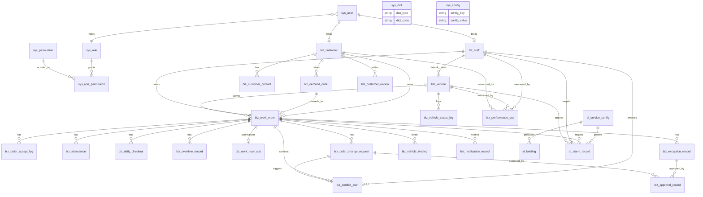

# 吊车作业工单全流程管理系统 — 数据库设计文档（DBD）

| 项 | 内容 |
|---|---|
| 文档编号 | 02 |
| 版本 | v1.0 |
| 状态 | 待评审 |
| 文档名称 | 吊车作业工单全流程管理系统数据库设计文档 |
| 上游文档 | 《吊车作业工单全流程管理系统产品需求文档》v5.4；《吊车作业工单全流程管理系统 — 总体技术架构设计（HLD）》v1.0（文档编号 01） |
| 适用对象 | DBA、后端工程师、测试工程师 |
| 下游任务包 | 03 接口设计规范、09 AI Agent 任务包（建表脚本生成、实体与 Mapper 生成） |
| 编写时间 | 2026 年 10 月 17 日 |

> 本文为文档 02，是 01 文档 §6「数据设计概要」的落地展开。01 文档已锁定的命名规范、枚举字面量与一致性规则在本文件中视为硬约束，不作重新定义；本文只做细化，不引入冲突约定 [Data-backed：01 §6]。

---

## 1. 设计概述

### 1.1 目的与范围

本文定义系统的数据库概念模型、逻辑表结构与物理设计，目标是使后端工程师可直接依本文生成建表脚本、实体类与数据访问层，使 DBA 可据此完成建库、初始化与容量管理 [Expert judgment]。

覆盖范围：

- 全部业务实体与关系（概念设计）
- 逐表字段定义：字段名、数据类型、可空、约束、业务说明（逻辑设计）
- 索引、字符集 / 引擎、分区与归档、敏感字段存储（物理设计）
- 表清单与关键字段业务含义（数据字典）
- 建库建表、初始管理员账号、字典与参数初始化（迁移与初始化）

明确不覆盖（由下游文档承接）：

- 接口请求 / 响应报文与错误码 → 文档 03
- 部署参数、卷与端口配置 → 文档 08
- 页面展示字段的取舍与排序 → 文档 04、05、06、07

### 1.2 上游需求追溯

| 数据库设计目标 | 追溯来源 | 证据 |
|---|---|---|
| 表名、主键、字段与索引命名统一 | 01 §6.2 命名规范 | [Data-backed] |
| 枚举字面量与 01 §6.3 完全一致 | 01 §6.3 枚举字典 | [Data-backed] |
| 以工单为核心的组织结构，工单串联需求单、人、车、客户、打卡、异常、评价 | PRD 1.1、2.2、5.1 | [Data-backed] |
| 需求单为暂存态，与工单弱关联，工单记录来源需求单编号 | PRD 2.1、3.1.5、4.1 | [Data-backed] |
| 司机互斥口径「未暂停且进行中」需可被数据库直接查询判定 | PRD 4.18.1、4.16、结论 52 | [Data-backed] |
| 冲突提醒记录须支持按司机 / 工单 / 时间 / 场景 / 处置状态筛选，并支撑升级链路 | PRD 3.1.10、4.18.4、4.18.5 | [Data-backed] |
| 打卡 / 签退双节点、逐日留痕、加班与工时统计持久化 | PRD 3.2.6、3.2.9、3.2.10、3.2.11、4.13 | [Data-backed] |
| 派单前置校验所需数据（车辆状态、司机在岗、司机进行中工单数）可被索引化查询 | PRD 3.1.1、4.16 | [Data-backed] |
| 第三方派单标记的外部占用时长单独计量 | PRD 3.1.2.1、4.12、结论 20 | [Data-backed] |
| 双通道通知的送达状态、去重与重试留痕 | PRD 3.4.5、结论 45 | [Data-backed] |
| AI 服务配置、简报（保留 10 天）、报警记录（含原始数据）持久化 | PRD 9.1、9.3、9.6、结论 29~31 | [Data-backed] |
| 跟踪类数据长期留存、逻辑删除统一过滤 | PRD 5.6、01 §6.4 | [Data-backed] |
| 单表规模按千万级以内设计，避免过度分片 | 01 §1.3、§7 性能目标 | [Hypothesis，待确认] |

### 1.3 设计目标与约束

- 结构目标：工单表为聚合根，所有派生记录（打卡、签退、加班、工时、异常、变更、接单、冲突、绑定、状态变更）通过 `work_order_id` 归集到工单；客户、员工、车辆为档案型主数据，通过外键关联被工单引用 [Expert judgment]
- 一致性目标：工单状态变更与状态变更记录、冲突提醒记录生成与业务动作同事务写入 [Data-backed：01 §6.4]
- 查询目标：列表页与巡检任务均为等值 / 范围查询，全部给出可命中的索引，禁止全表扫描 [Expert judgment]
- 约束一：不使用数据库外键约束强制业务关系，仅保留字段与索引，由服务层维护引用完整性，理由见 §4.5 [Expert judgment]
- 约束二：所有表含公共字段，逻辑删除统一 `deleted`，查询默认过滤 [Data-backed：01 §6.2、§6.4]
- 约束三：枚举字段取值必须与 01 §6.3 字面一致；01 §6.3 未覆盖的枚举在本文件登记为待确认项，回填 01 后方可作为代码生成输入 [Data-backed：01 §6.3]
- 约束四：不臆造容量数字与版本号，未知项标 `[待确认]` [Data-backed：01 §1.3]

### 1.4 术语表

| 术语 | 含义 |
|---|---|
| 聚合根 | 本系统中指工单，其余业务数据以其为归属主体 |
| 互斥占用 | 司机同一时间仅允许一项「未暂停且进行中」工单，数据库以 `status = IN_PROGRESS` 判定 [Data-backed：PRD 4.18.1] |
| 双节点签退 | `DAILY_CHECKOUT` 当日签退（不结单）与 `TASK_END` 任务结束（结单）两个独立节点 |
| 外部占用时长 | 车辆被第三方派单占用期间累积的时长，单独计量并计入车辆使用率 |
| 冲突提醒记录 | 每次冲突提醒生成的一条留痕记录，含触发场景、冲突工单、涉及司机、通知与处置 |
| 处置时限 | 司机收到冲突提醒后需处置的时限，默认 15 分钟，超时升级 [Data-backed：PRD 结论 54] |
| 提前提醒时段 T | 距下一工单约定服务时间不足 T 分钟时开启互斥巡检，T 默认 60 分钟 |
| 去重键 | 通知记录中用于「同一工单同一节点不重复发送」的唯一键 |

---

## 2. 概念设计

### 2.1 实体总览

概念模型围绕工单聚合根展开，共 31 张表，按 01 §6.2 前缀划分为三类 [Data-backed：01 §6.2]：

- `sys_` 账号权限域（8 张）：用户、角色、权限、角色权限关联、字典、系统配置、短信验证码、幂等键
- `biz_` 业务域（20 张）：员工、客户、客户联系人、车辆、需求单、工单及其派生记录、通知、统计、评价
- `ai_` 智能分析域（3 张）：AI 服务配置、AI 简报、AI 报警记录

### 2.2 实体关系图



图说明：关系以工单为中心收敛。`sys_user` 与 `biz_staff`、`biz_customer` 为一对零或一的双向绑定（一个账号绑定一份档案，一份档案至多一个账号）；`sys_user` 与 `sys_role` 为多对一（一个账号一个角色，角色固定三类）[Data-backed：PRD 3.1.9、结论 9]；`sys_role` 与 `sys_permission` 通过 `sys_role_permission` 形成多对多。业务侧：客户一对多需求单、工单、评价、联系人；需求单对工单为一对零或一（一个需求单默认转一个工单）；员工与车辆为一对多（一人多车通过车辆默认司机字段表达）；车辆与工单为多对一。工单派生九类记录（接单、打卡、每日签退、加班、工时、异常、变更、绑定、通知）。冲突提醒同时指向一名司机与两张工单（前一单、后一单），并可由延期类变更申请触发，形成「申请 → 提醒 → 处置」的追踪链路 [Data-backed：PRD 4.18.2]。车辆状态变更记录为车辆一对多。绩效统计以统计对象类型区分员工 / 车辆 / 客户 / 项目四类维度。AI 三表以配置表为源头，简报与报警记录各关联一份配置。`sys_dict` 与 `sys_config` 为无外键的支撑表，为枚举与可配置参数提供数据源。

### 2.3 实体与基数清单

| 实体 | 表名 | 基数关系 |
|---|---|---|
| 用户 | `sys_user` | 对员工 / 客户 1:0..1；对角色 N:1 |
| 角色 | `sys_role` | 对用户 1:N；对权限 N:M |
| 权限 | `sys_permission` | 对角色 N:M；自关联父子 1:N |
| 角色权限 | `sys_role_permission` | 关联表 |
| 字典 | `sys_dict` | 独立支撑表 |
| 系统配置 | `sys_config` | 独立支撑表 |
| 短信验证码 | `sys_sms_code` | 独立支撑表，按手机号 + 用途留存发送记录 |
| 幂等键 | `sys_idempotency` | 独立支撑表，写接口去重 |
| 员工档案 | `biz_staff` | 对车辆 1:N；对工单 1:N；对冲突提醒 1:N |
| 客户 | `biz_customer` | 对联系人 / 需求单 / 工单 / 评价 1:N |
| 客户联系人 | `biz_customer_contact` | 对客户 N:1 |
| 车辆 | `biz_vehicle` | 对员工 N:1；对工单 1:N；对状态变更 1:N |
| 需求单 | `biz_demand_order` | 对客户 N:1；对工单 1:0..1 |
| 工单 | `biz_work_order` | 聚合根；对客户 / 员工 / 车辆 / 需求单 N:1 |
| 接单拒单记录 | `biz_order_accept_log` | 对工单 N:1 |
| 打卡记录 | `biz_attendance` | 对工单 N:1 |
| 每日签退记录 | `biz_daily_checkout` | 对工单 N:1（工单 + 日期唯一） |
| 加班记录 | `biz_overtime_record` | 对工单 N:1 |
| 工时统计 | `biz_work_hour_stat` | 对工单 1:0..1 |
| 异常记录 | `biz_exception_record` | 对工单 N:1 |
| 工单变更申请 | `biz_order_change_request` | 对工单 N:1 |
| 冲突提醒记录 | `biz_conflict_alert` | 对司机 / 前一单 / 后一单 N:1 |
| 审批记录 | `biz_approval_record` | 对异常 / 变更申请 N:1 |
| 绩效统计 | `biz_performance_stat` | 按统计对象与周期聚合 |
| 客户通知记录 | `biz_notification_record` | 对工单与接收人 N:1 |
| 车辆绑定记录 | `biz_vehicle_binding` | 对车辆 / 工单 / 司机 N:1 |
| 车辆状态变更记录 | `biz_vehicle_status_log` | 对车辆 N:1 |
| 客户评价 | `biz_customer_review` | 对工单 1:0..1 |
| AI 服务配置 | `ai_service_config` | 对简报 / 报警 1:N |
| AI 简报 | `ai_briefing` | 对配置 N:1 |
| AI 报警记录 | `ai_alarm_record` | 对配置 N:1；对工单 / 员工 / 车辆 N:1 |

---

## 3. 逻辑设计

### 3.1 通用约定

#### 3.1.1 公共字段

每张表均含以下五个公共字段，§3.2 至 §3.4 各表的字段表中不再逐行展开，统一以「公共字段」一行引用本节 [Data-backed：01 §6.2]。

| 字段名 | 数据类型 | 可空 | 约束 / 默认 | 说明 |
|---|---|---|---|---|
| created_at | DATETIME | 否 | DEFAULT CURRENT_TIMESTAMP | 创建时间 |
| updated_at | DATETIME | 否 | DEFAULT CURRENT_TIMESTAMP ON UPDATE CURRENT_TIMESTAMP | 更新时间 |
| created_by | BIGINT UNSIGNED | 是 | — | 创建人，存 `sys_user.id`；系统任务写入为空 |
| updated_by | BIGINT UNSIGNED | 是 | — | 更新人，存 `sys_user.id` |
| deleted | TINYINT(1) | 否 | DEFAULT 0 | 逻辑删除标记，0 正常、1 已删除 |

#### 3.1.2 数据类型与命名约定

- 主键统一 `id BIGINT UNSIGNED NOT NULL AUTO_INCREMENT` [Data-backed：01 §6.2]
- 外键字段统一 `<实体>_id`，类型 `BIGINT UNSIGNED`，可空与否按业务必填性确定 [Data-backed：01 §6.2]
- 布尔字段统一 `is_<语义> TINYINT(1)`，取值 0 / 1 [Data-backed：01 §6.2]
- 时间字段统一 `<语义>_at DATETIME`；仅日期语义（如施工日期）用 `DATE` [Data-backed：01 §6.2]
- 编号类字段（工单号、提醒编号、需求单编号等）统一 `<语义>_no VARCHAR(32)`，由服务层按规则生成并建唯一索引
- 金额 / 重量 / 吨位统一 `DECIMAL`，不使用浮点类型，避免累计统计误差 [Expert judgment]
- 经纬度统一 `DECIMAL(10,7)`，精度约厘米级，满足点位与距离计算 [Expert judgment]
- 多值集合字段（照片、佐证、变更前后快照）统一 `JSON`，理由见 §4.4 [Expert judgment]
- 文本备注统一 `VARCHAR(500)`；超长描述（AI 简报正文、异常描述）用 `TEXT` / `MEDIUMTEXT`

#### 3.1.3 枚举使用说明

- 01 §6.3 已锁定的枚举（需求单状态、工单状态、工单来源、车辆状态、打卡类型、变更申请类型与状态、冲突触发场景、冲突处置状态与动作、角色、通知通道）在本文中**逐字使用，不作改写、不新增取值** [Data-backed：01 §6.3]
- 01 §6.3 未覆盖但本设计必需的枚举（员工岗位与状态、客户类型与状态、账号状态、异常类型与批复指令、通知节点与发送状态、审批动作与业务类型、绩效统计对象与周期、报警类型与等级、AI 简报类型等）在本文件中给出取值建议，并在 §7 待确认清单统一登记，须回填 01 §6.3 后方可作为代码生成输入，标注 `[待确认]` [Data-backed：01 §6.3]

### 3.2 sys_ 账号权限域

#### 3.2.1 用户表 sys_user

承载四角色统一账号。登录采用微信授权一键登录 + 绑定预留手机号，账号由管理员创建并录入预留手机号，不设初始密码 [Data-backed：PRD 3.1.8、结论 8、43]。

| 字段名 | 数据类型 | 可空 | 约束 / 默认 | 说明 |
|---|---|---|---|---|
| id | BIGINT UNSIGNED | 否 | PK，自增 | 主键 |
| phone | VARCHAR(20) | 否 | uk_su_phone | 预留手机号，身份凭据与短信通知目标 |
| open_id | VARCHAR(64) | 是 | uk_su_open_id | 微信小程序 openid，首次授权后写入 |
| union_id | VARCHAR(64) | 是 | idx_su_union_id | 微信 unionid，用于多端识别 |
| nick_name | VARCHAR(64) | 是 | — | 微信昵称或系统展示名 |
| avatar_url | VARCHAR(500) | 是 | — | 头像资源路径 |
| role_id | BIGINT UNSIGNED | 否 | idx_su_role | 所属角色，一个账号一个角色 |
| staff_id | BIGINT UNSIGNED | 是 | idx_su_staff | 员工账号绑定的员工档案 |
| customer_id | BIGINT UNSIGNED | 是 | idx_su_customer | 客户账号绑定的客户档案 |
| status | VARCHAR(16) | 否 | DEFAULT 'PENDING_BIND' | 账号状态：`PENDING_BIND` 待绑定、`ACTIVE` 已激活、`FROZEN` 冻结、`DISABLED` 停用 [待确认] |
| bound_at | DATETIME | 是 | — | 手机号绑定成功（激活）时间 |
| last_login_at | DATETIME | 是 | — | 最近登录时间 |
| force_logout_at | DATETIME | 是 | — | 强制下线时间戳，早于该时间的令牌失效 [Data-backed：PRD 5.6] |
| 公共字段 | — | — | 见 3.1.1 | created_at、updated_at、created_by、updated_by、deleted |

#### 3.2.2 角色表 sys_role

固定四角色体系，但总监与管理员合并为同一账号类型，故角色码为三类 [Data-backed：PRD 1.2、结论 9]。

| 字段名 | 数据类型 | 可空 | 约束 / 默认 | 说明 |
|---|---|---|---|---|
| id | BIGINT UNSIGNED | 否 | PK，自增 | 主键 |
| code | VARCHAR(32) | 否 | uk_sr_code | 角色码：`ADMIN` 管理员（含原总监职责）、`DRIVER` 司机（员工）、`CUSTOMER` 客户（普通用户） [Data-backed：01 §6.3] |
| name | VARCHAR(64) | 否 | — | 角色名称 |
| data_scope | VARCHAR(16) | 否 | DEFAULT 'SELF' | 数据范围：`ALL` 全部、`SELF` 仅本人、`RELATED` 仅本人关联 [待确认] |
| is_system | TINYINT(1) | 否 | DEFAULT 1 | 系统内置角色，不允许删除 |
| sort | INT | 否 | DEFAULT 0 | 展示排序 |
| description | VARCHAR(255) | 是 | — | 角色说明 |
| 公共字段 | — | — | 见 3.1.1 | created_at、updated_at、created_by、updated_by、deleted |

#### 3.2.3 权限表 sys_permission

权限码与 01 §4.2 前端共享层「权限位」及路由 / 按钮级控制保持一致，字面相同 [Data-backed：01 §4.2]。

| 字段名 | 数据类型 | 可空 | 约束 / 默认 | 说明 |
|---|---|---|---|---|
| id | BIGINT UNSIGNED | 否 | PK，自增 | 主键 |
| code | VARCHAR(64) | 否 | uk_sp_code | 权限码，如 `work_order:create`、`conflict:handle` |
| name | VARCHAR(64) | 否 | — | 权限名称 |
| type | VARCHAR(16) | 否 | DEFAULT 'API' | 权限类型：`MENU` 菜单、`BUTTON` 按钮、`API` 接口 [待确认] |
| module | VARCHAR(64) | 否 | idx_sp_module | 所属业务域，取值对齐 01 §3 模块名，如 `workorder`、`conflict` |
| parent_id | BIGINT UNSIGNED | 是 | idx_sp_parent | 上级权限，构成菜单树 |
| path | VARCHAR(255) | 是 | — | 前端路由或接口路径 |
| sort | INT | 否 | DEFAULT 0 | 展示排序 |
| 公共字段 | — | — | 见 3.1.1 | created_at、updated_at、created_by、updated_by、deleted |

#### 3.2.4 角色权限关联表 sys_role_permission

| 字段名 | 数据类型 | 可空 | 约束 / 默认 | 说明 |
|---|---|---|---|---|
| id | BIGINT UNSIGNED | 否 | PK，自增 | 主键 |
| role_id | BIGINT UNSIGNED | 否 | uk_srp_role_perm | 角色 id |
| permission_id | BIGINT UNSIGNED | 否 | uk_srp_role_perm | 权限 id |
| 公共字段 | — | — | 见 3.1.1 | created_at、updated_at、created_by、updated_by、deleted |

唯一键 `uk_srp_role_perm(role_id, permission_id)` 防止同角色重复授予同一权限 [Expert judgment]。该表由初始化脚本按 PRD 3.1.9 权限矩阵一次性写入，逐字对应矩阵中的功能模块与四角色勾选状态 [Data-backed：PRD 3.1.9]。

#### 3.2.5 字典表 sys_dict

为 01 §6.3 枚举与前端下拉提供统一数据源，后端 Java 枚举、本表、前端共享层枚举三者字面一致 [Data-backed：01 §6.3]。

| 字段名 | 数据类型 | 可空 | 约束 / 默认 | 说明 |
|---|---|---|---|---|
| id | BIGINT UNSIGNED | 否 | PK，自增 | 主键 |
| dict_type | VARCHAR(64) | 否 | uk_sd_type_code | 字典类型，取值对齐 01 §6.3 字典名，如 `work_order_status` |
| dict_code | VARCHAR(64) | 否 | uk_sd_type_code | 字典码，即枚举字面量，如 `IN_PROGRESS` |
| dict_label | VARCHAR(128) | 否 | — | 中文标签，如「进行中」 |
| dict_value | VARCHAR(64) | 是 | — | 附加值（如颜色语义、排序权重） |
| color_token | VARCHAR(16) | 是 | — | 状态色语义令牌，供前端色彩语义化使用 [Data-backed：PRD 10.1] |
| sort | INT | 否 | DEFAULT 0 | 排序 |
| is_enabled | TINYINT(1) | 否 | DEFAULT 1 | 是否启用 |
| remark | VARCHAR(255) | 是 | — | 说明 |
| 公共字段 | — | — | 见 3.1.1 | created_at、updated_at、created_by、updated_by、deleted |

#### 3.2.6 系统配置表 sys_config

承载 PRD 全部「后台可配置」参数。集中存储的理由是这些参数被巡检任务与多张业务表读取，集中可减少散落常量，且值可随时调整而不发版 [Expert judgment]。

| 字段名 | 数据类型 | 可空 | 约束 / 默认 | 说明 |
|---|---|---|---|---|
| id | BIGINT UNSIGNED | 否 | PK，自增 | 主键 |
| config_key | VARCHAR(128) | 否 | uk_sc_key | 配置键，如 `conflict.ahead_window_minutes` |
| config_value | VARCHAR(512) | 是 | — | 配置值，统一以字符串存储由服务层转换 |
| value_type | VARCHAR(16) | 否 | DEFAULT 'STRING' | 值类型：`INT`、`DECIMAL`、`STRING`、`BOOLEAN`、`JSON` [待确认] |
| group_name | VARCHAR(64) | 否 | idx_sc_group | 分组：`conflict`、`attendance`、`overtime`、`demand`、`alarm`、`sms`、`ai`、`storage` |
| is_encrypted | TINYINT(1) | 否 | DEFAULT 0 | 是否密文存储 |
| description | VARCHAR(255) | 是 | — | 参数含义说明 |
| 公共字段 | — | — | 见 3.1.1 | created_at、updated_at、created_by、updated_by、deleted |

初始化键值见 §6.3，默认值来源为 PRD 明文约定 [Data-backed：PRD 结论 1、27、37、54、9.7]。

#### 3.2.7 短信验证码表 sys_sms_code

承载登录 / 绑定的短信验证码发送与校验记录。规模极小（日发送量个位数），落库取代缓存中间件，可支持发送频次控制与验证码追溯 [Data-backed：01 §2.3、10 §4]。

| 字段名 | 数据类型 | 可空 | 约束 / 默认 | 说明 |
|---|---|---|---|---|
| id | BIGINT UNSIGNED | 否 | PK，自增 | 主键 |
| phone | VARCHAR(20) | 否 | idx_ssc_phone_used | 接收手机号 |
| scene | VARCHAR(32) | 否 | idx_ssc_phone_used | 场景：`LOGIN` 登录、`BIND` 绑定手机号 [待确认] |
| code | VARCHAR(8) | 否 | — | 验证码，仅存一次（含密文存储待确认，见 C-04） |
| expires_at | DATETIME | 否 | idx_ssc_expires | 过期时间 |
| used_at | DATETIME | 是 | — | 校验成功使用时间，未使用为空 |
| send_count | INT | 否 | DEFAULT 1 | 该手机号当日同场景发送次数，用于频次控制 |
| send_result | VARCHAR(64) | 是 | — | 短信发送结果（第三方返回或降级标记） |
| 公共字段 | — | — | 见 3.1.1 | created_at、updated_at、created_by、updated_by、deleted |

校验规则：取该手机号 + 场景最新一条未使用且未过期的记录比对；使用后置 `used_at`，防止重复使用 [Expert judgment]。当日发送次数上限与重发间隔由 `sys_config` 承载（见 §6.3 短信参数）[Data-backed：03 §3.1]。

#### 3.2.8 幂等键表 sys_idempotency

承载写接口 `Idempotency-Key` 去重。窗口内同一幂等键的重复请求返回首次结果，防止派单 / 接单 / 签退等重复提交 [Data-backed：01 §5、03 §3]。

| 字段名 | 数据类型 | 可空 | 约束 / 默认 | 说明 |
|---|---|---|---|---|
| id | BIGINT UNSIGNED | 否 | PK，自增 | 主键 |
| idempotency_key | VARCHAR(64) | 否 | uk_si_key | 幂等键，客户端生成（建议 UUID） |
| biz_type | VARCHAR(32) | 否 | — | 业务类型，如 `dispatch`、`accept`、`checkout` |
| result_code | VARCHAR(16) | 是 | — | 首次处理结果码，重复请求直接返回 |
| result_payload | JSON | 是 | — | 首次响应摘要（脱敏），重复请求直接返回 |
| expire_at | DATETIME | 否 | idx_si_expire | 幂等窗口截止时间，过期后记录可清理 |
| 公共字段 | — | — | 见 3.1.1 | created_at、updated_at、created_by、updated_by、deleted |

唯一键 `uk_si_key(idempotency_key)` 从数据库层保证同键只处理一次 [Expert judgment]。过期记录由应用内定时任务或备份容器定期清理，保留周期待确认（见 C-15）。

### 3.3 biz_ 业务域

#### 3.3.1 员工档案表 biz_staff

| 字段名 | 数据类型 | 可空 | 约束 / 默认 | 说明 |
|---|---|---|---|---|
| id | BIGINT UNSIGNED | 否 | PK，自增 | 主键 |
| staff_no | VARCHAR(32) | 否 | uk_st_staff_no | 员工编号，系统自动生成 |
| name | VARCHAR(64) | 否 | — | 姓名 |
| phone | VARCHAR(20) | 否 | uk_st_phone | 手机号，唯一校验，短信通知目标 |
| id_card | VARCHAR(64) | 否 | uk_st_id_card | 身份证号，密文存储 [Data-backed：PRD 5.6] |
| position | VARCHAR(16) | 否 | — | 岗位：`DRIVER` 司机、`EMPLOYEE` 员工 [待确认] |
| status | VARCHAR(16) | 否 | DEFAULT 'IDLE' | 人员状态：`IDLE` 空闲、`BUSY` 作业中、`AWAY` 离岗、`RESIGNED` 离职 [待确认] |
| license_type | VARCHAR(16) | 是 | — | 驾驶证类型，如 C1、B2、A2；司机必填 |
| special_cert_no | VARCHAR(64) | 是 | — | 特种作业证（吊车操作证）编号；司机必填 |
| special_cert_photo_url | VARCHAR(500) | 是 | — | 证件照片，私有资源路径 |
| emergency_name | VARCHAR(64) | 是 | — | 紧急联系人姓名 |
| emergency_phone | VARCHAR(20) | 是 | — | 紧急联系人电话 |
| hire_date | DATE | 是 | — | 入职日期 |
| user_id | BIGINT UNSIGNED | 是 | idx_st_user | 绑定登录账号 |
| remark | VARCHAR(255) | 是 | — | 备注 |
| 公共字段 | — | — | 见 3.1.1 | created_at、updated_at、created_by、updated_by、deleted |

「常用车辆 / 一人多车」不单独建表，由 `biz_vehicle.default_staff_id` 反向表达：一名司机对应多辆车的记录即构成一人多车，各车可独立标记第三方派单状态 [Data-backed：PRD 3.1.2.1、3.2.8、结论 19]。离职员工由 `status = RESIGNED` 表达，派单前置校验据此阻断 [Data-backed：PRD 3.1.1]。

#### 3.3.2 客户资料表 biz_customer

| 字段名 | 数据类型 | 可空 | 约束 / 默认 | 说明 |
|---|---|---|---|---|
| id | BIGINT UNSIGNED | 否 | PK，自增 | 主键 |
| customer_no | VARCHAR(32) | 否 | uk_cu_customer_no | 客户编号，系统自动生成 |
| name | VARCHAR(128) | 否 | idx_cu_name | 客户名称，公司名称或个人姓名 |
| type | VARCHAR(16) | 否 | — | 客户类型：`COMPANY` 公司、`PERSON` 个人 [待确认] |
| credit_code | VARCHAR(64) | 是 | — | 统一社会信用代码，公司客户必填 |
| industry | VARCHAR(32) | 是 | — | 所属行业：吊装、供暖配套、其他 |
| address | VARCHAR(255) | 是 | — | 联系地址 |
| phone | VARCHAR(20) | 否 | idx_cu_phone | 客户总机 / 主号码 |
| audit_status | VARCHAR(16) | 否 | DEFAULT 'PENDING' | 审核状态：`PENDING` 待审核、`APPROVED` 已审核、`REJECTED` 已驳回 [待确认] |
| status | VARCHAR(16) | 否 | DEFAULT 'ACTIVE' | 客户状态：`ACTIVE` 合作中、`DISABLED` 停用 [待确认] |
| user_id | BIGINT UNSIGNED | 是 | idx_cu_user | 绑定的客户登录账号 |
| remark | VARCHAR(255) | 是 | — | 备注 |
| 公共字段 | — | — | 见 3.1.1 | created_at、updated_at、created_by、updated_by、deleted |

客户账号停用与客户资料停用同步生效，因此账号侧校验需回读本表 `status` [Data-backed：PRD 3.1.8]。

#### 3.3.3 客户联系人表 biz_customer_contact

| 字段名 | 数据类型 | 可空 | 约束 / 默认 | 说明 |
|---|---|---|---|---|
| id | BIGINT UNSIGNED | 否 | PK，自增 | 主键 |
| customer_id | BIGINT UNSIGNED | 否 | idx_cc_customer | 所属客户 |
| name | VARCHAR(64) | 否 | — | 联系人姓名 |
| gender | VARCHAR(8) | 是 | — | 性别 |
| position | VARCHAR(64) | 是 | — | 职务，如项目经理、采购、现场负责人 |
| phone | VARCHAR(20) | 否 | uk_cc_phone | 手机号，全局唯一，防止重复账号与重复登记 |
| wechat | VARCHAR(64) | 是 | — | 微信号 |
| email | VARCHAR(128) | 是 | — | 邮箱 |
| is_default | TINYINT(1) | 否 | DEFAULT 0 | 是否默认联系人，每客户唯一，由服务层保证 [待确认 C-12] |
| remark | VARCHAR(255) | 是 | — | 备注 |
| 公共字段 | — | — | 见 3.1.1 | created_at、updated_at、created_by、updated_by、deleted |

每个客户至少一个联系人、默认联系人唯一，为跨行约束，MySQL 无法以普通唯一索引表达，故由服务层在保存事务内校验 [Data-backed：PRD 3.1.3、Expert judgment]。

#### 3.3.4 车辆档案表 biz_vehicle

| 字段名 | 数据类型 | 可空 | 约束 / 默认 | 说明 |
|---|---|---|---|---|
| id | BIGINT UNSIGNED | 否 | PK，自增 | 主键 |
| plate_no | VARCHAR(16) | 否 | uk_ve_plate_no | 车牌号 |
| model | VARCHAR(64) | 是 | — | 车辆型号 |
| tonnage | DECIMAL(8,2) | 否 | — | 吊车吨位（吨） |
| default_staff_id | BIGINT UNSIGNED | 是 | idx_ve_default_staff | 默认司机（固定归属），一人多车表现为多行共用同一值 |
| status | VARCHAR(16) | 否 | DEFAULT 'IDLE' | 车辆状态：`IDLE` 空闲、`BUSY` 忙碌（系统派单）、`BUSY_THIRD` 忙碌（第三方派单）、`MAINTENANCE` 维保、`DISABLED` 停用 [Data-backed：01 §6.3] |
| current_order_id | BIGINT UNSIGNED | 是 | idx_ve_current_order | 当前绑定的进行中工单 |
| third_party_marked_at | DATETIME | 是 | idx_ve_third_at | 第三方派单标记时刻，用于计算外部占用时长与超阈值提醒 |
| is_away | TINYINT(1) | 否 | DEFAULT 0 | 是否在外未回场，由每日签退的离场 / 回场确认派生 [待确认 C-11] |
| remark | VARCHAR(255) | 是 | — | 备注 |
| 公共字段 | — | — | 见 3.1.1 | created_at、updated_at、created_by、updated_by、deleted |

PRD 3.1.2 中的「作业中 / 故障停用 / 维修中」在 01 §6.3 中对应为 `BUSY`、`DISABLED`、`MAINTENANCE`，本表统一采用 01 字面量，不另设别名 [Data-backed：01 §6.3]。

#### 3.3.5 需求单表 biz_demand_order

| 字段名 | 数据类型 | 可空 | 约束 / 默认 | 说明 |
|---|---|---|---|---|
| id | BIGINT UNSIGNED | 否 | PK，自增 | 主键 |
| demand_no | VARCHAR(32) | 否 | uk_do_demand_no | 需求单编号 |
| source | VARCHAR(16) | 否 | — | 来源：`CUSTOMER_MP` 客户小程序提报、`PHONE` 电话下单、`ADMIN` 管理员录入 [待确认] |
| customer_id | BIGINT UNSIGNED | 是 | idx_do_customer | 关联客户资料，管理员代录时可能暂缺 |
| contact_id | BIGINT UNSIGNED | 是 | idx_do_contact | 关联客户联系人 |
| contact_name | VARCHAR(64) | 是 | — | 提报人姓名快照，防止联系人变更后丢失 |
| contact_phone | VARCHAR(20) | 否 | idx_do_contact_phone | 联系电话 |
| address | VARCHAR(255) | 否 | — | 客户地址 / 施工地址 |
| longitude | DECIMAL(10,7) | 是 | — | 地图选点经度 |
| latitude | DECIMAL(10,7) | 是 | — | 地图选点纬度 |
| description | TEXT | 是 | — | 需求描述 |
| image_urls | JSON | 是 | — | 需求图片，私有资源路径数组 |
| intended_vehicle_id | BIGINT UNSIGNED | 是 | idx_do_intended_vehicle | 意向车辆 |
| crane_tonnage | DECIMAL(8,2) | 是 | — | 吊车吨位需求（需管理员复核） |
| cargo_weight | DECIMAL(10,2) | 是 | — | 被吊装货物重量（吨，需管理员复核） |
| expected_start_at | DATETIME | 是 | — | 期望施工时间 |
| status | VARCHAR(16) | 否 | DEFAULT 'PENDING' | 需求单状态：`PENDING` 待处理、`REVIEWING` 待复核、`CONVERTED` 已转工单、`REJECTED` 已驳回、`CLOSED` 已关闭 [Data-backed：01 §6.3] |
| review_remark | VARCHAR(500) | 是 | — | 复核意见或驳回原因，对客户可见 |
| reject_count | INT | 否 | DEFAULT 0 | 驳回次数，支撑驳回后重提的链路展示 |
| parent_demand_id | BIGINT UNSIGNED | 是 | idx_do_parent | 重提前指向被驳回的原需求单，原记录保留 |
| converted_order_id | BIGINT UNSIGNED | 是 | idx_do_converted_order | 转化后的工单，实现需求单与工单双向回溯 |
| expires_at | DATETIME | 是 | idx_do_expires_at | 暂存到期时间（创建时间 + 10 天，可配置），超期自动转 `CLOSED` |
| closed_at | DATETIME | 是 | — | 关闭时间 |
| 公共字段 | — | — | 见 3.1.1 | created_at、updated_at、created_by、updated_by、deleted |

PRD 3.1.5 的「已编辑」对应 01 §6.3 的 `REVIEWING`，本表采用 01 字面量 [Data-backed：01 §6.3]。

#### 3.3.6 工单表 biz_work_order

本表为聚合根，承载派单、执行、结单全过程所需判定字段 [Data-backed：PRD 3.1.1]。

| 字段名 | 数据类型 | 可空 | 约束 / 默认 | 说明 |
|---|---|---|---|---|
| id | BIGINT UNSIGNED | 否 | PK，自增 | 主键 |
| order_no | VARCHAR(32) | 否 | uk_wo_order_no | 工单号，对客户与司机展示的唯一编号 |
| name | VARCHAR(128) | 否 | — | 任务名称 |
| source | VARCHAR(16) | 否 | — | 工单来源：`DEMAND` 需求单转入、`DIRECT` 管理员直建 [Data-backed：01 §6.3] |
| demand_id | BIGINT UNSIGNED | 是 | idx_wo_demand | 来源需求单编号，用于回溯 |
| customer_id | BIGINT UNSIGNED | 否 | idx_wo_customer | 关联客户 |
| contact_id | BIGINT UNSIGNED | 是 | idx_wo_contact | 关联客户联系人 |
| staff_id | BIGINT UNSIGNED | 否 | idx_wo_staff_status | 执行司机 |
| vehicle_id | BIGINT UNSIGNED | 否 | idx_wo_vehicle | 施工车辆 |
| address | VARCHAR(255) | 否 | — | 施工地点详细地址 |
| longitude | DECIMAL(10,7) | 否 | — | 高德点位经度 |
| latitude | DECIMAL(10,7) | 否 | — | 高德点位纬度 |
| cargo_name | VARCHAR(128) | 是 | — | 货物名称 |
| cargo_quantity | DECIMAL(10,2) | 是 | — | 货物数量 |
| cargo_weight | DECIMAL(10,2) | 是 | — | 实际吊装货物重量（吨），来自需求单并经复核 |
| crane_tonnage | DECIMAL(8,2) | 是 | — | 吊车吨位 |
| expected_start_at | DATETIME | 否 | idx_wo_expected_start | 预计开始时间，超时未签到提醒与冲突巡检的判定基准 |
| accepted_at | DATETIME | 是 | — | 司机接单时间 |
| started_at | DATETIME | 是 | — | 任务启动时间（签到成功时写入），工时统计起点 |
| suspended_at | DATETIME | 是 | — | 最近一次进入施工受阻的时间 |
| completed_at | DATETIME | 是 | — | 自动结单时间，工时统计终点 |
| cancelled_at | DATETIME | 是 | — | 取消时间 |
| cancelled_reason | VARCHAR(500) | 是 | — | 取消原因，对客户可见 |
| status | VARCHAR(16) | 否 | DEFAULT 'PENDING_ACCEPT'，idx_wo_status | 工单状态：`PENDING_ACCEPT`、`PENDING_ARRIVE`、`IN_PROGRESS`、`SUSPENDED`、`COMPLETED`、`CANCELLED` [Data-backed：01 §6.3] |
| customer_visible_status | VARCHAR(32) | 是 | — | 客户可见状态：`DISPATCHED` 已派单、`ACCEPTED` 已接单、`STARTED` 任务开始执行、`PAUSED` 任务暂停 / 推迟 / 终止、`FINISHED` 任务已完成、`CANCELLED` 任务已取消 [待确认] |
| accept_deadline_at | DATETIME | 是 | idx_wo_accept_deadline | 接单时限（下发时间 + 30 分钟，可配置） |
| timeout_reminded_at | DATETIME | 是 | — | 超时未签到提醒已发出时间，用于防止重复提醒 |
| is_pinned_alarm | TINYINT(1) | 否 | DEFAULT 0 | 是否在报警中心置顶高亮 |
| remark | VARCHAR(500) | 是 | — | 任务备注 |
| requirement | VARCHAR(500) | 是 | — | 施工要求 |
| 公共字段 | — | — | 见 3.1.1 | created_at、updated_at、created_by、updated_by、deleted |

互斥判定说明：司机是否被占用由 `status = 'IN_PROGRESS'` 唯一表达，与 PRD 4.18.1「未暂停且进行中」口径一致，`SUSPENDED`（已暂停）、`PENDING_ACCEPT`、`PENDING_ARRIVE`、`COMPLETED`、`CANCELLED` 均不占用司机 [Data-backed：PRD 4.18.1、结论 52]。派单前置校验因此可简化为按 `(staff_id, status)` 与 `(vehicle_id, status)` 两条等值查询，索引设计见 §4.2。客户可见状态与内部状态为双状态映射，单独落库以便客户侧列表直接查询且不暴露内部改派过程 [Data-backed：PRD 3.1.1、3.4.1]。

#### 3.3.7 接单拒单记录表 biz_order_accept_log

| 字段名 | 数据类型 | 可空 | 约束 / 默认 | 说明 |
|---|---|---|---|---|
| id | BIGINT UNSIGNED | 否 | PK，自增 | 主键 |
| order_id | BIGINT UNSIGNED | 否 | idx_oal_order | 关联工单 |
| staff_id | BIGINT UNSIGNED | 否 | idx_oal_staff_at | 操作司机 |
| action | VARCHAR(16) | 否 | — | 动作：`ACCEPT` 接单、`REJECT` 拒单 [待确认] |
| reason_type | VARCHAR(32) | 是 | — | 拒单原因类型：车辆故障、时间冲突、能力不符、其他 [待确认] |
| reason | VARCHAR(500) | 是 | — | 拒单原因明细，接单时为空 |
| acted_at | DATETIME | 否 | idx_oal_staff_at | 操作时间 |
| deliver_round | INT | 否 | DEFAULT 1 | 派单轮次，同一工单多次派单时区分留痕 |
| 公共字段 | — | — | 见 3.1.1 | created_at、updated_at、created_by、updated_by、deleted |

接单时间同时回写 `biz_work_order.accepted_at` 作为报警规则「未执行签到」的计算输入 [Data-backed：PRD 3.2.14、9.6]。

#### 3.3.8 打卡记录表 biz_attendance

| 字段名 | 数据类型 | 可空 | 约束 / 默认 | 说明 |
|---|---|---|---|---|
| id | BIGINT UNSIGNED | 否 | PK，自增 | 主键 |
| order_id | BIGINT UNSIGNED | 否 | idx_at_order_type | 关联工单 |
| staff_id | BIGINT UNSIGNED | 否 | idx_at_staff_at | 打卡司机 |
| type | VARCHAR(16) | 否 | idx_at_order_type | 打卡类型：`CHECK_IN` 签到、`DAILY_CHECKOUT` 当日签退、`TASK_END` 任务结束 [Data-backed：01 §6.3] |
| checked_at | DATETIME | 否 | idx_at_staff_at | 打卡时间，服务端记录 |
| captured_at | DATETIME | 是 | — | 客户端实际采集时间，弱网补传时保留原始采集时间不被篡改 |
| longitude | DECIMAL(10,7) | 是 | — | 打卡经度 |
| latitude | DECIMAL(10,7) | 是 | — | 打卡纬度 |
| distance_meters | INT | 是 | — | 打卡点与工单预设点位直线距离（米） |
| is_in_range | TINYINT(1) | 是 | — | 是否在有效范围内，签到强制、签退弱校验 |
| is_compliant | TINYINT(1) | 是 | DEFAULT 1 | 位置是否合规，签退在范围外由后台标注为 0 |
| photo_urls | JSON | 是 | — | 现场照片私有资源路径数组，不限张数 |
| is_valid | TINYINT(1) | 是 | — | 是否有效打卡，签到须同时满足定位与照片两条件 |
| upload_mode | VARCHAR(16) | 是 | DEFAULT 'ONLINE' | 上传方式：`ONLINE` 实时上传、`OFFLINE_RETRY` 离线补传 [待确认] |
| 公共字段 | — | — | 见 3.1.1 | created_at、updated_at、created_by、updated_by、deleted |

签到有效范围为后台可配置（默认 1000 米），`distance_meters` 与 `is_in_range` 由服务端计算后落库，便于审计复盘而不依赖重算 [Data-backed：PRD 结论 1、4.4]。同一工单同一类型的重复提交由服务层以「工单 + 类型 + 时间窗」二次判重，故不设唯一索引 [Data-backed：01 §8]。

#### 3.3.9 每日签退记录表 biz_daily_checkout

承载跨天任务逐日签退与车辆离场 / 回场确认 [Data-backed：PRD 3.2.6、3.2.9]。

| 字段名 | 数据类型 | 可空 | 约束 / 默认 | 说明 |
|---|---|---|---|---|
| id | BIGINT UNSIGNED | 否 | PK，自增 | 主键 |
| order_id | BIGINT UNSIGNED | 否 | uk_dc_order_date | 关联工单 |
| staff_id | BIGINT UNSIGNED | 否 | idx_dc_staff_date | 司机 |
| attendance_id | BIGINT UNSIGNED | 是 | idx_dc_attendance | 关联当日签退打卡记录 |
| work_date | DATE | 否 | uk_dc_order_date | 施工日期 |
| day_start_at | DATETIME | 是 | — | 当日施工开始时间 |
| day_end_at | DATETIME | 否 | — | 当日施工结束时间（今日任务完成时刻） |
| longitude | DECIMAL(10,7) | 是 | — | 签退经度 |
| latitude | DECIMAL(10,7) | 是 | — | 签退纬度 |
| distance_meters | INT | 是 | — | 签退点与任务执行地直线距离（米） |
| is_in_range | TINYINT(1) | 是 | — | 位置校验结果，签退为弱校验，允许范围外提交 |
| photo_urls | JSON | 是 | — | 当日离场照片 |
| is_left_site | TINYINT(1) | 是 | — | 车辆是否离场 |
| is_returned | TINYINT(1) | 是 | — | 车辆是否回场；选回场则车辆状态置空闲 |
| 公共字段 | — | — | 见 3.1.1 | created_at、updated_at、created_by、updated_by、deleted |

唯一键 `uk_dc_order_date(order_id, work_date)` 保证同一工单同日仅一条逐日签退记录，防止跨天场景重复提交 [Data-backed：PRD 3.2.9]。离场 / 回场确认不参与工单完成判定，仅驱动车辆状态与位置语义 [Data-backed：PRD 结论 50、51]。

#### 3.3.10 加班记录表 biz_overtime_record

| 字段名 | 数据类型 | 可空 | 约束 / 默认 | 说明 |
|---|---|---|---|---|
| id | BIGINT UNSIGNED | 否 | PK，自增 | 主键 |
| order_id | BIGINT UNSIGNED | 否 | idx_ot_order | 关联工单 |
| staff_id | BIGINT UNSIGNED | 否 | idx_ot_staff_date | 司机 |
| daily_checkout_id | BIGINT UNSIGNED | 是 | — | 关联每日签退记录 |
| work_date | DATE | 否 | idx_ot_staff_date | 加班所属日期 |
| normal_off_at | DATETIME | 否 | — | 正常下班时间节点（默认 18:00，后台可配置） |
| actual_checkout_at | DATETIME | 否 | — | 实际签退时间 |
| checkout_longitude | DECIMAL(10,7) | 是 | — | 签退坐标经度 |
| checkout_latitude | DECIMAL(10,7) | 是 | — | 签退坐标纬度 |
| checkout_distance_meters | INT | 是 | — | 签退点与任务执行地距离（米） |
| is_location_compliant | TINYINT(1) | 否 | — | 签退位置是否在任务执行地 1 公里范围内，不合规则不计加班 |
| overtime_minutes | INT | 否 | DEFAULT 0 | 加班时长（分钟）= 实际签退时间 − 正常下班时间，仅晚间下班时段 |
| audit_status | VARCHAR(16) | 否 | DEFAULT 'PENDING' | 审核状态：`PENDING` 待审核、`APPROVED` 已确认、`REJECTED` 已驳回 [待确认] |
| audited_by | BIGINT UNSIGNED | 是 | — | 审核人 |
| audited_at | DATETIME | 是 | — | 审核时间 |
| is_effective | TINYINT(1) | 否 | DEFAULT 0 | 审核通过后置 1，方可计入绩效 |
| 公共字段 | — | — | 见 3.1.1 | created_at、updated_at、created_by、updated_by、deleted |

位置不合规的记录仍落库并标注，由管理员人工确认，不做物理剔除 [Data-backed：PRD 3.2.10、结论 33]。加班须管理员审核后生效，故以 `audit_status` + `is_effective` 双字段表达，避免绩效侧再解释 [Data-backed：PRD 结论 32]。

#### 3.3.11 工时统计表 biz_work_hour_stat

| 字段名 | 数据类型 | 可空 | 约束 / 默认 | 说明 |
|---|---|---|---|---|
| id | BIGINT UNSIGNED | 否 | PK，自增 | 主键 |
| order_id | BIGINT UNSIGNED | 否 | uk_whs_order | 关联工单，一单一条 |
| staff_id | BIGINT UNSIGNED | 否 | idx_whs_staff_period | 司机 |
| vehicle_id | BIGINT UNSIGNED | 是 | idx_whs_vehicle_period | 车辆，用于车辆使用率口径 |
| started_at | DATETIME | 是 | — | 任务启动时间 |
| ended_at | DATETIME | 是 | — | 任务结束时间 |
| total_minutes | INT | 否 | DEFAULT 0 | 总工作时长（分钟） |
| overtime_minutes | INT | 否 | DEFAULT 0 | 加班总时长（分钟），仅含已生效加班 |
| check_in_count | INT | 否 | DEFAULT 0 | 签到次数，含跨天任务的每日签到 |
| checkout_count | INT | 否 | DEFAULT 0 | 签退次数 |
| calc_version | INT | 否 | DEFAULT 1 | 计算版本，重算覆盖时递增，保留可追溯性 |
| computed_at | DATETIME | 否 | — | 统计生成时间 |
| 公共字段 | — | — | 见 3.1.1 | created_at、updated_at、created_by、updated_by、deleted |

工时由打卡记录派生，允许重算覆盖，不手工编辑，故以 `calc_version` 记录重算次数而非保留历史多版本 [Data-backed：01 §6.4]。该表为「与纸质结算单据比对」与「按任务 / 人员 / 周期导出」的数据源 [Data-backed：PRD 3.2.11、结论 34]。

#### 3.3.12 异常记录表 biz_exception_record

| 字段名 | 数据类型 | 可空 | 约束 / 默认 | 说明 |
|---|---|---|---|---|
| id | BIGINT UNSIGNED | 否 | PK，自增 | 主键 |
| order_id | BIGINT UNSIGNED | 否 | idx_ex_order_status | 关联工单 |
| staff_id | BIGINT UNSIGNED | 否 | idx_ex_staff | 上报司机 |
| type | VARCHAR(32) | 否 | — | 异常类型：`RAIN` 下雨、`PARTY_STOP` 甲方停工、`VEHICLE_FAULT` 车辆故障、`CUSTOM` 自定义 [待确认] |
| type_label | VARCHAR(64) | 是 | — | 自定义原因的标签文本，固定选项时为空 |
| description | VARCHAR(1000) | 否 | — | 异常描述 / 自定义原因明细 |
| image_urls | JSON | 是 | — | 配图，私有资源路径数组 |
| status | VARCHAR(16) | 否 | DEFAULT 'PENDING'，idx_ex_order_status | 处理状态：`PENDING` 待批复、`APPROVED` 已批复、`CLOSED` 已关闭 [待确认] |
| instruction | VARCHAR(32) | 是 | — | 批复指令：`CONTINUE` 继续施工、`SUSPEND` 暂停、`TERMINATE` 终止 [待确认] |
| order_status_before | VARCHAR(16) | 是 | — | 上报时的工单状态快照 |
| order_status_after | VARCHAR(16) | 是 | — | 批复后的工单状态快照 |
| is_public_to_customer | TINYINT(1) | 否 | DEFAULT 1 | 是否对客户公开，含司机自定义原因 |
| reported_at | DATETIME | 否 | idx_ex_order_status | 上报时间 |
| replied_at | DATETIME | 是 | — | 批复时间 |
| 公共字段 | — | — | 见 3.1.1 | created_at、updated_at、created_by、updated_by、deleted |

状态快照字段使「上报 → 批复 → 状态回写」链路可独立复现，不依赖对工单表的时序推断 [Data-backed：PRD 3.1.4]。异常未批复期间司机不可签到 / 签退，该阻断由服务层依 `status = 'PENDING'` 判定 [Data-backed：PRD 3.1.4]。

#### 3.3.13 工单变更申请表 biz_order_change_request

| 字段名 | 数据类型 | 可空 | 约束 / 默认 | 说明 |
|---|---|---|---|---|
| id | BIGINT UNSIGNED | 否 | PK，自增 | 主键 |
| request_no | VARCHAR(32) | 否 | uk_ocr_request_no | 变更申请编号 |
| order_id | BIGINT UNSIGNED | 否 | idx_ocr_order_status | 关联工单 |
| applicant_staff_id | BIGINT UNSIGNED | 否 | idx_ocr_applicant | 申请司机 |
| type | VARCHAR(16) | 否 | — | 变更类型：`CANCEL` 取消工单、`VEHICLE_CHANGE` 车辆更换、`POSTPONE` 延期、`ADDRESS_CHANGE` 改址 [Data-backed：01 §6.3] |
| reason_type | VARCHAR(32) | 是 | — | 原因分类，如天气、客户要求、现场条件 |
| reason | VARCHAR(500) | 否 | — | 变更原因，支持自定义输入 |
| evidence_urls | JSON | 是 | — | 佐证照片，私有资源路径数组 |
| before_snapshot | JSON | 是 | — | 变更前要素快照（车辆、司机、时间、地点） |
| after_snapshot | JSON | 是 | — | 申请中的变更后要素 |
| status | VARCHAR(16) | 否 | DEFAULT 'PENDING'，idx_ocr_order_status | 申请状态：`PENDING` 待审批、`APPROVED` 已通过、`REJECTED` 已驳回 [Data-backed：01 §6.3] |
| conflict_alert_id | BIGINT UNSIGNED | 是 | idx_ocr_conflict | 延期类申请触发的冲突提醒记录，形成申请与提醒的双向追踪 |
| applied_at | DATETIME | 否 | idx_ocr_order_status | 申请提交时间 |
| handled_by | BIGINT UNSIGNED | 是 | — | 审批人 |
| handled_at | DATETIME | 是 | — | 审批时间 |
| reject_reason | VARCHAR(500) | 是 | — | 驳回原因，反馈申请人 |
| 公共字段 | — | — | 见 3.1.1 | created_at、updated_at、created_by、updated_by、deleted |

PRD 3.2.13 的申请类型含「其他」，因 01 §6.3 仅锁定四类，其他场景通过 `reason` 自由文本承载，不新增枚举值 [Data-backed：01 §6.3、待确认]。变更仅需管理员审批，取消后通知客户，变更 / 重新派单后通知客户与司机 [Data-backed：PRD 结论 35]。

#### 3.3.14 冲突提醒记录表 biz_conflict_alert

本表须支撑 PRD 3.1.10 的列表字段、五维筛选与升级链路 [Data-backed：PRD 3.1.10、4.18.4、4.18.5]。

| 字段名 | 数据类型 | 可空 | 约束 / 默认 | 说明 |
|---|---|---|---|---|
| id | BIGINT UNSIGNED | 否 | PK，自增 | 主键 |
| alert_no | VARCHAR(32) | 否 | uk_ca_alert_no | 提醒编号，系统生成 |
| trigger_scene | VARCHAR(16) | 否 | idx_ca_scene_status | 触发场景：`AHEAD_WINDOW` 提前提醒时段、`DRIVER_POSTPONE` 司机申请延期、`ADMIN_EDIT` 管理员修改工单、`ADMIN_DISPATCH` 管理员重新派单 [Data-backed：01 §6.3] |
| staff_id | BIGINT UNSIGNED | 否 | idx_ca_staff_status_time | 涉及司机 |
| staff_no_snapshot | VARCHAR(32) | 是 | — | 司机工号快照，供列表直接展示 |
| prev_order_id | BIGINT UNSIGNED | 是 | idx_ca_prev_order | 冲突前一单（进行中工单） |
| next_order_id | BIGINT UNSIGNED | 是 | idx_ca_next_order | 冲突后一单（进入提前提醒时段的工单） |
| prev_order_no | VARCHAR(32) | 是 | — | 前一单工单号快照 |
| next_order_no | VARCHAR(32) | 是 | — | 后一单工单号快照 |
| conflict_summary | VARCHAR(500) | 否 | — | 冲突说明，含两单任务名与约定服务时间 |
| notify_targets | JSON | 否 | — | 提醒对象数组，取值 `DRIVER`、`ADMIN`（总监并入管理员，不单列） [Data-backed：PRD 结论 9] |
| notify_channels | JSON | 否 | — | 各对象通道与送达：对象 → 通道（`WECHAT`、`SMS`、`INAPP`）→ 送达状态（`PENDING`、`SENT`、`FAILED`、`UNKNOWN`） [待确认] |
| generated_at | DATETIME | 否 | idx_ca_generated_at | 提醒生成时间 |
| response_deadline_at | DATETIME | 否 | idx_ca_deadline | 处置时限截止时间（生成时间 + 15 分钟，可配置），升级巡检依据 |
| status | VARCHAR(16) | 否 | DEFAULT 'PENDING'，idx_ca_scene_status、idx_ca_staff_status_time | 处置状态：`PENDING` 待处理、`HANDLED` 已处置、`ESCALATED` 已升级、`CLOSED` 已关闭 [Data-backed：01 §6.3] |
| handle_action | VARCHAR(32) | 是 | — | 处置动作：`REASSIGN` 改派、`APPROVE_POSTPONE` 延期审批、`SUSPEND` 暂停终止、`NOTIFY` 再次通知、`CONTINUE` 司机确认继续执行 [Data-backed：01 §6.3] |
| handled_by | BIGINT UNSIGNED | 是 | — | 处置人 |
| handled_at | DATETIME | 是 | — | 处置时间 |
| handle_remark | VARCHAR(500) | 是 | — | 处置说明 |
| escalated_at | DATETIME | 是 | — | 升级时间 |
| escalate_targets | JSON | 是 | — | 升级提醒对象，超时未处置时写入 |
| is_pinned | TINYINT(1) | 否 | DEFAULT 0 | 是否在数据驾驶舱报警中心置顶 |
| closed_reason | VARCHAR(255) | 是 | — | 关闭原因，如延期审批使互斥解除、司机确认继续执行 |
| order_change_request_id | BIGINT UNSIGNED | 是 | idx_ca_change_request | 由延期类变更申请触发时指向该申请 |
| 公共字段 | — | — | 见 3.1.1 | created_at、updated_at、created_by、updated_by、deleted |

设计说明：

- 五维筛选可直接命中索引：按司机 `idx_ca_staff_status_time(staff_id, status, generated_at)`；按工单 `idx_ca_prev_order`、`idx_ca_next_order`；按时间 `idx_ca_generated_at`；按场景与处置状态 `idx_ca_scene_status(trigger_scene, status)` [Expert judgment]
- 升级链路可通过 `response_deadline_at` 扫描待处理且逾期的记录实现，无需额外表；升级动作回写 `status = 'ESCALATED'`、`escalated_at`、`escalate_targets`、`is_pinned` [Data-backed：PRD 4.18.5]
- 冲突未解除前记录保持 `PENDING`，直到改派 / 延期审批 / 暂停或结单使互斥解除，故不设自动过期字段 [Data-backed：PRD 4.18.5]
- 通知对象与通道采用 JSON 而非拆分子表，理由见 §4.4；该决策在 §7 登记为待确认项 C-07

#### 3.3.15 审批记录表 biz_approval_record

| 字段名 | 数据类型 | 可空 | 约束 / 默认 | 说明 |
|---|---|---|---|---|
| id | BIGINT UNSIGNED | 否 | PK，自增 | 主键 |
| biz_type | VARCHAR(32) | 否 | idx_ar_biz | 业务类型：`EXCEPTION` 异常批复、`ORDER_CHANGE` 变更申请审批 [待确认] |
| biz_id | BIGINT UNSIGNED | 否 | idx_ar_biz | 关联业务记录 id |
| order_id | BIGINT UNSIGNED | 否 | idx_ar_order | 关联工单，供工单详情页直接聚合审批流 |
| approver_id | BIGINT UNSIGNED | 否 | idx_ar_approver | 审批人账号 |
| action | VARCHAR(16) | 否 | — | 审批动作：`APPROVE` 通过、`REJECT` 驳回 [待确认] |
| instruction | VARCHAR(32) | 是 | — | 下发指令，如继续施工、暂停、终止 |
| opinion | VARCHAR(1000) | 是 | — | 审批意见 |
| approved_at | DATETIME | 否 | idx_ar_order | 审批时间 |
| 公共字段 | — | — | 见 3.1.1 | created_at、updated_at、created_by、updated_by、deleted |

异常与变更审批合并为一张表，用 `biz_type` 区分，理由是二者字段同构且均需在工单详情页合流展示；表内不冗余业务明细，明细仍留在各自业务表 [Expert judgment]。审批记录永久存档可追溯 [Data-backed：PRD 3.1.4]。

#### 3.3.16 绩效统计表 biz_performance_stat

| 字段名 | 数据类型 | 可空 | 约束 / 默认 | 说明 |
|---|---|---|---|---|
| id | BIGINT UNSIGNED | 否 | PK，自增 | 主键 |
| stat_object_type | VARCHAR(16) | 否 | uk_ps_object_period | 统计对象类型：`STAFF` 员工、`VEHICLE` 车辆、`CUSTOMER` 客户、`PROJECT` 整体项目 [待确认] |
| object_id | BIGINT UNSIGNED | 否 | uk_ps_object_period | 统计对象 id，项目级为空 |
| period_type | VARCHAR(16) | 否 | uk_ps_object_period | 周期类型：`DAY`、`WEEK`、`MONTH`、`CUSTOM` [待确认] |
| period_start | DATE | 否 | uk_ps_object_period | 周期起始日期 |
| period_end | DATE | 否 | — | 周期结束日期 |
| order_count | INT | 否 | DEFAULT 0 | 工单数量 |
| completed_count | INT | 否 | DEFAULT 0 | 已完成工单数 |
| completion_rate | DECIMAL(5,2) | 是 | — | 完工率 |
| exception_order_count | INT | 否 | DEFAULT 0 | 发生异常上报的工单数 |
| exception_rate | DECIMAL(5,2) | 是 | — | 异常率 |
| attendance_count | INT | 否 | DEFAULT 0 | 有效签到次数，含跨天每日签到 |
| total_tonnage | DECIMAL(12,2) | 是 | — | 吊装总吨位 |
| work_minutes | INT | 否 | DEFAULT 0 | 本系统作业时长（分钟） |
| external_occupy_minutes | INT | 否 | DEFAULT 0 | 第三方派单外部占用时长（分钟） |
| usage_rate | DECIMAL(5,2) | 是 | — | 车辆使用率 |
| fault_count | INT | 否 | DEFAULT 0 | 车辆故障次数 |
| demand_count | INT | 否 | DEFAULT 0 | 客户需求单数量 |
| deal_order_count | INT | 否 | DEFAULT 0 | 成交工单数量 |
| activity_flag | TINYINT(1) | 是 | — | 客户合作活跃度标记，阈值后台可配置 |
| avg_review_score | DECIMAL(3,2) | 是 | — | 客户评分均值，仅记录留存不作绩效直接评定 |
| generated_at | DATETIME | 否 | — | 统计生成时间 |
| calc_version | INT | 否 | DEFAULT 1 | 计算版本，口径调整后重算递增 |
| 公共字段 | — | — | 见 3.1.1 | created_at、updated_at、created_by、updated_by、deleted |

唯一键 `uk_ps_object_period(stat_object_type, object_id, period_type, period_start)` 保证同一对象同一周期仅一条，重算走覆盖更新 [Expert judgment]。指标字段覆盖 PRD 3.1.6 全部口径：员工侧工单数量、完工率、异常率、出勤打卡次数、吊装总吨位、客户评分；车辆侧施工频次、使用率、故障次数、吊装总吨位、外部占用时长；客户侧需求数量、成交工单数量、合作活跃度 [Data-backed：PRD 3.1.6]。客户评分字段仅留存，不参与绩效评定 [Data-backed：PRD 结论 26]。

#### 3.3.17 客户通知记录表 biz_notification_record

| 字段名 | 数据类型 | 可空 | 约束 / 默认 | 说明 |
|---|---|---|---|---|
| id | BIGINT UNSIGNED | 否 | PK，自增 | 主键 |
| notify_no | VARCHAR(32) | 否 | uk_nr_notify_no | 通知流水号 |
| dedup_key | VARCHAR(160) | 否 | uk_nr_dedup_key | 去重键，由「工单 / 需求单 + 通知节点 + 接收人 + 通道」构成，保证同节点不重复发送 |
| biz_type | VARCHAR(32) | 否 | idx_nr_biz | 业务类型：`ORDER`、`DEMAND`、`EXCEPTION`、`CONFLICT` [待确认] |
| biz_id | BIGINT UNSIGNED | 否 | idx_nr_biz | 关联业务记录 |
| order_id | BIGINT UNSIGNED | 是 | idx_nr_order_node | 关联工单 |
| receiver_type | VARCHAR(16) | 否 | idx_nr_receiver | 接收人类型：`CUSTOMER` 客户、`DRIVER` 司机、`ADMIN` 管理员（含总监） [待确认] |
| receiver_id | BIGINT UNSIGNED | 否 | idx_nr_receiver | 接收人 id：客户为 `biz_customer.id`、司机为 `biz_staff.id`、管理员为 `sys_user.id` |
| receiver_phone | VARCHAR(20) | 是 | — | 发送目标手机号快照 |
| notify_node | VARCHAR(32) | 否 | idx_nr_order_node | 通知节点：`DISPATCHED` 派单完成、`ACCEPTED` 司机接单、`ARRIVED` 司机到场、`EXCEPTION_REPLIED` 异常批复、`COMPLETED` 完工结单、`CANCELLED` 工单取消、`DEMAND_REJECTED` 需求单驳回、`DEMAND_CLOSED` 需求单关闭、`TIMEOUT_CHECKIN` 超时未签到、`CONFLICT` 互斥冲突 [待确认] |
| channel | VARCHAR(16) | 否 | uk_nr_dedup_key | 通道：`WECHAT` 微信订阅消息、`SMS` 短信、`INAPP` 站内 [Data-backed：01 §6.3] |
| template_code | VARCHAR(64) | 是 | — | 模板编码，用于按模板统计短信用量与费用 |
| content | VARCHAR(1000) | 是 | — | 通知内容快照 |
| send_status | VARCHAR(16) | 否 | DEFAULT 'PENDING'，idx_nr_status_at | 发送状态：`PENDING` 待发送、`SUCCESS` 成功、`FAILED` 失败、`UNKNOWN` 未知、`DEGRADED` 已降级为其他通道 [待确认] |
| retry_count | INT | 否 | DEFAULT 0 | 已重试次数，默认最多 2 次且间隔递增 |
| sent_at | DATETIME | 是 | idx_nr_status_at | 最近一次发送时间 |
| fail_reason | VARCHAR(255) | 是 | — | 失败原因 |
| degrade_from_channel | VARCHAR(16) | 是 | — | 降级来源通道，如订阅未授权时由 `WECHAT` 降级至 `SMS` |
| is_billable | TINYINT(1) | 否 | DEFAULT 0 | 是否计费，短信为 1 |
| 公共字段 | — | — | 见 3.1.1 | created_at、updated_at、created_by、updated_by、deleted |

去重键作为唯一索引，从数据库层面保证「同一工单同一节点短信去重」[Data-backed：PRD 3.4.5、结论 45]。降级链（订阅未授权 → 短信 → 站内）以 `degrade_from_channel` 留痕，配合 `send_status = 'DEGRADED'` 可完整复现降级路径 [Data-backed：PRD 3.4.5]。短信分场景上限由 `sys_config` 承载，超限后本表记录站内降级 [Data-backed：PRD 3.4.5]。

#### 3.3.18 车辆绑定记录表 biz_vehicle_binding

| 字段名 | 数据类型 | 可空 | 约束 / 默认 | 说明 |
|---|---|---|---|---|
| id | BIGINT UNSIGNED | 否 | PK，自增 | 主键 |
| vehicle_id | BIGINT UNSIGNED | 否 | idx_vb_vehicle_active | 车辆 |
| order_id | BIGINT UNSIGNED | 否 | idx_vb_order | 工单 |
| staff_id | BIGINT UNSIGNED | 否 | idx_vb_staff | 司机，形成车辆 ↔ 工单 ↔ 司机三方绑定 |
| bound_at | DATETIME | 否 | — | 绑定时间，外部占用与使用率统计的计时起点 |
| released_at | DATETIME | 是 | — | 释放时间 |
| release_reason | VARCHAR(64) | 是 | — | 释放原因：`COMPLETED` 结单、`CANCELLED` 取消、`REASSIGN` 改派 [待确认] |
| is_active | TINYINT(1) | 否 | DEFAULT 1，idx_vb_vehicle_active | 绑定是否生效 |
| 公共字段 | — | — | 见 3.1.1 | created_at、updated_at、created_by、updated_by、deleted |

「同一车辆同一时段仅一个生效绑定」为跨行约束，MySQL 无部分唯一索引，故以 `idx_vb_vehicle_active(vehicle_id, is_active)` 支撑查询并在服务层以互斥校验 + 事务保证唯一 [Data-backed：PRD 4.10、Expert judgment]。

#### 3.3.19 车辆状态变更记录表 biz_vehicle_status_log

| 字段名 | 数据类型 | 可空 | 约束 / 默认 | 说明 |
|---|---|---|---|---|
| id | BIGINT UNSIGNED | 否 | PK，自增 | 主键 |
| vehicle_id | BIGINT UNSIGNED | 否 | idx_vsl_vehicle_at | 车辆 |
| before_status | VARCHAR(16) | 是 | — | 变更前状态，取值同车辆状态枚举 |
| after_status | VARCHAR(16) | 否 | idx_vsl_vehicle_at | 变更后状态 |
| change_type | VARCHAR(32) | 否 | idx_vsl_type_at | 变更类型：`DISPATCH` 派单占用、`RELEASE` 结单释放、`THIRD_PARTY_MARK` 第三方派单标记、`THIRD_PARTY_RESUME` 第三方恢复、`MAINTENANCE` 维保、`DISABLE` 停用、`DAILY_CHECKOUT` 离场回场确认 [待确认] |
| order_id | BIGINT UNSIGNED | 是 | — | 关联工单 |
| staff_id | BIGINT UNSIGNED | 是 | — | 操作司机 |
| operator_id | BIGINT UNSIGNED | 是 | — | 操作账号 |
| occur_at | DATETIME | 否 | idx_vsl_vehicle_at | 变更发生时间 |
| external_occupy_minutes | INT | 是 | — | 本次外部占用时长（分钟），由 `THIRD_PARTY_RESUME` 时回填 |
| remark | VARCHAR(255) | 是 | — | 变更说明 |
| 公共字段 | — | — | 见 3.1.1 | created_at、updated_at、created_by、updated_by、deleted |

第三方派单期间的外部占用时长单独计量并计入车辆使用率 [Data-backed：PRD 3.1.2.1、结论 20]。标记持续超过阈值（默认 24 小时）未恢复时向司机与管理员提醒，该巡检以 `idx_vsl_type_at` 与车辆当前 `third_party_marked_at` 为输入 [Data-backed：PRD 3.1.2.1]。

#### 3.3.20 客户评价表 biz_customer_review

| 字段名 | 数据类型 | 可空 | 约束 / 默认 | 说明 |
|---|---|---|---|---|
| id | BIGINT UNSIGNED | 否 | PK，自增 | 主键 |
| order_id | BIGINT UNSIGNED | 否 | uk_cr_order | 关联工单，一单一评价 |
| customer_id | BIGINT UNSIGNED | 否 | idx_cr_customer | 评价客户 |
| contact_id | BIGINT UNSIGNED | 是 | — | 评价联系人 |
| score | TINYINT | 否 | CHECK (score BETWEEN 1 AND 5) | 评分，1~5 星 |
| content | VARCHAR(1000) | 是 | — | 文字评价 |
| is_default | TINYINT(1) | 否 | DEFAULT 0 | 是否默认好评，客户未操作时由定时任务置 1 |
| reviewed_at | DATETIME | 否 | idx_cr_customer | 评价时间 |
| 公共字段 | — | — | 见 3.1.1 | created_at、updated_at、created_by、updated_by、deleted |

唯一键 `uk_cr_order(order_id)` 保证一单一次评价 [Data-backed：PRD 3.4.6]。评分字段仅留存，不作绩效直接评定 [Data-backed：PRD 结论 26]。

### 3.4 ai_ 智能分析域

#### 3.4.1 AI 服务配置表 ai_service_config

「供应商」为后台通用配置字段，取值不体现任何具体厂商或品牌名称 [Data-backed：PRD 9.1、结论 47]。

| 字段名 | 数据类型 | 可空 | 约束 / 默认 | 说明 |
|---|---|---|---|---|
| id | BIGINT UNSIGNED | 否 | PK，自增 | 主键 |
| name | VARCHAR(64) | 否 | — | 配置名称，供管理员识别 |
| provider | VARCHAR(64) | 是 | — | 服务供应方标识，通用文本字段，仅后台内部识别 |
| endpoint | VARCHAR(255) | 否 | — | 接口地址 |
| api_key_cipher | VARCHAR(512) | 否 | — | API Key 密文，加密存储，仅管理员与总监可维护 |
| model_name | VARCHAR(64) | 是 | — | 模型名称 |
| channel_role | VARCHAR(16) | 否 | DEFAULT 'PRIMARY' | 通道角色：`PRIMARY` 主用、`BACKUP` 备用 [待确认] |
| scenario | VARCHAR(32) | 否 | DEFAULT 'ALL' | 适用场景：`BRIEFING`、`PERSONNEL`、`ALARM`、`ALL` [待确认] |
| timeout_seconds | INT | 否 | DEFAULT 30 | 调用超时时间（秒），超时即中断 |
| retry_max | INT | 否 | DEFAULT 2 | 失败自动重试次数上限 |
| daily_call_limit | INT | 是 | — | 每日调用次数上限 |
| monthly_call_limit | INT | 是 | — | 每月调用次数上限 |
| max_input_size | INT | 是 | — | 单次调用最大输入规模 |
| schedule_time | TIME | 是 | — | 定时生成执行时刻，默认 20:00 |
| push_channel | VARCHAR(16) | 是 | — | 结果推送途径：`INAPP`、`SMS`、`WECHAT` [待确认] |
| briefing_retention_days | INT | 否 | DEFAULT 10 | 简报保留天数，到期自动清除 |
| is_enabled | TINYINT(1) | 否 | DEFAULT 1 | 调用开关 |
| 公共字段 | — | — | 见 3.1.1 | created_at、updated_at、created_by、updated_by、deleted |

多通道可配并手动切换，主通道连续失败时按配置自动切换备用通道，`channel_role` 为切换依据 [Data-backed：PRD 9.8]。

#### 3.4.2 AI 简报表 ai_briefing

| 字段名 | 数据类型 | 可空 | 约束 / 默认 | 说明 |
|---|---|---|---|---|
| id | BIGINT UNSIGNED | 否 | PK，自增 | 主键 |
| briefing_no | VARCHAR(32) | 否 | uk_ab_briefing_no | 简报编号 |
| type | VARCHAR(32) | 否 | idx_ab_type_period | 简报类型：`DAILY` 当日工作简报、`WEEKLY` 周简报、`MONTHLY` 月简报、`PERSONNEL` 人效分析、`PERSONNEL_ANOMALY` 人效异常分析、`PERSONNEL_RANK` 人效工单排名 [待确认] |
| period_start | DATE | 是 | idx_ab_type_period | 统计周期起始日期 |
| period_end | DATE | 是 | — | 统计周期结束日期 |
| content_markdown | MEDIUMTEXT | 否 | — | 简报正文，Markdown 格式，前端直接渲染 |
| content_json | JSON | 是 | — | 结构化简报数据，供二次加工与报表导出 |
| ai_config_id | BIGINT UNSIGNED | 是 | idx_ab_config | 使用的 AI 服务配置 |
| call_status | VARCHAR(16) | 否 | DEFAULT 'SUCCESS' | 生成状态：`SUCCESS` 成功、`FAILED` 失败、`SKIPPED` 本次跳过 [待确认] |
| retry_count | INT | 否 | DEFAULT 0 | 重试次数 |
| fail_reason | VARCHAR(255) | 是 | — | 失败原因，多次失败时记录并通知管理员 |
| generated_at | DATETIME | 否 | idx_ab_generated_at | 生成时间 |
| expires_at | DATETIME | 否 | idx_ab_expires_at | 过期时间 = 生成时间 + 保留天数（默认 10 天），到期由定时任务清除 |
| 公共字段 | — | — | 见 3.1.1 | created_at、updated_at、created_by、updated_by、deleted |

简报以 Markdown 存于系统内供前端随时查阅，保留 10 天后自动清除，故以 `expires_at` 承载保留策略并由清理任务按 `idx_ab_expires_at` 批量删除 [Data-backed：PRD 结论 31、5.5.4]。AI 失败时按降级策略跳过本次生成并记录失败状态，不影响业务主流程 [Data-backed：PRD 9.8]。

#### 3.4.3 AI 报警记录表 ai_alarm_record

| 字段名 | 数据类型 | 可空 | 约束 / 默认 | 说明 |
|---|---|---|---|---|
| id | BIGINT UNSIGNED | 否 | PK，自增 | 主键 |
| alarm_no | VARCHAR(32) | 否 | uk_aar_alarm_no | 报警编号 |
| type | VARCHAR(32) | 否 | idx_aar_type_status | 报警类型：`NOT_ARRIVED` 司机预定时间未到场、`NOT_CHECKED_IN` 未执行签到、`VEHICLE_OCCUPIED` 车辆长时间处于占用状态、`CONFLICT_TIMEOUT` 冲突未处置升级 [待确认] |
| level | VARCHAR(8) | 否 | idx_aar_level | 等级：`MEDIUM` 中、`HIGH` 高 [待确认] |
| target_type | VARCHAR(16) | 否 | — | 报警对象类型：`ORDER`、`STAFF`、`VEHICLE` [待确认] |
| order_id | BIGINT UNSIGNED | 是 | idx_aar_order | 关联工单 |
| staff_id | BIGINT UNSIGNED | 是 | idx_aar_staff | 关联司机 |
| vehicle_id | BIGINT UNSIGNED | 是 | idx_aar_vehicle | 关联车辆 |
| dedup_key | VARCHAR(160) | 否 | uk_aar_dedup_key | 去重合并键，由「报警类型 + 对象 + 时间窗口」构成 |
| raw_data | JSON | 否 | — | 原始数据摘要，供 AI 分析输入与人工复核 |
| trigger_rule | VARCHAR(64) | 是 | — | 触发的报警规则标识 |
| threshold_value | VARCHAR(64) | 是 | — | 触发时使用的阈值快照 |
| ai_analysis | TEXT | 是 | — | AI 分析结果：是否真异常、可能原因、处置建议 |
| ai_analyzed_at | DATETIME | 是 | — | AI 分析时间 |
| ai_config_id | BIGINT UNSIGNED | 是 | idx_aar_config | 使用的 AI 服务配置 |
| status | VARCHAR(16) | 否 | DEFAULT 'OPEN'，idx_aar_type_status | 处理状态：`OPEN` 待处理、`ANALYZED` 已分析、`HANDLED` 已处置、`CLOSED` 已关闭 [待确认] |
| is_pinned | TINYINT(1) | 否 | DEFAULT 0 | 是否置顶高亮，高等级报警为 1 |
| occurred_at | DATETIME | 否 | idx_aar_occurred_at | 触发时间 |
| 公共字段 | — | — | 见 3.1.1 | created_at、updated_at、created_by、updated_by、deleted |

报警项与阈值口径覆盖 PRD 9.6：司机预定时间未到场（工单预计开始时间 + 宽限期）、未执行签到（接单后超过时限未签到）、车辆长时间占用（作业中 12 小时 / 第三方派单 24 小时），阈值均可后台配置 [Data-backed：PRD 9.6]。同类报警在时间窗口内合并由 `dedup_key` 唯一索引保证 [Data-backed：PRD 9.6]。AI 报警只在系统内推送，不发短信与微信，故本表不含通道字段 [Data-backed：PRD 9.6、结论 30]。

---

## 4. 物理设计

### 4.1 引擎与字符集

| 项 | 取值 | 理由与证据 |
|---|---|---|
| 存储引擎 | InnoDB | 需要事务、行级锁与崩溃恢复，工单状态变更、互斥校验、冲突记录生成均在事务内完成 [Expert judgment] |
| 默认字符集 | utf8mb4 | 承载中文备注、微信昵称与可能的图形字符，与 01 §2.5 选型一致 [Data-backed：01 §2.5] |
| 默认排序规则 | utf8mb4_0900_ai_ci | MySQL 8 默认排序规则，大小写与重音不敏感，适合编号与名称的等值查询 [Expert judgment，待确认 C-03] |
| 行格式 | DYNAMIC | 配合 JSON 与 TEXT 字段的溢出页存储，减少主表膨胀 [Expert judgment] |
| 时间基准 | 服务器时区 Asia/Shanghai，DATETIME 不带时区偏移 | 与接口层 ISO 8601 输出解耦，所有时间由服务端统一写入 [Expert judgment] |
| 表与字段注释 | 全部中文注释 | 便于 DBA 与运维直接阅读，降低沟通成本 [Expert judgment] |

### 4.2 索引策略

索引设计遵循两条原则：其一，所有列表筛选与巡检任务的查询条件必须有对应索引，禁止全表扫描 [Expert judgment]；其二，索引数量克制，单表索引不超过 6 个，避免写入放大，因为本系统写路径（派单、打卡、状态变更）频次高于查询 [Expert judgment]。索引命名遵循 `idx_<表简写>_<字段>`、唯一索引 `uk_<表简写>_<字段>` [Data-backed：01 §6.2]。

| 表 | 索引 | 类型 | 建索引理由 |
|---|---|---|---|
| biz_work_order | `uk_wo_order_no(order_no)` | 唯一 | 工单号对外展示且需从外部编号反查工单 [Data-backed：PRD 3.1.1] |
| biz_work_order | `idx_wo_staff_status(staff_id, status)` | 普通 | 互斥校验核心索引：按司机 + 状态判断是否已有进行中工单，派单、修改、恢复执行、冲突巡检四条路径共用 [Data-backed：PRD 4.16、4.18.1] |
| biz_work_order | `idx_wo_vehicle_status(vehicle_id, status)` | 普通 | 派单前置校验「车辆须空闲」与车辆占用查询 [Data-backed：PRD 3.1.1] |
| biz_work_order | `idx_wo_status(status, expected_start_at)` | 普通 | 冲突巡检按「待接单 / 待到场且预计开始时间临近」批量取数；驾驶舱按状态统计 [Data-backed：PRD 4.18.2] |
| biz_work_order | `idx_wo_customer(customer_id)` | 普通 | 客户侧「仅本人关联工单」列表，按月统计客户成交工单 [Data-backed：PRD 3.1.9、3.3.6] |
| biz_work_order | `idx_wo_expected_start(expected_start_at)` | 普通 | 超时未签到提醒与接单超时提醒的定时扫描 [Data-backed：PRD 3.2.14、4.6] |
| biz_conflict_alert | `uk_ca_alert_no(alert_no)` | 唯一 | 提醒编号唯一，支持按编号检索与导出 [Data-backed：PRD 3.1.10] |
| biz_conflict_alert | `idx_ca_staff_status_time(staff_id, status, generated_at)` | 普通 | 冲突提醒中心「按司机 + 处置状态 + 时间范围」组合筛选，为最高频筛选路径 [Data-backed：PRD 3.1.10] |
| biz_conflict_alert | `idx_ca_scene_status(trigger_scene, status)` | 普通 | 「按触发场景 + 处置状态」筛选，并支撑按场景统计冲突频次 [Data-backed：PRD 3.1.10] |
| biz_conflict_alert | `idx_ca_prev_order(prev_order_id)` / `idx_ca_next_order(next_order_id)` | 普通 | 「按工单号」筛选需覆盖冲突双方两张工单，单列索引避免 OR 条件退化 [Data-backed：PRD 3.1.10] |
| biz_conflict_alert | `idx_ca_deadline(response_deadline_at)` | 普通 | 升级巡检扫描待处理且已逾期的记录 [Data-backed：PRD 4.18.5] |
| biz_conflict_alert | `idx_ca_generated_at(generated_at)` | 普通 | 「按时间范围」筛选与周期冲突统计 [Data-backed：PRD 3.1.10] |
| biz_attendance | `idx_at_order_type(order_id, type)` | 普通 | 工单详情页打卡记录聚合、按类型校验签到 / 签退是否已存在 [Data-backed：PRD 3.1.1] |
| biz_attendance | `idx_at_staff_at(staff_id, checked_at)` | 普通 | 员工出勤打卡次数统计与个人打卡明细查询 [Data-backed：PRD 3.1.6] |
| biz_work_hour_stat | `uk_whs_order(order_id)` | 唯一 | 一单一条工时统计，重算走覆盖更新 [Data-backed：PRD 3.2.11] |
| biz_work_hour_stat | `idx_whs_staff_period(staff_id, computed_at)` | 普通 | 按人员与周期导出工时与加班明细 [Data-backed：PRD 3.2.11] |
| biz_notification_record | `uk_nr_dedup_key(dedup_key)` | 唯一 | 从数据库层面保证「同一工单同一节点同一接收人同一通道」不重复发送 [Data-backed：PRD 3.4.5] |
| biz_notification_record | `idx_nr_order_node(order_id, notify_node)` | 普通 | 工单详情页通知流转留痕查询 [Data-backed：PRD 3.1.1] |
| biz_notification_record | `idx_nr_status_at(send_status, sent_at)` | 普通 | 失败重试任务扫描与短信用量按月 / 模板统计 [Data-backed：PRD 3.4.5、结论 45] |
| biz_performance_stat | `uk_ps_object_period(stat_object_type, object_id, period_type, period_start)` | 唯一 | 同一对象同一周期唯一，防重算产生重复行 [Data-backed：PRD 3.1.6] |
| biz_vehicle_status_log | `idx_vsl_vehicle_at(vehicle_id, occur_at)` | 普通 | 车辆历史状态变更记录查询与外部占用时长归集 [Data-backed：PRD 3.2.8、3.1.2.1] |
| biz_vehicle_status_log | `idx_vsl_type_at(change_type, occur_at)` | 普通 | 第三方派单标记超阈值（24 小时）巡检 [Data-backed：PRD 3.1.2.1] |
| biz_staff | `uk_st_phone(phone)` / `uk_st_staff_no(staff_no)` / `uk_st_id_card(id_card)` | 唯一 | 手机号与身份证唯一是账号与派单校验的前提，工号唯一用于展示与检索 [Data-backed：PRD 3.1.3] |
| biz_customer_contact | `uk_cc_phone(phone)` | 唯一 | 手机号全局唯一，防止重复账号与重复登记 [Data-backed：PRD 3.1.3] |
| biz_vehicle | `uk_ve_plate_no(plate_no)` | 唯一 | 车牌号唯一，客户选车与派单展示依据 [Data-backed：PRD 3.1.2] |
| biz_demand_order | `idx_do_expires_at(expires_at, status)` | 普通 | 需求单暂存超期自动关闭的巡检扫描 [Data-backed：PRD 结论 27] |
| sys_user | `uk_su_phone(phone)` / `uk_su_open_id(open_id)` | 唯一 | 手机号为登录身份凭据，open_id 为微信授权唯一标识，均须唯一 [Data-backed：PRD 3.1.8、结论 43] |
| ai_briefing | `idx_ab_expires_at(expires_at)` | 普通 | 简报保留 10 天到期自动清除的批量删除 [Data-backed：PRD 结论 31] |
| ai_alarm_record | `uk_aar_dedup_key(dedup_key)` | 唯一 | 同类报警在时间窗口内去重合并 [Data-backed：PRD 9.6] |

复合索引的字段顺序统一按「等值条件在前、范围条件在后」排列，例如 `(staff_id, status, generated_at)` 中司机与状态取等值、时间为范围 [Expert judgment]。物理外键全部不建，故所有 `<实体>_id` 字段均补建单列或复合索引，避免关联查询退化为全表扫描 [Expert judgment]。

### 4.3 分区与归档

首先说明一个约束冲突：MySQL 8 要求分区表的每个唯一索引（含主键）必须包含全部分区列。若高增长日志表按 `created_at` 做 RANGE 分区，则主键须改为 `(id, created_at)` 复合形式，这与 01 §6.2「主键统一 `id`」的约定冲突 [Expert judgment]。

据此本设计的取舍如下：

- 本期不启用原生分区，主键保持 `id` 单列，优先满足 01 §6.2 的硬约定 [Expert judgment]
- 高增长表通过「时间索引 + 定期归档」控制体量，归档与清理策略如下 [Expert judgment]：

| 表 | 增长特征 | 保留与归档策略 |
|---|---|---|
| biz_attendance、biz_daily_checkout | 每工单多次写入，跨天任务逐日累积 | 按 `checked_at` / `work_date` 定期导出归档至历史库，在线表保留近期区间；具体区间 [待确认 C-09] |
| biz_notification_record | 每节点多渠道写入，短信与站内量最大 | 成功记录按 `sent_at` 定期清理；失败与降级记录保留以便追溯 [Data-backed：PRD 3.4.5] |
| biz_vehicle_status_log | 每次车辆状态变更写一条 | 按 `occur_at` 归档；聚合后的外部占用时长落 `biz_performance_stat` 长期保留 |
| biz_conflict_alert | 高频但总量可控 | 长期保留，满足审计溯源要求 [Data-backed：PRD 4.18.4] |
| ai_briefing | 每周期一份 | 按 `expires_at` 删除过期简报，默认保留 10 天 [Data-backed：PRD 结论 31] |
| ai_alarm_record | 报警触发写入 | 按 `occurred_at` 归档，原始数据摘要保留以备复核 |

- 归档任务由应用内定时任务执行，执行前获取分布式锁，避免多实例重复执行 [Data-backed：01 §8]
- 照片与佐证文件不入库，仅存私有资源路径，按工单与日期分目录归档，便于扩容迁移与历史清理 [Data-backed：PRD 5.5.4]

### 4.4 JSON 字段与敏感字段存储

采用 JSON 承载多值集合的字段：需求单图片、打卡照片、每日签退照片、异常配图、变更佐证与前后快照、冲突提醒的通知对象与通道、报警原始数据 [Expert judgment]。取舍理由：

- 这些集合为「展示与留存」用途，不参与筛选与聚合，无需建立二级索引；若拆子表会引入多张仅作存储的表，与 01 §6.1 已收敛的 21 个实体的概念模型偏离 [Expert judgment]
- 照片张数不限，JSON 数组比定长多列更贴合业务
- 代价是无法用 SQL 精确查询单张照片元数据，且需依赖应用层保证 JSON 结构一致；该代价在 §7 登记为 C-13 待确认，若后续需要按附件体积统计与治理，可改为独立附件表 [Data-backed：PRD 4.4 附件体积统计需求]

敏感字段存储：

| 字段 | 处理方式 | 证据 |
|---|---|---|
| `ai_service_config.api_key_cipher` | 密文存储，仅管理员与总监可维护与查看 | [Data-backed：PRD 9.1、5.6] |
| `biz_staff.id_card` | 密文存储，展示时脱敏 | [Data-backed：PRD 5.6] |
| `sys_user.phone`、`biz_staff.phone`、`biz_customer_contact.phone` | 按需加密或脱敏展示，索引仍基于原值以支持唯一校验 | [待确认 C-04] |
| 数据库连接串、通知服务凭据 | 不入库，由环境变量注入 | [Data-backed：PRD 5.5.1] |

加密算法、密钥管理与轮换方案不在本文范围，登记为 C-04 [待确认]。

### 4.5 一致性与事务边界

| 规则 | 落库方式 | 证据 |
|---|---|---|
| 工单状态变更与状态变更记录同事务 | 工单状态更新与 `biz_vehicle_status_log`、`biz_order_accept_log` 等留痕记录在同一事务内提交 | [Data-backed：01 §6.4] |
| 互斥校验在创建 / 派单 / 修改 / 恢复执行同事务内完成 | 事务内先查 `(staff_id, status = 'IN_PROGRESS')`，命中即回滚并触发冲突提醒 | [Data-backed：PRD 4.18.1、01 §6.4] |
| 冲突提醒记录生成与业务动作同事务，推送为提交后的异步动作 | 提醒行与业务行同事务写入；推送由事务提交后事件驱动，保证可追溯且不阻塞主流程 | [Data-backed：01 §6.4] |
| 工时与加班由打卡派生，允许重算覆盖 | `biz_work_hour_stat` 以 `order_id` 唯一，重算覆盖并递增 `calc_version` | [Data-backed：01 §6.4] |
| 逻辑删除统一 `deleted = 1` | 查询默认追加 `deleted = 0`，由数据访问层统一处理 | [Data-backed：01 §6.4] |
| 不建物理外键 | 由服务层维护引用完整性，避免外键在批量状态变更时引入锁等待与级联风险；代价是需在回归测试中覆盖引用一致性用例 | [Expert judgment] |
| 唯一性跨行约束 | 默认联系人唯一、车辆同一时段单一生效绑定等无法用普通唯一索引表达的约束，由服务层在事务内校验 | [Expert judgment，见 C-12] |

事务隔离级别采用 MySQL 默认的可重复读，唯一性判定依赖唯一索引而非间隙锁推断，以减少死锁概率 [Expert judgment]。

---

## 5. 数据字典

### 5.1 表清单

| 序号 | 表名 | 中文名 | 所属域 | 主键 | 关键索引 | 增长与保留 |
|---|---|---|---|---|---|---|
| 1 | `sys_user` | 用户表 | 账号权限 | id | uk_su_phone、uk_su_open_id、idx_su_role | 稳定，长期保留 |
| 2 | `sys_role` | 角色表 | 账号权限 | id | uk_sr_code | 固定数据，几乎不增长 |
| 3 | `sys_permission` | 权限表 | 账号权限 | id | uk_sp_code、idx_sp_parent | 随功能迭代增长，量小 |
| 4 | `sys_role_permission` | 角色权限关联表 | 账号权限 | id | uk_srp_role_perm | 量小 |
| 5 | `sys_dict` | 字典表 | 账号权限 | id | uk_sd_type_code | 量小 |
| 6 | `sys_config` | 系统配置表 | 账号权限 | id | uk_sc_key、idx_sc_group | 量小 |
| 7 | `sys_sms_code` | 短信验证码表 | 账号权限 | id | idx_ssc_phone_used、idx_ssc_expires | 低，过期后定期清理 |
| 8 | `sys_idempotency` | 幂等键表 | 账号权限 | id | uk_si_key、idx_si_expire | 中，窗口过期后清理 |
| 9 | `biz_staff` | 员工档案表 | 业务 | id | uk_st_phone、uk_st_staff_no、uk_st_id_card | 稳定，长期保留 |
| 10 | `biz_customer` | 客户资料表 | 业务 | id | uk_cu_customer_no、idx_cu_name | 稳定，长期保留 |
| 11 | `biz_customer_contact` | 客户联系人表 | 业务 | id | uk_cc_phone、idx_cc_customer | 稳定，长期保留 |
| 12 | `biz_vehicle` | 车辆档案表 | 业务 | id | uk_ve_plate_no、idx_ve_default_staff | 稳定，长期保留 |
| 13 | `biz_demand_order` | 需求单表 | 业务 | id | uk_do_demand_no、idx_do_expires_at | 中，超期关闭后归档 |
| 14 | `biz_work_order` | 工单表 | 业务 | id | uk_wo_order_no、idx_wo_staff_status、idx_wo_vehicle_status | 长期保留 |
| 15 | `biz_order_accept_log` | 接单拒单记录表 | 业务 | id | idx_oal_order、idx_oal_staff_at | 长期保留 |
| 16 | `biz_attendance` | 打卡记录表 | 业务 | id | idx_at_order_type、idx_at_staff_at | 高，定期归档 |
| 17 | `biz_daily_checkout` | 每日签退记录表 | 业务 | id | uk_dc_order_date、idx_dc_staff_date | 高，定期归档 |
| 18 | `biz_overtime_record` | 加班记录表 | 业务 | id | idx_ot_order、idx_ot_staff_date | 长期保留，对接绩效 |
| 19 | `biz_work_hour_stat` | 工时统计表 | 业务 | id | uk_whs_order、idx_whs_staff_period | 长期保留 |
| 20 | `biz_exception_record` | 异常记录表 | 业务 | id | idx_ex_order_status | 长期保留，不可删除 |
| 21 | `biz_order_change_request` | 工单变更申请表 | 业务 | id | uk_ocr_request_no、idx_ocr_order_status | 长期保留 |
| 22 | `biz_conflict_alert` | 冲突提醒记录表 | 业务 | id | uk_ca_alert_no、idx_ca_staff_status_time、idx_ca_scene_status | 长期保留，审计溯源 |
| 23 | `biz_approval_record` | 审批记录表 | 业务 | id | idx_ar_biz、idx_ar_order | 长期保留 |
| 24 | `biz_performance_stat` | 绩效统计表 | 业务 | id | uk_ps_object_period | 按周期累积，可归档 |
| 25 | `biz_notification_record` | 客户通知记录表 | 业务 | id | uk_nr_dedup_key、idx_nr_status_at | 高，成功记录定期清理 |
| 26 | `biz_vehicle_binding` | 车辆绑定记录表 | 业务 | id | idx_vb_vehicle_active、idx_vb_order | 中，长期保留 |
| 27 | `biz_vehicle_status_log` | 车辆状态变更记录表 | 业务 | id | idx_vsl_vehicle_at、idx_vsl_type_at | 高，聚合后归档 |
| 28 | `biz_customer_review` | 客户评价表 | 业务 | id | uk_cr_order、idx_cr_customer | 长期保留，仅留存 |
| 29 | `ai_service_config` | AI 服务配置表 | 智能分析 | id | — | 量小，含密文 |
| 30 | `ai_briefing` | AI 简报表 | 智能分析 | id | uk_ab_briefing_no、idx_ab_expires_at | 保留 10 天自动清除 |
| 31 | `ai_alarm_record` | AI 报警记录表 | 智能分析 | id | uk_aar_dedup_key、idx_aar_occurred_at | 中，定期归档 |

### 5.2 关键字段业务含义汇总

以下字段名称语义不够直观或口径易歧义，集中说明其业务含义以统一下游理解 [Expert judgment]。

| 字段 | 所属表 | 业务含义 |
|---|---|---|
| `status`（工单） | biz_work_order | 内部状态，六态流转；`IN_PROGRESS` 是互斥占用的唯一判定值 |
| `customer_visible_status` | biz_work_order | 对外状态，与内部状态为映射关系；司机拒单与内部改派期间保持不变 |
| `distance_meters` | biz_attendance、biz_daily_checkout | 打卡点与工单预设高德点位的直线距离，非路径距离 |
| `is_in_range` | biz_attendance、biz_daily_checkout | 是否落在有效范围内，签到强制为真方可成功，签退允许为假但标注不合规 |
| `is_compliant` | biz_attendance | 位置是否合规的业务标记，签退范围外为 0，供管理员人工确认 |
| `captured_at` | biz_attendance | 客户端实际采集时间，弱网补传时保留原值，不随上传时间改写 |
| `is_left_site` / `is_returned` | biz_daily_checkout | 车辆离场 / 回场确认结果，仅驱动车辆状态与位置语义，不参与工单完成判定 |
| `is_effective` | biz_overtime_record | 加班是否已由管理员审核生效，生效后方可计入绩效 |
| `calc_version` | biz_work_hour_stat、biz_performance_stat | 计算版本号，重算覆盖时递增，用于判断数据新鲜度 |
| `external_occupy_minutes` | biz_vehicle_status_log、biz_performance_stat | 第三方派单期间的车辆外部占用时长，单独计量并计入车辆使用率 |
| `dedup_key` | biz_notification_record、ai_alarm_record | 去重合并键，唯一索引载体，保证同节点通知与同类报警不重复 |
| `response_deadline_at` | biz_conflict_alert | 处置时限截止时刻，升级巡检的扫描条件 |
| `escalate_targets` | biz_conflict_alert | 超时未处置时的升级提醒对象集合 |
| `is_pinned` | biz_work_order、biz_conflict_alert、ai_alarm_record | 是否在数据驾驶舱报警中心置顶高亮 |
| `notify_channels` | biz_conflict_alert | 各提醒对象的通道与送达状态集合，按对象区分双通道 / 站内 + 短信 |
| `trigger_scene` | biz_conflict_alert | 冲突触发场景，四类取值与 PRD 4.18.2 一一对应 |
| `third_party_marked_at` | biz_vehicle | 第三方派单标记时刻，超阈值提醒与外部占用时长的起点 |
| `expires_at` | biz_demand_order、ai_briefing | 到期时刻，需求单为暂存时限，简报为保留时限 |
| `data_scope` | sys_role | 角色数据范围，对应权限矩阵中「全部 / 仅本人 / 仅本人关联工单」三档 |
| `parent_demand_id` | biz_demand_order | 驳回后重提时指向原需求单，原驳回记录保留可查 |

---

## 6. 迁移与初始化

### 6.1 建库建表

- 建库语句：`CREATE DATABASE crane_workorder CHARACTER SET utf8mb4 COLLATE utf8mb4_0900_ai_ci;`，库名沿用 01 §9 的 `crane-` 前缀与容器命名口径 [Data-backed：PRD 5.5.2]
- 建表顺序按依赖关系：先 `sys_` 与档案型主数据（`sys_role`、`sys_permission`、`sys_user`、`sys_dict`、`sys_config`、`sys_sms_code`、`sys_idempotency`、`biz_staff`、`biz_customer`、`biz_vehicle`），后工单及其派生表，最后 `ai_` 三表 [Expert judgment]
- 数据访问层配置 `deleted` 逻辑删除过滤、`created_at` / `updated_at` 自动填充，减少业务代码重复 [Data-backed：01 §6.4]
- 建表脚本纳入版本控制，按版本号顺序命名并记录执行状态，禁止直接在生产库手工改表 [Expert judgment]

以工单表为例给出建表模板，其余 30 张表按 §3 定义同构生成 [Expert judgment]：

```sql
CREATE TABLE biz_work_order (
  id BIGINT UNSIGNED NOT NULL AUTO_INCREMENT COMMENT '主键',
  order_no VARCHAR(32) NOT NULL COMMENT '工单号',
  name VARCHAR(128) NOT NULL COMMENT '任务名称',
  source VARCHAR(16) NOT NULL COMMENT '来源：DEMAND 需求单转入 / DIRECT 管理员直建',
  demand_id BIGINT UNSIGNED NULL COMMENT '来源需求单 id',
  customer_id BIGINT UNSIGNED NOT NULL COMMENT '关联客户 id',
  contact_id BIGINT UNSIGNED NULL COMMENT '关联客户联系人 id',
  staff_id BIGINT UNSIGNED NOT NULL COMMENT '执行司机 id',
  vehicle_id BIGINT UNSIGNED NOT NULL COMMENT '施工车辆 id',
  address VARCHAR(255) NOT NULL COMMENT '施工地点详细地址',
  longitude DECIMAL(10,7) NOT NULL COMMENT '高德点位经度',
  latitude DECIMAL(10,7) NOT NULL COMMENT '高德点位纬度',
  cargo_name VARCHAR(128) NULL COMMENT '货物名称',
  cargo_quantity DECIMAL(10,2) NULL COMMENT '货物数量',
  cargo_weight DECIMAL(10,2) NULL COMMENT '实际吊装货物重量（吨）',
  crane_tonnage DECIMAL(8,2) NULL COMMENT '吊车吨位',
  expected_start_at DATETIME NOT NULL COMMENT '预计开始时间',
  accepted_at DATETIME NULL COMMENT '司机接单时间',
  started_at DATETIME NULL COMMENT '任务启动时间',
  suspended_at DATETIME NULL COMMENT '最近进入施工受阻时间',
  completed_at DATETIME NULL COMMENT '自动结单时间',
  cancelled_at DATETIME NULL COMMENT '取消时间',
  cancelled_reason VARCHAR(500) NULL COMMENT '取消原因',
  status VARCHAR(16) NOT NULL DEFAULT 'PENDING_ACCEPT' COMMENT '工单状态',
  customer_visible_status VARCHAR(32) NULL COMMENT '客户可见状态',
  accept_deadline_at DATETIME NULL COMMENT '接单时限',
  timeout_reminded_at DATETIME NULL COMMENT '超时未签到提醒已发出时间',
  is_pinned_alarm TINYINT(1) NOT NULL DEFAULT 0 COMMENT '是否报警置顶',
  remark VARCHAR(500) NULL COMMENT '任务备注',
  requirement VARCHAR(500) NULL COMMENT '施工要求',
  created_at DATETIME NOT NULL DEFAULT CURRENT_TIMESTAMP COMMENT '创建时间',
  updated_at DATETIME NOT NULL DEFAULT CURRENT_TIMESTAMP ON UPDATE CURRENT_TIMESTAMP COMMENT '更新时间',
  created_by BIGINT UNSIGNED NULL COMMENT '创建人',
  updated_by BIGINT UNSIGNED NULL COMMENT '更新人',
  deleted TINYINT(1) NOT NULL DEFAULT 0 COMMENT '逻辑删除',
  PRIMARY KEY (id),
  UNIQUE KEY uk_wo_order_no (order_no),
  KEY idx_wo_staff_status (staff_id, status),
  KEY idx_wo_vehicle_status (vehicle_id, status),
  KEY idx_wo_status (status, expected_start_at),
  KEY idx_wo_customer (customer_id),
  KEY idx_wo_expected_start (expected_start_at)
) ENGINE=InnoDB DEFAULT CHARSET=utf8mb4 COLLATE=utf8mb4_0900_ai_ci COMMENT='工单表';
```

### 6.2 初始管理员账号

- 四角色统一采用微信授权一键登录 + 绑定手机号，不设初始密码，故初始管理员账号的初始化内容为：在 `sys_user` 写入一条 `role_id` 指向 `ADMIN` 的记录，`phone` 预留为交付方指定号码，`status` 置 `PENDING_BIND` [Data-backed：PRD 结论 8、43]
- 初始化完成后由管理员首次使用微信授权登录并绑定预留手机号，账号转为 `ACTIVE`；绑定成功即完成激活，无需额外发号流程 [Data-backed：PRD 3.1.8]
- 预留手机号由交付方在部署时以环境变量或一次性脚本参数提供，不写入镜像，不硬编码进脚本 [Data-backed：PRD 5.5.1]
- 该账号同时用于创建员工档案、客户档案与客户账号，是后续数据初始化的入口 [Expert judgment]

### 6.3 字典与参数初始化

字典初始化：将 01 §6.3 已锁定的全部枚举逐条写入 `sys_dict`，`dict_type` 与 `dict_code` 与 01 表格逐字一致 [Data-backed：01 §6.3]。至少覆盖以下字典类型：

| dict_type | 覆盖内容 | 取值来源 |
|---|---|---|
| `demand_order_status` | 需求单五态 | [Data-backed：01 §6.3] |
| `work_order_status` | 工单六态 | [Data-backed：01 §6.3] |
| `work_order_source` | 工单来源两态 | [Data-backed：01 §6.3] |
| `vehicle_status` | 车辆五态 | [Data-backed：01 §6.3] |
| `attendance_type` | 打卡三态 | [Data-backed：01 §6.3] |
| `change_request_type` | 变更申请四类 | [Data-backed：01 §6.3] |
| `change_request_status` | 变更申请三态 | [Data-backed：01 §6.3] |
| `conflict_trigger_scene` | 冲突触发场景四类 | [Data-backed：01 §6.3] |
| `conflict_status` | 冲突处置状态四态 | [Data-backed：01 §6.3] |
| `conflict_handle_action` | 冲突处置动作五类 | [Data-backed：01 §6.3] |
| `role_code` | 角色三类 | [Data-backed：01 §6.3] |
| `notify_channel` | 通知通道三类 | [Data-backed：01 §6.3] |
| `staff_status`、`staff_position`、`customer_type`、`customer_status`、`user_status`、`exception_type`、`exception_instruction`、`approval_action`、`notification_node`、`send_status`、`perf_object_type`、`perf_period_type`、`alarm_type`、`alarm_level`、`briefing_type` 等 | 01 §6.3 未覆盖的枚举 | [待确认：须回填 01 §6.3，见 C-02] |

权限初始化：按 PRD 3.1.9 权限矩阵逐行写入 `sys_permission` 与 `sys_role_permission`，角色勾选状态与矩阵一致；管理员的权限位与总监一致，不另设总监角色 [Data-backed：PRD 3.1.9、结论 9]。

参数初始化：写入 `sys_config` 的键值如下，默认值取自 PRD 明文约定，凡未明确者标 `[待确认]`。

| config_key | 默认值 | 含义 | 来源 |
|---|---|---|---|
| `conflict.ahead_window_minutes` | 60 | 提前提醒时段 T | [Data-backed：PRD 结论 54] |
| `conflict.handle_deadline_minutes` | 15 | 司机处置时限，超时升级 | [Data-backed：PRD 结论 54] |
| `attendance.valid_range_meters` | 1000 | 签到有效范围 | [Data-backed：PRD 结论 1] |
| `attendance.overtime_range_meters` | 1000 | 加班签退有效范围 | [Data-backed：PRD 结论 23] |
| `attendance.photo_max_size_mb` | 10 | 单张附件大小上限 | [Data-backed：PRD 4.4] |
| `attendance.photo_max_long_edge_px` | 1920 | 单张长边压缩上限 | [Data-backed：PRD 4.4] |
| `overtime.normal_off_time` | 18:00 | 正常下班时间节点 | [Data-backed：PRD 结论 37] |
| `order.accept_deadline_minutes` | 30 | 接单时限 | [Data-backed：PRD 3.2.14] |
| `order.max_pending_orders_per_staff` | 3 | 同一司机同时未接单派单数上限 | [Data-backed：PRD 4.15] |
| `demand.retention_days` | 10 | 需求单暂存时限 | [Data-backed：PRD 结论 27] |
| `vehicle.third_party_remind_hours` | 24 | 第三方派单标记持续时长提醒阈值 | [Data-backed：PRD 3.1.2.1] |
| `alarm.arrive_grace_minutes` | 15 | 未到场报警宽限期 | [Data-backed：PRD 9.6] |
| `alarm.checkin_deadline_minutes` | 30 | 未签到报警时限 | [Data-backed：PRD 9.6] |
| `alarm.vehicle_busy_hours` | 12 | 车辆作业中占用报警阈值 | [Data-backed：PRD 9.6] |
| `alarm.vehicle_third_party_hours` | 24 | 车辆第三方派单占用报警阈值 | [Data-backed：PRD 9.6] |
| `notification.sms_retry_max` | 2 | 短信失败重试次数上限 | [Data-backed：PRD 3.4.5] |
| `notification.sms_daily_limit` | [待确认] | 短信每日发送上限 | [Data-backed：PRD 结论 45，具体数值待业务确认] |
| `notification.sms_monthly_limit` | [待确认] | 短信每月发送上限 | [Data-backed：PRD 结论 45，具体数值待业务确认] |
| `notification.sms_dedup_enabled` | true | 同工单同节点短信去重开关 | [Data-backed：PRD 3.4.5] |
| `customer.activity_threshold` | [待确认] | 客户合作活跃度阈值 | [Data-backed：PRD 3.1.6，具体数值待业务确认] |
| `ai.daily_run_time` | 20:00 | AI 定时生成执行时刻 | [Data-backed：PRD 9.3] |
| `ai.briefing_retention_days` | 10 | 简报保留天数，到期清除 | [Data-backed：PRD 结论 31] |
| `storage.usage_alert_percent` | [待确认] | 存储使用率告警阈值 | [Data-backed：PRD 5.5.4，具体数值待业务确认] |

### 6.4 数据迁移与演进

- 本期为新建系统，无存量数据迁移；初始化仅包含字典、权限、参数与初始管理员账号 [Data-backed：01 §1.2]
- 后续表结构调整一律以增量脚本追加，禁止修改已执行脚本；破坏性变更（删列、改类型）须提供数据回填与回滚脚本 [Expert judgment]
- 若后续引入原生分区或独立附件表，需先更新 01 §6.1 与 §6.2 约定，再同步本文与下游 03、09 文档 [Expert judgment，见 C-01、C-13]

---

## 7. 待确认清单

| 编号 | 事项 | 影响范围 | 状态 |
|---|---|---|---|
| C-01 | 高增长日志表是否启用原生 RANGE 分区：若启用，主键须放宽为 `(id, created_at)`，与 01 §6.2「主键统一 id」冲突，需先决策 | biz_attendance、biz_notification_record、biz_vehicle_status_log、ai_alarm_record | 待确认 |
| C-02 | 01 §6.3 未覆盖的枚举取值（员工岗位与状态、账号状态、客户类型与状态、异常类型与批复指令、审批动作与业务类型、通知节点与发送状态、绩效对象与周期、报警类型与等级、简报类型、上传方式等）需回填 01 §6.3 后方可作为代码生成输入 | 全部涉及枚举的表、前端共享层枚举 | 待确认 |
| C-03 | 数据库字符集排序规则是否采用 `utf8mb4_0900_ai_ci`；若需与既有应用或中间件保持一致，可能需改为 `utf8mb4_general_ci` | 全库 | 待确认 |
| C-04 | 身份证号、手机号、AI API Key 的加密算法与密钥管理方案；加密后唯一索引的可用性（如是否改为存哈希列做唯一校验） | biz_staff、sys_user、biz_customer_contact、ai_service_config | 待确认 |
| C-05 | 照片与佐证文件的存储路径规范、签名链接有效期与命名规则；本文仅存资源路径，具体规范需与文档 08 对齐 | biz_attendance、biz_daily_checkout、biz_exception_record、biz_order_change_request、biz_demand_order | 待确认 |
| C-06 | `sys_config` 初始化清单的最终值，含短信日 / 月发送上限、客户合作活跃度阈值、存储使用率告警阈值等未定数值 | sys_config | 待确认 |
| C-07 | 冲突提醒的通知对象是否需为总监保留独立记录；当前按结论 9「总监不设独立标识」合并为 `ADMIN`，若后续需分区统计总监处置行为，需调整 `notify_targets` 取值与字典 | biz_conflict_alert、sys_dict | 待确认 |
| C-08 | 逻辑删除过滤是否由数据访问层统一强制注入，以及在统计类查询（绩效、简报输入）中是否需显式排除已删除记录 | 全库、biz_performance_stat | 待确认 |
| C-09 | 归档与清理策略的具体保留区间：打卡、每日签退、通知、车辆状态变更在线保留多久，归档库形态与查询回流方式 | biz_attendance、biz_daily_checkout、biz_notification_record、biz_vehicle_status_log | 待确认 |
| C-10 | 「正常下班时间」是否需按岗位或班次区分；当前为全局单值配置（默认 18:00），若存在多班次需增加排班维度 | biz_overtime_record、sys_config | 待确认 |
| C-11 | 车辆「是否在外」是独立落库字段（`biz_vehicle.is_away`）还是完全由每日签退记录派生实时计算，需确认一致性与刷新时机 | biz_vehicle、biz_daily_checkout | 待确认 |
| C-12 | 跨行唯一约束（每客户默认联系人唯一、车辆同一时段单一生效绑定）的强制方式：服务层事务校验或引入生成列 + 唯一索引，需确认实现口径与并发强度 | biz_customer_contact、biz_vehicle_binding | 待确认 |
| C-13 | 附件是否改用独立附件表替代 JSON 字段：若需按工单统计与导出附件体积、或按文件维度治理存储，JSON 方案需调整 | biz_attendance、biz_daily_checkout、biz_exception_record、biz_order_change_request | 待确认 |
| C-14 | 工单号、需求单号、提醒编号、变更申请编号等业务编号的生成规则（前缀、日期段、序列位数），本文仅约束字段长度与唯一性 | 全部含 `*_no` 字段的表 | 待确认 |
| C-15 | 验证码与幂等键记录的保留周期与清理时机：建议验证码当日清理、幂等键窗口过期（建议 24 小时）后清理，由应用内定时任务或备份容器执行，具体数值待确认 | sys_sms_code、sys_idempotency | 待确认 |

> 上述 C-01 至 C-15 为本文档新增待确认项，编号从 C-01 起独立编号，与 01 文档的 C-01 至 C-05 不重叠，引用时需注明所属文档 [Expert judgment]。