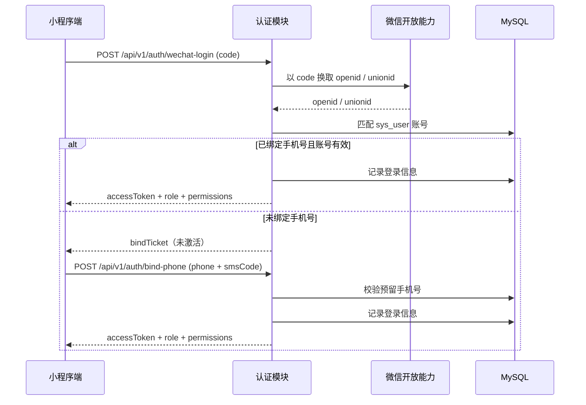

# 济南诚重吊装业务管理系统 — 接口设计规范（API 契约）

| 项 | 内容 |
|---|---|
| 文档编号 | 03 |
| 版本 | v1.0 |
| 状态 | 待评审 |
| 上游文档 | 《济南诚重吊装业务管理系统产品需求文档》v5.4、文档 01《总体技术架构设计（HLD）》 |
| 适用对象 | 前端工程师、后端工程师 |
| 下游文档 | 04 H5 访问端、05 统一多角色小程序、06 数据大屏、07 后台管理系统、08 部署与环境、09 AI Agent 任务包 |

---

## 1 设计概述

### 1.1 目的与范围

本文定义系统对外暴露的 HTTP 接口契约：统一约定、接口清单、逐接口请求 / 响应报文、鉴权与授权、错误码、版本兼容策略与 Mock 规范。它在文档 01 的「模块边界」与前端页面、后端源码之间，回答「每条接口怎么调、报文长什么样、失败怎么表达」。

覆盖范围：

- 认证、工单、派单与接单、打卡与工时、异常、变更审批、冲突提醒、通知、统计、AI、文件、系统配置共 12 个域的接口契约
- 全局请求头、统一响应、分页、幂等、时间格式、多端标识约定
- 鉴权与授权（JWT 流程、微信授权换令牌、手机号绑定、角色与数据范围）
- 统一错误码全集、版本管理与兼容策略、前端 Mock 规范

明确不覆盖（由其他文档承接）：

- 逐字段表结构、索引、数据字典 → 文档 02
- 页面交互、组件、路由与视觉 → 文档 04、05、06、07
- 容器、端口、网络与卷配置 → 文档 08
- 可直接投喂代码生成 Agent 的子任务提示词 → 文档 09

本文所有版本号以实际锁定版本回填；未确认项见第 8 章。

### 1.2 上游需求追溯

| 接口域 | 追溯来源 | 证据 |
|---|---|---|
| 认证 auth（微信授权登录、手机号绑定、账号密码登录） | PRD 3.1.8、4.8；01 §5、§6.3（角色） | [Data-backed] |
| 工单 workorder（建单、详情、列表、修改、状态变更、自动结单、评价） | PRD 3.1.1、3.4.1、4.2、4.5、4.17 | [Data-backed] |
| 派单 dispatch（前置校验、派单、接单、拒单、重新派单） | PRD 3.1.1、3.2.14、4.15、4.16 | [Data-backed] |
| 打卡 attendance（签到、当日签退、任务结束、工时、加班） | PRD 3.2.3、3.2.6、3.2.10、3.2.11、4.4、4.13 | [Data-backed] |
| 异常 exception（上报、列表、详情、批复） | PRD 3.1.4、3.2.4、4.7 | [Data-backed] |
| 变更 change（申请、审批、记录） | PRD 3.2.13、4.14 | [Data-backed] |
| 冲突提醒 conflict（记录列表、处置、再次通知、导出、校验） | PRD 3.1.10、4.18（v5.4 新增） | [Data-backed] |
| 通知 notify（记录、重发、短信用量、订阅结果） | PRD 3.4.5、4.6 | [Data-backed] |
| 统计 stat（驾驶舱、报警中心、绩效、车辆分布图、导出） | PRD 3.1.6、3.1.7、4.6 | [Data-backed] |
| AI（简报、人效、报警分析、服务配置） | PRD 第九章；01 §8 降级策略 | [Data-backed] |
| 文件 file（上传、签名链接、删除） | PRD 4.4、5.6 | [Data-backed] |
| 系统配置 system（配置项、字典） | PRD 3.1.1、3.1.2.1、4.4；01 §6.3 | [Data-backed] |
| 统一响应、分页、幂等、错误码分段、多端标识 | 01 §5 接口设计概要 | [Data-backed] |

### 1.3 接口设计原则

1. **单一核心实体贯穿**：工单是所有域接口的聚合根，状态变更、打卡、异常、变更、冲突、评价均围绕工单编号关联 [Expert judgment]。
2. **契约完整且一致**：每个接口给出方法、路径、鉴权、参数、请求体、响应体、错误码、幂等要求；同一接口在清单表与详细契约中的方法 / 路径 / 错误码必须完全一致 [Expert judgment]。
3. **统一外层信封**：所有接口返回 `{ code, message, data, traceId }`，`code = 0` 为成功，业务失败以 `code` 表达而非 HTTP 状态码独占语义 [Data-backed：01 §5]。
4. **写接口幂等**：所有写接口支持 `Idempotency-Key`，重复提交返回首次结果，避免派单、接单、签退重复落库 [Data-backed：01 §5、§8]。
5. **越权即拒绝**：功能权限由权限码判定，数据范围由角色（管理员 / 司机 / 客户）判定，二者在业务层二次校验，任一不通过返回 10003 [Expert judgment]。
6. **枚举字面锁定**：所有枚举取值与 01 §6.3 逐字一致，前后端与数据库共用同一字典，禁止各自定义 [Data-backed：01 §6.3]。
7. **冲突对主流程零侵入**：互斥冲突仅新增校验与提醒，不改变工单既有状态机与结单逻辑 [Data-backed：PRD 4.18.5]。

### 1.4 全局契约约定

**基础路径**：`/api/v1`，按域分前缀（`/api/v1/` + 域前缀，见 1.5）。未来主版本升级以路径前缀承载 [Expert judgment]。

**统一响应**

| 字段 | 类型 | 说明 |
|---|---|---|
| code | int | 0 成功；非 0 为错误码，见第 5 章 |
| message | string | 面向用户的提示文案（参数校验错误附字段级提示） |
| data | object / array / null | 业务数据；失败时为 null 或字段级错误详情 |
| traceId | string | 链路追踪标识，由鉴权入口注入，用于问题定位 |

**请求头约定**

| 请求头 | 必填 | 取值 | 说明 |
|---|---|---|---|
| Authorization | 视接口 | `Bearer <accessToken>`；绑定手机号阶段为 `Bind <bindTicket>` | 见第 4 章 |
| X-Client | 必填 | `admin` \| `h5` \| `mp` \| `screen` | 多端标识，用于日志与限流分桶 |
| Idempotency-Key | 写接口必填 | 客户端生成的唯一字符串（建议 UUID） | 服务端以幂等键表去重，幂等窗口见第 4 章 |
| Content-Type | 写接口 | `application/json`（上传接口为 `multipart/form-data`） | — |

**分页约定**

- 入参：`pageNum`（从 1 开始，默认 1）、`pageSize`（默认 20，上限 100）
- 出参：`data.total`（总条数）、`data.list`（当前页数组）；越界或非正数返回 20003

**时间格式**：ISO 8601 带时区，如 `2026-10-17T14:00:00+08:00`；采集类时间（`capturedAt`）按实际采集时间留痕，不因补传改写 [Data-backed：PRD 4.4]。

**枚举字典**：一律引用 01 §6.3 字面量，关键取值如下。

| 字典 | 取值 |
|---|---|
| 工单状态 status | `PENDING_ACCEPT`、`PENDING_ARRIVE`、`IN_PROGRESS`、`SUSPENDED`、`COMPLETED`、`CANCELLED` |
| 工单来源 source | `DEMAND`、`DIRECT` |
| 车辆状态 | `IDLE`、`BUSY`、`BUSY_THIRD`、`MAINTENANCE`、`DISABLED` |
| 打卡类型类型 | `CHECK_IN`、`DAILY_CHECKOUT`、`TASK_END` |
| 变更申请类型 | `CANCEL`、`VEHICLE_CHANGE`、`POSTPONE`、`ADDRESS_CHANGE` |
| 变更申请状态 | `PENDING`、`APPROVED`、`REJECTED` |
| 冲突触发场景 triggerScene | `AHEAD_WINDOW`、`DRIVER_POSTPONE`、`ADMIN_EDIT`、`ADMIN_DISPATCH` |
| 冲突处置状态 status | `PENDING`、`HANDLED`、`ESCALATED`、`CLOSED` |
| 冲突处置动作 handleAction | `REASSIGN`、`APPROVE_POSTPONE`、`SUSPEND`、`NOTIFY`、`CONTINUE` |
| 角色 code | `ADMIN`（含原总监职责）、`DRIVER`、`CUSTOMER` |
| 通知通道 | `WECHAT`、`SMS`、`INAPP` |

> 总监职责并入 `ADMIN`，不设独立角色标识 [Data-backed：01 §6.3]。

### 1.5 域前缀与权限码基线

| 域 | 路径前缀 | 主要权限码 |
|---|---|---|
| auth 认证 | `/api/v1/auth` | 登录前接口无权限码；其余仅需登录 |
| workorder 工单 | `/api/v1/work-order` | `workorder:create`、`workorder:read`、`workorder:update`、`workorder:settle`、`workorder:review` |
| dispatch 派单 | `/api/v1/dispatch` | `dispatch:read`、`dispatch:precheck`、`dispatch:create`、`dispatch:accept`、`dispatch:reject` |
| attendance 打卡工时 | `/api/v1/attendance` | `attendance:checkin`、`attendance:checkout`、`attendance:read`、`attendance:confirm` |
| exception 异常 | `/api/v1/exception` | `exception:create`、`exception:read`、`exception:reply` |
| change 变更 | `/api/v1/change` | `change:create`、`change:read`、`change:approve` |
| conflict 冲突提醒 | `/api/v1/conflict` | `conflict:read`、`conflict:handle`、`conflict:notify` |
| notify 通知 | `/api/v1/notify` | `notify:read`、`notify:resend` |
| stat 统计 | `/api/v1/stat` | `stat:read`、`stat:export` |
| AI | `/api/v1/ai` | `ai:read`、`ai:config` |
| file 文件 | `/api/v1/file` | `file:upload`、`file:read` |
| system 系统配置 | `/api/v1/system` | `system:read`、`system:update` |

权限码与角色映射依据 PRD 3.1.9 权限矩阵推导，`ADMIN` 拥有全部权限码，`DRIVER` 与 `CUSTOMER` 按矩阵分配 [Data-backed：PRD 3.1.9]。

---

## 2 接口清单

共 68 个接口。下表的方法、路径、鉴权与权限码与第 3 章详细契约完全一致。

| 编号 | 所属域 | 方法 | 路径 | 鉴权 | 权限码 | 说明 |
|---|---|---|---|---|---|---|
| API-AUTH-001 | auth | POST | /api/v1/auth/wechat-login | 免鉴权 | — | 微信授权 code 换业务令牌 |
| API-AUTH-002 | auth | POST | /api/v1/auth/bind-phone | Bind 凭据 / Bearer | — | 绑定手机号激活账号 |
| API-AUTH-003 | auth | POST | /api/v1/auth/sms-code | 免鉴权 | — | 发送登录 / 绑定验证码 |
| API-AUTH-004 | auth | POST | /api/v1/auth/password-login | 免鉴权 | — | 账号密码登录（后台与大屏） |
| API-AUTH-005 | auth | POST | /api/v1/auth/logout | Bearer | — | 登出并失效令牌 |
| API-AUTH-006 | auth | GET | /api/v1/auth/me | Bearer | — | 当前用户与权限码 |
| API-WO-001 | workorder | POST | /api/v1/work-order/orders | Bearer | workorder:create | 创建工单（含派单前置校验） |
| API-WO-002 | workorder | GET | /api/v1/work-order/orders | Bearer | workorder:read | 工单列表（筛选 / 搜索） |
| API-WO-003 | workorder | GET | /api/v1/work-order/orders/{id} | Bearer | workorder:read | 工单详情 |
| API-WO-004 | workorder | PATCH | /api/v1/work-order/orders/{id} | Bearer | workorder:update | 修改工单（触发互斥校验） |
| API-WO-005 | workorder | POST | /api/v1/work-order/orders/{id}/status | Bearer | workorder:update | 工单状态变更（取消 / 暂停 / 恢复） |
| API-WO-006 | workorder | POST | /api/v1/work-order/orders/{id}/settle | Bearer | workorder:settle | 工单结单（自动结单联动与兜底） |
| API-WO-007 | workorder | GET | /api/v1/work-order/orders/{id}/status-logs | Bearer | workorder:read | 状态变更记录 |
| API-WO-008 | workorder | POST | /api/v1/work-order/orders/{id}/review | Bearer | workorder:review | 提交客户评价 |
| API-DISP-001 | dispatch | POST | /api/v1/dispatch/precheck | Bearer | dispatch:precheck | 派单前置校验 |
| API-DISP-002 | dispatch | POST | /api/v1/dispatch/orders/{workOrderId}/dispatch | Bearer | dispatch:create | 派单 |
| API-DISP-003 | dispatch | POST | /api/v1/dispatch/orders/{workOrderId}/accept | Bearer | dispatch:accept | 接单 |
| API-DISP-004 | dispatch | POST | /api/v1/dispatch/orders/{workOrderId}/reject | Bearer | dispatch:reject | 拒单 |
| API-DISP-005 | dispatch | POST | /api/v1/dispatch/orders/{workOrderId}/redispatch | Bearer | dispatch:create | 重新派单 |
| API-DISP-006 | dispatch | GET | /api/v1/dispatch/pending-redispatch | Bearer | dispatch:read | 待重新派单队列 |
| API-DISP-007 | dispatch | GET | /api/v1/dispatch/orders/{workOrderId}/logs | Bearer | dispatch:read | 接单拒单记录 |
| API-ATT-001 | attendance | POST | /api/v1/attendance/check-in | Bearer | attendance:checkin | 到场签到（定位 + 照片） |
| API-ATT-002 | attendance | POST | /api/v1/attendance/daily-checkout | Bearer | attendance:checkout | 当日签退（今日任务完成） |
| API-ATT-003 | attendance | POST | /api/v1/attendance/task-end | Bearer | attendance:checkout | 任务结束（最终完工签退） |
| API-ATT-004 | attendance | GET | /api/v1/attendance/records | Bearer | attendance:read | 打卡记录查询 |
| API-ATT-005 | attendance | GET | /api/v1/attendance/work-hours | Bearer | attendance:read | 工时查询 |
| API-ATT-006 | attendance | GET | /api/v1/attendance/work-hours/export | Bearer | stat:export | 工时导出 |
| API-ATT-007 | attendance | GET | /api/v1/attendance/overtime | Bearer | attendance:read | 加班记录查询 |
| API-ATT-008 | attendance | POST | /api/v1/attendance/overtime/{id}/confirm | Bearer | attendance:confirm | 加班管理员确认 |
| API-EXC-001 | exception | POST | /api/v1/exception/reports | Bearer | exception:create | 异常上报 |
| API-EXC-002 | exception | GET | /api/v1/exception/reports | Bearer | exception:read | 异常列表 |
| API-EXC-003 | exception | GET | /api/v1/exception/reports/{id} | Bearer | exception:read | 异常详情 |
| API-EXC-004 | exception | POST | /api/v1/exception/reports/{id}/reply | Bearer | exception:reply | 异常批复 |
| API-CHG-001 | change | POST | /api/v1/change/requests | Bearer | change:create | 提交变更申请 |
| API-CHG-002 | change | GET | /api/v1/change/requests | Bearer | change:read | 变更申请列表 |
| API-CHG-003 | change | GET | /api/v1/change/requests/{id} | Bearer | change:read | 变更申请详情 |
| API-CHG-004 | change | POST | /api/v1/change/requests/{id}/approve | Bearer | change:approve | 审批变更申请 |
| API-CHG-005 | change | GET | /api/v1/change/requests/{id}/logs | Bearer | change:read | 变更审批记录 |
| API-CFL-001 | conflict | GET | /api/v1/conflict/alerts | Bearer | conflict:read | 冲突提醒记录列表 |
| API-CFL-002 | conflict | GET | /api/v1/conflict/alerts/{id} | Bearer | conflict:read | 冲突提醒详情 |
| API-CFL-003 | conflict | POST | /api/v1/conflict/alerts/{id}/handle | Bearer | conflict:handle | 处置冲突提醒 |
| API-CFL-004 | conflict | POST | /api/v1/conflict/alerts/{id}/notify-again | Bearer | conflict:notify | 手动再次通知 |
| API-CFL-005 | conflict | GET | /api/v1/conflict/alerts/export | Bearer | stat:export | 导出提醒记录 |
| API-CFL-006 | conflict | POST | /api/v1/conflict/check | Bearer | conflict:read | 互斥校验（内部 / 显式调用） |
| API-NTF-001 | notify | GET | /api/v1/notify/records | Bearer | notify:read | 通知记录列表 |
| API-NTF-002 | notify | GET | /api/v1/notify/records/{id} | Bearer | notify:read | 通知详情与送达状态 |
| API-NTF-003 | notify | POST | /api/v1/notify/records/{id}/resend | Bearer | notify:resend | 重新发送通知 |
| API-NTF-004 | notify | GET | /api/v1/notify/sms-usage | Bearer | notify:read | 短信用量与费用统计 |
| API-NTF-005 | notify | POST | /api/v1/notify/subscribe-result | Bearer | — | 上报微信订阅授权结果 |
| API-STAT-001 | stat | GET | /api/v1/stat/dashboard | Bearer | stat:read | 数据驾驶舱指标 |
| API-STAT-002 | stat | GET | /api/v1/stat/alarms | Bearer | stat:read | 报警中心列表 |
| API-STAT-003 | stat | GET | /api/v1/stat/performance/staff | Bearer | stat:read | 员工绩效 |
| API-STAT-004 | stat | GET | /api/v1/stat/performance/vehicle | Bearer | stat:read | 车辆绩效 |
| API-STAT-005 | stat | GET | /api/v1/stat/performance/customer | Bearer | stat:read | 客户维度统计 |
| API-STAT-006 | stat | GET | /api/v1/stat/vehicle-map | Bearer | stat:read | 中央车辆分布图点位 |
| API-STAT-007 | stat | GET | /api/v1/stat/report/export | Bearer | stat:export | 报表导出 |
| API-AI-001 | ai | GET | /api/v1/ai/briefings | Bearer | ai:read | 简报查询 |
| API-AI-002 | ai | POST | /api/v1/ai/briefings/generate | Bearer | ai:read | 触发生成简报 |
| API-AI-003 | ai | GET | /api/v1/ai/efficiency | Bearer | ai:read | 人效分析与人效排名 |
| API-AI-004 | ai | GET | /api/v1/ai/alarms | Bearer | ai:read | 报警分析列表 |
| API-AI-005 | ai | GET | /api/v1/ai/config | Bearer | ai:config | AI 服务配置查询 |
| API-AI-006 | ai | PUT | /api/v1/ai/config | Bearer | ai:config | AI 服务配置更新 |
| API-FILE-001 | file | POST | /api/v1/file/files | Bearer | file:upload | 上传文件 |
| API-FILE-002 | file | POST | /api/v1/file/sign | Bearer | file:read | 获取签名链接 |
| API-FILE-003 | file | DELETE | /api/v1/file/files/{id} | Bearer | file:upload | 删除文件 |
| API-SYS-001 | system | GET | /api/v1/system/configs | Bearer | system:read | 配置项查询 |
| API-SYS-002 | system | PUT | /api/v1/system/configs/{key} | Bearer | system:update | 配置项更新 |
| API-SYS-003 | system | GET | /api/v1/system/dictionaries | Bearer | — | 字典查询 |

---

## 3 逐接口契约

除非另注，写接口（POST / PATCH / PUT / DELETE）均要求 `Idempotency-Key` 请求头；重复键在幂等窗口内返回首次结果，窗口默认 24 小时 [待确认]。所有请求体字段名为小驼峰。

### 3.1 auth 认证

#### API-AUTH-001 微信授权登录

- 方法路径：`POST /api/v1/auth/wechat-login`
- 鉴权与权限码：免鉴权；无权限码
- 请求体：

| 字段 | 类型 | 必填 | 约束 |
|---|---|---|---|
| code | string | 是 | 微信登录 code，单次有效 |
| client | string | 是 | 枚举 `admin` \| `h5` \| `mp` \| `screen` |

- 成功响应：`data` = `{ tokenType: "Bearer", accessToken, expiresIn, bound, bindTicket, role, permissions }`；`bound=false` 时返回 `bindTicket`（短时效绑定凭据），`role`、`permissions` 此时为 null
- 错误码：10005、10006、20001
- 幂等：免幂等
- 说明：服务端以 code 换取 openid / unionid 并匹配账号；已绑定直接签发令牌，未绑定返回 `bindTicket` [Data-backed：PRD 3.1.8、4.8]

#### API-AUTH-002 绑定手机号

- 方法路径：`POST /api/v1/auth/bind-phone`
- 鉴权与权限码：`Authorization: Bind <bindTicket>` 或 `Bearer <accessToken>`；无权限码
- 请求体：

| 字段 | 类型 | 必填 | 约束 |
|---|---|---|---|
| phone | string | 是 | 11 位手机号，全局唯一 |
| smsCode | string | 是 | 6 位短信验证码 |

- 成功响应：`data` = `{ accessToken, expiresIn, role, permissions, userId }`
- 错误码：10005、10007、10008、10009、20002
- 幂等：必填 `Idempotency-Key`
- 说明：手机号须与员工档案 / 客户预留手机号匹配，匹配成功即激活账号；未匹配返回 10007「账号未开通，请联系管理员」[Data-backed：PRD 3.1.8、4.8]

#### API-AUTH-003 发送短信验证码

- 方法路径：`POST /api/v1/auth/sms-code`
- 鉴权与权限码：免鉴权；无权限码
- 请求体：`phone`(string, 必填, 11 位)、`scene`(string, 必填, 枚举 `LOGIN` \| `BIND_PHONE`)
- 成功响应：`data` = `{ expiresIn, interval }`（验证码有效期与再次发送间隔，秒）
- 错误码：10007、20002、50003
- 幂等：必填；同一手机号同一场景 60 秒内限一次
- 说明：短信用量与每日 / 每月上限见 PRD 3.4.5 与 API-NTF-004 [Data-backed：PRD 3.4.5]

#### API-AUTH-004 账号密码登录

- 方法路径：`POST /api/v1/auth/password-login`
- 鉴权与权限码：免鉴权；无权限码
- 请求体：`username`(string, 必填)、`password`(string, 必填)
- 成功响应：`data` = `{ tokenType: "Bearer", accessToken, expiresIn, role, permissions }`
- 错误码：10003、10005、10010、20002
- 幂等：免幂等
- 说明：仅 `admin` 端与大屏通道使用；密码策略与初始密码规则 [待确认]，见第 8 章 [Data-backed：01 §4.3]

#### API-AUTH-005 登出

- 方法路径：`POST /api/v1/auth/logout`
- 鉴权与权限码：Bearer 令牌；无权限码
- 请求体：无
- 成功响应：`data` = null
- 错误码：10001、10002
- 幂等：免幂等；重复登出返回成功
- 说明：更新用户强制下线时间戳，使已签发令牌失效 [Expert judgment]

#### API-AUTH-006 当前用户信息

- 方法路径：`GET /api/v1/auth/me`
- 鉴权与权限码：Bearer 令牌；无权限码
- 成功响应：`data` = `{ userId, role, name, phone, staffId, customerId, dataScope, permissions }`；`dataScope` 取值枚举 `ALL` \| `SELF_STAFF` \| `SELF_CUSTOMER`
- 错误码：10001、10002、10004
- 幂等：只读

### 3.2 workorder 工单

#### API-WO-001 创建工单

- 方法路径：`POST /api/v1/work-order/orders`
- 鉴权与权限码：Bearer 令牌；`workorder:create`
- 请求体：

| 字段 | 类型 | 必填 | 约束 |
|---|---|---|---|
| taskName | string | 是 | 最长 100 |
| customerId | long | 是 | 必须存在 |
| contactId | long | 否 | 客户联系人 |
| vehicleId | long | 是 | 状态须为 `IDLE` |
| staffId | long | 是 | 状态须为在岗（非离岗 / 离职） |
| planStartAt | datetime | 是 | ISO 8601 |
| address | string | 是 | 施工地点详细地址 |
| longitude | number | 是 | 高德经度 |
| latitude | number | 是 | 高德纬度 |
| cargoName | string | 是 | 吊装货物名称 |
| cargoQty | int | 是 | ≥ 1 |
| cargoWeightTon | number | 是 | > 0，实际吊装货物重量（吨），须复核 |
| craneTonnage | number | 是 | 吊车吨位 |
| source | string | 是 | 枚举 `DEMAND` \| `DIRECT` |
| demandOrderId | long | 条件 | `source=DEMAND` 时必填 |
| remark | string | 否 | 任务备注 |
| requirement | string | 否 | 施工要求 |

- 成功响应：`data` = `{ orderId, orderNo, status: "PENDING_ACCEPT", customerVisibleStatus }`
- 错误码：20001、20002、30001、30004、40002、40003、40005、40006
- 幂等：必填 `Idempotency-Key`
- 说明：建单即执行派单前置校验（车辆空闲、司机在岗且无进行中工单、时间合法性）；命中互斥时阻止建单并触发冲突提醒（场景 `ADMIN_DISPATCH`）[Data-backed：PRD 3.1.1、4.2、4.16、4.18.2]

#### API-WO-002 工单列表

- 方法路径：`GET /api/v1/work-order/orders`
- 鉴权与权限码：Bearer 令牌；`workorder:read`
- 查询参数：`pageNum`、`pageSize`、`status`、`customerVisibleStatus`、`source`、`customerId`、`staffId`、`vehicleId`、`keyword`（工单号 / 任务名）、`startDate`、`endDate`、`sort`
- 成功响应：`data` = `{ total, list: [ { orderId, orderNo, taskName, status, customerVisibleStatus, source, staffId, staffName, vehicleId, plateNo, customerId, planStartAt, createdAt } ] }`
- 错误码：10003、20003
- 幂等：只读
- 说明：数据范围按角色过滤——司机仅本人工单、客户仅本人关联工单、管理员全部 [Data-backed：PRD 3.1.9]

#### API-WO-003 工单详情

- 方法路径：`GET /api/v1/work-order/orders/{id}`
- 鉴权与权限码：Bearer 令牌；`workorder:read`
- 路径参数：`id`（long，工单主键）
- 成功响应：`data` = 工单全量字段 + `staff`（姓名、联系方式）+ `vehicle`（车牌号、吨位）+ `customer` + `cargo`（名称、数量、重量）+ `attendanceList` + `exceptionList` + `changeList` + `review`；司机签到 / 签退照片对客户不返回 [Data-backed：PRD 3.1.1、3.4.2]
- 错误码：10003、40001
- 幂等：只读

#### API-WO-004 修改工单

- 方法路径：`PATCH /api/v1/work-order/orders/{id}`
- 鉴权与权限码：Bearer 令牌；`workorder:update`
- 请求体（部分更新，未传字段不变）：

| 字段 | 类型 | 必填 | 约束 |
|---|---|---|---|
| vehicleId | long | 否 | 改派车辆 |
| staffId | long | 否 | 改派司机 |
| planStartAt | datetime | 否 | 变更约定服务时间 |
| address | string | 否 | 变更地点 |
| longitude | number | 否 | 与 latitude 成对 |
| latitude | number | 否 | 与 longitude 成对 |
| cargoWeightTon | number | 否 | 复核后重量 |
| remark | string | 否 | — |
| confirmForce | boolean | 否 | 命中互斥时二次确认强行放行，默认 false |

- 成功响应：`data` = `{ orderId, status, changed, conflict }`；`conflict` 仅在命中互斥且 `confirmForce=true` 时返回冲突摘要
- 错误码：20001、20002、30001、30004、40001、40002、40003、40004
- 幂等：必填 `Idempotency-Key`
- 说明：保存前做互斥校验，命中则阻止保存并触发冲突提醒（场景 `ADMIN_EDIT`）；`confirmForce=true` 强行放行须留痕 [Data-backed：PRD 4.18.2 第 3 条]

#### API-WO-005 工单状态变更

- 方法路径：`POST /api/v1/work-order/orders/{id}/status`
- 鉴权与权限码：Bearer 令牌；`workorder:update`
- 请求体：

| 字段 | 类型 | 必填 | 约束 |
|---|---|---|---|
| targetStatus | string | 是 | 枚举 `SUSPENDED` \| `IN_PROGRESS` \| `CANCELLED` |
| reason | string | 条件 | `CANCELLED` 时必填 |
| confirm | boolean | 否 | `IN_PROGRESS → CANCELLED` 需二次确认，默认 false |

- 成功响应：`data` = `{ orderId, status, customerVisibleStatus, staffStatus, vehicleStatus }`
- 错误码：20001、20008、30001、30007、40001、40004
- 幂等：必填 `Idempotency-Key`
- 说明：`SUSPENDED → IN_PROGRESS`（恢复执行）须做互斥校验，命中触发冲突提醒并在同一事务内回滚；取消后果按 4.17 释放人车 [Data-backed：PRD 4.17、4.18.1]

#### API-WO-006 工单结单

- 方法路径：`POST /api/v1/work-order/orders/{id}/settle`
- 鉴权与权限码：Bearer 令牌；`workorder:settle`（管理员兜底）；常规由 API-ATT-003 内部联动
- 请求体：`settleSource`(string, 必填, 枚举 `TASK_END` \| `ADMIN`)
- 成功响应：`data` = `{ orderId, status: "COMPLETED", vehicleStatus: "IDLE", customerNotified, reviewOpen }`
- 错误码：40001、40004
- 幂等：必填；重复调用返回已结单结果
- 说明：自动结单联动车辆释放、客户「任务已完成」通知、开放评价；「今日任务完成」不触发结单 [Data-backed：PRD 4.5]

#### API-WO-007 状态变更记录

- 方法路径：`GET /api/v1/work-order/orders/{id}/status-logs`
- 鉴权与权限码：Bearer 令牌；`workorder:read`
- 查询参数：`pageNum`、`pageSize`
- 成功响应：`data` = `{ total, list: [ { fromStatus, toStatus, changedAt, changedBy, changedByName, remark } ] }`
- 错误码：40001
- 幂等：只读

#### API-WO-008 提交客户评价

- 方法路径：`POST /api/v1/work-order/orders/{id}/review`
- 鉴权与权限码：Bearer 令牌；`workorder:review`（仅客户）
- 请求体：`score`(int, 必填, 1~5)、`content`(string, 否, 最长 500)
- 成功响应：`data` = `{ reviewId, score, createdAt }`
- 错误码：10003、40001、40004
- 幂等：必填；同一工单同一客户仅一条有效评价
- 说明：客户不操作时由定时任务按「默认好评」写入；评分仅留存不作绩效直接评定 [Data-backed：PRD 3.4.6]

### 3.3 dispatch 派单与接单

#### API-DISP-001 派单前置校验

- 方法路径：`POST /api/v1/dispatch/precheck`
- 鉴权与权限码：Bearer 令牌；`dispatch:precheck`
- 请求体：`vehicleId`(long, 必填)、`staffId`(long, 必填)、`planStartAt`(datetime, 必填)、`workOrderId`(long, 否，重新派单场景传入以排除自身)
- 成功响应：`data` = `{ pass, checks: [ { code, pass, message } ], conflicts: [冲突摘要] }`；`checks[].code` 取值 `VEHICLE_IDLE` \| `STAFF_ON_DUTY` \| `STAFF_NO_ACTIVE_ORDER` \| `TIME_VALID` \| `PENDING_DISPATCH_LIMIT`
- 错误码：30001、30002、30003、30004、40002、40003
- 幂等：只读校验，免幂等
- 说明：覆盖 4 项前置规则与「同一司机未接单派单数上限（默认 3，可配置）」；时间早于当前需二次确认 [Data-backed：PRD 3.1.1、4.15、4.16]

#### API-DISP-002 派单

- 方法路径：`POST /api/v1/dispatch/orders/{workOrderId}/dispatch`
- 鉴权与权限码：Bearer 令牌；`dispatch:create`
- 请求体：`vehicleId`(long, 必填)、`staffId`(long, 必填)、`planStartAt`(datetime, 必填)、`remark`(string, 否)
- 成功响应：`data` = `{ orderId, orderNo, status: "PENDING_ACCEPT", staffId, vehicleId, customerVisibleStatus }`
- 错误码：30001、30002、30003、30004、40001、40002、40003、40004
- 幂等：必填 `Idempotency-Key`
- 说明：派单成功通知司机（微信订阅 + 短信双通道）；命中互斥阻止派单并触发冲突提醒（场景 `ADMIN_DISPATCH`）[Data-backed：PRD 3.1.1、3.2.2、4.18.2]

#### API-DISP-003 接单

- 方法路径：`POST /api/v1/dispatch/orders/{workOrderId}/accept`
- 鉴权与权限码：Bearer 令牌；`dispatch:accept`（仅被派司机本人）
- 请求体：无
- 成功响应：`data` = `{ orderId, status: "PENDING_ARRIVE", acceptedAt }`
- 错误码：10003、40001、40004
- 幂等：必填；重复接单返回原结果
- 说明：记录接单时间并通知客户「工单已被接受」；接单时间供超时与报警规则使用 [Data-backed：PRD 3.2.14]

#### API-DISP-004 拒单

- 方法路径：`POST /api/v1/dispatch/orders/{workOrderId}/reject`
- 鉴权与权限码：Bearer 令牌；`dispatch:reject`（仅被派司机本人）
- 请求体：`reasonType`(string, 必填, 枚举 `VEHICLE_FAULT` \| `TIME_CONFLICT` \| `ABILITY_MISMATCH` \| `OTHER`)、`reason`(string, 条件：`OTHER` 必填, 最长 200)
- 成功响应：`data` = `{ orderId, status, redispatchQueued: true }`
- 错误码：20001、40001、40004
- 幂等：必填
- 说明：工单退回「待重新派单」队列并通知管理员；客户侧状态保持不变，不暴露内部改派过程 [Data-backed：PRD 3.2.14、4.15]

#### API-DISP-005 重新派单

- 方法路径：`POST /api/v1/dispatch/orders/{workOrderId}/redispatch`
- 鉴权与权限码：Bearer 令牌；`dispatch:create`
- 请求体：`vehicleId`(long, 必填)、`staffId`(long, 必填)、`planStartAt`(datetime, 必填)、`changeRequestId`(long, 否，来源变更申请)
- 成功响应：`data` = `{ orderId, status: "PENDING_ACCEPT", staffId, vehicleId, acceptedAt: null }`
- 错误码：30001、30002、30003、30004、40001、40002、40003、40004
- 幂等：必填 `Idempotency-Key`
- 说明：重派前互斥校验，命中触发冲突提醒（场景 `ADMIN_DISPATCH`）；重派后通知客户与司机 [Data-backed：PRD 4.14、4.18.2]

#### API-DISP-006 待重新派单队列

- 方法路径：`GET /api/v1/dispatch/pending-redispatch`
- 鉴权与权限码：Bearer 令牌；`dispatch:read`
- 查询参数：`pageNum`、`pageSize`、`keyword`
- 成功响应：`data` = `{ total, list: [ { orderId, orderNo, taskName, rejectReason, rejectedAt, planStartAt } ] }`
- 错误码：20003
- 幂等：只读

#### API-DISP-007 接单拒单记录

- 方法路径：`GET /api/v1/dispatch/orders/{workOrderId}/logs`
- 鉴权与权限码：Bearer 令牌；`dispatch:read`
- 成功响应：`data` = `{ list: [ { action: "ACCEPT" \| "REJECT", reason, operatorId, operatorName, operatedAt } ] }`
- 错误码：40001
- 幂等：只读

### 3.4 attendance 打卡与工时

#### API-ATT-001 签到

- 方法路径：`POST /api/v1/attendance/check-in`
- 鉴权与权限码：Bearer 令牌；`attendance:checkin`（司机本人）
- 请求体：

| 字段 | 类型 | 必填 | 约束 |
|---|---|---|---|
| workOrderId | long | 是 | 状态须为 `PENDING_ARRIVE` |
| longitude | number | 是 | 实时定位经度 |
| latitude | number | 是 | 实时定位纬度 |
| accuracy | number | 否 | 定位精度（米） |
| capturedAt | datetime | 是 | 实际采集时间 |
| fileIds | long[] | 是 | 现场照片，至少 1 张 |
| offlineSync | boolean | 否 | 弱网补传标记，默认 false |

- 成功响应：`data` = `{ attendanceId, workOrderStatus: "IN_PROGRESS", distanceMeters, staffStatus, vehicleStatus }`
- 错误码：20006、30005、30006、30008、30012、40001、40004
- 幂等：必填；服务端以「工单 + 类型 + 时间窗」二次判重
- 说明：有效范围默认 1 公里（后台可配），超范围返回 30005；异常未批复期间不可签到，返回 30008；签到成功后工单转 `IN_PROGRESS`、人车转作业中；补传不改写 `capturedAt` [Data-backed：PRD 3.2.3、4.4]

#### API-ATT-002 当日签退（今日任务完成）

- 方法路径：`POST /api/v1/attendance/daily-checkout`
- 鉴权与权限码：Bearer 令牌；`attendance:checkout`（司机本人）
- 请求体：

| 字段 | 类型 | 必填 | 约束 |
|---|---|---|---|
| workOrderId | long | 是 | 状态须为 `IN_PROGRESS` |
| longitude | number | 是 | 签退定位经度 |
| latitude | number | 是 | 签退定位纬度 |
| capturedAt | datetime | 是 | 实际采集时间 |
| fileIds | long[] | 是 | 离场照片，至少 1 张 |
| vehicleLeaveSite | boolean | 是 | 车辆是否离场 |
| vehicleReturnDepot | boolean | 是 | 车辆是否回场 |
| offlineSync | boolean | 否 | 弱网补传标记 |

- 成功响应：`data` = `{ attendanceId, workOrderStatus: "IN_PROGRESS", vehicleStatus, locationCompliant, overtimeMinutes, needsManualConfirm }`；`vehicleReturnDepot=true` → `vehicleStatus=IDLE`，否则 `BUSY`
- 错误码：30008、30012、30013、40001、40004
- 幂等：必填；同日重复提交判重
- 说明：仅结束当日施工，不改变工单完成状态；加班仅在位置合规且晚于正常下班时间时计算，不合规置 `needsManualConfirm=true` [Data-backed：PRD 3.2.6、3.2.10、4.13]

#### API-ATT-003 任务结束（最终完工签退）

- 方法路径：`POST /api/v1/attendance/task-end`
- 鉴权与权限码：Bearer 令牌；`attendance:checkout`（司机本人）
- 请求体：`workOrderId`(long, 必填)、`longitude`(number, 必填)、`latitude`(number, 必填)、`capturedAt`(datetime, 必填)、`fileIds`(long[], 必填, 至少 1 张)、`offlineSync`(boolean, 否)
- 成功响应：`data` = `{ attendanceId, workOrderStatus: "COMPLETED", vehicleStatus: "IDLE", totalWorkMinutes, overtimeMinutesTotal }`
- 错误码：30008、30012、40001、40004
- 幂等：必填；重复返回已结单结果
- 说明：内部联动 API-WO-006 结单、车辆释放、客户通知；统计「启动 → 结束」完整工时并存储，供纸质单据比对 [Data-backed：PRD 3.2.6、3.2.11、4.5]

#### API-ATT-004 打卡记录查询

- 方法路径：`GET /api/v1/attendance/records`
- 鉴权与权限码：Bearer 令牌；`attendance:read`
- 查询参数：`pageNum`、`pageSize`、`workOrderId`、`staffId`、`type`（枚举 `CHECK_IN` \| `DAILY_CHECKOUT` \| `TASK_END`）、`startDate`、`endDate`
- 成功响应：`data` = `{ total, list: [ { attendanceId, workOrderId, staffId, type, capturedAt, createdAt, longitude, latitude, distanceMeters, locationCompliant, fileIds } ] }`
- 错误码：20003、10003
- 幂等：只读
- 说明：客户角色不返回照片字段 [Data-backed：PRD 3.4.2]

#### API-ATT-005 工时查询

- 方法路径：`GET /api/v1/attendance/work-hours`
- 鉴权与权限码：Bearer 令牌；`attendance:read`
- 查询参数：`staffId`、`workOrderId`、`periodType`（枚举 `DAY` \| `WEEK` \| `MONTH` \| `CUSTOM`）、`startDate`、`endDate`
- 成功响应：`data` = `{ items: [ { workOrderId, staffId, startAt, endAt, totalMinutes, overtimeMinutes } ], summary: { totalMinutes, overtimeMinutes } }`
- 错误码：20002、20003、10003
- 幂等：只读

#### API-ATT-006 工时导出

- 方法路径：`GET /api/v1/attendance/work-hours/export`
- 鉴权与权限码：Bearer 令牌；`stat:export`
- 查询参数：同 API-ATT-005，另加 `exportType`（选填，默认按明细）
- 成功响应：`data` = `{ fileUrl, expiresIn }`；`fileUrl` 为签名链接
- 错误码：20002、50006
- 幂等：只读
- 说明：导出格式由开发方自行设计，无特定格式要求 [Data-backed：PRD 3.2.11]

#### API-ATT-007 加班记录查询

- 方法路径：`GET /api/v1/attendance/overtime`
- 鉴权与权限码：Bearer 令牌；`attendance:read`
- 查询参数：`staffId`、`workOrderId`、`date`、`confirmStatus`、`pageNum`、`pageSize`
- 成功响应：`data` = `{ total, list: [ { overtimeId, workOrderId, staffId, normalOffWorkAt, actualCheckoutAt, isCompliant, overtimeMinutes, confirmStatus } ] }`
- 错误码：20003、10003
- 幂等：只读

#### API-ATT-008 加班确认

- 方法路径：`POST /api/v1/attendance/overtime/{id}/confirm`
- 鉴权与权限码：Bearer 令牌；`attendance:confirm`（管理员）
- 请求体：`approved`(boolean, 必填)、`adjustedMinutes`(int, 否, ≥ 0)、`remark`(string, 否)
- 成功响应：`data` = `{ overtimeId, confirmStatus, overtimeMinutes }`
- 错误码：30013、40001、40004
- 幂等：必填
- 说明：加班须管理员确认后生效并计入绩效；位置不合规项由管理员人工确认后处理 [Data-backed：PRD 3.2.10]

### 3.5 exception 异常

> 异常类型与异常状态字典未收录于 01 §6.3，以下字面量为拟定值，标注 [待确认]，见第 8 章。

#### API-EXC-001 异常上报

- 方法路径：`POST /api/v1/exception/reports`
- 鉴权与权限码：Bearer 令牌；`exception:create`（司机本人）
- 请求体：`workOrderId`(long, 必填)、`type`(string, 必填, 枚举 `RAIN` \| `PARTY_HALT` \| `VEHICLE_FAULT` \| `CUSTOM` [待确认])、`description`(string, 条件：`CUSTOM` 必填, 最长 500)、`fileIds`(long[], 否)、`pause`(boolean, 否，是否申请暂停为施工受阻，默认 false)
- 成功响应：`data` = `{ exceptionId, workOrderStatus, createdAt }`；`pause=true` 时 `workOrderStatus=SUSPENDED`
- 错误码：20001、30007、40001、40004
- 幂等：必填
- 说明：固定选项「下雨 / 甲方停工 / 车辆故障」+ 自定义原因；未批复期间工单保持受阻且不可签到 / 签退，异常原因对客户公开（含自定义）[Data-backed：PRD 3.2.4、3.1.4、3.4.3]

#### API-EXC-002 异常列表

- 方法路径：`GET /api/v1/exception/reports`
- 鉴权与权限码：Bearer 令牌；`exception:read`
- 查询参数：`pageNum`、`pageSize`、`workOrderId`、`staffId`、`type`、`status`、`startDate`、`endDate`
- 成功响应：`data` = `{ total, list: [ { exceptionId, workOrderId, staffId, type, description, status, reportedAt } ] }`
- 错误码：20003、10003
- 幂等：只读

#### API-EXC-003 异常详情

- 方法路径：`GET /api/v1/exception/reports/{id}`
- 鉴权与权限码：Bearer 令牌；`exception:read`
- 成功响应：`data` = 异常全量 + `fileIds` + `replyList`（批复意见、指令、操作人、时间）
- 错误码：40001
- 幂等：只读

#### API-EXC-004 异常批复

- 方法路径：`POST /api/v1/exception/reports/{id}/reply`
- 鉴权与权限码：Bearer 令牌；`exception:reply`（管理员）
- 请求体：`decision`(string, 必填, 枚举 `CONTINUE` \| `SUSPEND` \| `TERMINATE`)、`opinion`(string, 否, 最长 500)、`cancelOrder`(boolean, 否，`TERMINATE` 且不再执行时置 `CANCELLED`，默认 false)
- 成功响应：`data` = `{ exceptionId, workOrderStatus, staffStatus, vehicleStatus, customerNotified }`
- 错误码：20008、40001、40004
- 幂等：必填
- 说明：`CONTINUE` → 工单回 `IN_PROGRESS`；`SUSPEND` → 保持 `SUSPENDED`；`TERMINATE` 且不再执行 → 置 `CANCELLED` 并通知客户 [Data-backed：PRD 3.1.4、4.7]

### 3.6 change 变更申请与审批

#### API-CHG-001 提交变更申请

- 方法路径：`POST /api/v1/change/requests`
- 鉴权与权限码：Bearer 令牌；`change:create`（司机本人）
- 请求体：

| 字段 | 类型 | 必填 | 约束 |
|---|---|---|---|
| workOrderId | long | 是 | — |
| type | string | 是 | 枚举 `CANCEL` \| `VEHICLE_CHANGE` \| `POSTPONE` \| `ADDRESS_CHANGE` |
| reasonType | string | 否 | 固定选项原因 |
| reason | string | 否 | 自定义说明，最长 500 |
| fileIds | long[] | 否 | 佐证照片 |
| expectedStartAt | datetime | 条件 | `POSTPONE` 建议填写新时间 |
| expectedAddress | string | 条件 | `ADDRESS_CHANGE` 建议填写 |
| longitude | number | 条件 | `ADDRESS_CHANGE` 建议填写 |
| latitude | number | 条件 | `ADDRESS_CHANGE` 建议填写 |

- 成功响应：`data` = `{ changeRequestId, status: "PENDING", conflict }`；`conflict` 仅在 `POSTPONE` 命中互斥且已触发生成提醒时返回
- 错误码：20001、30010、40001、40004
- 幂等：必填 `Idempotency-Key`
- 说明：`POSTPONE` 类型实时做互斥校验，命中立即触发冲突提醒（场景 `DRIVER_POSTPONE`）并返回 30010 [Data-backed：PRD 3.2.13、4.18.2]

#### API-CHG-002 变更申请列表

- 方法路径：`GET /api/v1/change/requests`
- 鉴权与权限码：Bearer 令牌；`change:read`
- 查询参数：`pageNum`、`pageSize`、`status`、`type`、`workOrderId`、`staffId`、`startDate`、`endDate`
- 成功响应：`data` = `{ total, list: [ { changeRequestId, workOrderId, staffId, type, status, reason, createdAt, reviewedAt } ] }`
- 错误码：20003、10003
- 幂等：只读

#### API-CHG-003 变更申请详情

- 方法路径：`GET /api/v1/change/requests/{id}`
- 鉴权与权限码：Bearer 令牌；`change:read`
- 成功响应：`data` = 申请全量 + `beforeSnapshot` + `afterSnapshot` + `fileIds` + `reviewLogs`
- 错误码：40001
- 幂等：只读

#### API-CHG-004 审批变更申请

- 方法路径：`POST /api/v1/change/requests/{id}/approve`
- 鉴权与权限码：Bearer 令牌；`change:approve`（管理员）
- 请求体：

| 字段 | 类型 | 必填 | 约束 |
|---|---|---|---|
| approved | boolean | 是 | 通过 / 驳回 |
| opinion | string | 否 | 审批意见，最长 500 |
| redispatch | object | 否 | 通过后改派要素：`vehicleId`、`staffId`、`planStartAt` |

- 成功响应：`data` = `{ changeRequestId, status: "APPROVED" \| "REJECTED", workOrderId, workOrderStatus, customerNotified, staffNotified }`
- 错误码：30001、30009、40001、40004
- 幂等：必填
- 说明：通过后按申请修改工单并走重新派单校验（API-DISP-005），命中互斥返回 30001；取消工单通过后通知客户，变更 / 重派后通知客户与司机 [Data-backed：PRD 3.2.13、4.14]

#### API-CHG-005 变更审批记录

- 方法路径：`GET /api/v1/change/requests/{id}/logs`
- 鉴权与权限码：Bearer 令牌；`change:read`
- 成功响应：`data` = `{ list: [ { action, opinion, operatorId, operatorName, operatedAt } ] }`
- 错误码：40001
- 幂等：只读

### 3.7 conflict 冲突提醒

冲突提醒的 4 类触发场景必须全覆盖：`AHEAD_WINDOW`（提前提醒时段自动巡检）、`DRIVER_POSTPONE`（司机申请延期，见 API-CHG-001）、`ADMIN_EDIT`（管理员修改工单，见 API-WO-004）、`ADMIN_DISPATCH`（管理员派单 / 重新派单，见 API-DISP-002、API-DISP-005）[Data-backed：PRD 4.18.2]。

#### API-CFL-001 冲突提醒记录列表

- 方法路径：`GET /api/v1/conflict/alerts`
- 鉴权与权限码：Bearer 令牌；`conflict:read`
- 查询参数：`pageNum`、`pageSize`、`staffId`、`workOrderNo`、`triggerScene`、`status`、`startDate`、`endDate`
- 成功响应：`data` = `{ total, list: [ { alertId, alertNo, triggerScene, conflictOrders: [ { orderId, orderNo, taskName, planStartAt, role: "PREVIOUS" \| "NEXT" } ], staff: { staffId, name, staffNo, phone, activeOrderNo }, notifyTargets, channels, deliverStatus, createdAt, status, handleAction, handledBy, handledByName, handledAt } ] }`
- 错误码：20003、10003
- 幂等：只读
- 说明：筛选口径覆盖司机 / 工单号 / 触发场景 / 时间范围 / 处置状态 [Data-backed：PRD 3.1.10、4.18.4]

#### API-CFL-002 冲突提醒详情

- 方法路径：`GET /api/v1/conflict/alerts/{id}`
- 鉴权与权限码：Bearer 令牌；`conflict:read`
- 成功响应：`data` = 记录全量 + 关联工单摘要 + `handleLogs`（处置动作、处置人、时间）+ `notificationList`（通道、送达状态）
- 错误码：40008
- 幂等：只读

#### API-CFL-003 处置冲突提醒

- 方法路径：`POST /api/v1/conflict/alerts/{id}/handle`
- 鉴权与权限码：Bearer 令牌；`conflict:handle`
- 请求体：

| 字段 | 类型 | 必填 | 约束 |
|---|---|---|---|
| action | string | 是 | 枚举 `REASSIGN` \| `APPROVE_POSTPONE` \| `SUSPEND` \| `CONTINUE` |
| vehicleId | long | 条件 | `REASSIGN` 必填 |
| staffId | long | 条件 | `REASSIGN` 必填 |
| planStartAt | datetime | 条件 | `REASSIGN` / `APPROVE_POSTPONE` 必填 |
| remark | string | 否 | 处置说明 |

- 成功响应：`data` = `{ alertId, status, handleAction, workOrderChanges, operator, handledAt }`
- 错误码：30001、30014、40004、40008
- 幂等：必填 `Idempotency-Key`
- 说明：`REASSIGN` 调用重新派单校验仍受 4.16 约束；`APPROVE_POSTPONE` 调整约定时间解除冲突；`SUSPEND` 置受阻 / 取消即时释放司机占用；`CONTINUE` 视为司机已阅知风险并留痕，记录随之关闭 [Data-backed：PRD 3.1.10、4.18.5]

#### API-CFL-004 手动再次通知

- 方法路径：`POST /api/v1/conflict/alerts/{id}/notify-again`
- 鉴权与权限码：Bearer 令牌；`conflict:notify`
- 请求体：`targets`(string[], 必填, 枚举 `DRIVER` \| `ADMIN`)、`channels`(string[], 否, 枚举 `WECHAT` \| `SMS` \| `INAPP`)
- 成功响应：`data` = `{ alertId, notifications: [ { channel, status } ] }`
- 错误码：40008、50002、50003
- 幂等：必填；同一工单同一节点短信去重
- 说明：手动再次推送提醒与处理指引；处置动作 `NOTIFY` 与该接口语义一致 [Data-backed：PRD 3.1.10、4.18.3]

#### API-CFL-005 导出提醒记录

- 方法路径：`GET /api/v1/conflict/alerts/export`
- 鉴权与权限码：Bearer 令牌；`stat:export`
- 查询参数：同 API-CFL-001
- 成功响应：`data` = `{ fileUrl, expiresIn }`
- 错误码：20002、50006
- 幂等：只读
- 说明：满足追溯与审计要求 [Data-backed：PRD 3.1.10]

#### API-CFL-006 互斥校验

- 方法路径：`POST /api/v1/conflict/check`
- 鉴权与权限码：Bearer 令牌；`conflict:read`（供恢复执行、内部与排查场景显式调用）
- 请求体：`staffId`(long, 必填)、`planStartAt`(datetime, 否)、`workOrderId`(long, 否)、`scene`(string, 否, 枚举 `AHEAD_WINDOW` \| `DRIVER_POSTPONE` \| `ADMIN_EDIT` \| `ADMIN_DISPATCH`)
- 成功响应：`data` = `{ conflict, conflictOrders, alertId }`；命中并生成记录时返回 `alertId`
- 错误码：20001、40005
- 幂等：免幂等（只读校验，命中时按业务需要生成记录）
- 说明：判定基准为「未暂停且进行中」；`AHEAD_WINDOW` 场景由应用内定时任务按「预计开始时间 − 提前提醒时长 T ≤ 当前时间」判定后调用本领域服务，不对外暴露触发入口；本接口不改变既有状态机 [Data-backed：PRD 4.18.1、4.18.2]

### 3.8 notify 通知

#### API-NTF-001 通知记录列表

- 方法路径：`GET /api/v1/notify/records`
- 鉴权与权限码：Bearer 令牌；`notify:read`
- 查询参数：`pageNum`、`pageSize`、`recipientType`（枚举 `DRIVER` \| `CUSTOMER` \| `ADMIN`）、`recipientId`、`workOrderId`、`node`、`channel`（枚举 `WECHAT` \| `SMS` \| `INAPP`）、`status`、`startDate`、`endDate`
- 成功响应：`data` = `{ total, list: [ { notificationId, recipientType, recipientId, workOrderId, node, channel, status, sentAt, retryCount } ] }`
- 错误码：20003、10003
- 幂等：只读

#### API-NTF-002 通知详情

- 方法路径：`GET /api/v1/notify/records/{id}`
- 鉴权与权限码：Bearer 令牌；`notify:read`
- 成功响应：`data` = 记录全量 + `deliverStatus` + `retryCount` + `failReason`
- 错误码：40001
- 幂等：只读
- 说明：短信发送状态（成功 / 失败 / 未知）留痕可查 [Data-backed：PRD 3.4.5]

#### API-NTF-003 重新发送通知

- 方法路径：`POST /api/v1/notify/records/{id}/resend`
- 鉴权与权限码：Bearer 令牌；`notify:resend`
- 请求体：`channels`(string[], 否, 枚举 `WECHAT` \| `SMS` \| `INAPP`；默认沿用原通道)
- 成功响应：`data` = `{ notificationId, notifications: [ { channel, status } ] }`
- 错误码：30011、40001、50002、50003
- 幂等：必填；同一工单同一节点短信去重
- 说明：发送失败自动重试默认最多 2 次、间隔递增 [Data-backed：PRD 3.4.5]

#### API-NTF-004 短信用量与费用统计

- 方法路径：`GET /api/v1/notify/sms-usage`
- 鉴权与权限码：Bearer 令牌；`notify:read`
- 查询参数：`periodType`（枚举 `DAY` \| `MONTH`）、`startDate`、`endDate`、`templateCode`
- 成功响应：`data` = `{ items: [ { templateCode, sent, success, failed, limit, usage, cost } ], summary: { sent, failed, cost } }`
- 错误码：20002、10003
- 幂等：只读
- 说明：支持按日 / 按月与按模板统计，异常增长提示管理员 [Data-backed：PRD 3.4.5]

#### API-NTF-005 上报微信订阅授权结果

- 方法路径：`POST /api/v1/notify/subscribe-result`
- 鉴权与权限码：Bearer 令牌；无权限码（登录用户）
- 请求体：`templateIds`(string[], 必填)、`result`(string, 必填, 枚举 `ACCEPT` \| `REJECT`)
- 成功响应：`data` = null
- 错误码：20001、20002
- 幂等：免幂等（同结果重复上报无副作用）
- 说明：未授权或已拒收时通知自动降级为短信 [Data-backed：PRD 3.4.5]

### 3.9 stat 统计与报表导出

#### API-STAT-001 数据驾驶舱指标

- 方法路径：`GET /api/v1/stat/dashboard`
- 鉴权与权限码：Bearer 令牌；`stat:read`（管理员）
- 查询参数：`periodType`（枚举 `TODAY` \| `WEEK` \| `MONTH`，默认 `TODAY`）
- 成功响应：`data` = `{ orderCounts: { total, inProgress, suspended, completed }, staffCounts: { onDuty, idle, working }, vehicleCounts: { working, idle, thirdParty }, customerStats: { newCustomers, demands }, conflictPendingCount }`
- 错误码：20002、10003
- 幂等：只读

#### API-STAT-002 报警中心列表

- 方法路径：`GET /api/v1/stat/alarms`
- 鉴权与权限码：Bearer 令牌；`stat:read`
- 查询参数：`pageNum`、`pageSize`、`type`（枚举 `NOT_ARRIVED` \| `NOT_CHECKED_IN` \| `VEHICLE_TIMEOUT_OCCUPY` \| `CONFLICT` \| `EXCEPTION`）、`status`
- 成功响应：`data` = `{ total, list: [ { alarmId, type, targetType, targetId, title, level, status, occurredAt, conflictAlertId } ] }`；列表按优先级排序，未处置冲突提醒置顶
- 错误码：20003、10003
- 幂等：只读
- 说明：超时未签到、异常告警与冲突待办集中展示并置顶 [Data-backed：PRD 3.1.7、4.6、4.18.5]

#### API-STAT-003 员工绩效

- 方法路径：`GET /api/v1/stat/performance/staff`
- 鉴权与权限码：Bearer 令牌；`stat:read`（司机仅本人）
- 查询参数：`staffId`、`periodType`（枚举 `DAY` \| `WEEK` \| `MONTH` \| `CUSTOM`）、`startDate`、`endDate`
- 成功响应：`data` = `{ items: [ { staffId, staffName, orderCount, completionRate, exceptionRate, attendanceCount, totalWeightTon, reviewScore } ] }`
- 错误码：20002、10003
- 幂等：只读
- 说明：口径按 PRD 3.1.6 统计规则 [Data-backed：PRD 3.1.6]

#### API-STAT-004 车辆绩效

- 方法路径：`GET /api/v1/stat/performance/vehicle`
- 鉴权与权限码：Bearer 令牌；`stat:read`
- 查询参数：`vehicleId`、`periodType`、`startDate`、`endDate`
- 成功响应：`data` = `{ items: [ { vehicleId, plateNo, orderCount, usageRate, thirdPartyMinutes, faultCount, totalWeightTon } ] }`
- 错误码：20002、10003
- 幂等：只读
- 说明：第三方派单单独计「外部占用时长」并计入车辆使用率 [Data-backed：PRD 3.1.6]

#### API-STAT-005 客户维度统计

- 方法路径：`GET /api/v1/stat/performance/customer`
- 鉴权与权限码：Bearer 令牌；`stat:read`
- 查询参数：`customerId`、`periodType`、`startDate`、`endDate`
- 成功响应：`data` = `{ items: [ { customerId, customerName, demandCount, dealCount, activity, totalWeightTon, reviewScore } ] }`
- 错误码：20002、10003
- 幂等：只读

#### API-STAT-006 中央车辆分布图点位

- 方法路径：`GET /api/v1/stat/vehicle-map`
- 鉴权与权限码：Bearer 令牌；`stat:read`
- 成功响应：`data` = `{ vehicles: [ { vehicleId, plateNo, longitude, latitude, driverName, workOrderNo, status, lastUpdateAt, highlighted } ] }`；`status` 拟定枚举 `NOT_ARRIVED` \| `ARRIVED_NOT_STARTED` \| `IN_PROGRESS` \| `COMPLETED` [待确认]
- 错误码：10003
- 幂等：只读
- 说明：打点取车辆当前进行中工单的预设施工点，颜色口径与 10.1 色彩语义化一致；未到场超时 / 车辆超时占用等报警车辆高亮置顶 [Data-backed：PRD 3.1.7]

#### API-STAT-007 报表导出

- 方法路径：`GET /api/v1/stat/report/export`
- 鉴权与权限码：Bearer 令牌；`stat:export`
- 查询参数：`reportType`(string, 必填, 枚举 `WORK_ORDER` \| `PERFORMANCE_STAFF` \| `PERFORMANCE_VEHICLE` \| `WORK_HOUR` \| `CONFLICT` \| `NOTIFY`)、`periodType`、`startDate`、`endDate`
- 成功响应：`data` = `{ fileUrl, expiresIn }`
- 错误码：20002、50006
- 幂等：只读

### 3.10 AI 简报 / 人效 / 报警查询

> 相关表述统一使用「AI」，不出现具体厂商或品牌名 [Data-backed：项目硬约束]。

#### API-AI-001 简报查询

- 方法路径：`GET /api/v1/ai/briefings`
- 鉴权与权限码：Bearer 令牌；`ai:read`（管理员）
- 查询参数：`briefingType`（枚举 `DAILY` \| `WEEKLY` \| `MONTHLY`）、`startDate`、`endDate`、`pageNum`、`pageSize`
- 成功响应：`data` = `{ total, list: [ { briefingId, briefingType, period, content, generatedAt } ] }`
- 错误码：20003、10003
- 幂等：只读

#### API-AI-002 触发生成简报

- 方法路径：`POST /api/v1/ai/briefings/generate`
- 鉴权与权限码：Bearer 令牌；`ai:read`（管理员）
- 请求体：`briefingType`(string, 必填, 枚举 `DAILY` \| `WEEKLY` \| `MONTHLY`)
- 成功响应：`data` = `{ briefingId, status, degraded }`；`degraded=true` 表示 AI 不可用已降级
- 错误码：20001、50005
- 幂等：必填
- 说明：AI 服务不可用时保留上一期简报、跳过本次生成并记录，不影响业务主流程 [Data-backed：01 §8]

#### API-AI-003 人效分析

- 方法路径：`GET /api/v1/ai/efficiency`
- 鉴权与权限码：Bearer 令牌；`ai:read`
- 查询参数：`periodType`、`startDate`、`endDate`
- 成功响应：`data` = `{ items: [ { staffId, staffName, efficiencyScore, rank } ], summary }`
- 错误码：20002、10003
- 幂等：只读

#### API-AI-004 报警分析列表

- 方法路径：`GET /api/v1/ai/alarms`
- 鉴权与权限码：Bearer 令牌；`ai:read`
- 查询参数：`alarmType`、`level`、`status`、`startDate`、`endDate`、`pageNum`、`pageSize`
- 成功响应：`data` = `{ total, list: [ { alarmId, alarmType, target, level, status, aiAnalysis, occurredAt } ] }`
- 错误码：20003、10003
- 幂等：只读

#### API-AI-005 AI 服务配置查询

- 方法路径：`GET /api/v1/ai/config`
- 鉴权与权限码：Bearer 令牌；`ai:config`
- 成功响应：`data` = `{ channel, model, enabled, hasApiKey }`；不返回密钥明文
- 错误码：10003
- 幂等：只读

#### API-AI-006 AI 服务配置更新

- 方法路径：`PUT /api/v1/ai/config`
- 鉴权与权限码：Bearer 令牌；`ai:config`
- 请求体：`channel`(string, 必填)、`model`(string, 否)、`apiKey`(string, 否，不回显)、`enabled`(boolean, 必填)
- 成功响应：`data` = null
- 错误码：20001、20002、10003
- 幂等：必填
- 说明：密钥加密存储，查询接口仅返回是否已配置 [Data-backed：PRD 3.1.9 权限矩阵]

### 3.11 file 上传与签名链接

#### API-FILE-001 上传文件

- 方法路径：`POST /api/v1/file/files`
- 鉴权与权限码：Bearer 令牌；`file:upload`
- 请求体（`multipart/form-data`）：`file`(binary, 必填, JPG / PNG, 单张 ≤ 10MB)、`bizType`(string, 必填, 枚举 `CHECK_IN` \| `DAILY_CHECKOUT` \| `TASK_END` \| `EXCEPTION` \| `CHANGE` \| `DEMAND`)、`workOrderId`(long, 否)
- 成功响应：`data` = `{ fileId, storagePath, width, height, size, compressed }`
- 错误码：20006、50006
- 幂等：选填，以客户端文件指纹作幂等键
- 说明：单张 ≤ 10MB、过长边压缩至 1920px 内，具体默认值后台可配 [Data-backed：PRD 4.4]

#### API-FILE-002 获取签名链接

- 方法路径：`POST /api/v1/file/sign`
- 鉴权与权限码：Bearer 令牌；`file:read`
- 请求体：`fileIds`(long[], 必填)、`expireSeconds`(int, 否, 默认 300)
- 成功响应：`data` = `{ urls: [ { fileId, url, expiresIn } ] }`
- 错误码：20001、40007
- 幂等：只读
- 说明：私有资源经签名链接访问，替代公开 URL，满足合规要求 [Data-backed：PRD 5.6]

#### API-FILE-003 删除文件

- 方法路径：`DELETE /api/v1/file/files/{id}`
- 鉴权与权限码：Bearer 令牌；`file:upload`
- 成功响应：`data` = null
- 错误码：40007
- 幂等：必填

### 3.12 system 配置与字典

#### API-SYS-001 配置项查询

- 方法路径：`GET /api/v1/system/configs`
- 鉴权与权限码：Bearer 令牌；`system:read`
- 查询参数：`keys`（选填，逗号分隔；缺省返回全部可读项）
- 成功响应：`data` = `{ items: [ { key, value, valueType, description } ] }`
- 错误码：20002、10003
- 幂等：只读
- 说明：含提前提醒时长 T、签到有效范围、正常下班时间、第三方派单标记提醒阈值、同一司机未接单派单数上限、短信用量上限等 [Data-backed：PRD 3.1.1、3.1.2.1、4.4]

#### API-SYS-002 配置项更新

- 方法路径：`PUT /api/v1/system/configs/{key}`
- 鉴权与权限码：Bearer 令牌；`system:update`
- 路径参数：`key`（string）
- 请求体：`value`(string, 必填)
- 成功响应：`data` = `{ key, value, updatedAt }`
- 错误码：20002、40001、10003
- 幂等：必填

#### API-SYS-003 字典查询

- 方法路径：`GET /api/v1/system/dictionaries`
- 鉴权与权限码：Bearer 令牌；无权限码（登录用户可读）
- 查询参数：`codes`（选填，逗号分隔，如 `work_order_status,conflict_trigger_scene`）
- 成功响应：`data` = `{ items: [ { code, label, value } ] }`
- 错误码：20002、10001
- 幂等：只读
- 说明：返回 01 §6.3 枚举字典，供三端共享层复用 [Data-backed：01 §6.3]

---

## 4 鉴权与授权

### 4.1 JWT 令牌流程

1. 登录（微信授权 / 账号密码）成功后，服务端签发 JWT `accessToken`，并记录用户最近登录时间 [Expert judgment]。
2. 客户端后续请求携带 `Authorization: Bearer <accessToken>`。
3. 鉴权入口过滤按顺序校验：令牌存在性与签名 → 过期时间 → 比对用户强制下线时间戳（支持强制下线）→ 注入 `traceId`。任一不通过返回 10001、10002 或 10004。
4. 业务层按「权限码 + 数据范围」做二次校验，越权返回 10003 [Data-backed：01 §2.3]。

令牌有效期、续期策略与是否提供独立刷新接口 [待确认]，见第 8 章。

### 4.2 微信授权 code 换业务令牌

上图说明微信授权登录与业务令牌的换取路径：登录以微信 code 起手（API-AUTH-001），服务端换取 openid / unionid 后匹配账号；已绑定且账号有效直接签发业务令牌，未绑定返回短时效 `bindTicket`，客户端据此完成手机号绑定（API-AUTH-002）后再签发令牌。管理员与司机同样使用「微信授权 + 绑定手机号」口径，手机号来自员工档案录入 [Data-backed：PRD 3.1.8、4.8]。

### 4.3 手机号绑定规则

- 手机号全局唯一，一个手机号仅绑定一个账号；重复绑定返回 10008 [Data-backed：PRD 3.1.3]
- 绑定须匹配管理员在后台录入的预留手机号，未匹配返回 10007「账号未开通，请联系管理员」，不允许自助注册 [Data-backed：PRD 3.1.8]
- 手机号变更由管理员修改预留手机号后，用户重新绑定
- 离职 / 停用后账号自动失效，登录时返回 10005 [Data-backed：PRD 3.1.8]

### 4.4 角色与数据范围

| 角色 | code | 数据范围 | 典型权限码 |
|---|---|---|---|
| 管理员（含总监职责） | ADMIN | 全部数据 | 全部权限码 |
| 司机（员工） | DRIVER | 本人派单、本人打卡、本人车辆、本人变更申请 | `dispatch:accept`、`dispatch:reject`、`attendance:checkin`、`attendance:checkout`、`exception:create`、`change:create` |
| 客户 | CUSTOMER | 本人关联工单、本人需求单、本人联系人 | `workorder:read`、`workorder:review`、`file:upload` |

数据范围在业务层以「当前用户 → 归属主体 → 数据过滤条件」实现；越权访问返回 10003 [Data-backed：PRD 3.1.9、4.15]。

---

## 5 统一错误码表

`code = 0` 表示成功。错误码分段规则：1xxxx 认证鉴权、2xxxx 参数校验、3xxxx 业务规则、4xxxx 资源状态、5xxxx 系统与第三方 [Data-backed：01 §5]。

### 5.1 1xxxx 认证鉴权

| 错误码 | 含义 |
|---|---|
| 10001 | 未登录或令牌缺失 |
| 10002 | 令牌无效或已过期 |
| 10003 | 无权限访问该资源（权限码或数据范围不通过） |
| 10004 | 令牌已失效（已被强制下线） |
| 10005 | 账号已停用或员工已离职 |
| 10006 | 微信登录 code 无效或已使用 |
| 10007 | 手机号未匹配预留手机号，账号未开通 |
| 10008 | 手机号已绑定其他账号 |
| 10009 | 短信验证码错误或已过期 |
| 10010 | 账号或密码错误 |

### 5.2 2xxxx 参数校验

| 错误码 | 含义 |
|---|---|
| 20001 | 必填参数缺失 |
| 20002 | 参数格式非法 |
| 20003 | 分页参数越界或非法 |
| 20004 | 时间格式非法 |
| 20005 | 字段长度或取值范围超出限制 |
| 20006 | 附件规格不符（类型或大小） |
| 20007 | 经纬度坐标非法 |
| 20008 | 枚举取值非法 |

### 5.3 3xxxx 业务规则

| 错误码 | 含义 |
|---|---|
| 30001 | 司机已有未暂停的进行中工单（互斥冲突，已触发冲突提醒） |
| 30002 | 司机处于离岗或离职状态，不可派单 |
| 30003 | 同一司机未接单派单数已达上限 |
| 30004 | 预计开始时间早于当前时间，需二次确认 |
| 30005 | 超出签到有效范围 |
| 30006 | 定位获取失败或未授权 |
| 30007 | 当前工单状态不允许执行该操作 |
| 30008 | 存在未批复异常，不可签到或签退 |
| 30009 | 变更申请已处理或状态不允许审批 |
| 30010 | 延期申请命中互斥冲突（已触发冲突提醒） |
| 30011 | 重复提交（幂等命中） |
| 30012 | 必传照片缺失或附件数量不符 |
| 30013 | 签退位置不合规，加班需人工确认 |
| 30014 | 冲突提醒记录已处置，不可重复处置 |

### 5.4 4xxxx 资源状态

| 错误码 | 含义 |
|---|---|
| 40001 | 资源不存在 |
| 40002 | 车辆非空闲，不可派单 |
| 40003 | 车辆已被占用 |
| 40004 | 资源状态不允许该操作 |
| 40005 | 员工或账号不存在 |
| 40006 | 客户不存在 |
| 40007 | 文件不存在或已删除 |
| 40008 | 冲突提醒记录不存在 |
| 40009 | 需求单不存在或已关闭 |
| 40010 | 已取消工单不可再被派单 |

### 5.5 5xxxx 系统与第三方

| 错误码 | 含义 |
|---|---|
| 50000 | 系统内部错误 |
| 50001 | 数据库异常 |
| 50002 | 微信订阅消息发送失败 |
| 50003 | 短信发送失败或超出上限 |
| 50004 | 高德地图服务异常 |
| 50005 | AI 服务不可用（已降级） |
| 50006 | 文件存储读写失败 |
| 50007 | 幂等键处理中，请稍后重试 |
| 50008 | 请求过于频繁（限流） |

错误处理与降级策略（第三方超时重试、订阅失败回退短信、AI 降级）遵循 01 §8 [Data-backed：01 §8]。

---

## 6 版本管理与兼容策略

- **版本载体**：主版本以路径前缀承载，当前为 `/api/v1`；不在报文体中重复版本号 [Expert judgment]。
- **向后兼容变更（不升版本）**：新增可选字段、新增接口、新增枚举取值、新增错误码。前端须对未知枚举值做容错默认，不得因新值崩溃 [Expert judgment]。
- **破坏性变更（升 `/api/v2` 或灰度）**：删除或重命名字段、改变字段语义或必填性、调整路径与错误码语义。此类变更须同步三端并提前公告 [Expert judgment]。
- **枚举一致性**：任一枚举新增或调整须同步后端枚举、数据库字典与前端共享层，禁止各自定义 [Data-backed：01 §6.3]。
- **弃用流程**：标记为弃用的接口在响应头返回 `Deprecation` 与 `Sunset`（取值格式 [待确认]），并在本文档与共享层注释中标注替代接口 [Expert judgment]。
- **契约单一来源**：本文档为接口层唯一契约来源，代码生成 Agent 与共享层类型以其为准；文档与实现不一致时以本文档为准并回改实现 [Expert judgment]。

---

## 7 Mock 规范

供前端在接口未完成时并行开发，Mock 服务须与真实接口在路径、方法、外层信封、枚举字面与错误码上一致。

- **基址与路径**：Mock 基址与真实一致（同 `/api/v1` 前缀），前端通过共享层开关（如构建变量）切换 Mock 与真实服务，业务代码不改 [Expert judgment]。
- **统一信封**：所有 Mock 响应为 `{ code, message, data, traceId }`；`traceId` 用固定前缀 + 随机串模拟。
- **分页**：Mock 列表至少提供 2 页数据，`total` 与 `list` 完整，便于前端验证分页组件。
- **幂等**：写接口以请求体 + `Idempotency-Key` 作键，重复请求返回同一份 Mock 响应。
- **错误码覆盖**：每个域至少覆盖 1 个成功与 1 个失败样例，冲突与打卡域须覆盖 30001（互斥冲突）、30005（超出签到有效范围）、30014（记录已处置）。
- **枚举字面**：Mock 数据中的枚举取值必须来自第 1.4 节与 01 §6.3，禁止自造字面。
- **多端与延迟**：按 `X-Client` 返回差异化空态样例；Mock 响应延迟模拟 200~500 毫秒，便于验证加载态。
- **文件组织**：Mock 数据按域与操作命名（如 `work-order/create-order.json`、`conflict/list-alerts.json`），与接口编号可对应 [Expert judgment]。

---

## 8 待确认清单

| 编号 | 事项 | 说明 | 状态 |
|---|---|---|---|
| Q-01 | 提前提醒时长 T 默认值与可配范围 | 拟定默认 60 分钟 | 待确认（01 C-05） |
| Q-02 | 司机冲突处置时限默认值 | 拟定默认 15 分钟 | 待确认（01 C-05） |
| Q-03 | 同一司机未接单派单数上限 | 拟定默认 3 | 待确认 |
| Q-04 | 第三方派单标记时长提醒阈值 | 拟定默认 24 小时 | 待确认 |
| Q-05 | 签到有效范围、附件大小与压缩规格的具体默认值 | 拟定 1 公里、10MB、1920px | 待确认 |
| Q-06 | 正常下班时间节点默认值 | 拟定 18:00 | 待确认 |
| Q-07 | 异常类型与异常状态字典字面量 | 01 §6.3 未收录，本文为拟定值 | 待确认 |
| Q-08 | 拒单原因、变更原因固定选项的字面量 | 01 §6.3 未收录字典 | 待确认 |
| Q-09 | 变更申请「其他」类型 | 01 §6.3 未定义 `OTHER`，暂以 `ADDRESS_CHANGE` 承载自定义说明 | 待确认 |
| Q-10 | 客户可见状态字面量字典 | 已派单 / 已接单 / 任务开始执行等需锁定 | 待确认 |
| Q-11 | 令牌有效期与续期策略、是否提供刷新接口 | 本文未定义 `refresh` 接口 | 待确认 |
| Q-12 | 签名链接默认有效期 | 拟定 300 秒 | 待确认 |
| Q-13 | 幂等键有效窗口 | 拟定 24 小时 | 待确认 |
| Q-14 | 短信用量上限与费用统计口径的具体数值 | 后台可配 | 待确认 |
| Q-15 | 大屏数据刷新方式 | 轮询或推送，影响接口形态 | 待确认 |
| Q-16 | 车辆分布图状态字面量字典 | 本文为拟定值 | 待确认 |
| Q-17 | 弃用响应头版本取值格式 | `Deprecation` / `Sunset` 取值规范 | 待确认 |
| Q-18 | 账号密码登录的密码策略与初始密码规则 | 后台与大屏使用 | 待确认 |
