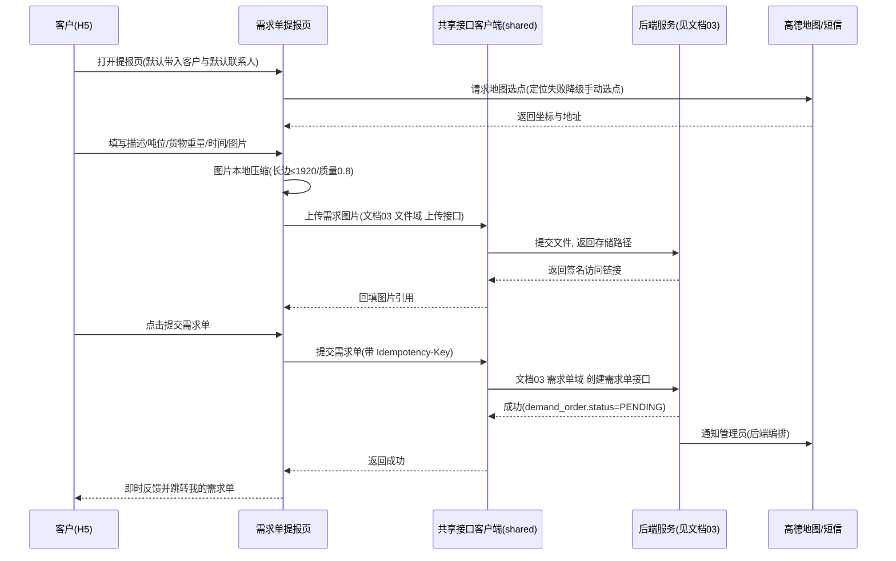
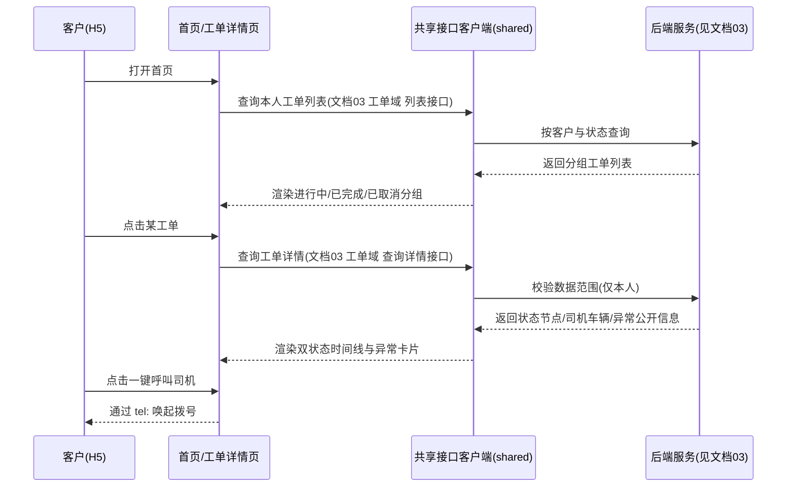
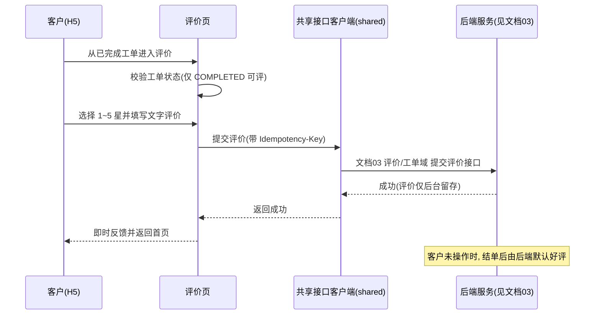

# 济南诚重吊装业务管理系统 — 移动端 H5 访问端设计文档

| 项 | 内容 |
|---|---|
| 文档编号 | 04 |
| 版本 | v1.0 |
| 状态 | 待评审 |
| 上游文档 | 《济南诚重吊装业务管理系统产品需求文档》v5.4、文档 01《总体技术架构设计（HLD）》v1.0 |
| 适用对象 | 前端工程师 |
| 下游文档 | 09 AI Agent 任务包 |
| 定位 | 客户端（普通用户 / 客户）通过手机浏览器访问的 H5 通道；与统一多角色小程序共用 `apps/mobile` 一套 uni-app 源码、同源复用。本文只描述 H5 通道的差异点与页面设计，小程序通道见文档 05 |
| 接口依赖 | 全部后端接口契约见文档 03《接口设计规范》，本文只引用其接口名称与编号，不自造任何后端路径 |

---

## 1 设计概述

### 1.1 目的与范围

本文把 PRD 第 3.4 节「客户端功能」与第十章「UI / 交互规范」翻译为 H5 通道可直接落地的页面与路由设计，回答「客户端在手机浏览器里呈现哪些页面、走哪些路由、各页面承载什么功能、与小程序通道差在哪里」。

本文覆盖：

- H5 通道的登录、定位、图片上传、消息触达四类平台差异处理
- 客户端角色的路由与页面清单、页面结构与信息边界
- 需求单提报、工单进度查看、评价提交三条关键交互的时序
- 户外可用性（响应式与强光）与 H5 合规授权（位置 / 手机号 / 照片授权、隐私政策与用户协议、账号注销）

明确不覆盖（由上游或下游承接）：

- 后端接口的请求 / 响应报文与错误码全集 → 文档 03
- 统一多角色小程序的页面与路由 → 文档 05
- 后台管理、司机端页面 → 文档 07、05
- 可直接投喂代码生成 Agent 的子任务提示词 → 文档 09

### 1.2 上游需求追溯

| 设计目标 | 追溯来源 | 证据 |
|---|---|---|
| H5 与小程序同源复用，一套源码多端编译 | 01 §4.1、§4.3 | [Data-backed：01 本次决策] |
| 客户端可自主提报需求单，管理员审核后转工单 | PRD 3.4.0、4.1 | [Data-backed] |
| 客户端全程可视化：工单状态、司机信息、异常公开 | PRD 3.4.1、3.4.2、3.4.3 | [Data-backed] |
| 完工自动通知（微信订阅 + 短信双通道） | PRD 3.4.4、3.4.5 | [Data-backed] |
| 任务评价 1~5 星，支持默认好评，仅后台留存参考 | PRD 3.4.6 | [Data-backed] |
| 个人中心自助维护资料与联系人 | PRD 3.4.7 | [Data-backed] |
| 多工单并行展示，进行中工单突出 | PRD 3.4.8、10.2 | [Data-backed] |
| 敏感信息（位置 / 手机号 / 照片）采集前告知授权 | PRD 5.6 | [Data-backed] |
| 隐私政策与用户协议入口、账号注销入口 | PRD 5.6 | [Data-backed] |
| 极简 UI、图标替代 Emoji、图标 + 颜色 + 文字三重表达状态 | PRD 10.3 | [Data-backed] |
| 客户 / 司机端共用同一套图标与图框规范 | PRD 10.3 | [Data-backed] |

### 1.3 通道定位与同源复用方案

H5 通道面向「普通用户 / 客户」角色（角色枚举 `CUSTOMER`，见 01 §6.3），是客户在**手机浏览器**中「提报需求、看状态、看异常、维护资料、评价」的入口；与统一多角色小程序共用 `apps/mobile` 同一份 uni-app 源码 [Data-backed：01 §4.1]。

同源复用方式：

| 复用项 | 说明 | 证据 |
|---|---|---|
| 页面与组件 | H5 与小程序共用页面骨架、卡片 / 图框组件与交互逻辑，平台差异以条件编译隔离 | [Data-backed：01 §4.1] |
| 接口客户端 | 复用 `packages/shared` 的统一接口封装（baseURL、鉴权头、统一响应解包、错误提示、重试） | [Data-backed：01 §4.2] |
| 类型与枚举 | 复用 `packages/shared` 的实体类型与枚举字典，与 01 §6.3 字面一致 | [Data-backed：01 §4.2、§6.3] |
| 权限位 | 复用共享权限码，路由与按钮级判定一致 | [Data-backed：01 §4.2] |
| SVG 图标 | 复用统一 24×24 描边风格内联 sprite，图标继承容器尺寸与颜色，无外部 CDN / 字体 / 图片依赖 | [Data-backed：01 §4.2、PRD 10.3] |
| 主题令牌 | 复用色彩语义（户外强光高对比）、间距、字号令牌 | [Data-backed：01 §4.2] |

平台差异通过 `#ifdef H5` / `#ifdef MP-WEIXIN` 条件编译隔离，微信能力（授权登录、订阅消息、定位、图片上传）封装为跨端适配层，H5 侧以微信网页授权或手机号验证码登录，并调用浏览器定位能力 [Data-backed：01 §4.1]。多端标识：H5 请求统一携带 `X-Client: h5`（见 01 §5）[Data-backed]。

---

## 2 H5 与小程序差异点处理

四类差异点是同源复用中必须通过条件编译或适配层隔离的部分，均不改变上层页面的业务逻辑。

### 2.1 差异点一 登录方式

| 维度 | 小程序通道（见文档 05） | H5 通道（本文） |
|---|---|---|
| 主登录 | 微信授权一键登录（`wx.login` + 授权） | 微信内浏览器：微信网页授权登录；外部浏览器：手机号 + 短信验证码登录 |
| 绑定手机号 | 微信授权后绑定预留手机号 | 同左，登录后校验 / 绑定预留手机号 |
| 登录态 | JWT 无状态令牌，登录态有有效期，过期需重新授权；强制下线经用户时间戳校验 | 同左 |

处理约定：

- 客户端账号由管理员创建并录入预留手机号，微信授权后与预留手机号绑定核对 [Data-backed：PRD 结论 8]。接口见文档 03《认证》域的「微信授权登录」「手机号绑定」「登出」接口。
- H5 在微信内置浏览器中优先走微信网页授权；非微信浏览器降级为手机号验证码登录，验证码有效期与发送频次沿用文档 03《认证》约定 [Expert judgment]。
- 令牌存放采用浏览器可用的安全存储策略（HttpOnly Cookie 或内存 + 刷新令牌），避免长期明文暴露 [Expert judgment，具体方案见文档 03]。
- 登录态失效统一跳转登录页，登录页为 H5 通道唯一无权限要求的路由。

### 2.2 差异点二 定位能力

客户端仅需在需求单提报时完成「施工地址选点」，不涉及司机端的到场签到距离校验。

| 场景 | 主用能力 | 降级策略 |
|---|---|---|
| 微信内置浏览器 | 微信 JS-SDK 定位 | 浏览器 Geolocation API |
| 外部浏览器 | 浏览器 Geolocation API（`navigator.geolocation`） | 地图手动选点 / 手动输入地址 |

处理约定：

- 定位结果仅用于「施工地址」的地图选点与地址回填，坐标与地址文本一并提交；地址文本为用户可编辑项 [Expert judgment]。
- 用户拒绝定位授权或定位超时时，不阻断提报，自动落到「地图手动选点」或「手动输入地址」，并给出明确提示（承接 PRD 5.6 拒绝授权的降级处理要求）[Data-backed：PRD 5.6]。
- 定位与地图服务由高德地图 Web API 承担（01 §2.5），H5 侧经适配层调用，不直接耦合具体 SDK [Data-backed]。

### 2.3 差异点三 图片上传与压缩

| 维度 | 处理方式 |
|---|---|
| 选图 | H5 使用浏览器文件选择（`input[type=file]`，`accept="image/*"`，支持 `capture` 调起相机），uni-app 侧统一封装为 `chooseImage` 适配 |
| 压缩 | 客户端选图后统一压缩：长边 ≤ 1920px、质量 0.8、单张 ≤ 2MB，超出再压，防止弱网上传超时 |
| 张数 | 需求图片数量不限张数 [Data-backed：PRD 结论 5] |
| 上传 | 走文档 03《文件》域的上传接口，取得存储路径；展示时不使用公开 URL，统一以有效期内的签名链接访问 [Data-backed：PRD 5.6] |
| 容错 | 单张失败可重传，不因单张失败中断整体提报；弱网给出「重试」入口，避免白屏 [Data-backed：PRD 10.1] |

### 2.4 差异点四 消息触达

H5 通道不具备微信订阅消息能力，因此触达链路调整如下：

| 通道 | 小程序 | H5 |
|---|---|---|
| 微信订阅消息 | 可用 | 不可用（仅微信内网页授权，无订阅消息） |
| 短信 | 可用（补充） | 关键节点主用，受每日 / 每月上限控制 |
| 站内消息 | 可用 | 主用，H5 内提供消息中心页面 |

处理约定：

- H5 关键节点（派单完成、司机到场、异常批复、完工结单、工单取消、需求单驳回 / 关闭）以**短信 + 站内消息**双通道触达；短信按模板 / 场景设上限，超限转站内并记录（承接 PRD 3.4.5）[Data-backed]。
- 站内消息中心承载全部通知的记录与已读状态，H5 与小程序共用同一份消息数据 [Expert judgment]。
- 消息内容与通知节点口径完全一致（PRD 3.4.5 通知规则表），H5 不新增业务节点 [Data-backed]。
- 触达编排由后端通知域完成，前端只负责展示与已读回执；发送失败重试与去重由后端承担（01 §8）[Data-backed]。

---

## 3 路由与页面清单

路由仅描述前端路由（uni-app 页面路径），不含后端接口路径。接口一律以「见文档 03 <域> <接口名>」引用。角色枚举与状态枚举沿用 01 §6.3 字面量。权限码为前端路由 / 按钮级权限位，命名与共享层权限位一致，具体值以文档 03 与后端权限位为准 [Expert judgment，权限码取值待确认]。

| 路由 path | 页面名 | 允许角色 | 权限码 | 功能要点 |
|---|---|---|---|---|
| `pages/login/index` | 登录 | 公开（未登录） | 无（公共路由） | 微信网页授权登录 / 手机号验证码登录；首次启动确认隐私政策与用户协议 |
| `pages/home/index` | 首页 · 多工单并行 | `CUSTOMER` | `customer:order:view` | 进行中工单突出（高亮 + 迷你进度），已完成 / 已取消分组；需求单提报入口 |
| `pages/workorder/detail` | 工单详情 | `CUSTOMER` | `customer:order:view` | 双状态时间线、司机与车辆信息、一键呼叫、异常公开卡片、评价入口 |
| `pages/demand/create` | 需求单提报 | `CUSTOMER` | `customer:demand:create` | 地址选点、需求描述、吨位、货物重量、期望时间、联系电话、需求图片、提交 |
| `pages/demand/list` | 我的需求单 | `CUSTOMER` | `customer:demand:view` | 需求单处理进度（`PENDING` / `CONVERTED` / `REJECTED`）与暂存倒计时、驳回原因 |
| `pages/review/create` | 任务评价 | `CUSTOMER` | `customer:order:review` | 1~5 星评分 + 文字评价；评价仅后台留存，未评价默认好评 |
| `pages/message/list` | 消息通知 | `CUSTOMER` | `customer:message:view` | 站内通知列表，按节点类型区分图标与状态，未读标记 |
| `pages/mine/index` | 个人中心 | `CUSTOMER` | `customer:profile:view` | 客户基础信息、历史需求 / 成交 / 累计评分统计、功能入口 |
| `pages/mine/profile` | 本人资料 | `CUSTOMER` | `customer:profile:manage` | 企业 / 个人信息查看与可编辑项维护 |
| `pages/mine/contacts` | 联系人维护 | `CUSTOMER` | `customer:profile:manage` | 联系人新增 / 编辑 / 删除、默认联系人设置 |
| `pages/legal/privacy` | 隐私政策 | 公开 | 无（公共路由） | 隐私政策全文与授权范围说明 |
| `pages/legal/agreement` | 用户协议 | 公开 | 无（公共路由） | 用户协议全文 |
| `pages/legal/cancel-account` | 账号注销 | `CUSTOMER` | `customer:profile:manage` | 账号注销入口与二次确认，说明注销后数据留存口径 |

> 页面数量：13 个（其中 4 个为登录与合规范畴的辅助 / 公共页面）。Tabbar 四个主入口对应首页、需求、消息、我的 [Data-backed：原型]。

状态枚举展示映射（与 01 §6.3 字面一致）：

| 前端展示语义 | 对应枚举 | 来源字典 |
|---|---|---|
| 已派单 | `PENDING_ACCEPT` 展示态 | `work_order.status` |
| 已接单 | `PENDING_ARRIVE` 展示态 | `work_order.status` |
| 任务开始执行 | `IN_PROGRESS` | `work_order.status` |
| 任务暂停 / 推迟 / 终止 | `SUSPENDED`（施工受阻） | `work_order.status` |
| 任务已完成 | `COMPLETED` | `work_order.status` |
| 工单已取消 | `CANCELLED` | `work_order.status` |
| 待处理 | `PENDING` | `demand_order.status` |
| 已转工单 | `CONVERTED` | `demand_order.status` |
| 已驳回 | `REJECTED` | `demand_order.status` |
| 已关闭 | `CLOSED` | `demand_order.status` |

---

## 4 页面结构说明

所有页面遵循 PRD 10.3 极简 UI 与图标规范：卡片 / 图框承载信息、统一矢量图标替代 Emoji、状态用「图标 + 颜色 + 文字」三重表达。图标取自共享 `packages/shared` 的统一 24×24 描边内联 sprite（图标清单见文档 05），下表只引用其 symbol id，图标继承容器尺寸与颜色，无外部 CDN / 字体 / 图片依赖 [Data-backed]。

### 4.1 需求单提报 `pages/demand/create`

结构自上而下：顶部告知卡片（提交后进入 `PENDING`、管理员复核全部内容后转工单、超期自动关闭的说明）→ 施工地址（地图选点，图标 `ic-pin`）→ 需求描述（多行文本）→ 意向吊车吨位（25t / 50t / 80t / 其他 单选）→ 被吊装货物重量（数字输入，标注为管理员复核项）→ 期望施工时间（日期时间选择，图标 `ic-clock`）→ 联系电话（默认带入默认联系人）→ 需求图片（不限张数，含已选缩略图与新增占位，图标 `ic-file`）→ 提交主按钮。

要点：

- 默认带入客户档案与默认联系人信息 [Data-backed：PRD 3.4.0]。
- 提交前校验必填项（地址、描述、吨位、货物重量、时间、联系电话），缺项就地提示 [Expert judgment]。
- 提交成功即时反馈并跳转「我的需求单」；提交后由后端通知管理员（前端不负责通知编排）[Data-backed：PRD 3.4.0]。
- 写接口携带 `Idempotency-Key`，防止重复提交（见 01 §8）[Data-backed]。

### 4.2 工单状态与异常查看 `pages/workorder/detail`

结构：工单标题 + 当前状态胶囊 → 工单编号与预计开始时间 → 双状态时间线（已派单 / 已接单 / 任务开始执行 / 任务已完成，节点图标 `ic-dot`、`ic-check`）→ 执行司机与车辆卡片 → 异常公开卡片（图标 `ic-alert`，异常类型 + 原因说明，含司机自定义原因）→ 温馨说明。

要点：

- 时间线节点逐个点亮，当前节点以高亮环强调，未到节点置灰 [Data-backed：原型]。
- 异常公开卡片展示异常类型与原因，覆盖下雨、甲方停工、车辆故障、任务推迟、任务结束 / 终止，并展示当前处置状态（如「已恢复施工」）[Data-backed：PRD 3.4.3]。
- 客户视角不含司机签到 / 签退照片等内部留存信息（信息边界见 4.3）[Data-backed：PRD 3.4.2]。
- 数据来源：见文档 03《工单》域的「查询详情」接口与《打卡工时》「工时查询」接口。

### 4.3 司机信息公开 `pages/workorder/detail`（内嵌区块）

结构：司机头像（首字母）+ 姓名 + 资质摘要 → 「一键呼叫司机」按钮（`ic-phone`）与「联系客服」按钮（`ic-headset`）→ 键值对信息（执行车辆、吊装货物、施工地点）。

信息边界表：

| 客户可见 | 客户不可见 |
|---|---|
| 司机姓名、司机联系方式（一键呼叫） | 司机签到 / 签退照片 |
| 执行车辆车牌号、吊车吨位 | 施工过程细节照片 |
| 吊装货物与重量、（已复核）标记 | 内部管理留存的其它打卡信息 |
| 施工地点、预计开始时间 | — |

要点：派单完成后司机与车辆信息方对客户公开 [Data-backed：PRD 3.4.1、3.4.2]。一键呼叫在 H5 中通过 `tel:` 唤起拨号（H5 能力），小程序差异在文档 05 说明 [Expert judgment]。

### 4.4 消息通知 `pages/message/list`

结构：按时间倒序的通知列表，每条 = 类型图标（派单 `ic-truck`、到场 `ic-person`、异常 `ic-alert`、完工 `ic-check-circle`）+ 标题 + 摘要 + 通道标签（短信 / 站内）+ 时间。

要点：

- 通道标签在 H5 显示「短信 + 站内」，与小程序「微信订阅 + 短信」不同（差异点四）[Expert judgment]。
- 未读消息以角标 / 圆点标注，进入详情或列表即回执已读 [Expert judgment]。
- 通知节点与内容严格对齐 PRD 3.4.5，H5 不新增节点 [Data-backed]。
- 数据来源：见文档 03《通知》域的「通知记录列表」与「标记已读」接口。

### 4.5 评价打分 `pages/review/create`

结构：工单信息头（工单名、编号、完工日期、司机）→ 五星划星评分（图标 `ic-star`，选中填充、未选描边）→ 评分语义提示（非常不满意 / 不满意 / 一般 / 满意 / 非常满意）→ 文字评价（选填）→ 提交按钮 → 「未评价将在结单后默认好评」说明。

要点：

- 评分 1~5 星，支持文字评价 [Data-backed：PRD 3.4.6]。
- 评分仅在后台记录留存，不作为绩效直接评定依据，仅作管理员人工参考 [Data-backed：PRD 3.4.6]。
- 未操作时默认好评，展示提示但不由前端触发默认值写入（默认好评由后端判定）[Data-backed：PRD 3.4.6、01 §6.4]。
- 评价入口仅对 `COMPLETED` 状态工单开放，二次提交以幂等键去重 [Expert judgment]。

### 4.6 本人资料与联系人维护 `pages/mine/profile`、`pages/mine/contacts`

结构（个人中心）：客户信息头（企业名、客户类型、行业、状态、账号编号）→ 三项统计（历史需求 / 成交工单 / 累计评分）→ 联系人区块 → 功能菜单（企业资料、我的需求单、我的评价、账号注销）。

结构（联系人维护）：联系人列表（头像首字母、姓名、角色、电话、微信）→ 默认联系人标记 → 编辑 / 删除 → 新增联系人按钮。

要点：

- 联系方式支持客户端自助维护 [Data-backed：PRD 3.4.7]。
- 默认联系人用于需求单提报时自动带入联系电话 [Data-backed：PRD 3.4.0]。
- 客户类型、所属行业、合作状态等由管理员后台维护，客户端只读 [Expert judgment]。
- 联系人数据来源：见文档 03《客户》域的「联系人列表」「联系人新增 / 编辑 / 删除」接口。

### 4.7 多工单并行展示 `pages/home/index`

结构：客户信息头（企业名、客户编号、进行中任务数）→ 「进行中」分组（进行中工单橙色高亮 `wcard.hot`，附迷你进度条与司机 / 车辆 / 到场时间）→ 「已完成」分组（含「去评价」入口）→ 「已取消」分组（置灰）→ 悬浮「提需求」按钮（图标为内联 SVG 的加号，不用 Emoji）。

要点：

- 按 `work_order.status` 分组：进行中（`IN_PROGRESS`、`PENDING_ACCEPT`、`PENDING_ARRIVE`、`SUSPENDED`）、已完成（`COMPLETED`）、已取消（`CANCELLED`）[Data-backed：PRD 3.4.8]。
- 进行中工单突出显示当前进度，多个工单互不干扰 [Data-backed：PRD 3.4.8、10.2]。
- 支持按时间 / 状态筛选与切换查看 [Data-backed：PRD 3.4.8]。
- 迷你进度条按工单状态节点映射点亮（派单 / 接单 / 到场 / 进行 / 完成），异常节点以警示色标记 [Expert judgment]。

---

## 5 关键交互时序图

时序图中的「后端服务」为 01 所述 Spring Boot 分层单体，接口调用统一以「文档 03 <域> <接口名>」指代，不含具体后端路径。

### 5.1 需求单提报

走查：客户端在提报页完成选点与填写，图片经前端压缩后走文件上传接口换取签名链接；提交需求单接口成功后进入 `PENDING` 态，通知管理员由后端通知域发起，前端不做通知编排。定位失败时页面降级为手动选点，不阻断提报。

### 5.2 工单进度查看

走查：首页按状态分组渲染多工单，进入详情后由后端校验数据范围（客户仅能查看与本人关联的工单），返回司机与车辆公开信息、双状态时间线与异常公开信息；司机签到 / 签退照片不进入响应，客户不可见。

### 5.3 评价提交

走查：评价入口仅对 `COMPLETED` 工单开放，前端先做状态校验；提交后评价仅在后端记录留存供管理员人工参考，默认好评由后端在结单时判定，前端不代写默认值。

---

## 6 响应式与户外可用性

客户端虽以室内查看为主，但仍可能在现场使用（强光、弱网），沿用 PRD 10.1 与 10.3 的可用性基线 [Data-backed]。

| 维度 | 设计要求 |
|---|---|
| 布局 | 移动优先，单列卡片流；适配主流手机宽度（375~430px），安全区（刘海 / 底部手势条）留白 |
| 字号与对比 | 关键信息大字号加粗，文字与背景对比度充足，强光下可读 [Data-backed：PRD 10.1] |
| 色彩语义 | 状态色统一：进行中 / 已派单=橙，异常=警示色，已完成=绿；不使用低对比柔和色 [Data-backed：PRD 10.1] |
| 触控 | 核心按钮热区高度不低于 44px，主操作按钮放大，减少误触 [Data-backed：PRD 10.1] |
| 单手可达 | 主操作位于拇指易触区，Tabbar 与提报悬浮按钮置于底部 [Data-backed：PRD 10.1] |
| 弱网容错 | 弱网下明确加载 / 失败提示并支持重试，避免白屏；上传支持单张重传 [Data-backed：PRD 10.1] |
| 图标 | 统一 24×24 描边 sprite，继承容器尺寸与颜色，禁用 Emoji，状态「图标 + 颜色 + 文字」三重表达 [Data-backed：PRD 10.3] |
| 反馈 | 关键操作二次确认（取消、注销），所有操作给出成功 / 失败 / 加载中即时反馈 [Data-backed：PRD 10.4] |

---

## 7 H5 合规与授权

承接 PRD 5.6 小程序合规与数据安全要求，H5 通道同样落实下列要求 [Data-backed]。

### 7.1 敏感信息采集告知与授权

| 敏感信息 | 采集场景 | 采集前告知 | 拒绝后的降级 |
|---|---|---|---|
| 位置信息 | 需求单提报地图选点 | 明确告知用途为施工地址选点 | 地图手动选点 / 手动输入地址，不阻断提报 |
| 手机号 | 登录、需求单联系电话 | 明确告知用于登录校验与任务联系 | 走微信网页授权登录路径；联系电话可手动填写默认联系人 |
| 照片 | 需求图片上传 | 明确告知用于需求说明，且为私有资源 | 可不传图片，其余字段照常提交 |

拒绝授权时一律给出明确提示而非静默失败 [Data-backed：PRD 5.6]。

### 7.2 隐私政策与用户协议

- 提供 `pages/legal/privacy` 与 `pages/legal/agreement` 两个公共入口，首次启动需用户确认同意 [Data-backed：PRD 5.6]。
- 登录页与个人中心均提供入口，保证随时可达 [Expert judgment]。

### 7.3 账号注销

- 提供 `pages/legal/cancel-account` 账号注销入口，二次确认后提交 [Data-backed：PRD 5.6]。
- 明确说明注销后按合规要求处理或留存必要业务数据（如已生成的工单、评价与操作日志按审计要求留存）[Data-backed：PRD 5.6、5.6 数据留存条款]。

### 7.4 传输与资源访问

- 对外服务启用 HTTPS；私有资源（需求图片等）前端通过有效期内的签名链接访问，禁止直接公开 URL [Data-backed：PRD 5.6、01 §7]。

---

## 8 待确认清单

| 编号 | 事项 | 状态 |
|---|---|---|
| H5-C-01 | 前端路由路径的最终命名规范（是否统一 `pages/` 前缀与目录层级） | 待确认 |
| H5-C-02 | 前端权限码的最终取值与命名（本文权限码为 [Expert judgment] 拟定） | 待确认 |
| H5-C-03 | H5 令牌存储方案（HttpOnly Cookie 与内存 + 刷新令牌的取舍） | 待确认 |
| H5-C-04 | 微信内浏览器网页授权与外部浏览器验证码登录的具体切换判定规则 | 待确认 |
| H5-C-05 | 地图服务在 H5 侧的调用方式（微信 JS-SDK 与高德 Web API 的优先级） | 待确认 |
| H5-C-06 | 图片压缩参数（长边 1920px / 质量 0.8 / 单张 2MB）与需求的最终取值 | 待确认 |
| H5-C-07 | 需求单暂存天数（原型示例为 10 天）与超期关闭规则的最终口径 | 待确认 |
| H5-C-08 | 迷你进度条与状态节点映射的最终节点顺序 | 待确认 |
| H5-C-09 | H5 是否与小程序共用域名与备案主体 | 待确认 |
| H5-C-10 | 短信模板与每日 / 每月上限对 H5 通道的适用口径 | 待确认 |
