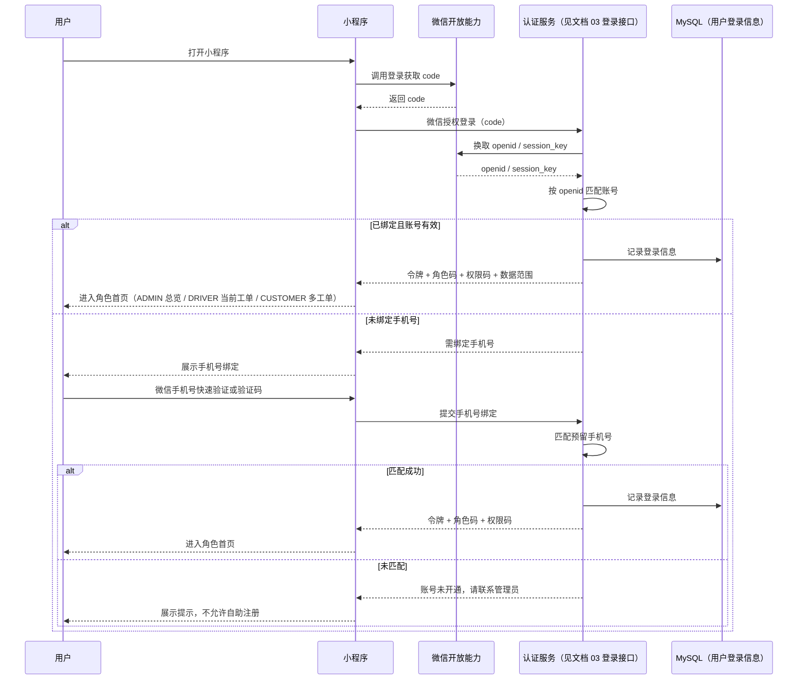
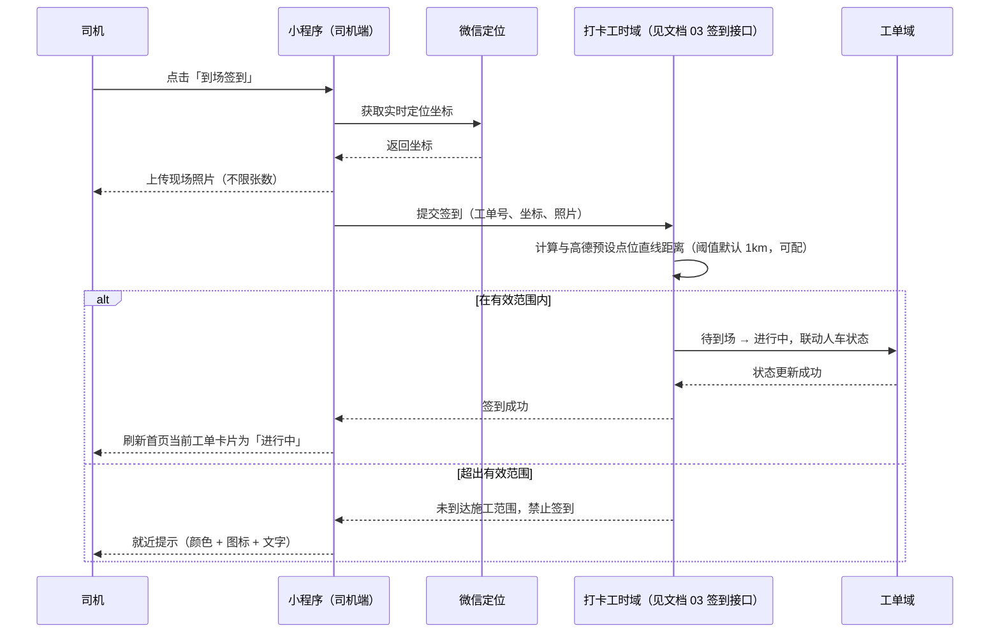
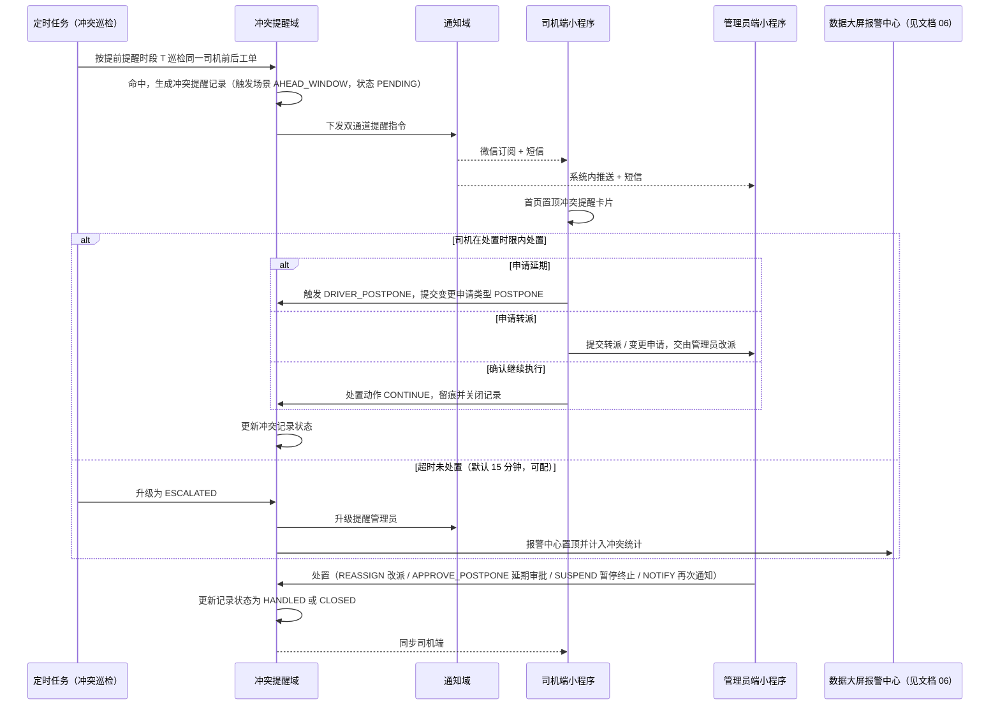

# 济南诚重吊装业务管理系统 — 统一多角色小程序设计文档

| 项 | 内容 |
|---|---|
| 文档编号 | 05 |
| 版本 | v1.0 |
| 状态 | 待评审 |
| 上游文档 | 《济南诚重吊装业务管理系统产品需求文档》v5.4（以下简称 PRD）；《01 总体技术架构设计（HLD）》v1.0（以下简称 01） |
| 适用对象 | 前端工程师、后端工程师 |
| 下游文档 | 09 AI Agent 任务包（小程序侧路由、权限码与页面清单作为代码生成输入） |

---

## 1 设计概述

### 1.1 目的与范围

本文定义统一多角色微信小程序的角色权限体系、登录与账号绑定、前端路由与页面清单、各角色功能边界与关键交互时序。它处在 01 §4「前端架构与共享层」与源码之间，回答「小程序侧有哪些页面、谁能进、谁能点、点完走哪条链路」。

覆盖范围

- 三角色（CUSTOMER、DRIVER、ADMIN）在小程序内的页面级与按钮级权限码
- 登录链路（微信授权一键登录 + 手机号绑定）与未开通账号的提示
- 前端路由清单（driver / admin / customer / common 四组）与功能要点
- 司机端「首页即当前工单」的操作化交互、冲突提醒卡片的置顶与处置
- 管理员移动端的全局监控、批复、拒单处理、超时告警、冲突处置
- 客户端的需求单提报、多工单并行、进度可视化与评价
- 消息订阅与双通道通知、合规（隐私政策 / 用户协议 / 账号注销）

明确不覆盖（由上下游文档承接）

- 后端接口报文、错误码全集 → 见文档 03（接口设计规范）
- H5 访问端差异 → 见文档 04（H5 访问端设计）
- PC 后台管理系统的页面与菜单 → 见文档 07（后台管理系统设计）
- 数据大屏与报警中心置顶 → 见文档 06（数据大屏设计）
- 表结构与数据字典 → 见文档 02（数据库设计）
- 部署、域名与备案配置 → 见文档 08（部署与环境设计）

> 本文档只描述**前端路由 path**，不定义后端接口路径；凡涉及后端契约，一律以「见文档 03 的接口编号 / 名称」引用。[Expert judgment]

### 1.2 文档定位与形态

小程序为**单套代码承载三角色**：由 `apps/mobile`（uni-app，Vue 3 语法）编译产出，与 H5 同源复用，平台差异通过 `#ifdef` 条件编译隔离 [Data-backed：01 §4.1]。角色由登录后返回的 `sys_role.code` 决定，前端据此加载对应路由表与权限码，登录页之后的首页按角色分流 [Data-backed：PRD 1.2]。

管理员与总监合并为统一管理员权限：`ADMIN` 一个角色码同时覆盖原「管理员」与「总监」职责，不设独立可见标识 [Data-backed：PRD 1.2、3.1.9]。

### 1.3 上游需求追溯

| 设计目标 | 追溯来源 | 证据 |
|---|---|---|
| 单套小程序承载三角色，按角色自动区分功能 | PRD 1.2 角色架构 | [Data-backed] |
| 管理员与总监合并为统一 ADMIN，功能完全一致 | PRD 1.2、3.1.9 权限矩阵、01 §6.3 | [Data-backed] |
| 微信授权一键登录 + 绑定预留手机号 | PRD 3.1.8 登录方式 | [Data-backed] |
| 司机端首页即当前工单，核心动作按钮化 | PRD 3.2 交互总纲、10.1、10.3 | [Data-backed] |
| 接单 / 拒单为司机端流程起点 | PRD 3.2.14 | [Data-backed] |
| 工单变更申请由司机发起、管理员审批 | PRD 3.2.13 | [Data-backed] |
| 双节点签退（今日任务完成 / 任务结束）与车辆去向二次确认 | PRD 3.2.6、3.2.9、第十一章 | [Data-backed] |
| 司机工单互斥冲突提醒卡片与三类处置入口 | PRD 3.2 交互总纲、4.18、01 §2.4 | [Data-backed] |
| 管理员移动端全局监控、批复、拒单处理、超时告警 | PRD 3.3、3.1.10 | [Data-backed] |
| 客户提报需求单、多工单并行、进度可视化、评价 | PRD 3.4.0、3.4.1、3.4.6、3.4.8 | [Data-backed] |
| 微信订阅消息 + 短信双通道通知与降级 | PRD 3.4.5、4.6、01 §2.5 | [Data-backed] |
| 隐私政策 / 用户协议 / 账号注销等合规 | PRD 5.6、01 §7 | [Data-backed] |
| 统一 24×24 描边内联 SVG 图标、禁用 Emoji | PRD 10.3、01 §4.2 | [Data-backed] |

### 1.4 设计目标与约束

- 单套源码多角色复用，角色差异集中在「路由表 + 权限码 + 数据范围」三处配置，页面组件尽量复用 [Expert judgment]
- 司机端在户外强光下单手可达、防误触：核心动作按钮高度不低于 60px [Data-backed：PRD 10.1]
- 界面极简、以图标 + 图框承载信息，禁用 Emoji [Data-backed：PRD 10.3]
- 图标统一为 24×24 描边内联 SVG sprite，继承容器尺寸与颜色，禁止外部 CDN、字体与图片引用 [Data-backed：01 §4.2、PRD 10.3]
- 冲突校验**不改变工单既有状态机**，仅新增校验与提醒，对主流程零侵入 [Data-backed：PRD 4.18.5]
- 关于智能分析的表述在界面与文档中统一使用通用词「AI」，不出现具体品牌名 [Data-backed：项目硬约束]
- 本文所有版本号在开工前以实际锁定版本回填，未确认前不作为代码生成输入 [Expert judgment]

### 1.5 设计基调：实用、克制、效率优先

本文的视觉与交互规范统一引用文档 11《前端设计手册》作为唯一基准，不另设第二套规范 [Data-backed：11 §1]。落实到小程序端的关键判断：

- **信息为先**：一屏只承担一个主任务。司机端首页即当前工单，冲突提醒卡片置顶于工单卡上方，不插任何装饰性内容 [Data-backed：PRD 3.2.13、4.18]
- **操作直达**：签到、签退、异常上报、冲突处置等高频动作首页直达，关键路径 2 次点击内完成，参考开元业务软件平台「效率优先、减少干扰」的设计经验 [Expert judgment]
- **色彩克制**：只使用 11 §2.2 语义色，同一时间同一屏彩色元素不超过 5 个；状态一律「图标 + 颜色 + 文字」三重表达 [Data-backed：11 §2.2、PRD 10.3]
- **户外可用**：对比度 ≥ 7:1、核心按钮高度 ≥ 44px、单手可达（见 11 §5.1）[Data-backed：PRD 10.1]

### 1.6 术语表

| 术语 | 含义 |
|---|---|
| 角色码 | `sys_role.code`，取值 `ADMIN` / `DRIVER` / `CUSTOMER` |
| 权限码 | 页面级 `page:<role>:<page>` 与按钮级 `btn:<resource>:<action>` 的统一标识 |
| 数据范围 | 账号可见数据的边界：`ALL` 全量、`SELF` 本人、`SELF_RELATED` 本人关联 |
| 当前工单 | 司机首页默认展示的「最近待执行工单」，无则为空态 |
| 冲突提醒卡片 | 司机首页当前工单卡片上方置顶的互斥冲突提示与处置入口 |
| 双节点签退 | 「今日任务完成」（不结单）与「任务结束」（自动结单）两个独立节点 |
| 双通道 | 微信订阅消息 + 短信，任一失败可降级回退 |

---

## 2 角色与权限体系

### 2.1 角色枚举

严格采用 01 §6.3 锁定字面量，前端 `packages/shared` 与后端 Java 枚举、数据库字典三处一致 [Data-backed：01 §6.3]。

| 角色码 | 中文名 | 小程序端定位 | 数据范围 |
|---|---|---|---|
| `ADMIN` | 管理员 | 全局监控、审批、派单与处置（含原总监职责） | `ALL` |
| `DRIVER` | 司机（员工） | 执行层：接拒单、签到签退、异常、变更申请、车辆自助 | `SELF` |
| `CUSTOMER` | 客户（普通用户） | 提报需求、查看进度、评价、维护资料与联系人 | `SELF_RELATED` |

> 总监不设独立角色码与独立标识，其功能权限与 `ADMIN` 完全一致，共用同一数据驾驶舱 [Data-backed：PRD 1.2、3.3]。

### 2.2 权限码清单

采用「页面级 + 按钮级」两层权限码，编码规则

- 页面级：`page:<role>:<page>`，控制路由能否进入
- 按钮级：`btn:<resource>:<action>`，控制按钮能否渲染与触发

前端权限码由共享层 `packages/shared` 单点定义，登录接口随令牌一并下发（见文档 03 的登录接口），前端做「渲染前校验」，后端做「执行时校验」双重把关 [Expert judgment]。前端管控仅为体验优化，最终越权拦截由后端数据范围校验承担 [Expert judgment]。

#### 2.2.1 页面级权限码

| 权限码 | 页面 |
|---|---|
| `page:common:login` | 登录授权 |
| `page:common:bind-phone` | 手机号绑定 |
| `page:common:agreement` | 隐私政策 / 用户协议 |
| `page:common:cancel` | 账号注销 |
| `page:driver:home` | 司机首页（当前工单） |
| `page:driver:order-list` | 任务与工单管理 |
| `page:driver:order-detail` | 工单详情 |
| `page:driver:checkin` | 到场签到 |
| `page:driver:checkout` | 签退（今日任务完成 / 任务结束） |
| `page:driver:vehicle-move` | 车辆去向确认 |
| `page:driver:exception` | 异常上报 |
| `page:driver:change-apply` | 工单变更申请 |
| `page:driver:conflict` | 冲突提醒处置 |
| `page:driver:vehicle` | 车辆状态自助管理 |
| `page:driver:workhours` | 工时明细 |
| `page:driver:overtime` | 加班记录 |
| `page:driver:message` | 消息通知 |
| `page:driver:mine` | 个人中心 |
| `page:admin:dashboard` | 全局监控总览 |
| `page:admin:order-list` | 工单列表 |
| `page:admin:order-detail` | 工单详情与批复 |
| `page:admin:demand-list` | 需求单列表 |
| `page:admin:demand-detail` | 需求单处理 |
| `page:admin:approval` | 待审批中心 |
| `page:admin:reject-queue` | 拒单处理队列 |
| `page:admin:dispatch` | 派单 / 重新派单 |
| `page:admin:conflict-list` | 冲突提醒中心 |
| `page:admin:conflict-detail` | 冲突处置 |
| `page:admin:alarm` | 超时告警 |
| `page:admin:resource-monitor` | 人员与车辆在岗监控 |
| `page:admin:briefing` | AI 简报与人效 |
| `page:admin:message` | 消息通知 |
| `page:admin:mine` | 个人中心 |
| `page:customer:home` | 客户首页（多工单并行） |
| `page:customer:demand-form` | 需求单提报 |
| `page:customer:demand-list` | 我的需求单 |
| `page:customer:order-detail` | 工单状态详情 |
| `page:customer:review` | 任务评价 |
| `page:customer:contacts` | 联系人维护 |
| `page:customer:message` | 消息通知 |
| `page:customer:mine` | 个人中心 |

#### 2.2.2 按钮级权限码

| 权限码 | 承载按钮 | 允许角色 |
|---|---|---|
| `btn:order:accept` | 接单 | DRIVER |
| `btn:order:reject` | 拒单 | DRIVER |
| `btn:attendance:checkin` | 到场签到 | DRIVER |
| `btn:attendance:daily-checkout` | 今日任务完成 | DRIVER |
| `btn:attendance:task-end` | 任务结束 | DRIVER |
| `btn:exception:report` | 异常上报 | DRIVER |
| `btn:change:apply` | 工单变更申请 | DRIVER |
| `btn:conflict:apply-postpone` | 申请延期（冲突处置） | DRIVER |
| `btn:conflict:apply-transfer` | 申请转派（冲突处置） | DRIVER |
| `btn:conflict:continue` | 确认继续执行（冲突处置） | DRIVER |
| `btn:vehicle:mark-third` | 标记忙碌（第三方派单） | DRIVER |
| `btn:vehicle:restore-idle` | 恢复空闲 | DRIVER |
| `btn:order:edit` | 编辑工单 | ADMIN |
| `btn:dispatch:assign` | 派单 / 重新派单 | ADMIN |
| `btn:dispatch:reassign` | 改派（冲突处置） | ADMIN |
| `btn:exception:approve` | 异常批复 | ADMIN |
| `btn:change:approve` | 变更审批 | ADMIN |
| `btn:conflict:approve-postpone` | 延期审批（冲突处置） | ADMIN |
| `btn:conflict:suspend` | 暂停 / 终止（冲突处置） | ADMIN |
| `btn:conflict:notify` | 再次通知（冲突处置） | ADMIN |
| `btn:demand:convert` | 需求单复核转工单 | ADMIN |
| `btn:demand:reject` | 需求单驳回 | ADMIN |
| `btn:demand:submit` | 提交需求单 | CUSTOMER |
| `btn:review:submit` | 提交评价 | CUSTOMER |
| `btn:contact:edit` | 维护联系人 | CUSTOMER |

### 2.3 角色 × 功能边界矩阵

与 PRD 3.1.9 权限矩阵一致；管理员列等同总监列（合并展示）[Data-backed：PRD 3.1.9]。

| 功能模块 | ADMIN | DRIVER | CUSTOMER |
|---|---|---|---|
| 工单创建 / 派单 | 全部 | 不可 | 不可 |
| 需求单编辑 / 复核 / 转工单 | 全部 | 不可 | 不可 |
| 需求单提报（客户提单） | 不可 | 不可 | 可 |
| 工单查看 | 全部 | 仅本人 | 仅本人关联 |
| 进度 / 司机信息查看 | 全部 | 仅本人 | 仅本人关联（司机信息按 PRD 3.4.2 公开） |
| 工单接单 / 拒单 | 不可 | 仅本人 | 不可 |
| 到场签到 / 签退 / 拍照 | 不可 | 可 | 不可 |
| 异常上报 | 不可 | 可 | 不可 |
| 异常批复 | 可 | 不可 | 不可 |
| 车辆管理 | 全部 | 本人常用车辆状态自助维护 | 不可 |
| 第三方派单状态标记 | 不可 | 可 | 不可 |
| 员工档案维护 | 可 | 查看本人 | 不可 |
| 客户资料 / 联系人维护 | 可 | 不可 | 查看 / 维护本人 |
| 客户需求（需求单）处理 | 可 | 不可 | 提报与查看进度 |
| 权限分配 | 可 | 不可 | 不可 |
| 客户评价打分 | 不可 | 不可 | 仅本人关联工单 |
| 绩效 / 报表 / 数据驾驶舱 | 全部 | 仅个人 | 不可 |
| AI 智能分析 / 简报 / 报警分析 | 可 | 不可 | 不可 |

### 2.4 数据范围规则

数据范围在**后端**强制生效；前端仅按范围裁剪展示，不作为安全边界 [Expert judgment]。

| 角色 | 数据范围 | 规则 |
|---|---|---|
| CUSTOMER | `SELF_RELATED` | 仅可见与本人客户档案关联的需求单、工单、评价；司机签到 / 签退照片不可见（内部留存）[Data-backed：PRD 3.4.2] |
| DRIVER | `SELF` | 仅可见分配给本人的工单、本人的打卡 / 工时 / 加班 / 变更申请记录；不可见他人数据 [Data-backed：PRD 3.1.9] |
| ADMIN | `ALL` | 可见系统内全部工单、需求单、人员、车辆、冲突提醒、统计与 AI 分析内容 [Data-backed：PRD 3.1.9] |

---

## 3 登录与账号绑定

### 3.1 登录链路

统一采用「微信授权一键登录 + 绑定手机号」，三角色同口径 [Data-backed：PRD 3.1.8]。

- 管理员 / 司机：管理员在员工档案中录入手机号作为身份凭据，不设初始密码；离职 / 停用后账号自动失效 [Data-backed：PRD 3.1.8]
- 客户：管理员在后台创建账号并录入预留手机号；客户首次微信授权登录时绑定预留手机号完成匹配 [Data-backed：PRD 3.1.8]
- 未匹配到预留手机号时，提示「账号未开通，请联系管理员」，**不允许自助注册** [Data-backed：PRD 3.1.8]
- 手机号变更须由管理员在后台修改预留手机号后，用户重新绑定

登录成功响应携带 `token`、`roleCode`、`permissionCodes`、`dataScope`（见文档 03 的微信授权登录接口）；前端据此加载对应路由表与首页 [Expert judgment]。

### 3.2 前端处理要点

| 场景 | 前端行为 |
|---|---|
| 未登录访问受限页面 | 重定向至登录授权页 |
| 令牌失效 / 被强制下线 | 清理本地登录态，回到登录授权页 |
| 角色为 `ADMIN` | 进入全局监控总览页 |
| 角色为 `DRIVER` | 进入司机首页（当前工单），无待执行工单时展示空态并提供「查看历史工单」入口 [Data-backed：PRD 3.2] |
| 角色为 `CUSTOMER` | 进入客户首页（多工单并行） |
| 页面级权限码缺失 | 拦截跳转并提示无权限 |
| 按钮级权限码缺失 | 按钮不渲染，不出现「点了报无权限」的体验 |

### 3.3 合规入口

- 登录页与个人中心均提供《隐私政策》《用户协议》入口，首次登录须勾选同意后方可继续 [Expert judgment]
- 个人中心提供账号注销入口，注销前二次确认并说明数据处置口径 [Data-backed：01 §7 合规]

---

## 4 路由与页面清单

### 4.1 路由表约定

- 前端路由采用 uni-app `pages.json` 的页面路径形式，如 `/pages/driver/home`
- 路径命名：`pages/<role>/<page>`；跨角色共用页面置于 `pages/common/`
- TabBar 页面各自独立，非 TabBar 页面通过 `navigateTo` 进入
- 路由守卫：进入页面前校验 `page:<role>:<page>` 权限码，并通过身份标识校验角色归属

### 4.2 通用页面

| 路由 path | 页面名 | 允许角色 | 权限码 | 功能要点 |
|---|---|---|---|---|
| `/pages/common/login` | 登录授权 | 全部 | `page:common:login` | 微信授权一键登录、协议勾选、未开通账号提示 |
| `/pages/common/bind-phone` | 手机号绑定 | 全部 | `page:common:bind-phone` | 微信手机号快速验证或验证码；匹配预留手机号 |
| `/pages/common/agreement` | 协议与政策 | 全部 | `page:common:agreement` | 展示隐私政策 / 用户协议 webview |
| `/pages/common/cancel` | 账号注销 | 全部 | `page:common:cancel` | 二次确认、数据处置说明、提交注销申请 |

### 4.3 司机端页面（DRIVER）

TabBar 结构遵循 PRD 3.2 交互总纲：Tab1「当前工单」、Tab2「任务 / 工单管理」、Tab3「个人中心」[Data-backed：PRD 3.2]；消息入口置于顶部导航（铃铛图标），车辆状态自助管理置于个人中心 [Data-backed：PRD 3.2.7、3.2.8]。

| 路由 path | 页面名 | 允许角色 | 权限码 | 功能要点 |
|---|---|---|---|---|
| `/pages/driver/home` | 当前工单（首页 · Tab1） | DRIVER | `page:driver:home` | 登录即首页；置顶冲突提醒卡片；展示最近待执行工单；接单 / 拒单、签到、签退、暂停、异常上报、变更申请大按钮；无工单时空态 |
| `/pages/driver/order-list` | 任务与工单管理（Tab2） | DRIVER | `page:driver:order-list` | 我的工单列表（待接单 / 进行中 / 已完成分组）、历史工单、变更申请进度 |
| `/pages/driver/order-detail` | 工单详情 | DRIVER | `page:driver:order-detail` | 工单要素、进度节点、管理员批复记录、逐日留痕、操作入口 |
| `/pages/driver/checkin` | 到场签到 | DRIVER | `page:driver:checkin` | 微信实时定位、距离校验提示、现场照片（不限张数）、超时未签到提示 |
| `/pages/driver/checkout` | 签退 | DRIVER | `page:driver:checkout` | 提供「今日任务完成」与「任务结束」两个独立节点入口，二次确认 |
| `/pages/driver/vehicle-move` | 车辆去向确认 | DRIVER | `page:driver:vehicle-move` | 「今日任务完成」后追加车辆是否离场 / 是否回场确认 [Data-backed：PRD 3.2.6] |
| `/pages/driver/exception` | 异常上报 | DRIVER | `page:driver:exception` | 固定类型（下雨 / 甲方停工 / 车辆故障）+ 自定义原因 + 配图（不限张数） |
| `/pages/driver/change-apply` | 工单变更申请 | DRIVER | `page:driver:change-apply` | 申请类型（取消 / 车辆更换 / 延期 / 改址或其他）、原因、佐证照片、进度查看 |
| `/pages/driver/conflict` | 冲突提醒处置 | DRIVER | `page:driver:conflict` | 冲突说明、处置入口（申请延期 / 申请转派 / 确认继续执行）、处置时限提示 |
| `/pages/driver/vehicle` | 车辆状态自助管理 | DRIVER | `page:driver:vehicle` | 本人常用车辆状态展示；标记「忙碌（第三方派单）」/ 恢复空闲；状态变更记录 |
| `/pages/driver/workhours` | 工时明细 | DRIVER | `page:driver:workhours` | 任务总时长、每日签到 / 签退时间留痕 |
| `/pages/driver/overtime` | 加班记录 | DRIVER | `page:driver:overtime` | 加班时长与待审核状态 |
| `/pages/driver/message` | 消息通知 | DRIVER | `page:driver:message` | 工单下发、超时提醒、冲突提醒、批复；展示通道标签 |
| `/pages/driver/mine` | 个人中心（Tab3） | DRIVER | `page:driver:mine` | 个人档案、工时、加班、历史工单、车辆管理、消息、协议与注销入口 |

### 4.4 管理员移动端页面（ADMIN）

共用一个 `ADMIN` 角色，覆盖原管理员与总监职责 [Data-backed：PRD 3.3]。移动端须含**流程审批**与**任务状态监控**两条主线。

| 路由 path | 页面名 | 允许角色 | 权限码 | 功能要点 |
|---|---|---|---|---|
| `/pages/admin/dashboard` | 全局监控总览 | ADMIN | `page:admin:dashboard` | 受阻 / 进行中工单、超时未签到告警、待处理需求单、待接单 / 被拒单工单计数与入口 |
| `/pages/admin/order-list` | 工单列表 | ADMIN | `page:admin:order-list` | 按状态 / 司机 / 时间筛选全部工单 |
| `/pages/admin/order-detail` | 工单详情与批复 | ADMIN | `page:admin:order-detail` | 工单要素、打卡 / 异常 / 变更记录、异常批复、编辑工单、冲突跳转 |
| `/pages/admin/demand-list` | 需求单列表 | ADMIN | `page:admin:demand-list` | 待处理 / 待复核 / 已转工单 / 已驳回筛选 |
| `/pages/admin/demand-detail` | 需求单处理 | ADMIN | `page:admin:demand-detail` | 复核吨位与吊装重量、编辑、转工单、驳回 |
| `/pages/admin/approval` | 待审批中心 | ADMIN | `page:admin:approval` | 异常审批、工单变更审批、加班确认入口聚合 |
| `/pages/admin/reject-queue` | 拒单处理队列 | ADMIN | `page:admin:reject-queue` | 被拒单工单、拒单原因、重新派单或取消 |
| `/pages/admin/dispatch` | 派单 / 重新派单 | ADMIN | `page:admin:dispatch` | 派单前置校验结果展示、司机 / 车辆选择、冲突阻止提示 |
| `/pages/admin/conflict-list` | 冲突提醒中心 | ADMIN | `page:admin:conflict-list` | 按司机 / 工单 / 场景 / 状态 / 时间筛选；导出提醒记录 |
| `/pages/admin/conflict-detail` | 冲突处置 | ADMIN | `page:admin:conflict-detail` | 直接改派 / 审批延期 / 暂停终止 / 再次通知；跳转冲突工单详情 |
| `/pages/admin/alarm` | 超时告警 | ADMIN | `page:admin:alarm` | 超时未签到、超时未接单、冲突超时未处置告警清单 |
| `/pages/admin/resource-monitor` | 人员与车辆监控 | ADMIN | `page:admin:resource-monitor` | 人员在岗 / 作业状态、车辆状态（含第三方派单外出）实时查看 |
| `/pages/admin/briefing` | AI 简报与人效 | ADMIN | `page:admin:briefing` | AI 工作简报、人效分析与排名、报警分析查看（只读） |
| `/pages/admin/message` | 消息通知 | ADMIN | `page:admin:message` | 拒单、超时告警、冲突提醒、升级通知 |
| `/pages/admin/mine` | 个人中心 | ADMIN | `page:admin:mine` | 账号信息、协议与注销入口 |

### 4.5 客户端页面（CUSTOMER）

TabBar 结构参考客户端原型：首页 / 需求 / 消息 / 我的 [Data-backed：原型-客户端小程序]。

| 路由 path | 页面名 | 允许角色 | 权限码 | 功能要点 |
|---|---|---|---|---|
| `/pages/customer/home` | 首页（多工单并行） | CUSTOMER | `page:customer:home` | 进行中工单突出展示 + 迷你进度、按已完成 / 已取消分组、悬浮「提需求」入口 |
| `/pages/customer/demand-form` | 需求单提报 | CUSTOMER | `page:customer:demand-form` | 施工地址地图选点、需求描述、意向吨位、被吊装货物重量、期望时间、联系电话、图片 |
| `/pages/customer/demand-list` | 我的需求单 | CUSTOMER | `page:customer:demand-list` | 待处理 / 已转工单 / 已驳回进度与驳回原因 |
| `/pages/customer/order-detail` | 工单状态详情 | CUSTOMER | `page:customer:order-detail` | 双状态时间线、司机与车辆信息、一键呼叫、异常公开信息（不含签到 / 签退照片） |
| `/pages/customer/review` | 任务评价 | CUSTOMER | `page:customer:review` | 1~5 星划星评分 + 文字评价；未评价默认好评 |
| `/pages/customer/contacts` | 联系人维护 | CUSTOMER | `page:customer:contacts` | 查看 / 新增 / 编辑本人联系人，标注默认联系人 |
| `/pages/customer/message` | 消息通知 | CUSTOMER | `page:customer:message` | 派单 / 接单 / 到场 / 异常批复 / 完工 / 取消 / 需求单驳回通知 |
| `/pages/customer/mine` | 个人中心 | CUSTOMER | `page:customer:mine` | 企业资料、我的需求单、我的评价、协议与注销入口 |

### 4.6 页面数量小结

| 分组 | 页面数 |
|---|---|
| 通用 | 4 |
| 司机端 | 13 |
| 管理员端 | 15 |
| 客户端 | 8 |
| 合计 | 40 |

---

## 5 司机端首页工单操作化

登录即首页，首页即「当前要执行的工单」[Data-backed：PRD 3.2]。

### 5.1 首页结构（自上而下）

1. **顶部问候与定位条**：问候语 + 今日任务概览；定位开启状态与用途说明（签到与加班位置校验）
2. **冲突提醒卡片（条件置顶）**：仅当存在互斥冲突时显示，置于当前工单卡片上方 [Data-backed：PRD 3.2 交互总纲]
3. **当前工单卡片**：任务名、工单号、客户、车辆与吨位、预计开始时间、吊装重量、跨天标记与逐日留痕摘要
4. **状态化动作按钮区**：按工单状态渲染对应按钮
5. **待执行 / 本月概览**：后续待执行工单卡片与本月工单 / 工时 / 加班统计

### 5.2 状态化动作按钮映射

| 工单状态（01 §6.3） | 首页主按钮 | 按钮级权限码 |
|---|---|---|
| `PENDING_ACCEPT` 待接单 | 接单、拒单 | `btn:order:accept`、`btn:order:reject` |
| `PENDING_ARRIVE` 待到场 | 到场签到、异常上报、工单变更申请 | `btn:attendance:checkin`、`btn:exception:report`、`btn:change:apply` |
| `IN_PROGRESS` 进行中 | 今日任务完成、任务结束、异常上报（可暂停）、工单变更申请 | `btn:attendance:daily-checkout`、`btn:attendance:task-end`、`btn:exception:report`、`btn:change:apply` |
| `SUSPENDED` 施工受阻 | 恢复执行（触发互斥校验）、工单变更申请 | `btn:change:apply` |
| `COMPLETED` 已完成 | 只读，跳转详情与历史 | — |
| `CANCELLED` 已取消 | 只读，跳转详情与历史 | — |

> 「今日任务完成」不参与整体完成判定，仅结束当日施工并按需更新车辆状态；工单完成由「任务结束」唯一决定 [Data-backed：PRD 3.2.9]。核心按钮高度不低于 60px，适配户外戴手套操作 [Data-backed：PRD 10.1]。

### 5.3 冲突提醒卡片

冲突提醒卡片由「互斥冲突」触发（判定口径见 01 §6.3 与 PRD 4.18）：同一司机下一工单进入提前提醒时段 T 而当前工单仍未暂停且进行中 [Data-backed：PRD 4.18.2]。

卡片内容

- 冲突说明：后一单（即将到期）与当前进行中前一单的工单号、任务名、约定服务时间、提前提醒时长 T
- 处置时限与状态：默认 15 分钟（可配），对应冲突处置状态 `PENDING` [Data-backed：PRD 4.18.5、01 §6.3]

卡片处置入口与枚举映射

| 处置入口 | 前端动作 | 对应枚举 |
|---|---|---|
| 申请延期 | 跳转工单变更申请页并预选「延期 / 变更执行时间」 | 触发场景 `DRIVER_POSTPONE`；提交变更申请类型 `POSTPONE` |
| 申请转派 | 发起转派 / 变更申请，交由管理员改派 | 触发场景 `DRIVER_POSTPONE`；处置动作落为管理员 `REASSIGN` |
| 确认继续执行 | 二次确认「阅知风险」，关闭该条冲突记录 | 处置动作 `CONTINUE` |

- 司机处置后卡片即时更新；「确认继续执行」视为已阅知风险并留痕，记录随之关闭，管理员仍可在冲突提醒中心查阅历史 [Data-backed：PRD 4.18.5]
- 超时未处置则升级为 `ESCALATED` 并提醒管理员，卡片状态同步展示 [Data-backed：PRD 4.18.5]

### 5.4 次页与层级控制

- 任务与工单管理（Tab2）承载列表、历史与变更申请进度，不作为首要交互界面 [Data-backed：PRD 3.2 交互总纲]
- 个人中心（Tab3）承载档案、工时、加班、车辆状态自助管理、协议与注销
- 常用功能一键直达，减少多层跳转；弱网下明确提示并支持重试，避免白屏 [Data-backed：PRD 10.1]

---

## 6 管理员移动端

### 6.1 全局监控

- 无需电脑，手机随时查看全局所有工单状态 [Data-backed：PRD 3.3]
- 总览页聚合四类实时计数与入口：受阻工单、进行中工单、超时未签到告警、待处理需求单、待接单 / 被拒单工单 [Data-backed：PRD 3.3]
- 人员与车辆在岗 / 作业状态实时监控，含第三方派单外出车辆 [Data-backed：PRD 3.3]
- AI 工作简报、人效分析与排名、报警分析只读查看（触发见文档 03 的 AI 相关接口）[Data-backed：PRD 3.3、第九章]

### 6.2 流程审批与状态处理

| 事项 | 页面 | 动作 |
|---|---|---|
| 异常批复 | 待审批中心 / 工单详情 | 通过 / 驳回，批复同步客户与司机 |
| 变更审批 | 待审批中心 / 冲突处置 | 通过 / 驳回；通过后按申请修改工单并重新派单 |
| 需求单处理 | 需求单处理 | 复核吨位与吊装重量、编辑、转工单、驳回 |
| 拒单处理 | 拒单处理队列 | 改派其他司机 / 车辆或取消工单；客户侧状态保持不变 |

- 变更审批通过后：取消工单通知客户；工单变更 / 重新派单通知客户与司机（双通道）[Data-backed：PRD 3.2.13]
- 拒单后客户侧不暴露内部改派过程 [Data-backed：PRD 3.2.14]
- 管理员修改工单 / 重新派单时须做互斥校验，命中则阻止保存并触发提醒（强行放行须留痕）[Data-backed：PRD 4.18.2]

### 6.3 冲突提醒中心与处置

- 提醒记录列表支持按司机 / 工单号 / 触发场景 / 时间范围 / 处置状态筛选，并支持导出 [Data-backed：PRD 3.1.10]
- 处置动作严格采用 01 §6.3 枚举：`REASSIGN` 改派、`APPROVE_POSTPONE` 延期审批、`SUSPEND` 暂停终止、`NOTIFY` 再次通知 [Data-backed：01 §6.3、PRD 3.1.10]
- 直接改派调用重新派单流程，仍受派单前置校验约束 [Data-backed：PRD 3.1.10]
- 处置后自动同步司机端并更新提醒记录状态 [Data-backed：PRD 3.1.10]
- 提醒记录可跳转冲突工单详情，查看打卡、异常、变更记录 [Data-backed：PRD 3.1.10]
- 未处置冲突在数据驾驶舱报警中心置顶（大屏侧见文档 06）[Data-backed：PRD 3.1.10]

### 6.4 超时告警

- 超时未签到、超时未接单（默认 30 分钟可配）、冲突超时未处置（默认 15 分钟可配）三类告警集中在超时告警页 [Data-backed：PRD 3.2.3、3.2.14、4.18.5]

---

## 7 客户端

### 7.1 需求单提报

- 客户可通过小程序自主提报需求单，为主要提单入口 [Data-backed：PRD 3.4.0]
- 表单字段：施工地址（地图选点）、需求描述、联系电话、需求图片、意向车辆、吊车吨位、被吊装货物重量、期望施工时间；默认带入客户档案与默认联系人信息 [Data-backed：PRD 3.4.0]
- 提交后需求单状态为 `PENDING` 待处理，及时通知管理员 [Data-backed：PRD 3.4.0、01 §6.3]
- 客户可查看本人需求单处理进度（`PENDING` / `CONVERTED` / `REJECTED`）[Data-backed：PRD 3.4.0、01 §6.3]
- 也可电话联系管理员由后台代录工单 [Data-backed：原型-客户端小程序]

### 7.2 工单查看与信息公开

客户可见状态与内容严格按 PRD 3.4.1 / 3.4.2 裁剪，横切「仅获取状态与异常信息」：

| 客户可见节点 | 可见内容 |
|---|---|
| 已派单 | 工单信息、司机姓名与联系方式、车辆（车牌号、吨位）、预计开始时间 |
| 已接单 | 「工单已接受」 |
| 任务开始执行 | 「任务开始执行，司机已到场」与到场时间 |
| 任务暂停 / 推迟 / 终止 | 异常原因（含司机自定义原因） |
| 任务已完成 | 「任务已完成」与吊装信息 |

- 司机签到 / 签退照片不对客户可见 [Data-backed：PRD 3.4.2]
- 异常信息公开，覆盖下雨、甲方停工、车辆故障、任务推迟、任务结束 / 终止 [Data-backed：PRD 3.4.3]
- 一键呼叫司机、联系客服入口 [Data-backed：原型-客户端小程序]

### 7.3 多工单并行展示

- 同一客户可同时运行多个工单，前端支持多工单并行展示 [Data-backed：PRD 3.4.8]
- 列表按状态分组（进行中 / 已完成 / 已取消），首页突出显示当前进行中工单及其实时进度 [Data-backed：PRD 3.4.8]
- 每个工单独立显示状态、司机、车辆、异常、评价入口，互不干扰 [Data-backed：PRD 3.4.8]
- 支持按时间 / 状态筛选与切换查看 [Data-backed：PRD 3.4.8]

### 7.4 任务评价

- 任务完成后客户可打分：1~5 星划星评分，可附文字评价 [Data-backed：PRD 3.4.6]
- 支持默认好评：客户不操作时默认好评 [Data-backed：PRD 3.4.6]
- 评分仅后台记录留存，不作为绩效直接评定依据 [Data-backed：PRD 3.4.6]

---

## 8 消息订阅与双通道通知

### 8.1 通道策略

- 双通道：微信订阅消息优先，短信作为补充；客户与司机的关键节点均走双通道 [Data-backed：PRD 3.4.5]
- 微信订阅消息需用户授权；未授权或已拒收时自动降级为短信 [Data-backed：PRD 3.4.5]
- 短信号码按模板 / 场景分类设置每日 / 每月发送上限（后台可配），超限转站内消息并记录；同工单同节点去重；失败自动重试（默认最多 2 次）[Data-backed：PRD 3.4.5]
- 小程序在关键节点前调用订阅授权（如工单下发、完工结单前），并在消息页展示通道与送达标签 [Expert judgment]

### 8.2 通知节点

| 通知对象 | 通知节点 | 呈现页面 |
|---|---|---|
| 客户 | 派单完成 / 司机接单 / 司机到场 / 异常批复 / 完工结单 / 工单取消 / 需求单驳回或关闭 | 客户消息页、客户首页进度 |
| 司机 | 工单下发 / 超时未签到 / 互斥冲突 | 司机消息页、司机首页 |
| 管理员 | 司机拒单 / 互斥冲突 / 冲突升级 | 管理员消息页、总览页告警 |

- 互斥冲突对司机与管理员的提醒内容与通道见 PRD 3.4.5、4.18.3 [Data-backed]

### 8.3 合规

- 提供《隐私政策》与《用户协议》，首次登录须勾选同意 [Data-backed：01 §7]
- 位置、手机号、照片等敏感权限在调用前明确告知用途 [Data-backed：PRD 5.6、01 §7]
- 提供账号注销入口与数据处置口径说明 [Data-backed：01 §7]
- 小程序侧遵循备案、HTTPS、签名链接访问私有资源的要求（配置见文档 08）[Data-backed：01 §2.5、§7]

---

## 9 图标与交互规范

### 9.0 规范基准

图标、色彩、字号、间距、圆角与动效令牌统一引用文档 11《前端设计手册》§2–§7，本文只补充小程序端的图标清单与移动端交互特例，不重复定义令牌值 [Data-backed：11 §8]。组件落地方向：卡片（`--panel` + `--line` + `--radius`）、主按钮（`--brand` 底 + 白字 + 图标）、状态标签（语义色文字 + 浅底），详见 11 §5.1。

### 9.1 图标规范

- 统一 24×24 网格、线宽 2、圆角端点的**描边内联 SVG sprite**，图标继承容器尺寸与颜色（`currentColor`）[Data-backed：01 §4.2、PRD 10.3]
- 禁止外部 CDN、图标字体与位图引用，离线可用；禁止使用 Emoji 表达功能与状态 [Data-backed：PRD 10.3]
- 状态一律用「图标 + 颜色 + 文字」三重表达，色彩语义化：进行中 = 蓝、异常 = 红、已完成 = 绿、第三方派单 = 紫 [Data-backed：PRD 10.1、10.3]

图标清单（取自原型 sprite，全端共用同一套）[Data-backed：原型-司机端小程序、原型-客户端小程序]

| 图标 id | 语义 | 主要使用位置 |
|---|---|---|
| `ic-clipboard` | 工单 / 列表 | Tab1、消息 |
| `ic-check` `ic-check-circle` `ic-dot` | 完成 / 进行节点 | 进度节点、签到成功 |
| `ic-pin` | 定位 / 地址 / 签到 | 签到、施工地点 |
| `ic-moon` | 当日签退 | 签退、加班 |
| `ic-alert` | 异常 / 告警 | 异常上报、超时告警 |
| `ic-edit` | 变更申请 | 工单变更 |
| `ic-clock` | 时间 / 延期 | 冲突延期、超时 |
| `ic-rain` `ic-cone` `ic-wrench` | 下雨 / 甲方停工 / 车辆故障 | 异常类型 |
| `ic-ban` | 取消 | 取消工单 |
| `ic-truck` | 车辆 | 车辆管理、第三方派单 |
| `ic-person` | 人员 | 个人中心、司机信息 |
| `ic-bell` | 消息 | 消息 Tab |
| `ic-stopwatch` | 工时 | 工时明细 |
| `ic-file` | 记录 | 历史工单 |
| `ic-building` | 企业 | 客户资料 |
| `ic-star` | 评价 | 评分 |
| `ic-home` | 首页 | 客户 Tab |
| `ic-play` | 继续执行 | 冲突处置 |
| `ic-swap` | 转派 / 改派 | 冲突处置 |
| `ic-conflict` | 互斥冲突 | 冲突提醒卡片 |
| `ic-phone` `ic-headset` | 呼叫 / 客服 | 客户联系入口 |

### 9.2 交互通用原则

- 关键操作二次确认（取消工单、任务结束、确认继续执行、账号注销）[Data-backed：PRD 10.4]
- 所有操作给出即时反馈（成功 / 失败 / 加载中）[Data-backed：PRD 10.4]
- 弱网给出明确提示并支持重试，避免白屏 [Data-backed：PRD 10.1]

---

## 10 关键交互时序图

### 10.1 微信授权登录

图中登录成功后由角色码分流至对应首页，未匹配预留手机号即拒绝进入，符合 PRD 3.1.8 既定口径 [Data-backed]。

### 10.2 司机签到

签到与加班位置校验共用同一距离算法，确保毫秒级响应、不阻塞操作 [Data-backed：PRD 3.2.3、3.2.10、3.2.12]。

### 10.3 冲突提醒触发与处置

图中冲突记录生成与业务动作同事务落库，推送为事务提交后的异步动作，保证可追溯且不阻塞主流程 [Data-backed：01 §6.4]。冲突机制不改变工单既有状态机与结单逻辑 [Data-backed：PRD 4.18.5]。

---

## 11 待确认清单

| 编号 | 事项 | 状态 |
|---|---|---|
| C-01 | 司机端 Tab 数量与分项：PRD 3.2 定「三 Tab（当前工单 / 任务与工单管理 / 个人中心）」，原型为「四 Tab（工单 / 车辆 / 消息 / 我的）」；本文按 PRD 三 Tab 落地，车辆与消息并入个人中心与顶部导航，需业务确认 | 待确认 |
| C-02 | 客户端与管理员端 Tab 结构未在 PRD 明示，本文参考原型拟定，需业务确认 | 待确认 |
| C-03 | 提前提醒时段 T 与司机处置时限的最终默认值（暂定 60 分钟 / 15 分钟） | 待确认（承接 01 C-05） |
| C-04 | 各通知节点的短信模板编号与发送上限具体数值 | 待确认 |
| C-05 | 权限码命名规范（`page:<role>:<page>`、`btn:<resource>:<action>`）是否与文档 03 鉴权约定统一 | 待确认 |
| C-06 | 微信订阅消息的订阅时机与模板 id 清单 | 待确认 |
| C-07 | 账号注销的数据保留期与处置口径 | 待确认 |
| C-08 | 需求单小程序端暂存有效期（原型示例为 10 天）是否与后端规则一致 | 待确认 |

---

## 附录 与上下游文档的引用关系

| 本文引用点 | 承接文档 |
|---|---|
| 登录、工单、派单、打卡、变更、冲突、统计、AI 等接口报文 | 文档 03（接口设计规范） |
| H5 端登录方式与浏览器定位差异 | 文档 04（H5 访问端设计） |
| 数据大屏报警中心置顶与冲突统计 | 文档 06（数据大屏设计） |
| PC 后台管理系统的页面与菜单 | 文档 07（后台管理系统设计） |
| 备案、HTTPS、域名与签名链接配置 | 文档 08（部署与环境设计） |
| 小程序侧路由、权限码与页面清单的代码生成输入 | 文档 09（AI Agent 任务包） |
