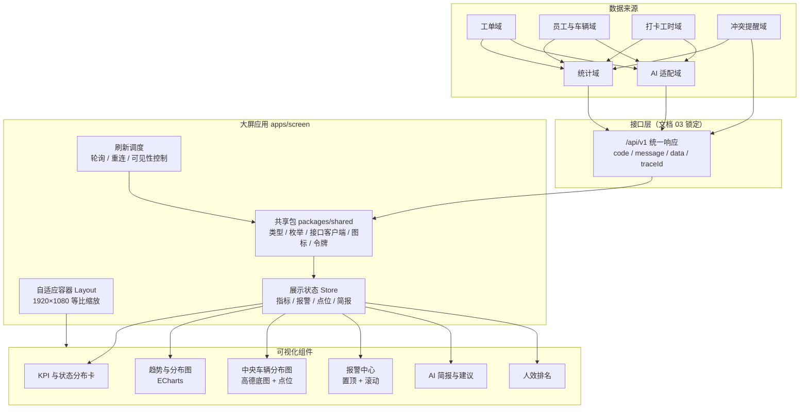
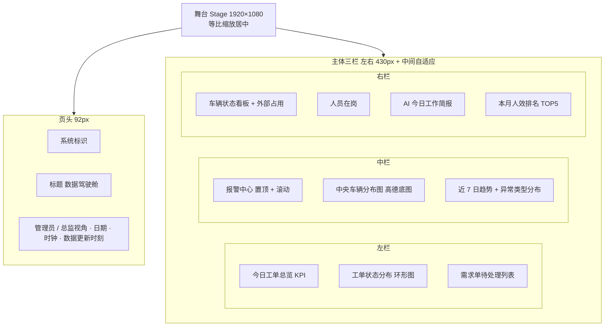
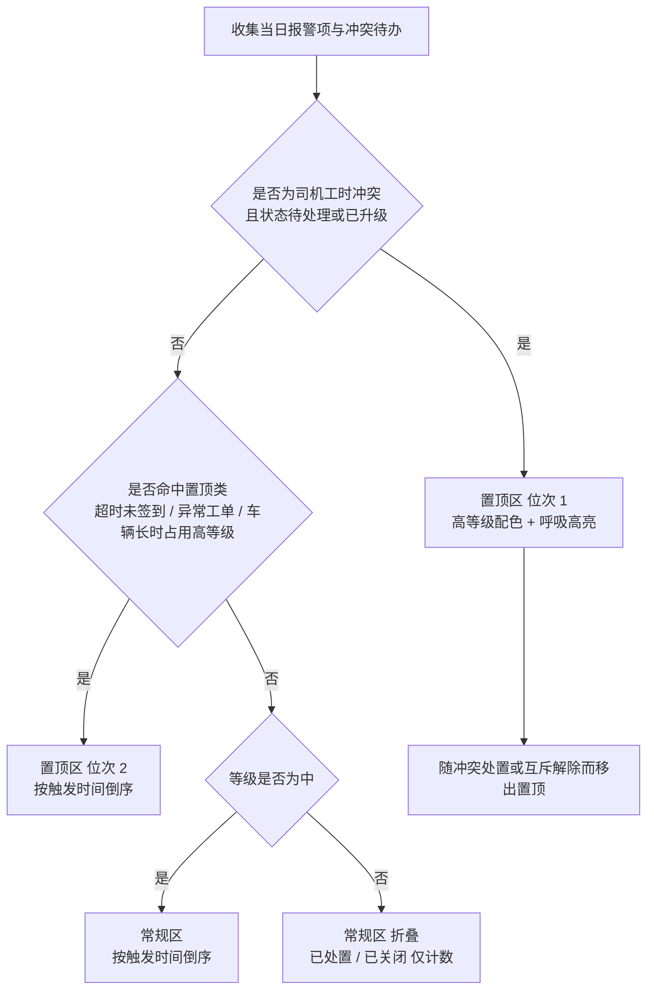
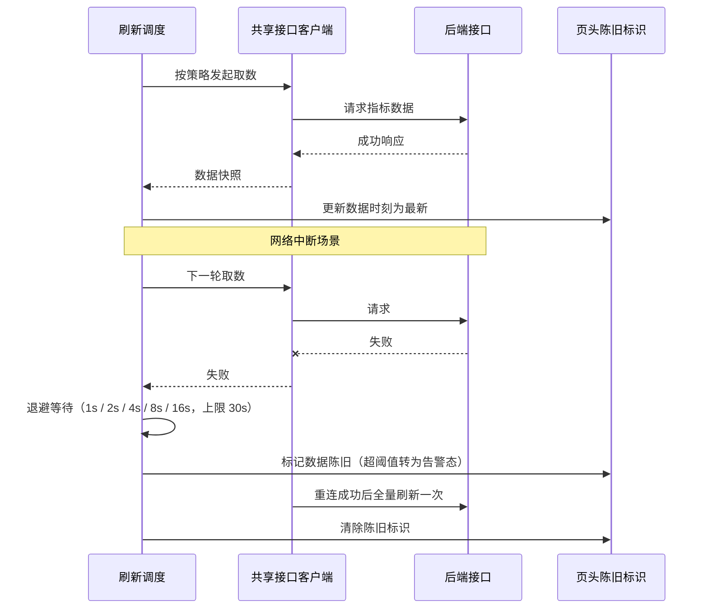

# 06 数据大屏模块设计文档

| 项 | 内容 |
|---|---|
| 文档编号 | 06 |
| 版本 | v1.0 |
| 状态 | 待评审 |
| 上游文档 | 《吊车作业工单全流程管理系统产品需求文档》v5.4；《01 总体技术架构设计（HLD）》v1.0；《03 接口设计规范》（接口名引用，尚未发布） |
| 适用对象 | 前端工程师、数据工程师 |
| 下游文档 | 09 AI Agent 任务包（大屏模块子任务） |
| 覆盖范围 | 数据大屏前端应用（`apps/screen`）：指标口径、图表清单、分区布局、配色令牌、报警规则、刷新策略、权限与脱敏 |

---

## 1. 设计概述

### 1.1 目的与范围

本文定义数据大屏模块的「怎么建」：指标口径与取数来源、图表与可视化组件清单、页面分区布局与自适应方案、深色配色令牌、报警中心与冲突待办的置顶规则、实时刷新与断线重连策略、权限与数据脱敏。它处在 PRD「做什么」与前端源码「逐行怎么写」之间，作为大屏代码生成 Agent 的模块与组件输入。

覆盖范围：

- 大屏应用内部的功能分区、组件划分与状态管理边界
- 每个图表 / 可视化组件的指标定义、数据源接口（接口名引用文档 03，不在本文写具体路径与报文）、刷新策略
- 大屏专属的深色主题令牌与语义色映射
- 报警中心的信息优先级、等级配色与 AI 处置建议展示形式
- 大屏的权限边界、访问方式与数据脱敏规则

明确不覆盖（由下游文档承接）：

- 后端统计指标的计算实现与 SQL（→ 文档 02、03）
- 接口请求 / 响应报文、错误码与鉴权细节（→ 文档 03）
- 部署、域名与网络暴露方式（→ 文档 08）
- 后台管理端报表页面与导出交互（→ 文档 07）
- 可直接投喂代码生成 Agent 的子任务提示词（→ 文档 09）

### 1.2 上游需求追溯

| 设计要求 | 追溯来源 | 证据 |
|---|---|---|
| 管理员与总监共用同一套数据大屏，总监不设独立可见标识 | PRD 1.2、3.1.7、3.3、结论 9 | [Data-backed] |
| 工单总览：今日 / 本周 / 本月总工单数、进行中 / 受阻 / 已完成数量 | PRD 3.1.7 | [Data-backed] |
| 车辆总览：车辆状态分布、第三方派单外出车辆统计 | PRD 3.1.7、3.1.2.1 | [Data-backed] |
| 人员总览：在岗人员、空闲人员 | PRD 3.1.7 | [Data-backed] |
| 客户活跃统计：本月新增客户、需求数 | PRD 3.1.7 | [Data-backed] |
| 中央车辆分布图：高德底图 + 工单预设点位 + 三态配色 + 异常高亮 + 实时刷新 | PRD 3.1.7（v5.3 新增） | [Data-backed] |
| 报警中心：未到场 / 未签到 / 车辆超时占用等报警集中展示，等级与阈值 | PRD 3.1.7、9.6 | [Data-backed] |
| 超时未签到报警、异常工单实时置顶告警 | PRD 3.1.7、9.6、4.6 | [Data-backed] |
| 司机工时冲突待办未处置时在报警中心置顶 | PRD 4.18.5、3.1.7、3.1.10 | [Data-backed] |
| AI 简报、AI 处置建议、人效排名仅管理员 / 总监可见 | PRD 9.2、9.3、9.6、9.7 | [Data-backed] |
| 外部占用统计：外部占用时长单独计并计入车辆使用率 | PRD 3.1.2.1、3.1.6、结论 20 | [Data-backed] |
| AI 报警仅在系统内推送，不发短信与微信 | PRD 9.6 报警原则 2 | [Data-backed] |
| AI 相关表述统一使用通用词「AI」，不出现具体厂商或品牌名 | 项目硬约束、01 §1.3 | [Data-backed] |
| 大屏为独立 Vue 3 应用，复用共享包的类型、枚举与接口客户端 | 01 §2.1、§4.1、§4.3 | [Data-backed] |
| 大屏主题令牌局部复用（深色） | 01 §4.3 | [Data-backed] |

指标口径的对外范围严格收敛在 PRD 第九章与 3.1.7，并叠加 4.18 / 3.1.10 的冲突置顶要求；PRD 其他章节的实时监控类描述（如 3.3 小程序管理员端）不属于大屏指标来源，本文不纳入。

### 1.3 大屏定位与观看场景

大屏是运营监控面，不是操作面：只读展示与告警呈现，不承载建单、派单、审批等写操作 [Expert judgment]。两类观看场景决定视觉与刷新参数：

| 场景 | 距离与时长 | 设计取舍 | 证据 |
|---|---|---|---|
| 会议室投影 | 3 至 6 米，短时集中观看（例会、复盘） | KPI 数字与报警条字号放大、关键项动效克制、图例常驻；配合汇报讲解，需支持近 7 日 / 周期趋势类图表 | [Expert judgment] |
| 值班室常驻 | 1 至 3 米，7×24 无人值守 | 报警区域必须在首屏视觉重心且自动滚动；数据陈旧需有显式提示；页面需长时间运行不泄漏内存 | [Expert judgment] |

两种场景共用同一份页面与分辨率基准（1920×1080），不拆分两套页面 [Expert judgment]。

### 1.4 术语表

| 术语 | 含义 |
|---|---|
| 大屏 / 数据驾驶舱 | 管理员与总监共用的只读监控大屏（PRD 3.1.7） |
| 报警项 | PRD 9.6 定义的告警条目，含未到场、未签到、车辆长时占用 |
| 冲突待办 | 司机工时互斥冲突提醒记录未处置时形成的待办项（PRD 4.18） |
| 点位三态 | 车辆分布图按「是否到场 / 是否开工 / 任务是否完成」三个维度着色（PRD 3.1.7） |
| 外部占用时长 | 车辆被第三方派单占用的时长，单独统计并计入车辆使用率（PRD 3.1.2.1） |
| 置顶 | 在报警中心列表中固定排于常规条目之前并高亮 |
| 数据陈旧 | 超过约定刷新周期未取到新数据的展示状态 |

---

## 2. 大屏组件结构与数据流

### 2.1 组件与数据流关系图

图中数据只从只读接口流入大屏，不产生任何写回业务数据的链路。统计域、AI 适配域与冲突提醒域向上提供接口，经 `/api/v1` 统一响应封装后由共享包的接口客户端消费，客户端统一完成鉴权头注入、响应解包、错误提示与重试；结果落入大屏的展示状态 Store，再分发给各可视化组件。刷新调度器是唯一发起网络请求的组件，其余组件只订阅 Store，避免同一指标被多个组件重复拉取 [Expert judgment]。

### 2.2 模块边界

| 模块 | 职责（一句话） | 输入 | 输出 | 依赖 | 边界 |
|---|---|---|---|---|---|
| 自适应容器 Layout | 按 16:9 等比缩放承载全部分区与卡片 | 视口尺寸 | 缩放后的舞台 | 无 | 不承载任何业务指标逻辑 |
| 刷新调度 RefreshScheduler | 按各指标的刷新策略统一触发取数并管理重连 | 指标刷新配置、页面可见性 | 取数指令、陈旧状态 | 共享接口客户端 | 不解析指标语义 |
| 展示状态 Store | 持有指标、报警、点位与简报的展示态快照 | 接口返回数据 | 订阅通知 | 无 | 不做业务口径计算（口径在后端） |
| 报警中心 AlarmCenter | 按优先级排序、置顶、滚动并展示 AI 建议 | 报警清单、冲突待办、AI 分析 | 报警列表视图 | Store | 不做报警判定与阈值计算 |
| 中央车辆分布图 VehicleMap | 在地图上按工单预设点位渲染三态着色点位与异常高亮 | 点位与状态数据 | 地图视图 | 高德 Web API、Store | 不做定位与地理编码 |
| 图表组件集 Charts | 以 ECharts 渲染趋势、分布与排名 | 指标序列 | 图表视图 | ECharts、Store | 不持有数据源 |
| AI 简报块 AiBriefing | 渲染简报正文与处置建议并标注免责提示 | 简报与建议文本 | 文本视图 | Store | 不触发 AI 生成 |

边界校验：上表每个模块的职责均已收敛为单一能力，无「和」式复合职责；依赖方向为 Layout / RefreshScheduler / Store → 可视化组件，无环依赖 [Expert judgment]。

---

## 3. 指标清单与口径

口径原则：所有比率型指标的分母、时间窗与状态集合在后端统计域统一计算，大屏不做二次加工，避免同一指标在不同页面出现口径漂移 [Expert judgment]。以下每条口径均注明追溯来源。

### 3.1 工单总览

| 指标 | 口径 | 追溯 | 证据 |
|---|---|---|---|
| 今日工单总数 | 按工单创建时间落在当日自然日的工单数量（含各状态） | PRD 3.1.7 | [Data-backed] |
| 本周工单总数 | 按自然周（周一 00:00 起）创建的工单数量 | PRD 3.1.7 | [Data-backed] |
| 本月工单总数 | 按自然月创建的工单数量 | PRD 3.1.7 | [Data-backed] |
| 进行中工单 | 状态为 `IN_PROGRESS` 的工单数量 | PRD 3.1.7、01 §6.3 | [Data-backed] |
| 受阻工单 | 状态为 `SUSPENDED`（施工受阻 / 已暂停）的工单数量 | PRD 3.1.7、01 §6.3 | [Data-backed] |
| 已完成工单 | 状态为 `COMPLETED` 的工单数量 | PRD 3.1.7、01 §6.3 | [Data-backed] |
| 工单状态分布占比 | 各状态数量 ÷ 所选时间窗工单总数 | PRD 3.1.7 | [Data-backed] |
| 近 7 日工单趋势 | 按日创建的工单数量序列，取最近 7 个自然日 | PRD 3.1.7（今日总数的时间维延伸） | [Data-backed] |
| 异常类型分布 | 当日异常记录按异常原因（含司机自定义原因）分组计数 | PRD 3.1.7「异常工单实时置顶告警」、10.1 异常原因对客户公开 | [Data-backed] |

### 3.2 车辆总览

| 指标 | 口径 | 追溯 | 证据 |
|---|---|---|---|
| 车辆总数 | 未停用与停用车辆合计（`deleted = 0`），作为分布卡分母 | PRD 3.1.7 | [Data-backed] |
| 空闲车辆 | 状态 `IDLE` 的车辆数量 | PRD 3.1.7、01 §6.3 | [Data-backed] |
| 作业中车辆 | 状态 `BUSY` 的车辆数量 | PRD 3.1.7、01 §6.3 | [Data-backed] |
| 第三方派单外出车辆 | 状态 `BUSY_THIRD` 的车辆数量 | PRD 3.1.7「第三方派单外出车辆统计」、3.1.2.1 | [Data-backed] |
| 维保车辆 | 状态 `MAINTENANCE` 的车辆数量 | PRD 3.1.7、01 §6.3 | [Data-backed] |
| 停用车辆 | 状态 `DISABLED` 的车辆数量 | PRD 3.1.7、01 §6.3 | [Data-backed] |
| 车辆使用率 | （所选周期内本系统作业中时长 + 第三方派单外部占用时长）÷ 周期内可用时长 | PRD 3.1.6、3.1.2.1 | [Data-backed] |

### 3.3 人员总览

| 指标 | 口径 | 追溯 | 证据 |
|---|---|---|---|
| 在岗人员 | 当前处于在岗状态的员工数量 | PRD 3.1.7「在岗人员」 | [Data-backed] |
| 空闲人员 | 当前无进行中工单占用且非离岗的员工数量 | PRD 3.1.7「空闲人员」、4.18.1 互斥口径 | [Data-backed] |
| 作业中人员 | 当前存在「未暂停且进行中」工单占用的员工数量 | PRD 4.18.1（互斥占用唯一口径） | [Data-backed] |
| 离岗人员 | 已离岗 / 停用状态的员工数量 | PRD 3.1.7（在岗口径的反向集合） | [Hypothesis] |

「离岗人员」在 PRD 3.1.7 中未单列，属对「在岗人员」反向集合的推断，取值口径需与员工档案状态字典对齐后方可定稿 [待确认]。

### 3.4 客户与需求统计

| 指标 | 口径 | 追溯 | 证据 |
|---|---|---|---|
| 本月新增客户 | 本月内完成登记并通过审核的客户档案数量 | PRD 3.1.7「客户活跃统计（本月新增客户、需求数）」 | [Data-backed] |
| 本月需求数 | 本月内创建的需求单数量 | PRD 3.1.7 | [Data-backed] |
| 待处理需求单 | 状态为 `PENDING` / `REVIEWING` 的需求单数量 | PRD 3.4.0 需求单状态、3.1.7 客户活跃统计 | [Data-backed] |

### 3.5 中央车辆分布图

| 指标 | 口径 | 追溯 | 证据 |
|---|---|---|---|
| 点位来源 | 取车辆当前进行中工单的预设施工点位（工单预设地点 / 高德选点经纬度）；一辆车有多个进行中工单时取当前进行中工单的预设点 | PRD 3.1.7 | [Data-backed] |
| 底图载体 | 高德地图 Web API，支持缩放、拖拽、点位聚合 | PRD 3.1.7、01 §2.5 | [Data-backed] |
| 是否到场 | 未到场 / 已到场 | PRD 3.1.7 三态表 | [Data-backed] |
| 是否开工 | 已到场未开工 / 已开工（工单进行中） | PRD 3.1.7 三态表 | [Data-backed] |
| 任务是否完成 | 进行中 / 已完成 | PRD 3.1.7 三态表 | [Data-backed] |
| 在图点位 / 总点位 | 当前有可定位点位的车辆数与车辆总数之比 | PRD 3.1.7 | [Data-backed] |
| 点位卡片字段 | 车牌、司机、关联工单号、当前状态、最后更新时间 | PRD 3.1.7 | [Data-backed] |
| 异常高亮 | 未到场超时、车辆超时占用等报警车辆在地图高亮置顶 | PRD 3.1.7、9.6 | [Data-backed] |

### 3.6 外部占用统计

| 指标 | 口径 | 追溯 | 证据 |
|---|---|---|---|
| 外部占用车辆数 | 所选周期内曾标记为 `BUSY_THIRD` 的车辆去重数量 | PRD 3.1.2.1、3.1.7 | [Data-backed] |
| 外部占用时长（当日 / 当月） | 标记为 `BUSY_THIRD` 的持续时长之和，单独计列不并入本系统作业时长 | PRD 3.1.2.1、结论 20 | [Data-backed] |
| 长时占用报警计数 | 车辆处于 `BUSY` 超 12 小时或 `BUSY_THIRD` 超 24 小时生成的报警条数 | PRD 9.6 车辆长时间占用规则 | [Data-backed] |
| 外部占用计入车辆使用率 | 外部占用时长计入车辆使用率分子 | PRD 3.1.6、3.1.2.1 | [Data-backed] |

### 3.7 报警与冲突指标

| 指标 | 口径 | 追溯 | 证据 |
|---|---|---|---|
| 司机预定时间未到场 | 当前时间 > 工单预计开始时间 + 宽限期（默认 15 分钟）且工单未进入进行中（未签到） | PRD 9.6 | [Data-backed] |
| 未执行签到 | 司机已到场（进入签到范围 / 已接单）但超过时限（默认 30 分钟）未提交签到与照片 | PRD 9.6、4.6 | [Data-backed] |
| 车辆长时间处于占用状态 | 车辆处于 `BUSY` 超 12 小时或 `BUSY_THIRD` 超 24 小时 | PRD 9.6 | [Data-backed] |
| 司机工时冲突待办 | 冲突提醒记录状态为待处理或已升级的条目，含冲突工单、涉及司机与待处理事项 | PRD 4.18.5、3.1.10 | [Data-backed] |
| 冲突升级 | 司机未在处置时限内（默认 15 分钟）处置，升级提醒管理员 / 总监 | PRD 4.18.5 | [Data-backed] |
| 报警频次统计 | 按日 / 周 / 月统计报警频次，识别人、车、时段高发规律 | PRD 9.6 报警原则 6 | [Data-backed] |

### 3.8 AI 简报与建议

| 指标 | 口径 | 追溯 | 证据 |
|---|---|---|---|
| 当日工作简报 | 每天定时生成（默认 20:00，后台可配），内容含当天工单概况、用车状态、异常汇总 | PRD 9.2、9.3 | [Data-backed] |
| 简报留存 | 以 Markdown 存于系统内，保留 10 天后自动清除 | PRD 9.3 | [Data-backed] |
| 报警处置建议 | AI 汇总报警项与原始数据，给出是否真异常、可能原因、处置建议 | PRD 9.6 报警原则 5、9.5.6 | [Data-backed] |
| 人效工单排名 | 按自然月统计人员工单数量排名 | PRD 3.1.6、9.2 | [Data-backed] |
| 简报生成失败降级 | 超时 / 失败自动重试（默认最多 2 次），多次失败跳过本次生成并通知管理员 | PRD 9.8、01 §8 | [Data-backed] |

---

## 4. 图表与可视化清单

### 4.1 清单表

数据源接口名引用文档 03（文档 03 尚未发布，表中名称为锁定候选，最终以 03 为准）。

| 序号 | 指标 / 内容 | 图表类型 | 组件 | 数据源接口（文档 03） | 刷新策略 | 追溯 |
|---|---|---|---|---|---|---|
| V-01 | 今日工单总数 | 数字指标卡（含滚动动画） | KPI 卡 | 统计域 · 驾驶舱指标查询 | 60s 轮询 | PRD 3.1.7 |
| V-02 | 进行中 / 受阻 / 已完成 | 数字指标卡组（4 宫格） | KPI 卡 | 统计域 · 驾驶舱指标查询 | 60s 轮询 | PRD 3.1.7 |
| V-03 | 工单状态分布 | 环形图 + 图例数值 | ECharts 环形图 | 统计域 · 驾驶舱指标查询 | 60s 轮询 | PRD 3.1.7 |
| V-04 | 近 7 日工单趋势 | 柱状图 | ECharts 柱状图 | 统计域 · 工单趋势查询 | 5min 轮询 | PRD 3.1.7 |
| V-05 | 异常类型分布 | 横向条形图 | ECharts 条形图 | 统计域 · 异常分布查询 | 60s 轮询 | PRD 3.1.7 |
| V-06 | 需求单待处理列表 | 列表 + 状态标签 | 列表组件 | 统计域 · 需求单待办查询 | 60s 轮询 | PRD 3.1.7、3.4.0 |
| V-07 | 车辆状态看板（各状态台数 + 使用率） | 列表 + 数值 + 进度提示 | 车辆看板 | 统计域 · 车辆状态汇总 | 30s 轮询 | PRD 3.1.7、3.1.2.1 |
| V-08 | 人员在岗 / 作业中 / 空闲 / 离岗 | 数字指标卡组 | 人员看板 | 统计域 · 人员状态汇总 | 30s 轮询 | PRD 3.1.7、4.18.1 |
| V-09 | 中央车辆分布图（三态点位、图例、异常高亮） | 高德地图 + 聚合点位图层 | 地图组件 | 统计域 · 车辆分布点位查询 | 15s 轮询 | PRD 3.1.7 |
| V-10 | 报警中心（含冲突待办置顶） | 报警列表 + 置顶 + 呼吸高亮 | 报警组件 | 冲突提醒 · 冲突记录列表；AI · 报警列表查询；统计域 · 报警清单查询 | 5s 短轮询（兜底 30s） | PRD 3.1.7、9.6、4.18.5 |
| V-11 | AI 处置建议（随报警条目内联） | 富文本单行摘要 + 免责标注 | 报警组件内嵌 | AI · 报警分析查询 | 随 V-10 | PRD 9.5.6、9.6 |
| V-12 | AI 今日工作简报 | 文本块（列表 / 表格） | AI 简报组件 | AI · 简报查询 | 定时生成后 5min 轮询 | PRD 9.2、9.3 |
| V-13 | 本月人效排名 TOP5 | 横向条形排名 | 排名组件 | AI · 人效排名查询 | 页面加载 + 每日 1 次 | PRD 3.1.6、9.2 |
| V-14 | 外部占用统计（车辆数、时长） | 数值 + 说明文本 | 车辆看板辅助行 | 统计域 · 外部占用统计查询 | 60s 轮询 | PRD 3.1.2.1、3.1.7 |
| V-15 | 报警频次按日 / 周 / 月 | 折线或柱状图（辅助图，可折叠） | ECharts 图 | 统计域 · 报警频次查询 | 5min 轮询 | PRD 9.6 报警原则 6 |
| V-16 | 顶部时钟与数据更新时刻 | 本地时钟 + 陈旧标识 | 页头组件 | 无（本地时间） | 时钟 1s 本地刷新 | 原型页头 |

### 4.2 图表密度与取舍

会议室投影场景下图表需可读，单屏图表总数控制在 10 个以内，其余以指标卡与列表承载 [Expert judgment]。V-15 报警频次为周期复盘用途，默认折叠为首屏以外的辅助图，避免与首屏报警中心争夺注意力 [Expert judgment]。V-01 至 V-05 与 V-07 至 V-14 为首屏必需，V-06 与 V-15 为可选（原型已含 V-06，其大屏必要性仍需业务确认 [待确认]）。

---

## 5. 页面分区布局与自适应

### 5.1 分区结构图

分区与原型保持一致：页头承载标题与上下文信息，主体左栏为工单维度概览、中栏为报警与地图（视觉重心）、右栏为资源与 AI 维度。中栏宽度自适应（`1fr`），左右栏固定 430px，栏间距 16px [Data-backed：原型布局]。报警中心固定在中栏顶部，保证值班室常驻场景下报警始终位于首屏视觉重心 [Expert judgment]。

### 5.2 自适应方案

| 方案项 | 设计 | 理由 | 证据 |
|---|---|---|---|
| 分辨率基准 | 1920×1080，16:9 | 主流大屏与投影比例 | [Expert judgment] |
| 缩放方式 | 以 `min(视口宽 ÷ 1920, 视口高 ÷ 1080)` 计算比例，对舞台整体 `transform: scale()` 并居中 | 等比缩放不破坏布局比例，矢量与 ECharts 缩放下不失真 | [Data-backed：原型实现] |
| 非 16:9 视口 | 保持等比缩放，多余方向留深色底（letterbox），不拉伸 | 避免拉伸导致的圆形变形与地图比例失真 | [Expert judgment] |
| 最小可读字号 | 正文不小于 12px（缩放后按实际距离评估），KPI 数值 40px 以上 | 会议室 3 至 6 米观看距离 | [Expert judgment] |
| 缩放实现位置 | 仅在 Layout 容器统一处理，子组件内部使用固定像素坐标 | 避免每个组件各自计算缩放，减少布局漂移 | [Expert judgment] |
| 分辨率极端值 | 视口宽高比偏离 16:9 超过 21:9 时，左右栏可选收窄至 380px | 防止中栏地图被过度压缩 | [Hypothesis，待确认] |
| 大屏轮播 | 首屏不支持多页轮播，信息全部收敛在单屏 | 报警与地图需常驻，轮播会导致告警被翻走 | [Expert judgment] |

---

## 6. 深色配色令牌与语义色

### 6.1 基础令牌

沿用原型已有令牌，作为大屏主题的唯一定义来源；共享包主题令牌在大屏侧只做「深色覆写」，不新增第二套色板 [Data-backed：01 §4.3、原型]。

| 令牌 | 值 | 用途 |
|---|---|---|
| `--bg0` | `#060c1a` | 页面最底层背景 |
| `--bg1` | `#0a1428` | 舞台渐变上端 |
| `--panel` | `rgba(13,28,54,.72)` | 卡片面板底 |
| `--line` | `rgba(64,156,255,.18)` | 卡片边框与分隔线 |
| `--line2` | `rgba(64,156,255,.35)` | 强调边框、标签描边 |
| `--cyan` | `#38bdf8` | 主强调色、进行中、地图作业中点位 |
| `--cyan2` | `#7dd3fc` | 数值文本、次级强调 |
| `--txt` | `#dbe7f5` | 主文本 |
| `--sub` | `#7d93b5` | 次级文本与说明 |
| `--green` | `#3ddc97` | 已完成、空闲车辆 |
| `--amber` | `#ffd54f` | 已到场、维修中 |
| `--orange` | `#ffab40` | 中等级报警、超时预警 |
| `--red` | `#fb4d63` | 高等级报警、停用、异常 |
| `--purple` | `#b388ff` | 第三方派单、AI 相关标识 |

对比度要求：主文本与面板底、数值与卡片底在缩放后仍需满足强光与投影可读，`--sub` 仅用于说明性文本不承载关键数据 [Expert judgment]。

### 6.2 语义色映射

| 语义 | 取值 | 令牌 | 追溯 |
|---|---|---|---|
| 未到场 | 灰 | `--sub` | PRD 3.1.7 三态表 |
| 已到场 / 已到场未开工 | 黄 | `--amber` | PRD 3.1.7 三态表 |
| 已开工（工单进行中）/ 进行中 | 蓝 | `--cyan` | PRD 3.1.7 三态表 |
| 任务已完成 / 已完成 | 绿 | `--green` | PRD 3.1.7 三态表 |
| 施工受阻 | 红 | `--red` | 原型「施工受阻」用于环形图与 KPI |
| 第三方派单外出 | 紫 | `--purple` | 原型车辆看板与地图图例 |
| 维保 | 黄 | `--amber` | 原型车辆看板 |
| 停用 | 红 | `--red` | 原型车辆看板 |
| 空闲 | 绿 | `--green` | 原型车辆看板 |
| 超时预警点位 | 橙 | `--orange` | 原型地图图例 |
| 报警点位 / 高等级报警 | 红 | `--red` | PRD 9.6、原型报警中心 |

工单状态到三态配色的映射关系如下：`PENDING_ACCEPT` / `PENDING_ARRIVE` 归入「未到场」（灰）；已到场未开工归入「已到场」（黄），其判定依据是签到记录存在而工单尚未进入进行中，与 01 §6.3 工单状态枚举的对应关系需在文档 03 中固化 [待确认]；`IN_PROGRESS` 归入「已开工」（蓝）；`COMPLETED` 归入「已完成」（绿）；`SUSPENDED` 与 `CANCELLED` 不进入三态主线，以辅助色或灰化处理 [Expert judgment]。第三方派单车辆无工单点位，单独以紫色标识并计入「在图 / 总」分子之外 [待确认]。

---

## 7. 报警中心与冲突待办置顶规则

### 7.1 置顶优先级判定

判定说明：冲突待办拥有最高置顶权，依据 PRD 4.18.5 的「未在处置时限内处置则升级并在数据驾驶舱报警中心置顶」与 3.1.10 的「未处置的冲突提醒在数据驾驶舱报警中心置顶」。置顶区第二位次容纳 3.1.7 明确要求置顶的三类内容：超时未签到报警、异常工单实时告警，以及 9.6 的车辆长时占用高等级报警。中等级报警进入常规区，已处置与已关闭条目仅保留计数不占列表空间，避免大屏被历史条目淹没。冲突记录在派单调整、延期审批、工单暂停或结单使互斥解除后移出置顶 [Data-backed：PRD 4.18.5]。置顶区同时最多展示 3 条，超出部分在置顶区内滚动 [Expert judgment]。

置顶区与常规区之间的位次规则在 3.1.7 与 9.6 中存在交叉表述，具体并列时的先后顺序需业务确认 [待确认]。

### 7.2 列表字段与展示

| 区域 | 展示字段 | 依据 |
|---|---|---|
| 冲突待办行 | 标题（司机工时冲突）、司机姓名、前一单与后一单工单号及约定时间、待处理事项（改派 / 延期审批）、AI 处置建议、待处置时长 | PRD 4.18.3、3.1.10 |
| 报警行 | 报警类型、对象（工单号 / 车牌 / 司机）、触发原因摘要、持续或超时时长、等级标签 | PRD 9.6 |
| AI 建议行 | 是否真异常判断、可能原因、处置建议 | PRD 9.6 报警原则 5、9.5.6 |
| 固定提示 | 「AI 建议仅供参考」「AI 报警仅系统内推送」 | PRD 9.5.6、9.6 报警原则 2 |
| 空态 | 「当前无待处理报警」，不使用占位假数据 | [Expert judgment] |

### 7.3 等级配色与动效

| 等级 | 主色 | 标签底色 | 动效 | 追溯 |
|---|---|---|---|---|
| 高 | `--red` `#fb4d63` | 实心高对比，白字 | 2.2s 呼吸光晕 + 红点 1s 闪烁 | PRD 9.6、原型 |
| 中 | `--orange` `#ffab40` | 实心，深色字 | 无呼吸，仅状态点常亮 | PRD 9.6、原型 |
| 低（如后续新增） | `--sub` | 描边 | 无 | [Hypothesis] |

动效遵循「报警呼吸、数据不闪」原则：仅报警区域允许持续性动效，KPI 与图表入场动画一次性播放后停止，避免大屏长时间运行造成视觉疲劳与不必要的重绘 [Expert judgment]。

### 7.4 AI 处置建议展示

- 每条报警与冲突待办在第二行以内联摘要展示 AI 结论，摘要限一行并截断，完整内容通过后台报警分析页查看（超出大屏范围）[Expert judgment]
- AI 未生成或调用失败时，该行降级为原始数据摘要并标注「AI 分析暂不可用」，不阻塞报警条目展示 [Data-backed：PRD 9.8、01 §8]
- AI 简报生成失败时保留上一次简报并标注生成时间，页面不出现空白块 [Data-backed：PRD 9.8、01 §8]
- AI 相关文案不出现任何具体厂商或品牌名，统一写「AI」 [Data-backed：项目硬约束]

---

## 8. 实时刷新与断线重连策略

### 8.1 刷新策略

| 数据类别 | 刷新方式 | 频率 | 依据 |
|---|---|---|---|
| 报警中心与冲突待办 | 短轮询，页面隐藏时暂停 | 5s（兜底 30s） | PRD 4.18.4 秒级实时性要求；高等级与冲突类需最快可见 |
| 车辆分布图点位与配色 | 轮询 | 15s | PRD 3.1.7「点位与颜色随工单状态自动联动刷新，无需人工维护」 |
| 车辆状态与人员状态 | 轮询 | 30s | 状态类指标变化频率中等 |
| 工单总览与状态分布、异常分布、需求待办、外部占用 | 轮询 | 60s | 聚合指标，变化平缓 |
| 近 7 日趋势、报警频次 | 轮询 | 5min | 按日聚合，变化慢 |
| AI 简报 | 定时生成后拉取 | 生成时刻 20:00 前后，页面 5min 轮询 | PRD 9.2、9.3 |
| 人效排名 | 页面加载 + 每日 1 次 | 每日 | PRD 3.1.6 统计周期为自然月 |
| 时钟 | 本地计时 | 1s | 原型页头 |

具体频次为待确认项，需结合后端统计域的性能余量（01 §7 以单表千万级、峰值 30 并发为前提）核定，避免刷新密度压垮统计查询 [待确认]。刷新通道默认采用轮询，不引入消息中间件与长连接服务，与 01 §2.3 中「单一 MySQL、无消息队列」的组件边界保持一致 [Data-backed：01 §2.3]；若后端在冲突提醒与报警推送场景已具备事件驱动能力，可评估以大屏侧事件流（如服务端推送）替代高频短轮询，作为可选增强方案 [Hypothesis，待确认]。

刷新实现约束：

- 同一指标只允许一个在途请求，未返回前不重复发起，防止大屏长时间运行下的请求堆积 [Expert judgment]
- 多个组件订阅同一指标时只触发一次取数，由刷新调度统一分发 [Expert judgment]
- 请求超时与失败的单次阈值与重试次数沿用共享包接口客户端策略，不在大屏侧另设一套 [Data-backed：01 §4.2]

### 8.2 数据陈旧与断线重连

重连规则：首次失败后按 1s、2s、4s、8s、16s 退避重试，上限 30s，恢复成功后立即执行一次全量刷新，保证大屏不会长时间停留在过期数据上 [Expert judgment]。连续失败达到陈旧阈值（建议 60s，取数最长周期的量级）时，页头更新时刻转为告警色并显示「数据更新于 hh:mm:ss」，值班人员可据此判断大屏是否仍在正常取数 [待确认]。页面不可见时暂停轮询以节省后端压力，标签页恢复可见时立即刷新一次 [Expert judgment]。

长时间运行：大屏按 7×24 常驻设计，需在每日低峰时段（如 03:00）自动重载页面以回收内存与清理地图图层，重载动作需避开报警处置时段 [Hypothesis，待确认]。报警提示音在值班室场景下的启用与音量需业务确认 [待确认]。

### 8.3 降级

| 降级项 | 触发 | 表现 | 依据 |
|---|---|---|---|
| AI 接口不可用 | AI 调用失败或超时 | 保留上一次简报与建议，标注生成时间 | PRD 9.8、01 §8 |
| 地图底图不可用 | 高德服务异常或配额受限 | 退化为深色底图 + 点位图层，保留图例与点位信息 | [Expert judgment] |
| 统计接口不可用 | 请求持续失败 | 分区显示陈旧标识与上次有效数据，不清空卡片 | [Expert judgment] |
| 点位缺失 | 工单无预设点位 | 该车辆不在地图打点，在图计数相应减少并在说明中体现 | PRD 3.1.7 |

---

## 9. 权限、访问与数据脱敏

### 9.1 权限与访问方式

| 项 | 设计 | 依据 |
|---|---|---|
| 可见角色 | 仅管理员与总监；员工与客户无任何入口与权限 | PRD 3.1.9 权限矩阵、9.7 |
| 角色差异 | 无差异，管理员与总监共用同一套大屏与数据 | PRD 1.2、3.1.7、结论 9 |
| 登录方式 | 账号密码，不使用微信授权 | 01 §4.3 |
| 鉴权 | 请求头携带业务令牌，由共享包接口客户端统一注入；令牌失效统一跳转登录 | 01 §5 |
| 多端标识 | 请求头标注大屏端身份，用于日志与限流分桶 | 01 §5 |
| 会话与令牌存放 | 令牌仅存内存 / 会话级存储，不写入持久化存储；登出即清除 | [Expert judgment] |
| 大屏部署位置 | 独立前端应用，静态资源经 Nginx 托管，与后台管理内网可达性一致 | 01 §2.2、§4.1 |
| 值班室展示授权 | 大屏常驻展示等同持续登录态，需明确物理访问与投屏权限归属 | [待确认] |
| 退出与息屏 | 无人值守时段的锁屏与退出策略需业务确认，避免长期挂载登录态 | [待确认] |

### 9.2 数据脱敏

| 数据项 | 大屏展示策略 | 依据 |
|---|---|---|
| 司机姓名 | 按 PRD 冲突待办与报警要求展示姓名，用于定位责任人 | PRD 4.18.3、3.1.10 |
| 司机手机号 | 大屏不展示，卡片与报警行仅展示姓名与工号；完整联系方式在后台冲突提醒中心查看 | PRD 4.18.3（联系方式列于后台字段清单）、9.7 |
| 客户姓名与联系方式 | 大屏不展示，客户维度只展示聚合数量（新增客户、需求数） | PRD 3.1.7 |
| 工单金额 / 合同类字段 | 大屏不展示，避免敏感经营数据出现在常驻屏幕上 | [Expert judgment] |
| 车牌号 | 展示，用于车辆定位与报警对象识别 | PRD 3.1.7 点位卡片、9.6 |
| 照片与附件 | 大屏不展示原图，仅在必要时以缩略图或计数呈现 | [Expert judgment] |
| 异常描述自由文本 | 展示前过滤超长与疑似敏感内容，截断展示 | [Expert judgment] |
| 报警原始数据 | 仅在大屏以摘要呈现，完整原始数据在后台报警分析页查看（仅管理员 / 总监） | PRD 9.6 报警原则 5、9.7 |

脱敏原则：大屏面向常驻屏幕与会议投屏，暴露面大于个人终端，因此仅保留「定位问题所需的最小识别信息」（车牌、司机姓名、工单号），不展示任何联系方式与客户身份信息 [Expert judgment]。所有展示字段与后台字段清单的差异需在文档 03 与文档 07 中同步确认 [待确认]。

---

## 10. 待确认清单

| 编号 | 事项 | 影响范围 | 状态 |
|---|---|---|---|
| C-06-01 | 各指标刷新频率最终取值（报警 5s、点位 15s、状态 30s、聚合 60s、趋势 5min） | 第 8.1 节全部刷新策略 | 待确认 |
| C-06-02 | 报警秒级推送是否引入事件流替代高频短轮询 | 8.1 节刷新通道选型 | 待确认 |
| C-06-03 | 置顶区内部并列规则（冲突、超时未签到、异常工单、车辆长时占用高等级之间的先后） | 7.1 节优先级判定 | 待确认 |
| C-06-04 | 工单状态到点位三态配色的精确对应关系（尤其「已到场未开工」的判定依据） | 6.2 节语义色映射、V-09 | 待确认 |
| C-06-05 | 第三方派单车辆是否进入中央分布图打点与「在图 / 总」计数 | 3.5 节、V-09 | 待确认 |
| C-06-06 | 「离岗人员」的档案状态口径 | 3.3 节人员总览 | 待确认，暂按在岗反向集合推断 |
| C-06-07 | 需求单待处理列表是否保留在大屏首屏（原型已含） | 4.1 节 V-06 | 待确认 |
| C-06-08 | 数据陈旧阈值与页头陈旧标识的触发边界 | 8.2 节 | 待确认，暂定 60s |
| C-06-09 | 每日低峰自动重载页面策略与报警提示音启用 | 8.2 节长时运行 | 待确认 |
| C-06-10 | 值班室大屏的物理访问、投屏与退出息屏策略 | 9.1 节权限与访问 | 待确认 |
| C-06-11 | 大屏展示字段与后台字段清单的差异（手机号、客户信息、照片）最终确认 | 9.2 节数据脱敏 | 待确认 |
| C-06-12 | 非 16:9 极端比例下左右栏收窄方案 | 5.2 节自适应 | 待确认 |
| C-06-13 | 文档 03 接口名与报文锁定后回填本文接口列 | 第 4.1 节全部接口引用 | 待确认 |
| C-06-14 | V-15 报警频次图是否纳入首屏 | 4.2 节图表密度 | 待确认 |

全部待确认项在开发前需由业务方或后端确认；未确认前，本文不对应的取值不作为大屏代码生成输入。
