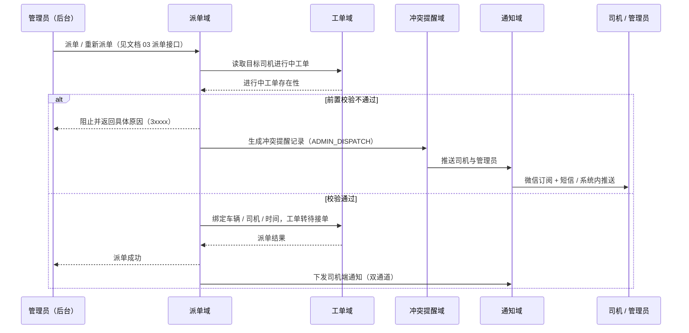
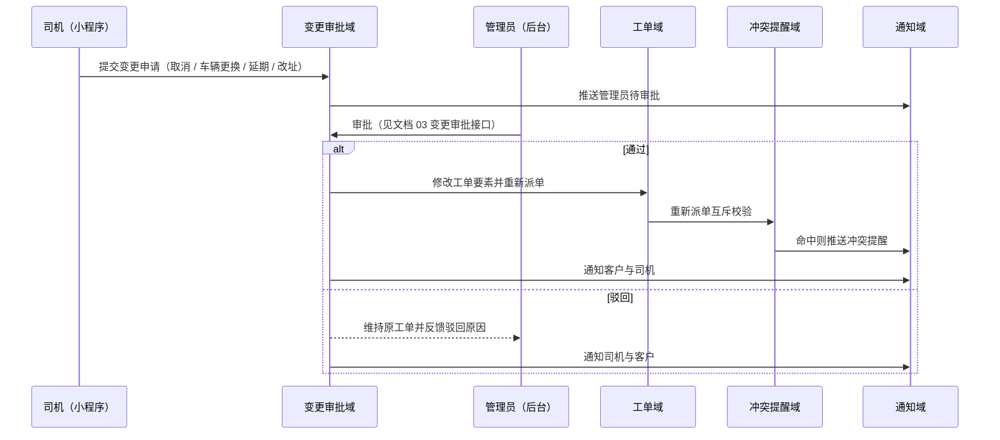
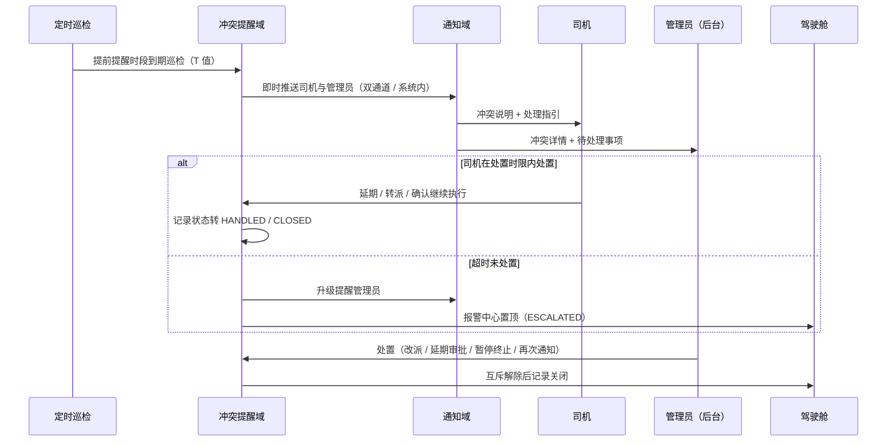

# 济南诚重吊装业务管理系统 — 后台管理系统设计文档

| 项 | 内容 |
|---|---|
| 文档编号 | 07 |
| 版本 | v1.0 |
| 状态 | 待评审 |
| 上游文档 | 《济南诚重吊装业务管理系统产品需求文档》v5.4、文档 01《总体技术架构设计（HLD）》v1.0 |
| 适用对象 | 前端工程师、后端工程师 |
| 下游文档 | 09 AI Agent 任务包与代码生成规范 |
| 定位 | PC 管理后台（`apps/admin`）面向统一管理员角色的页面、路由、权限与交互设计；数据大屏独立应用见文档 06，移动端与小程序见文档 04、05 |
| 接口依赖 | 全部后端接口契约见文档 03《接口设计规范》，本文只引用其接口名称与编号，不自造任何后端路径 |

---

## 1 设计概述与范围

### 1.1 目的与范围

本文把 PRD 第 3.1 节「PC 管理后台功能」、第四章「核心业务流转规则」与第十章「UI / 交互规范」翻译为后台可直接落地的菜单、路由、权限码与页面设计，回答「后台呈现哪些菜单、每个页面对应哪条路由与哪个权限码、页面承载哪些操作、依赖哪些后端接口」。

本文覆盖：

- 后台定位、信息架构与菜单树
- 路由与页面清单（path、页面名、权限码、主要功能）
- 十三个功能模块的职责、关键页面、主要操作与依赖接口名称
- 三条关键交互时序（派单前置校验与冲突触发、工单变更审批、冲突提醒处置）
- 表格与表单规范、权限矩阵（菜单级 / 按钮级 / 数据范围）

明确不覆盖（由上游或下游承接）：

- 后端逐接口请求 / 响应报文与错误码全集 → 文档 03
- 逐字段建表脚本与数据字典 → 文档 02
- 数据大屏（`apps/screen`）的视觉与图表设计 → 文档 06
- 司机端 / 客户端的页面与路由 → 文档 04、05
- 可直接投喂代码生成 Agent 的子任务提示词 → 文档 09

### 1.2 上游需求追溯

| 设计目标 | 追溯来源 | 证据 |
|---|---|---|
| 管理员与总监合并为统一管理员角色，功能权限等同 | PRD 3.1.9、01 §6.3 | [Data-backed] |
| 需求单编辑、复核、转工单与无需求单直建 | PRD 3.1.5、4.1 | [Data-backed] |
| 派单前置四类校验与拒单退回重派队列 | PRD 3.1.1、4.2、4.15、4.16 | [Data-backed] |
| 车辆默认归属司机、第三方派单状态与外部占用统计 | PRD 3.1.2、3.1.2.1、4.11、4.12 | [Data-backed] |
| 工单变更 / 重新派单审批流与全量留痕 | PRD 3.1.1、4.14 | [Data-backed] |
| 异常审批与受阻恢复路径 | PRD 3.1.4、4.7 | [Data-backed] |
| 超时未签到报警与驾驶舱置顶 | PRD 3.1.1、4.6、9.6 | [Data-backed] |
| 冲突提醒中心与处置升级链路 | PRD 3.1.7、4.18、01 §6.3 | [Data-backed] |
| 绩效统计口径与报表导出 | PRD 3.1.6、3.1.7 | [Data-backed] |
| AI 服务配置、简报、人效、报警规则与降级 | PRD 第九章、9.6、9.8 | [Data-backed] |
| 提前提醒时长 T、签到范围、阈值、端口等集中配置 | PRD 3.1.2.1、4.18、5.5、9.6 | [Data-backed] |
| 关键操作二次确认、报警置顶高亮、表格筛选导出 | PRD 10.2、10.4 | [Data-backed] |
| 不使用 Emoji，统一图标 + 图标 + 颜色 + 文字三重表达 | PRD 10.3、项目硬约束 | [Data-backed] |

---

## 2 后台定位与信息架构

### 2.1 后台定位

PC 管理后台是「全流程运营与配置」的唯一操作入口，登录角色为统一管理员（角色枚举 `ADMIN`，含原「总监」全部职责，不设独立标识）[Data-backed：PRD 3.1.9、01 §6.3]。司机（`DRIVER`）与客户（`CUSTOMER`）不在 PC 后台登录，其操作通道分别为统一多角色小程序与 H5 / 小程序 [Data-backed：01 §4.3]。

- 登录方式：账号密码 + 验证码 [Data-backed：01 §4.3]
- 多端标识：请求统一携带 `X-Client: admin` [Data-backed：01 §5]
- 数据范围：管理员默认可见全量数据；员工与客户端各自仅可见本人 / 本人关联数据，不进入本文范围 [Data-backed：PRD 3.1.9]

> 后台与数据大屏的边界：大屏为独立应用（`apps/screen`），视觉与图表见文档 06；后台「数据驾驶舱」页面为同一套指标在 PC 后台内的呈现入口，本文只定义页面入口、权限与联动跳转，不重复定义大屏视觉 [Expert judgment]。

### 2.2 信息架构与菜单树

菜单按「首页工作台 → 业务处理 → 档案 → 账号权限 → 统计 → AI → 系统配置」组织，一级菜单共 8 个，二级页面 25 个 [Expert judgment]：

```text
后台管理（ADMIN）
├─ 工作台 dashboard
│  ├─ 数据驾驶舱        /dashboard/cockpit
│  ├─ 中央车辆分布图     /dashboard/vehicle-map
│  └─ 报警中心          /dashboard/alarm-center
├─ 需求单 demand
│  └─ 需求单列表（含详情 / 编辑复核 / 转工单）  /demand/list
├─ 工单 workorder
│  ├─ 工单列表（含详情）        /workorder/list
│  ├─ 创建工单（含无需求单直建） /workorder/create
│  ├─ 待重新派单队列           /workorder/reassign-queue
│  └─ 工单变更审批             /workorder/change-approval
├─ 异常与冲突 exception
│  ├─ 异常审批              /exception/approval
│  └─ 冲突提醒中心          /conflict/center
├─ 档案 archive
│  ├─ 车辆档案              /archive/vehicle
│  ├─ 员工档案              /archive/staff
│  ├─ 客户资料              /archive/customer
│  └─ 客户联系人            /archive/customer-contact
├─ 账号与权限 iam
│  ├─ 账号管理              /iam/account
│  ├─ 客户账号管理          /iam/customer-account
│  └─ 角色权限              /iam/role
├─ 统计与 AI stat
│  ├─ 绩效统计              /stat/performance
│  ├─ 报表导出              /stat/report
│  ├─ 工作简报              /ai/briefing
│  ├─ 人效分析              /ai/efficiency
│  ├─ 报警分析              /ai/alarm-analysis
│  ├─ AI 服务配置           /ai/service-config
│  └─ 调用用量统计          /ai/usage
└─ 系统配置 system
   ├─ 业务参数配置          /system/params
   ├─ 报警规则配置          /system/alarm-rules
   ├─ 通知模板配置          /system/notify-template
   └─ 存储与运维监控        /system/storage
```

菜单树与路由清单一一对应；菜单项默认按权限码过滤，无权限的菜单不渲染 [Expert judgment]。

### 2.3 布局骨架

| 区域 | 内容 | 说明 |
|---|---|---|
| 顶栏 | 系统名、全局搜索（工单号 / 客户 / 车牌 / 司机）、报警铃铛（含未处置计数）、当前账号与退出 | 顶栏固定，参考开元业务软件平台「顶部固定导航」的效率型布局 [Expert judgment，见 11 §5.2] |
| 侧边 | 一 / 二级菜单，可折叠；当前项高亮 | 按权限过滤 [Expert judgment] |
| 内容区 | 面包屑 + 页面主体，列表页含筛选区、工具栏、表格、分页 | 见 §6 表格与表单规范与 11 §5.2 |
| 全局抽屉 | 冲突提醒 / 报警实时推送的轻量通知条 | 点击跳转对应详情 [Expert judgment] |

### 2.4 设计基调：实用、克制、效率优先

后台的视觉与组件规范统一引用文档 11《前端设计手册》§2、§4、§5.2、§7，本文只定义后台特有的信息架构与交互规则 [Data-backed：11 §8]。落实到后台的关键判断：

- **信息密度**：后台是全系统信息密度最高的端，表格行高 48px、表头次级色、数字列右对齐 + tabular-nums（11 §5.2）
- **操作直达**：筛选、导出、处置在列表页内完成，关键路径 2 次点击内可达；弹窗仅用于二次确认与强依赖表单（11 §5.2）
- **报警置顶**：报警铃铛计数 + 报警中心高等级置顶，置顶区呼吸高亮（11 §7）
- **Element Plus 覆写**：`--el-color-primary` 覆写为 `--brand`，圆角统一 8px，去除阴影依赖改用边框（11 §5.2）

---

## 3 路由与页面清单

权限码命名遵循「端前缀 + 模块 + 动作」三段式，全部由 `packages/shared` 共享，供三端一致判定 [Data-backed：01 §4.2]。下列权限码为本文提出的命名方案，最终以文档 03 与共享包枚举为准 [待确认]。

| path | 页面名 | 权限码 | 主要功能 |
|---|---|---|---|
| /dashboard/cockpit | 数据驾驶舱 | `admin.dashboard.cockpit.view` | 今日 / 本周 / 本月工单数，进行中 / 受阻 / 已完成数，在岗 / 空闲人员、作业车辆、第三方外出车辆统计，客户活跃统计，超时未签到与异常置顶，冲突待办置顶 |
| /dashboard/vehicle-map | 中央车辆分布图 | `admin.dashboard.vehicle-map.view` | 高德底图打点、状态色区分、点位弹卡（车牌 / 司机 / 工单号 / 状态 / 更新时间）、异常车辆高亮、实时刷新 |
| /dashboard/alarm-center | 报警中心 | `admin.dashboard.alarm.view` | 未到场 / 未签到 / 车辆超时占用等报警集中展示，高等级置顶高亮，冲突提醒待办置顶，联动地图 |
| /demand/list | 需求单列表 | `admin.demand.list.view` | 需求单筛选查询、详情查看、编辑复核、转工单、驳回、关闭，超期自动关闭留痕 |
| /workorder/list | 工单列表 | `admin.workorder.list.view` | 工单筛选搜索、详情、导出报表、查看轨迹 / 打卡照片 / 异常 / 变更记录 |
| /workorder/create | 创建工单 | `admin.workorder.create` | 无需求单直建（电话下单）、地图选点、绑定车辆 / 司机 / 客户、录入货物重量与预计开始时间 |
| /workorder/reassign-queue | 待重新派单队列 | `admin.workorder.reassign.view` | 拒单原因查看、改派其他司机 / 车辆、取消工单 |
| /workorder/change-approval | 工单变更审批 | `admin.workorder.change.approve` | 取消 / 车辆更换 / 延期 / 改址四类变更申请审批，通过后修改工单并重新派单，驳回填写原因 |
| /exception/approval | 异常审批 | `admin.exception.approve` | 异常列表、批复意见、下发指令、更改工单状态（继续施工 / 暂停终止 / 终止取消） |
| /conflict/center | 冲突提醒中心 | `admin.conflict.list.view` | 冲突记录按司机 / 工单 / 时间 / 场景 / 处置状态查询，处置、再次通知、关闭、升级记录查看 |
| /archive/vehicle | 车辆档案 | `admin.archive.vehicle.manage` | 车辆录入、默认司机归属维护、状态视图、第三方派单状态与外部占用时长查看、历史施工记录 |
| /archive/staff | 员工档案 | `admin.archive.staff.manage` | 员工录入、常用车辆归属、状态维护、个人绩效查看 |
| /archive/customer | 客户资料 | `admin.archive.customer.manage` | 客户录入、审核、状态维护、关联联系人与账号查看 |
| /archive/customer-contact | 客户联系人 | `admin.archive.contact.manage` | 联系人增删改、默认联系人唯一校验、手机号唯一校验 |
| /iam/account | 账号管理 | `admin.iam.account.manage` | 员工 / 管理员账号创建、预留手机号录入、冻结 / 解冻、解绑重绑 |
| /iam/customer-account | 客户账号管理 | `admin.iam.customer-account.manage` | 客户账号登记 → 审核 → 发放 → 绑定全流程，停用同步客户资料 |
| /iam/role | 角色权限 | `admin.iam.role.assign` | 账号角色分配、菜单级 / 按钮级 / 数据范围权限查看 |
| /stat/performance | 绩效统计 | `admin.stat.performance.view` | 员工 / 车辆 / 客户三口径绩效统计，口径按 §6 统一规则 |
| /stat/report | 报表导出 | `admin.stat.report.export` | 工单、绩效、工时、报警等报表按日 / 周 / 月 / 自定义区间导出 |
| /ai/briefing | 工作简报 | `admin.ai.briefing.view` | 当日 / 周期简报查看，手动「立即分析」触发 |
| /ai/efficiency | 人效分析 | `admin.ai.efficiency.view` | 人均效能概览、效能分布、高低效画像、异常识别、工单排名 |
| /ai/alarm-analysis | 报警分析 | `admin.ai.alarm-analysis.view` | 报警清单分析、原始数据查看、共性风险与处置建议 |
| /ai/service-config | AI 服务配置 | `admin.ai.config.edit` | 多通道配置、超时、重试次数、成本上限配置，连通性测试 |
| /ai/usage | 调用用量统计 | `admin.ai.usage.view` | 按日 / 月调用次数、耗时、费用估算，异常增长提示 |
| /system/params | 业务参数配置 | `admin.system.param.edit` | T 值、签到范围、超时阈值、暂存时限、接单时限、端口等集中配置 |
| /system/alarm-rules | 报警规则配置 | `admin.system.alarm-rule.edit` | 报警项阈值、等级、通知对象、去重窗口配置 |
| /system/notify-template | 通知模板配置 | `admin.system.notify-template.edit` | 短信 / 微信订阅模板与每日 / 每月发送上限 |
| /system/storage | 存储与运维监控 | `admin.system.storage.view` | 磁盘 / 数据卷使用率、阈值告警、备份记录 |

> 上述 25 个页面均归属 `ADMIN` 角色；司机与客户不使用这些路由 [Expert judgment]。

---

## 4 功能模块设计

各模块职责遵循 01 §3 后端模块划分，前端页面只做展示与操作编排，业务规则集中在服务端 [Data-backed：01 §3]。以下「依赖接口」均以「见文档 03 的接口名称」引用，编号以文档 03 为准 [待确认]。

### 4.1 需求单流转

| 项 | 内容 |
|---|---|
| 职责 | 接收客户提报 / 电话 / 手工录入的需求单，支持编辑复核、转工单、驳回、超期关闭，并保留与工单的溯源关联 |
| 关键页面 | /demand/list |
| 主要操作 | 筛选查询；编辑需求单全部字段；复核吊车吨位与被吊装货物重量；转为工单（记录来源需求单编号）；驳回并填写对客户可见的原因；手动关闭 |
| 依赖接口 | 需求单列表、需求单详情、需求单编辑复核、需求单转工单、需求单驳回、需求单关闭、需求转工单溯源查询（见文档 03） |
| 边界 | 不直接修改工单状态；无需求单直建走工单模块，不在此页 |
| 设计要点 | 超期关闭由服务端定时任务按可配置暂存时限（默认 10 天）执行并通知客户 [Data-backed：PRD 3.1.5] |

### 4.2 工单与派单

| 项 | 内容 |
|---|---|
| 职责 | 提供工单创建、下发、状态查看、变更与重新派单、取消，并承载派单前置校验与互斥冲突校验 |
| 关键页面 | /workorder/list、/workorder/create、/workorder/reassign-queue、/workorder/change-approval |
| 主要操作 | 无需求单直建并入队；高德地图选点保存地址与经纬度；绑定车辆 / 司机 / 客户；设定预计开始时间；派单（前置四类校验）；重新派单；取消（进行中需二次确认）；查看轨迹、打卡照片、异常、变更记录 |
| 依赖接口 | 创建工单、工单详情、工单列表、工单状态变更、自动结单、派单前置校验、派单、重新派单、拒单记录查询、工单取消、工单导出（见文档 03） |
| 派生约束 | 派单前置校验四类：车辆非空闲不派、司机离岗 / 离职不派、司机已有进行中工单不派、预计开始时间早于当前需二次确认 [Data-backed：PRD 3.1.1、4.16]；命中互斥则阻止并触发冲突提醒 [Data-backed：PRD 4.18] |
| 边界 | 不做冲突提醒推送通道细节（由冲突域与通知域承担）；不做打卡记录生成 |

### 4.3 车辆与员工档案

| 项 | 内容 |
|---|---|
| 职责 | 维护车辆档案与员工档案及其固定归属关系，展示车辆状态、第三方派单标记与外部占用统计 |
| 关键页面 | /archive/vehicle、/archive/staff |
| 主要操作 | 车辆录入（车牌、型号、吨位、状态）、默认司机归属维护（一人一车 / 一人多车）、绑定工单记录查看、历史施工记录；员工录入、常用车辆维护、状态维护、证件照片上传、个人绩效查看 |
| 依赖接口 | 车辆档案增删改查、车辆状态查询、车辆默认归属维护、车辆外部占用统计查询、员工档案增删改查、员工状态维护、员工绩效查询（见文档 03） |
| 设计要点 | 第三方派单标记由司机端自助完成，后台为只读展示 + 统计口径承接（外部占用时长计入车辆使用率）[Data-backed：PRD 3.1.2.1、4.12]；后台可查看标记时长超阈值（默认 24 小时）的提醒记录 [Data-backed：PRD 3.1.2.1] |
| 边界 | 后台不提供第三方派单标记入口（仅司机端可标记）[Data-backed：PRD 3.1.9 权限矩阵] |

### 4.4 客户资料与客户联系人

| 项 | 内容 |
|---|---|
| 职责 | 维护客户主数据与一对多联系人，支撑派单、对接时的联系人优先选择 |
| 关键页面 | /archive/customer、/archive/customer-contact |
| 主要操作 | 客户录入（名称、类型、统一社会信用代码、行业、地址、电话、状态）、审核、停用；联系人增删改、默认联系人唯一化、手机号全局唯一校验 |
| 依赖接口 | 客户资料增删改查、客户审核、客户状态变更、联系人增删改查、联系人默认设置（见文档 03） |
| 设计要点 | 联系方式支持客户端自助与后台维护双通道，后台改动需留痕 [Data-backed：PRD 3.1.3 B / C] |

### 4.5 客户账号管理

| 项 | 内容 |
|---|---|
| 职责 | 承载客户账号「登记 → 审核 → 发放 → 绑定」全生命周期 |
| 关键页面 | /iam/customer-account |
| 主要操作 | 创建客户账号并录入预留手机号；审核客户身份；冻结 / 解冻；解绑 / 重新绑定手机号；查看绑定关系 |
| 依赖接口 | 客户账号创建、客户账号审核、客户账号冻结解冻、预留手机号修改、客户账号绑定关系查询（见文档 03） |
| 设计要点 | 客户不自助注册；账号停用与客户资料停用同步生效；未匹配预留手机号时提示「账号未开通，请联系管理员」[Data-backed：PRD 3.1.8] |

### 4.6 权限管理

| 项 | 内容 |
|---|---|
| 职责 | 管理账号与角色分配，输出菜单级 / 按钮级 / 数据范围三类权限 |
| 关键页面 | /iam/account、/iam/role |
| 主要操作 | 员工 / 管理员账号创建与预留手机号录入；冻结 / 解冻；离职 / 停用自动失效；角色分配；权限查看 |
| 依赖接口 | 账号增删改查、账号冻结解冻、预留手机号修改、角色列表、角色分配（见文档 03） |
| 设计要点 | 角色枚举固定为 `ADMIN`、`DRIVER`、`CUSTOMER`，后台不提供自定义角色 [Data-backed：01 §6.3、PRD 3.1.9]；权限分配仅管理员可用 |

### 4.7 异常审批与超时未签到报警

| 项 | 内容 |
|---|---|
| 职责 | 处理司机上报异常与超时未签到报警，输出批复指令与状态联动 |
| 关键页面 | /exception/approval、/dashboard/alarm-center |
| 主要操作 | 异常列表与详情；填写批复意见；下发指令；更改工单状态（继续施工回流进行中 / 暂停终止保持受阻 / 终止不再执行则置取消并通知客户）；超时未签到报警查看与处置跳转 |
| 依赖接口 | 异常列表、异常详情、异常批复、异常记录导出、报警清单查询、报警详情（见文档 03） |
| 派生约束 | 异常未批复期间工单保持受阻、司机不可签到签退；批复「继续施工」时人员与车辆状态同步回作业中 [Data-backed：PRD 3.1.4] |
| 设计要点 | 到达预计开始时间未签到时，系统向司机（双通道）发送提醒并短信通知管理员，报警在驾驶舱置顶 [Data-backed：PRD 4.6] |

### 4.8 冲突提醒中心

| 项 | 内容 |
|---|---|
| 职责 | 集中查询、处置与升级司机互斥冲突提醒记录，输出全量留痕 |
| 关键页面 | /conflict/center、/dashboard/cockpit（待办置顶）、/dashboard/vehicle-map（联动） |
| 主要操作 | 按司机 / 工单 / 时间 / 触发场景 / 处置状态筛选；查看冲突工单与涉及司机；处置（改派 / 延期审批 / 暂停终止 / 再次通知）；查看升级记录与处置人 / 处置时间；手动再次通知 |
| 依赖接口 | 冲突记录列表、冲突记录详情、冲突处置、冲突再次通知、冲突升级记录查询（见文档 03） |
| 处置动作 | 枚举与 01 §6.3 一致：`REASSIGN` 改派、`APPROVE_POSTPONE` 延期审批、`SUSPEND` 暂停终止、`NOTIFY` 再次通知；司机侧 `CONTINUE` 确认继续执行 [Data-backed：01 §6.3] |
| 触发场景 | `AHEAD_WINDOW` 提前提醒时段、`DRIVER_POSTPONE` 司机申请延期、`ADMIN_EDIT` 管理员修改工单、`ADMIN_DISPATCH` 管理员重新派单 [Data-backed：01 §6.3] |
| 设计要点 | 超时未处置（默认 15 分钟）升级并在报警中心置顶；记录状态 `PENDING`、`HANDLED`、`ESCALATED`、`CLOSED` [Data-backed：PRD 4.18.5、01 §6.3] |

### 4.9 数据统计与驾驶舱

| 项 | 内容 |
|---|---|
| 职责 | 汇总工单、人员、车辆、客户多维指标，供运营决策 |
| 关键页面 | /dashboard/cockpit、/dashboard/vehicle-map、/stat/performance |
| 主要操作 | 周期切换（日 / 周 / 月 / 自定义）；指标卡与图表查看；中央车辆分布图打点查看与联动；报警置顶查看 |
| 依赖接口 | 驾驶舱指标查询、车辆分布数据查询、绩效统计查询（见文档 03） |
| 设计要点 | 车辆分布图以工单预设高德点位打点，颜色语义与 10.1 一致（未到场灰、已到场未开工黄、进行中蓝、已完成绿），异常车辆高亮联动报警中心 [Data-backed：PRD 3.1.7、10.1] |

### 4.10 报表导出

| 项 | 内容 |
|---|---|
| 职责 | 将工单、绩效、工时、报警等数据按需导出 |
| 关键页面 | /stat/report、各列表页导出按钮 |
| 主要操作 | 选择报表类型与周期；触发导出；下载文件 |
| 依赖接口 | 报表导出（见文档 03） |
| 设计要点 | 导出符合 01 §5 分页与时间格式约定；附件体积可按工单统计 [Data-backed：PRD 4.4] |

### 4.11 AI 智能分析

| 项 | 内容 |
|---|---|
| 职责 | 提供工作简报、人效分析、报警分析与 AI 服务配置，全程只读不改业务数据 |
| 关键页面 | /ai/briefing、/ai/efficiency、/ai/alarm-analysis、/ai/service-config、/ai/usage |
| 主要操作 | 查看当日 / 周期简报；手动「立即分析」；查看人均效能与异常识别、工单排名；查看报警分析与原始数据；配置通道 / 超时 / 重试 / 成本上限并做连通性测试；查看调用用量 |
| 依赖接口 | 简报查询与生成、人效分析查询、报警分析查询、报警原始数据查询、AI 服务配置读写、AI 用量统计（见文档 03） |
| 派生约束 | AI 仅读取统计与汇总数据，不修改业务数据 [Data-backed：PRD 9.4]；失败按超时 / 重试 / 多通道切换降级，超成本上限暂停自动生成并提示 [Data-backed：PRD 9.8] |
| 设计要点 | AI 报警仅系统内推送，不发短信 / 微信 [Data-backed：PRD 9.6]；界面与文案统一使用通用词「AI」，不出现任何厂商或品牌名 [Data-backed：项目硬约束] |

### 4.12 系统配置

| 项 | 内容 |
|---|---|
| 职责 | 集中管理业务参数、报警规则、通知模板与运维监控配置 |
| 关键页面 | /system/params、/system/alarm-rules、/system/notify-template、/system/storage |
| 主要操作 | 维护 T 值、签到有效范围、超时 / 宽限阈值、需求单暂存时限、接单时限、下班时间、第三方标记阈值、短信发送上限、端口等参数；配置报警项阈值与等级；配置通知模板；查看存储使用率与备份记录 |
| 依赖接口 | 系统参数读写、报警规则读写、通知模板读写、存储监控查询（见文档 03） |
| 关键参数 | 提前提醒时长 T（默认 60 分钟）、司机处置时限（默认 15 分钟）、签到范围（默认 1000 米）、宽限期（默认 15 分钟）、未签到时限（默认 30 分钟）、作业中占用（默认 12 小时）、第三方占用（默认 24 小时）、需求单暂存（默认 10 天）、接单时限（默认 30 分钟）[Data-backed：PRD 4.18、9.6、3.1.5] |
| 设计要点 | 端口集中配置、可后台调整，与同机其他 Docker 应用隔离 [Data-backed：PRD 5.5] |

---

## 5 关键交互时序

### 5.1 派单前置校验与冲突触发



图示：管理员发起派单时，服务端先做前置校验（车辆空闲、司机在岗且无进行中工单、时间合法）与互斥校验；命中互斥时在同一事务内阻止操作并生成冲突提醒记录，推送在事务提交后异步执行，保证可追溯且不阻塞主流程 [Data-backed：PRD 4.16、4.18；01 §6.4]。

### 5.2 工单变更审批



图示：变更申请由司机在小程序发起，管理员在 /workorder/change-approval 审批且仅需管理员审批；通过后修改工单并重新派单，重新派单环节复用 5.1 的互斥校验；取消后通知客户「工单已取消」，变更或重派后通知客户与司机，全程留痕 [Data-backed：PRD 4.14、4.18]。

### 5.3 冲突提醒处置



图示：定时巡检与事件驱动双机制触发；司机在处置时限（默认 15 分钟）内处置则记录转已处置，超时则升级管理员并在驾驶舱报警中心置顶；管理员处置使互斥解除后记录关闭，历史可查 [Data-backed：PRD 4.18.4、4.18.5]。

---

## 6 表格与表单规范

> **规范基准**：色彩、字号、圆角、间距与动效令牌统一引用文档 11《前端设计手册》§2–§7；本节只定义后台表格与表单的行为规则，不重复令牌值 [Data-backed：11 §8]。

### 6.1 列表与表格

| 规范项 | 规则 | 依据 |
|---|---|---|
| 分页 | 入参 `pageNum`（从 1 开始）、`pageSize`（默认 20、上限 100）；出参 `total`、`list` | [Data-backed：01 §5] |
| 筛选 | 列表页顶部筛选区，支持关键字 + 多条件组合；筛选条件可重置 | [Expert judgment] |
| 排序 | 报警 / 冲突类列表按等级与生成时间倒序，高等级置顶高亮 | [Data-backed：PRD 9.6] |
| 批量操作 | 批量导出、批量置状态（仅在无互斥依赖时提供） | [Expert judgment] |
| 空态 | 无数据时给出说明文案，不使用 Emoji，用图标 + 文字 | [Data-backed：PRD 10.3] |
| 行内操作 | 查看详情、编辑、处置、导出，随行展示 | [Expert judgment] |

### 6.2 表单

| 规范项 | 规则 | 依据 |
|---|---|---|
| 必填校验 | 前端即时校验 + 服务端二次校验，字段级错误提示 | [Data-backed：01 §8] |
| 唯一性校验 | 手机号、统一社会信用代码、默认联系人唯一 | [Data-backed：PRD 3.1.3] |
| 地图选点 | 后台点击地图选取施工地点，自动保存详细地址、经度、纬度 | [Data-backed：PRD 3.1.1] |
| 时间合法性 | 预计开始时间早于当前时间需二次确认 | [Data-backed：PRD 3.1.1] |
| 二次确认 | 取消工单、任务结束、终止异常、强行放行互斥等关键操作弹窗确认 | [Data-backed：PRD 10.4、4.18.2] |
| 留痕 | 变更、审批、冲突处置、强行放行均写入记录，含操作人、时间、前后值 | [Data-backed：PRD 3.1.1、4.18.4] |
| 幂等 | 写操作携带 `Idempotency-Key`，重复提交去重 | [Data-backed：01 §5] |

---

## 7 权限矩阵

### 7.1 菜单级权限

| 菜单 | ADMIN | 说明 |
|---|---|---|
| 数据驾驶舱 / 车辆分布图 / 报警中心 | 可见 | 全部指标对大屏与后台可见 [Data-backed：PRD 3.1.7] |
| 需求单、工单、派单、变更审批 | 可见 | 全流程运营 [Data-backed：PRD 3.1.9] |
| 异常审批、冲突提醒中心 | 可见 | 处置与升级 [Data-backed：PRD 3.1.4、4.18] |
| 车辆 / 员工 / 客户 / 联系人档案 | 可见 | 档案维护 [Data-backed：PRD 3.1.9] |
| 账号管理、客户账号、角色权限 | 可见 | 账号体系与权限分配 [Data-backed：PRD 3.1.9] |
| 绩效统计、报表导出 | 可见 | 管理员全量 [Data-backed：PRD 3.1.9] |
| AI 简报 / 人效 / 报警分析 / 服务配置 / 用量 | 可见 | AI 仅管理员 [Data-backed：PRD 9.7] |
| 系统配置全部子页 | 可见 | 参数、规则、模板、运维 [Data-backed：PRD 9.6] |

司机与客户不在 PC 后台登录，不参与本菜单矩阵；其三端权限见文档 04、05 [Data-backed：01 §4.3]。

### 7.2 按钮级权限

| 操作 | 权限码 | 角色 |
|---|---|---|
| 创建工单 / 无需求单直建 | `admin.workorder.create` | ADMIN |
| 派单 / 重新派单 | `admin.workorder.dispatch` | ADMIN |
| 取消工单 | `admin.workorder.cancel` | ADMIN |
| 变更审批 | `admin.workorder.change.approve` | ADMIN |
| 需求单转工单 | `admin.demand.convert` | ADMIN |
| 异常批复 | `admin.exception.approve` | ADMIN |
| 冲突处置 | `admin.conflict.handle` | ADMIN |
| 车辆 / 员工 / 客户档案维护 | `admin.archive.*.manage` | ADMIN |
| 账号创建 / 角色分配 | `admin.iam.account.manage`、`admin.iam.role.assign` | ADMIN |
| 报表导出 | `admin.stat.report.export` | ADMIN |
| AI 服务配置 | `admin.ai.config.edit` | ADMIN |
| 系统参数 / 规则 / 模板维护 | `admin.system.*.edit` | ADMIN |
| 第三方派单状态标记 | 无（仅司机端小程序） | DRIVER |

### 7.3 数据范围

| 角色 | 数据范围 | 依据 |
|---|---|---|
| ADMIN | 全量工单、全量档案、全量统计与报表 | [Data-backed：PRD 3.1.9] |
| DRIVER | 仅本人工单、本人绩效 | [Data-backed：PRD 3.1.9] |
| CUSTOMER | 仅本人关联工单、本人资料与联系人 | [Data-backed：PRD 3.1.9] |

后台越权防护：服务端对每次请求按角色与数据范围二次校验，不信任前端隐藏菜单 [Expert judgment：01 §7 安全策略]。

---

## 8 待确认清单

| 编号 | 事项 | 状态 |
|---|---|---|
| C-01 | 文档 03 接口编号命名规则与本文字段引用的一致性 | 待确认 |
| C-02 | 权限码命名方案（`admin.<模块>.<动作>`）与 `packages/shared` 最终枚举 | 待确认 |
| C-03 | 菜单级 / 按钮级权限码是否需细分子权限（如导出独立于查看） | 待确认 |
| C-04 | 数据驾驶舱与文档 06 独立大屏的功能重叠边界 | 待确认 |
| C-05 | 各类阈值参数的最终默认值（T 值、处置时限、报警阈值） | 待确认 |
| C-06 | 强行放行互斥的二次确认是否需要更高等级审批 | 待确认 |
| C-07 | 报表导出格式（xlsx / csv）与附件体积统计口径 | 待确认 |
| C-08 | 端口与运维参数在后台暴露的范围与安全边界 | 待确认 |
