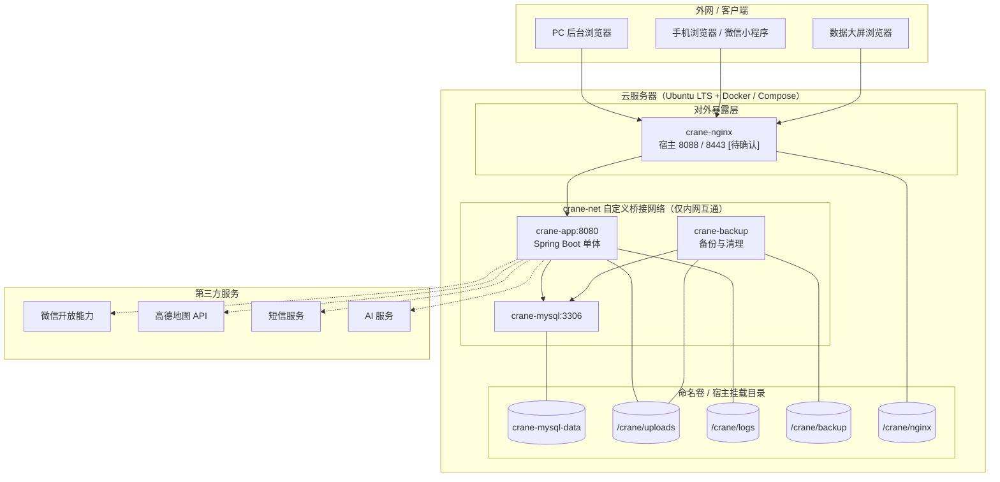

# 济南诚重吊装业务管理系统 — 部署与环境设计文档

| 项 | 内容 |
|---|---|
| 文档编号 | 08 |
| 版本 | v1.0 |
| 状态 | 待评审 |
| 上游文档 | 《济南诚重吊装业务管理系统产品需求文档》v5.4；01 总体技术架构设计（HLD）v1.0 |
| 适用对象 | DevOps |
| 下游文档 | 09 AI Agent 任务包 |

---

## 1. 设计概述与范围

### 1.1 目的与范围

本文定义系统的部署形态、环境划分、容器编排、网络与端口、数据持久化、资源限额、密钥管理、镜像策略、初始化、健康检查、备份恢复、存储监控与扩容、发布回滚以及同机多应用共存隔离要求。它处在 HLD 的「部署与运行概要」与部署脚本、Docker Compose 文件之间，回答「装到哪、怎么编排、怎么隔离、怎么运维」。

覆盖范围：

- 开发 / 测试 / 生产三套环境划分与配置来源
- 单机 Docker Compose 编排下的容器清单、服务依赖与重启策略
- 端口映射、独立自定义网络、命名卷与宿主挂载目录规划
- 资源限额、环境变量与密钥管理、镜像与版本策略
- 初始化脚本、健康检查、日志集中输出
- 备份与恢复、存储监控与扩容、发布与回滚流程
- 与同服务器其他 Docker 应用的隔离核对清单

明确不覆盖（由上游或下游承接）：

- 逐字段建表脚本、索引与数据字典 → 文档 02
- 逐接口契约与错误码 → 文档 03
- 前端页面与路由明细 → 文档 04、05、06、07
- 可直接投喂代码生成 Agent 的子任务提示词 → 文档 09

### 1.2 上游需求追溯

| 部署设计目标 | 追溯来源 | 证据 |
|---|---|---|
| 组件全部容器化、Docker Compose 统一编排、一键拉起 | PRD 5.5.1 | [Data-backed] |
| 每服务独立容器、固定镜像版本、不使用 latest | PRD 5.5.1 | [Data-backed] |
| 密钥与数据库密码经环境变量 / .env 注入，不硬编码进镜像 | PRD 5.5.1、5.6 | [Data-backed] |
| 端口隔离、网络隔离、数据卷隔离、资源限额、统一 crane- 前缀命名 | PRD 5.5.2、结论 38 | [Data-backed] |
| 本系统重启 / 升级 / 扩容不影响同机其他 Docker 应用 | PRD 5.5.2 | [Data-backed] |
| 数据库与上传文件挂载持久化卷，容器重建不丢数据 | PRD 5.5.3 | [Data-backed] |
| 数据库与业务服务均可独立重启 / 升级，新镜像替换 + 平滑重启 | PRD 5.5.3 | [Data-backed] |
| 存储用量分项统计、阈值告警、日志与临时文件定期清理 | PRD 5.5.4 | [Data-backed] |
| 扩容由用户负责，系统保证数据不丢、不影响业务运行 | PRD 5.5.4、结论 39 | [Data-backed] |
| 上传文件按工单 / 日期分目录归档 | PRD 5.5.4 | [Data-backed] |
| 区分开发 / 测试 / 生产环境配置，生产独立配置与镜像 | PRD 5.5.5 | [Data-backed] |
| 健康检查与异常自动重启、关键日志集中输出可检索 | PRD 5.5.5 | [Data-backed] |
| 首次部署支持初始化脚本（建库建表、初始化管理员账号） | PRD 5.5.5 | [Data-backed] |
| 对外 HTTPS、敏感配置加密存储 | PRD 5.6 | [Data-backed] |
| 备份每日一次、默认保留 7 份、可配置，支持按需恢复 | PRD 5.6 | [Data-backed] |
| AI 简报保留 10 天后自动清除 | PRD 5.5.4、5.6 | [Data-backed] |

### 1.3 设计前提与约束

- 部署目标为单台云服务器，Ubuntu LTS，已安装 Docker 与 Docker Compose；服务器上同时运行其他 Docker 应用 [Data-backed：PRD 5.5]
- 不使用 Kubernetes 等集群编排，采用单机 Compose，隔离成本低 [Data-backed：PRD 5.5；Expert judgment]
- 与既有应用互不干扰、端口不冲突、资源可控、数据可持久化、可平滑扩容 [Data-backed：PRD 5.5]
- 所有具体数值（CPU / 内存 / 磁盘 / 端口 / 域名）均标注 [待确认]，并给出建议默认值供替换 [Data-backed：项目约束]
- 业务规模按每日 200 张工单、峰值 30 并发设计，资源限额以此为基准留余量 [Hypothesis，待确认]
- 文档与界面中 AI 相关表述统一使用通用词「AI」，不出现具体厂商或品牌名 [Data-backed：项目硬约束]

### 1.4 术语表

| 术语 | 含义 |
|---|---|
| 命名卷 | Docker 管理的具名 Volume，前缀 `crane-`，与本项目生命周期绑定 |
| 宿主挂载目录 | 直接映射到宿主机文件系统的目录，用于需人工查看或迁移的数据 |
| crane-net | 本项目独立自定义桥接网络，服务间内网互通，仅必要端口对外暴露 |
| 分项统计 | 对数据库体积、上传文件体积、日志体积分别计量，便于定位增长来源 |
| 平滑重启 | 在不停止对外服务的前提下，先拉起新容器通过健康检查再停止旧容器 |
| 备份保留份数 | 本地保留的历史备份份数，默认 7，后台可配置 |

---

## 2. 环境划分

### 2.1 环境对照

| 维度 | 开发环境 | 测试环境 | 生产环境 |
|---|---|---|---|
| 用途 | 本地功能开发与联调 | 全流程闭环与兼容性测试 | 正式对外提供服务 |
| 部署位置 | 开发者本机或开发服务器 | 测试服务器（可与生产同机不同项目） | 云服务器，与同机其他应用共存 |
| 编排文件 | `docker-compose.yml` + `docker-compose.dev.yml` | `docker-compose.yml` + `docker-compose.test.yml` | `docker-compose.yml` + `docker-compose.prod.yml` |
| 配置来源 | `.env.dev` | `.env.test` | `.env.prod`（不纳入版本库） |
| 镜像标签 | `-dev` 后缀，可含调试工具 | `-rc` 后缀 | 固定语义化版本，无后缀 |
| 对外端口 | 本机默认端口，冲突时调整 | 独立测试端口段 | 独立生产端口段，[待确认] |
| 数据 | 可随时重建，含测试数据 | 预置测试数据，可重置 | 具备备份与恢复，不可随意重建 |
| 第三方服务 | 沙箱或 Mock | 沙箱 | 正式通道，密钥独立 |
| HTTPS | 可自签或关闭 | 建议启用 | 必须启用，域名与证书 [待确认] |
| 日志级别 | DEBUG | INFO | INFO（异常路径 WARN），集中输出 |

### 2.2 配置来源与差异管理

三套环境共用一份 `docker-compose.yml` 定义服务骨架，环境差异通过 Override 文件与 `.env` 文件叠加注入，禁止为不同环境复制多份主干编排文件 [Expert judgment]。差异项集中在：

- 端口映射（宿主端口按环境分配，避免冲突）
- 镜像标签（开发 / 测试用带后缀标签，生产用固定版本）
- 密钥与第三方凭据（环境独立，不共用）
- 资源限额（测试环境可下调）
- 数据卷命名后缀（避免同机多环境卷互相覆盖）
- 日志级别与健康检查阈值

`.env.dev`、`.env.test` 可纳入版本库模板（值为占位或非敏感项）；`.env.prod` 仅存在于目标服务器，权限受限，禁止提交 [Data-backed：PRD 5.5.1；Expert judgment]。

---

## 3. 部署拓扑



图中的读法：四条访问通道（PC 后台、手机浏览器 / 小程序、数据大屏）均经 `crane-nginx` 统一接入，HTTPS 在 Nginx 终止，宿主仅暴露 Nginx 的 HTTP / HTTPS 端口；Nginx 通过 `crane-net` 反向代理到 `crane-app`。`crane-app` 是唯一业务服务，读写 `crane-mysql`，内嵌定时任务（冲突巡检、简报生成、超时提醒、提醒升级），单实例部署同一进程执行，无需分布式锁；登录态失效、验证码、幂等键等中间态数据落 MySQL，上传文件写入 `/crane/uploads` 挂载目录。`crane-backup` 定时执行数据库导出与上传文件打包，产物落 `/crane/backup`。数据库数据落命名卷，与宿主文件系统解耦；上传文件、日志、备份落宿主挂载目录，便于人工查看与扩容迁移。第三方服务仅由 `crane-app` 经适配器出网调用，容器本身不新增对外暴露端口。

### 3.1 网络与端口关系

- 对外暴露：仅 `crane-nginx` 的 HTTP（建议 8088）与 HTTPS（建议 8443）映射到宿主，[待确认]
- 仅本机可达：`crane-mysql`（建议宿主 33061）如需宿主映射，绑定 `127.0.0.1`，不监听 `0.0.0.0`，[待确认]
- 不映射宿主：`crane-app`、`crane-backup` 仅在 `crane-net` 内通过服务名互相访问
- 出网：所有容器经宿主默认 NAT 出网，调用微信 / 高德 / 短信 / AI 服务，无需额外端口

---

## 4. 容器清单与服务划分

| 容器名 | 镜像 | 职责 | 依赖 | 重启策略 |
|---|---|---|---|---|
| `crane-nginx` | 固定版本 Nginx 镜像 [待确认] | HTTPS 终止、静态资源托管（后台 / 大屏 / H5 构建产物）、反向代理到 `crane-app`、压缩 | `crane-app` | `unless-stopped` |
| `crane-app` | 本项目后端镜像（基于固定版本 JRE 基础镜像）[待确认] | 提供全部业务接口，读写库，处理文件上传与签名链接，内嵌定时任务调度 | `crane-mysql` | `unless-stopped` |
| `crane-mysql` | 固定版本 MySQL 8.x 镜像 [待确认] | 全量业务数据持久化与一致性 | 命名卷 `crane-mysql-data` | `unless-stopped` |
| `crane-backup` | 轻量基础镜像 + 备份脚本 [待确认] | 定时导出数据库、打包上传文件、执行保留策略与日志清理 | `crane-mysql`、挂载上传目录 | `unless-stopped` |

说明：

- 定时任务作为 crane-app 应用内调度模块运行，不设独立容器；单实例部署下同一调度任务不会并发重复执行，无需分布式锁
- `crane-backup` 通过 `crane-net` 连接 `crane-mysql` 执行逻辑导出，不直接挂载数据库数据目录，避免与运行中数据库的存储层耦合 [Expert judgment]
- 前端构建产物不设独立容器，直接挂载进 `crane-nginx` 的静态目录卷，减少容器数量 [Expert judgment]

---

## 5. 端口与网络规划

### 5.1 端口建议值

| 服务 | 容器内端口 | 宿主映射端口（建议） | 暴露范围 | 说明 |
|---|---|---|---|---|
| `crane-nginx` HTTP | 80 | 8088 | `0.0.0.0`（重定向到 HTTPS） | [待确认]，避免占用 80 |
| `crane-nginx` HTTPS | 443 | 8443 | `0.0.0.0` | [待确认]，域名与证书另配 |
| `crane-app` | 8080 | 不映射 | 仅 `crane-net` | 由 Nginx 反代访问 |
| `crane-mysql` | 3306 | 33061 | `127.0.0.1` | [待确认]，仅供本机运维连接 |
| `crane-backup` | 无 | 不映射 | 仅 `crane-net` | 无对外接口 |

端口选型原则 [Expert judgment]：

- 宿主端口一律先于部署核对占用情况，避开既有应用与本机常用端口（80、443、3306 大概率已被占用），[待确认]
- 宿主映射端口集中定义在 `.env` 中，后台可调整，容器内端口固定不动，做到「容器内端口与宿主映射端口分离管理」[Data-backed：PRD 5.5.2]
- 数据库默认不映射宿主；确需临时排障时映射且绑定 `127.0.0.1`，用完即撤 [Expert judgment]
- 仅必要端口对外暴露，应用、备份容器一律不映射 [Data-backed：PRD 5.5.2]

### 5.2 独立自定义网络

- 新建桥接网络 `crane-net`，本项目全部容器加入，服务间通过服务名（如 `crane-mysql`）解析互访 [Data-backed：PRD 5.5.2]
- 不加入既有应用的网络，不使用默认 `bridge`、`host` 或 `none` 网络，避免与他应用互相可见或端口冲突 [Data-backed：PRD 5.5.2]
- 需要与他应用通信时，采用单播端口白名单方式，禁止并入对方的自定义网络 [Expert judgment]
- 网络命名、卷命名、容器命名统一 `crane-` 前缀并附加环境后缀（如 `crane-net-test`），同机多环境互不干扰 [Data-backed：PRD 5.5.2]

---

## 6. 数据卷与持久化

### 6.1 卷与挂载规划

| 用途 | 类型 | 名称 / 路径（建议） | 归属数据 | 备份 |
|---|---|---|---|---|
| 数据库数据 | 命名卷 | `crane-mysql-data` | MySQL 数据文件 | 逻辑导出备份 |
| 上传文件 | 宿主挂载 | `/crane/uploads` | 签到 / 异常 / 需求图片，不限张数 | 打包备份 |
| 应用与调度日志 | 宿主挂载 | `/crane/logs` | 应用、调度、备份日志 | 不备份，定期清理 |
| Nginx 配置与产物 | 宿主挂载 | `/crane/nginx` | 站点配置、证书、前端构建产物 | 不备份（可从版本库重建） |
| 备份产物 | 宿主挂载 | `/crane/backup` | 数据库与上传文件备份文件 | 不备份 |
| 初始化脚本 | 宿主挂载 | `/crane/init` | 建库建表、字典、初始管理员脚本 | 不备份（版本库管理） |

### 6.2 上传文件归档

上传文件按工单与日期分目录归档，目录规则 [Data-backed：PRD 5.5.4]：

```
/crane/uploads/
├─ workorder/
│  └─ {workOrderId}/
│     └─ {yyyyMMdd}/
│        ├─ checkin/      # 签到 / 签退照片
│        ├─ exception/    # 异常上报照片
│        └─ other/        # 其他业务附件
├─ demand/
│  └─ {demandOrderId}/{yyyyMMdd}/   # 需求单图片
└─ tmp/                   # 临时文件，定期清理
```

- 分目录归档便于按工单 / 日期迁移、清理与容量核算 [Data-backed：PRD 5.5.4]
- 文件不落容器可写层，一律写入挂载目录，容器重建不丢数据 [Data-backed：PRD 5.5.3]
- 私有文件不直接公开，前端经签名链接访问，映射由应用层生成 [Data-backed：PRD 5.6]

### 6.3 隔离要求

- 所有命名卷与宿主挂载目录归属本项目，路径统一在 `/crane/` 下，不与他应用共享任何数据卷或目录 [Data-backed：PRD 5.5.2]
- 不挂载宿主根目录、Docker Socket 或其他应用的目录；如备份需读取数据库，仅经网络连接而非挂载其数据卷 [Expert judgment]
- 卷与目录命名附加环境后缀，避免同机多环境互相覆盖 [Expert judgment]

---

## 7. 资源限额

| 容器 | CPU 上限（建议） | 内存上限（建议） | 说明 |
|---|---|---|---|
| `crane-app` | 2.0 | 2G | 峰值 30 并发，留 JVM 堆与元空间余量，[待确认] |
| `crane-mysql` | 2.0 | 2G | 单机全量数据，[待确认] |
| `crane-nginx` | 0.5 | 256M | 静态资源与反代，[待确认] |
| `crane-backup` | 0.5 | 256M | 备份时段短暂升高，[待确认] |

约束与配套：

- 所有容器设置 `cpus` 与 `mem_limit`，防止本系统抢占同机其他应用资源 [Data-backed：PRD 5.5.2]
- `crane-app` JVM 最大堆显式设置（建议不高于容器内存限额的 70%），避免容器被 OOM 终止 [Expert judgment]
- `crane-mysql` 单独限制最大连接数（建议 200，[待确认]），并限制 `innodb_buffer_pool_size` 不超过容器内存限额的 60% [Expert judgment]
- 应用侧数据库连接池最大连接数（建议 20，[待确认]）须低于数据库最大连接数，留运维连接余量 [Expert judgment]
- 资源限额数值以服务器实际规格为准，需在部署前核对同机其他应用资源占用后调整 [Hypothesis，待确认]

---

## 8. 环境变量与密钥管理

### 8.1 .env 变量清单

| 变量名 | 用途 | 是否敏感 | 备注 |
|---|---|---|---|
| `CRANE_ENV` | 环境标识（dev / test / prod） | 否 | 用于日志与卷名后缀 |
| `TZ` | 时区（建议 `Asia/Shanghai`） | 否 | 统一容器时区 |
| `NGINX_HTTP_PORT` | Nginx HTTP 宿主端口 | 否 | 默认 8088，[待确认] |
| `NGINX_HTTPS_PORT` | Nginx HTTPS 宿主端口 | 否 | 默认 8443，[待确认] |
| `SERVER_DOMAIN` | 对外域名 | 否 | 用于证书与回调，[待确认] |
| `MYSQL_HOST` | 数据库服务名 | 否 | 默认 `crane-mysql` |
| `MYSQL_PORT` | 数据库端口 | 否 | 默认 3306 |
| `MYSQL_DATABASE` | 数据库名 | 否 | 建议 `crane_workorder` |
| `MYSQL_USER` | 业务数据库账号 | 否 | 非 root 账号 |
| `MYSQL_PASSWORD` | 业务数据库密码 | 是 | 加密存储 |
| `MYSQL_ROOT_PASSWORD` | 数据库 root 密码 | 是 | 加密存储，仅运维使用 |
| `MYSQL_MAX_CONNECTIONS` | 数据库最大连接数 | 否 | [待确认] |
| `MYSQL_HOST_PORT` | 数据库宿主映射端口 | 否 | 默认 33061，仅本机，[待确认] |
| `JWT_SECRET` | 令牌签名密钥 | 是 | 加密存储，不与测试环境共用 |
| `TOKEN_TTL` | 登录态有效期 | 否 | [待确认] |
| `WX_APPID` | 微信应用标识 | 否 | 小程序凭据 |
| `WX_SECRET` | 微信应用密钥 | 是 | 加密存储 |
| `SMS_ACCESS_KEY` / `SMS_SECRET` | 短信服务凭据 | 是 | 加密存储 |
| `AMAP_KEY` | 地图服务密钥 | 是 | 加密存储 |
| `AI_ENABLED` | AI 功能开关 | 否 | 降级控制用 |
| `AI_CHANNEL` | AI 服务通道标识 | 否 | 多通道可配，不写具体厂商名 |
| `AI_API_KEY` | AI 服务密钥 | 是 | 加密存储 |
| `AI_BASE_URL` | AI 服务地址 | 是 | 加密存储 |
| `AI_BRIEFING_RETENTION_DAYS` | AI 简报保留天数 | 否 | 默认 10 |
| `BACKUP_RETENTION` | 备份保留份数 | 否 | 默认 7，可配置 |
| `BACKUP_CRON` | 备份执行计划 | 否 | 默认每日一次 |
| `STORAGE_ALERT_THRESHOLD` | 存储告警阈值 | 否 | 默认 80%，[待确认] |
| `LOG_RETENTION_DAYS` | 日志保留天数 | 否 | 支持定期清理 |

### 8.2 密钥管理规则

- 全部配置经环境变量或 `.env` 注入，不硬编码进镜像、不写入源码或构建产物 [Data-backed：PRD 5.5.1]
- 敏感项（标记「是」）在服务器侧以加密方式存储，`.env.prod` 权限受限、不纳入版本库 [Data-backed：PRD 5.6]
- 敏感值不打印进日志、不出现在健康检查与报错响应中；日志中涉及密钥的位置统一脱敏 [Expert judgment]
- 开发 / 测试 / 生产密钥完全独立，禁止跨环境复用 [Expert judgment]
- 数据库连接凭据、AI 服务密钥均属敏感项，须加密存储 [Data-backed：PRD 5.6]

---

## 9. 镜像与版本策略

- 所有镜像使用固定标签，禁用 `latest` 或浮动标签，保证环境一致、可回滚 [Data-backed：PRD 5.5.1]
- 后端镜像由版本库构建，标签采用语义化版本（如 `v1.0.0`）+ 提交短哈希，可精确定位到构建源 [Expert judgment]
- 基础镜像（JRE、Nginx、MySQL）版本在开工前锁定并回填，未确认前不予代码生成输入 [Data-backed：HLD 2.5；待确认]
- 生产环境镜像推送至镜像仓库（私有或云端），服务器侧仅拉取，不在服务器上现场构建 [Expert judgment]
- 镜像替换流程：构建并打新标签 → 推送 / 加载 → 更新 `.env` 或编排中的标签引用 → 拉起新容器通过健康检查 → 停止旧容器 [Data-backed：PRD 5.5.3]
- 数据库镜像升级沿用「新镜像替换 + 平滑重启」，升级前必须完成一次完整备份并验证可恢复 [Data-backed：PRD 5.5.3；Expert judgment]
- 保留最近可回滚的镜像标签在服务器本地，回滚时直接切回旧标签，避免依赖远端拉取失败 [Expert judgment]

---

## 10. 初始化脚本

首次部署执行一次性初始化，脚本置于 `/crane/init`，按顺序执行 [Data-backed：PRD 5.5.5]：

| 序号 | 脚本 | 职责 | 幂等要求 |
|---|---|---|---|
| 01 | `01-schema.sql` | 建库建表（表结构与索引来自文档 02） | `IF NOT EXISTS`，可重复执行 |
| 02 | `02-dict.sql` | 字典初始化（工单状态、车辆状态、冲突场景、角色等枚举字典） | 存在即更新，按唯一键去重 |
| 03 | `03-config.sql` | 系统参数初始化（提前提醒时段 T 默认 60、司机处置时限 15、签到有效距离 1000、正常下班时间 18:00 等） | 存在即保留现值，不覆盖人工改动 |
| 04 | `04-admin-init` | 初始化管理员账号（预留手机号，无初始密码，微信授权登录后绑定） | 已存在则跳过 |

执行方式：

- `01`、`02`、`03` 通过 MySQL 初始化机制或 `crane-init` 一次性容器执行，执行完即退出，不留常驻容器 [Expert judgment]
- `04` 由后端一次性初始化命令执行，密码不落明文，交由应用层加密与登录态机制处理 [Data-backed：PRD 5.6；Expert judgment]
- 初始化脚本纳入版本库，生产执行前在测试环境验证一遍 [Expert judgment]
- 脚本执行前须完成数据库连通性与权限校验，失败即中止并回显，不产生半初始化状态 [Expert judgment]

---

## 11. 健康检查、日志与可观测

### 11.1 健康检查与自动重启

| 容器 | 健康检查方式 | 间隔（建议） | 失败判定 | 重启策略 |
|---|---|---|---|---|
| `crane-nginx` | 探测本地 HTTP 探针路径返回 200 | 30s | 连续 3 次失败 | `unless-stopped` |
| `crane-app` | 探测应用健康端点（含数据库连通性） | 30s | 连续 3 次失败 | `unless-stopped` |
| `crane-mysql` | 数据库探针命令 | 30s | 连续 3 次失败 | `unless-stopped` |

- 应用健康端点须校验数据库连通性，避免「进程存活但依赖不可用」的假健康 [Expert judgment]
- 依赖服务（数据库）通过编排启动顺序与 `depends_on` 结合健康检查，先就绪再起应用 [Expert judgment]
- 重启策略统一 `unless-stopped`，Docker 守护进程或服务器重启后自动拉起，无需人工干预 [Data-backed：PRD 5.5.5]
- 健康检查间隔与阈值属建议值，部署时按实际启动耗时调整 [Hypothesis，待确认]

### 11.2 日志集中输出与检索

- 容器日志采用 `json-file` 驱动并设置 `max-size`、`max-file` 滚动上限，防止日志耗尽磁盘 [Expert judgment]
- 应用与调度将结构化日志按日写入 `/crane/logs` 挂载目录，字段含时间、级别、TraceId、模块、请求标识，支持按 TraceId 检索全链路 [Data-backed：PRD 5.5.5；Expert judgment]
- 日志级别：生产 INFO，异常与第三方失败路径 WARN，禁止在日志中输出密钥与个人敏感字段 [Expert judgment]
- 日志集中输出后可经宿主侧检索命令或轻量采集工具按关键字、时间、TraceId 查询 [Data-backed：PRD 5.5.5]
- 日志保留天数由 `LOG_RETENTION_DAYS` 控制，到期由 `crane-backup` 定时清理 [Data-backed：PRD 5.5.4]

---

## 12. 备份与恢复

### 12.1 备份策略

| 项 | 内容 | 证据 |
|---|---|---|
| 频率 | 每日一次（默认，可配置），由 `BACKUP_CRON` 控制 | [Data-backed：PRD 5.6] |
| 保留份数 | 默认 7 份，可配置（`BACKUP_RETENTION`） | [Data-backed：PRD 5.6] |
| 分项 | 数据库逻辑导出与上传文件打包分开成两类备份 | [Data-backed：PRD 5.5.3] |
| 存放 | 备份文件落 `/crane/backup`，与运行数据（数据库卷、上传目录）分离存放 | [Data-backed：PRD 5.5.3] |
| 执行者 | `crane-backup` 容器定时执行，产物带日期与类型命名 | [Expert judgment] |

- 数据库备份采用逻辑导出，含建表语句与数据，便于跨版本恢复 [Expert judgment]
- 上传文件备份对 `/crane/uploads` 打包，仅归档新增或变化部分时按日期增量亦可，但至少保留完整可恢复集合 [Expert judgment]
- 备份文件命名统一 `crane_{db|uploads}_yyyyMMddHHmm.{sql|tar.gz}`，便于识别与保留策略裁剪 [Expert judgment]
- 每日备份后校验产物完整性（非空、可解压 / 可解析），校验失败即告警 [Expert judgment]
- 建议将最新一份备份同步至异地或对象存储，避免与服务器同盘损毁，异地留存属可选增强 [Hypothesis，待确认]

### 12.2 恢复流程

1. 停止 `crane-app`，阻断写流量，避免恢复期间数据错乱 [Expert judgment]
2. 数据库恢复：选用目标日期备份逻辑导入 `crane-mysql`，恢复后校验关键表行数与最新业务时间 [Expert judgment]
3. 上传文件恢复：将对应日期打包解压回 `/crane/uploads`，保持原目录结构 [Expert judgment]
4. 应用恢复：按当前镜像标签拉起应用与调度，健康检查通过后开放流量 [Expert judgment]
5. 恢复演练：测试环境定期演练一次完整恢复，验证备份可用与流程可执行 [Expert judgment]
6. 恢复属高危操作，须在业务低峰执行并提前通知，操作全程留痕 [Expert judgment]

---

## 13. 存储监控与扩容

### 13.1 分项用量统计

系统向管理员提供存储用量分项统计，可见可查 [Data-backed：PRD 5.5.4]：

| 分项 | 统计方式 | 展示 |
|---|---|---|
| 数据库体积 | 查询数据库元数据与表空间大小 | 按库 / 按表汇总 |
| 上传文件体积 | 统计 `/crane/uploads` 目录占用，可按工单 / 日期细分 | 总量与增长趋势 |
| 日志体积 | 统计 `/crane/logs` 目录占用 | 总量与滚动情况 |
| 备份体积 | 统计 `/crane/backup` 目录占用 | 当前份数与总量 |
| 磁盘整体使用率 | 读取宿主磁盘使用率 | 百分比与阈值对比 |

### 13.2 阈值告警

- 磁盘 / 数据卷使用率超过阈值（`STORAGE_ALERT_THRESHOLD`，建议默认 80%，[待确认]）时，向管理员告警提示 [Data-backed：PRD 5.5.4]
- 告警通道复用系统通知能力（站内 + 短信），触发频率需做去重与上限控制，避免告警风暴 [Expert judgment]
- 告警阈值后台可配置，支持分级（如 80% 预警、90% 严重）[Hypothesis，待确认]

### 13.3 自动清理

- 日志与临时文件定期清理，按 `LOG_RETENTION_DAYS` 与临时目录策略执行 [Data-backed：PRD 5.5.4]
- AI 简报按约定保留 10 天后自动清除（`AI_BRIEFING_RETENTION_DAYS` 默认 10），由应用内定时任务执行 [Data-backed：PRD 5.5.4]
- 备份保留策略自动裁剪超出份数的历史备份 [Data-backed：PRD 5.6]
- 清理动作仅针对非业务运行数据，禁止清理数据库业务数据与有效上传文件 [Expert judgment]

### 13.4 扩容步骤

存储扩容由用户负责，系统保证扩容不影响业务运行、不丢失数据 [Data-backed：PRD 5.5.4；结论 39]：

1. 通过监控识别增长分项，确定扩容对象（数据盘 / 上传目录 / 备份目录）[Expert judgment]
2. 在云平台扩容数据盘或挂载新盘，宿主层调整文件系统容量 [Expert judgment]
3. 若为上传 / 备份目录迁移，先同步数据到新位置，校验一致后再切换挂载路径 [Expert judgment]
4. 数据库卷扩容优先采用云盘在线扩容 + 文件系统扩容，尽量避免停机；确需停机迁移时安排在业务低峰 [Expert judgment]
5. 容量变更期间保持容器运行，挂载路径变更通过编排更新挂载项，做到平滑切换 [Data-backed：PRD 5.5.4]
6. 挂载路径与扩容方式文档化，纳入本文件与运维手册，供后续维护 [Data-backed：PRD 5.5.4]

> 扩容的具体盘位、容量与云平台操作细节 [待确认]，需结合服务器实际配置确定。

---

## 14. 发布与回滚流程

### 14.1 发布流程

1. 构建后端镜像并打语义化版本标签，推送至镜像仓库 [Expert judgment]
2. 测试环境部署同版本镜像，跑通全流程闭环与关键回归 [Expert judgment]
3. 生产发布前执行一次数据库与上传文件完整备份，并验证可恢复 [Data-backed：PRD 5.5.3；Expert judgment]
4. 更新生产 `.env` / 编排中的镜像标签引用，仅变更目标服务，不重启无关容器 [Data-backed：PRD 5.5.2]
5. 拉起新版本容器，通过健康检查后再移出旧容器；数据库编排变更单独分批执行 [Data-backed：PRD 5.5.3]
6. 灰度验证关键接口与监控指标（错误率、响应时间、第三方耗时），无异常后完成发布 [Expert judgment]

### 14.2 回滚流程

- 触发条件：健康检查持续失败、关键指标异常、业务回归出现阻塞级缺陷 [Expert judgment]
- 回滚方式：将镜像标签切回上一个稳定版本，拉起旧容器通过健康检查，不重建数据卷 [Data-backed：PRD 5.5.3]
- 数据回滚：仅当本次发布含不可逆数据结构变更时，按变更前备份恢复数据库，并与应用版本对齐 [Expert judgment]
- 回滚后保留故障版本镜像与日志，用于事后定位 [Expert judgment]
- 发布与回滚均不影响同机其他 Docker 应用的运行 [Data-backed：PRD 5.5.2]

---

## 15. 同机多应用共存隔离核对清单

部署前与部署后均按下表逐项核对 [Data-backed：PRD 5.5.2；Expert judgment]：

| 维度 | 核对项 | 通过标准 |
|---|---|---|
| 端口 | 宿主端口占用 | 本项目宿主端口与他应用不冲突，映射绑定范围最小化 |
| 端口 | 对外暴露 | 仅 Nginx 的 HTTP / HTTPS 对外，其余不映射或仅绑 `127.0.0.1` |
| 网络 | 自定义网络 | 使用独立 `crane-net`，未并入他应用网络，未使用 `host` / 默认 `bridge` |
| 网络 | 服务发现 | 服务间仅经 `crane-net` 服务名互访，不依赖宿主端口 |
| 卷 | 命名卷 | 全部 `crane-` 前缀，未与他应用共用数据卷 |
| 卷 | 宿主挂载 | 全部位于 `/crane/` 下，未挂载根目录 / Docker Socket / 他应用目录 |
| 资源 | CPU / 内存 | 所有容器设置上限，数据库单独限连接数与内存 |
| 命名 | 容器 / 网络 / 卷 | 统一 `crane-` 前缀，附加环境后缀，可一眼识别 |
| 互不干扰 | 重启 / 升级 | 仅操作本项目容器，未执行全量 `docker compose down` / 全机重启 |
| 互不干扰 | 中断影响 | 本项目升级或扩容期间他应用运行不受影响 |
| 出网 | 第三方调用 | 第三方调用经宿主 NAT 出网，未占用额外宿主端口 |

---

## 16. 待确认清单

| 编号 | 事项 | 建议默认值 | 状态 |
|---|---|---|---|
| D-08-01 | 云服务器 CPU / 内存 / 磁盘规格 | 4 核 8G / 100G 数据盘 | 待确认 |
| D-08-02 | 操作系统版本（Ubuntu LTS） | 近期 LTS | 待确认 |
| D-08-03 | Nginx HTTP / HTTPS 宿主端口 | 8088 / 8443 | 待确认 |
| D-08-04 | 数据库宿主映射端口 | 33061（仅本机） | 待确认 |
| D-08-06 | 对外域名与 ICP 备案状态 | 暂缺 | 待确认 |
| D-08-07 | HTTPS 证书来源与续期方式 | 待定 | 待确认 |
| D-08-08 | 基础镜像具体版本（JRE / Nginx / MySQL） | 待定 | 待确认 |
| D-08-09 | 各容器 CPU / 内存限额 | 见第 7 节建议值 | 待确认 |
| D-08-10 | 数据库最大连接数与连接池上限 | 200 / 20 | 待确认 |
| D-08-12 | 存储告警阈值与分级 | 80% 预警 | 待确认 |
| D-08-13 | 备份保留份数与执行时点 | 7 份 / 每日 02:00 | 待确认 |
| D-08-14 | 日志保留天数与滚动上限 | 30 天 | 待确认 |
| D-08-15 | 是否启用异地 / 对象存储备份 | 建议启用 | 待确认 |
| D-08-16 | 登录态有效期 TOKEN_TTL | 待定 | 待确认 |
| D-08-17 | 镜像仓库选型与访问凭据 | 待定 | 待确认 |
